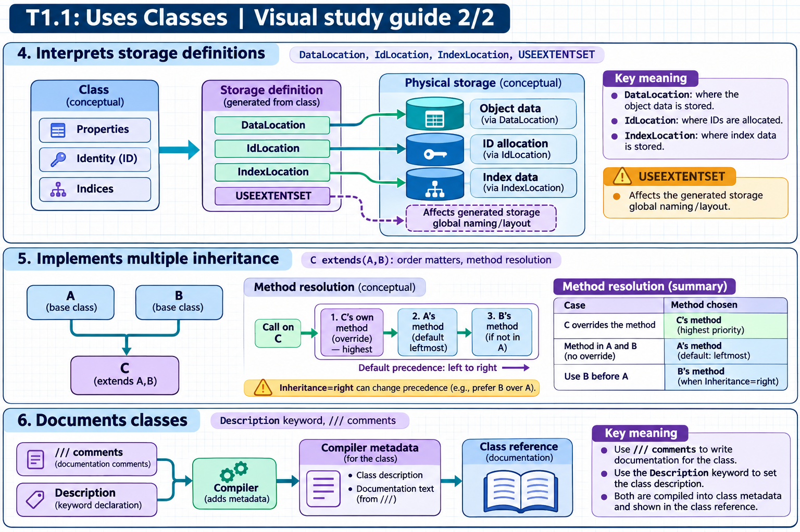
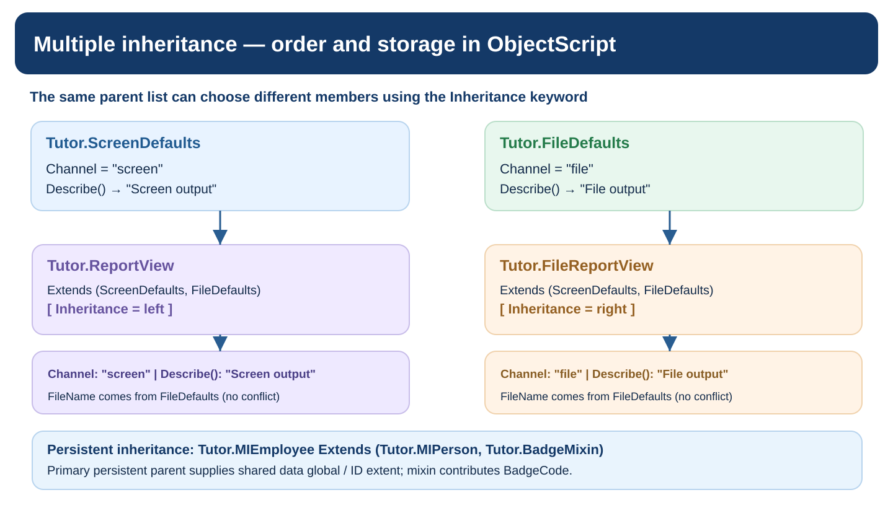

[Topic contents](../index.md) · [Full topic guide](../study.md) · [All topics](../../../index.md)

# T1.1: Uses Classes

Saved 2 November 2026 from [exam-prep.es](https://exam-prep.es/exams/objectscript/knowledge/T1.1.html). Reference links require internet access.

## 5. Implements multiple inheritance (order matters, method resolution)



*This diagram covers sections 4–6; use the matching numbered panel for this page.* [Chapter diagrams](../visuals.md) · [Technical review notes](../../../visual-technical-notes.md)



*The resolution examples use the actual `Tutor.ScreenDefaults`, `Tutor.FileDefaults`, and persistent mixin classes introduced below.*

### Key Points

- InterSystems IRIS supports **multiple inheritance** (a class can extend multiple superclasses)
- **Left-to-right order** determines priority when superclasses define the same member
- The **leftmost superclass** in the Extends list has the highest priority
- Storage inheritance comes from the **primary (first) persistent superclass**
- Use multiple inheritance carefully to avoid ambiguity and complexity

### Detailed Notes

#### Overview

Multiple inheritance allows a class to combine behaviors from several parent classes. In InterSystems IRIS, a class can extend multiple superclasses separated by commas. The order in which superclasses are listed is significant because it determines which version of a member is inherited when conflicts occur.

#### Syntax

```objectscript
Class MyApp.Manager Extends (Sample.Person, Sample.Employee, %Populate)
{
    // Inherits from all three classes
    // Sample.Person has highest priority for conflicts
}
```

#### Method Resolution Order (MRO)

When two or more superclasses define a method or property with the same name, the class compiler resolves the conflict using **left-to-right priority**:

1. The class's own members have the highest priority 2. Then the first (leftmost) superclass 3. Then the second superclass 4. And so on

Example:

```objectscript
Class Base.A Extends %RegisteredObject
{
    Method Greet() { Write "Hello from A", ! }
}

Class Base.B Extends %RegisteredObject
{
    Method Greet() { Write "Hello from B", ! }
}

Class MyApp.Combined Extends (Base.A, Base.B)
{
    // Greet() is inherited from Base.A (leftmost)
}
```

Calling `Greet()` on a `MyApp.Combined` instance executes `Base.A`'s implementation.

#### Storage and Primary Superclass

For persistent classes, the **primary superclass** (the first persistent class in the Extends list) determines the storage strategy. All other persistent superclasses contribute their properties but do not contribute an independent storage definition.

```objectscript
Class MyApp.ExtendedPerson Extends (Sample.Person, Sample.Auditable)
{
    // Storage comes from Sample.Person (primary)
    // Properties from Sample.Auditable are added to Sample.Person's storage
}
```

#### Common Patterns for Multiple Inheritance

- **Mixin pattern**: Combine a primary persistent class with utility registered classes that add behavior (logging, auditing, validation)
- **%Populate mixin**: Add `%Populate` to enable test data generation
- **Adapter pattern**: Combine persistent storage with interface adapters

#### Pitfalls to Avoid

- Changing the order of superclasses can change which methods are inherited
- Adding a new superclass in the middle of the list may break existing behavior
- Diamond inheritance (where two superclasses share a common ancestor) is handled automatically but can create subtle issues
- Property name collisions between superclasses cause compiler errors if types differ

### Documentation References

- [Class Inheritance](https://docs.intersystems.com/irislatest/csp/docbook/DocBook.UI.Page.cls?KEY=GOBJ_classes_inheritance)
- [Multiple Inheritance](https://docs.intersystems.com/irislatest/csp/docbook/DocBook.UI.Page.cls?KEY=GOBJ_classes_inheritance#GOBJ_classes_multiple)
