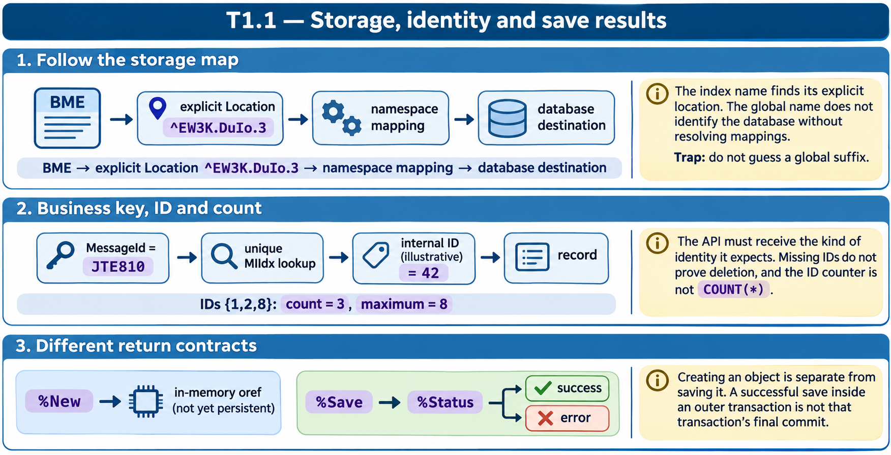

# T1.1 · 01 — Dal nome dell’indice al global reale

[Indice degli approfondimenti](README.md) · [Quiz originale](../quiz.md) · [Teoria](../study.md)

**Esercizi di partenza:** [Q1](../quiz.md#question-1-single) · [Q10](../quiz.md#question-10-single) · [Q11](../quiz.md#question-11-single) · [Q16](../quiz.md#question-16-multiple). L’approfondimento rielabora il concetto e aggiunge una variante; non riproduce soltanto la risposta del quiz.

## Il caso concreto

Nel quiz BME è l’indice bitmap di estensione. La sua posizione è dichiarata nello storage: un nome intuitivo non sostituisce quella mappa.

```xml
<Index name="BME">
  <Location>^EW3K.DuIo.3</Location>
</Index>
```

## Ragionamento passo per passo

Segui tre passaggi: identifica BME nella classe; cerca lo stesso nome nello storage; leggi Location. Solo dopo risolvi il mapping del global dal namespace al database. La risposta è ^EW3K.DuIo.3 nello scenario, indipendentemente dal suffisso normalmente usato dalle classi di esempio.

## Perché il distrattore è plausibile

Scegliere ^Sample.PatientI perché termina con I, oppure confondere DefaultData con un database. DefaultData nomina una definizione di dati.

## Lo spunto da portare oltre l’esercizio

Il modello logico, il global e il database sono tre livelli distinti. Una diagnosi fisica richiede tutti e tre.



*Leggi il pannello 1; gli altri due collegano il caso agli altri approfondimenti del capitolo.*

## Variante: prova prima di leggere la soluzione

Se SKUIdx ha Location ^A1B2.C3D4.3 ma IndexLocation termina con .I, dove cerchi SKUIdx?

<details>
<summary>Soluzione ragionata</summary>

Nella Location specifica ^A1B2.C3D4.3; il valore generico non scavalca il mapping esplicito.

</details>

## Riferimenti e precisazioni

- [Storage delle classi](https://docs.intersystems.com/irislatest/csp/docbook/DocBook.UI.Page.cls?KEY=GOBJ_storage)
- [Oggetti persistenti](https://docs.intersystems.com/irislatest/csp/docbook/DocBook.UI.Page.cls?KEY=GOBJ_persobj)
- [API degli oggetti](https://docs.intersystems.com/irislatest/csp/docbook/DocBook.UI.Page.cls?KEY=GOBJ_objapi)

[Note specifiche del capitolo](README.md#precisazioni-rispetto-al-quiz) · [Metodo e limiti della revisione](../../../approfondimenti-esercizi.md#metodo-e-limiti)
