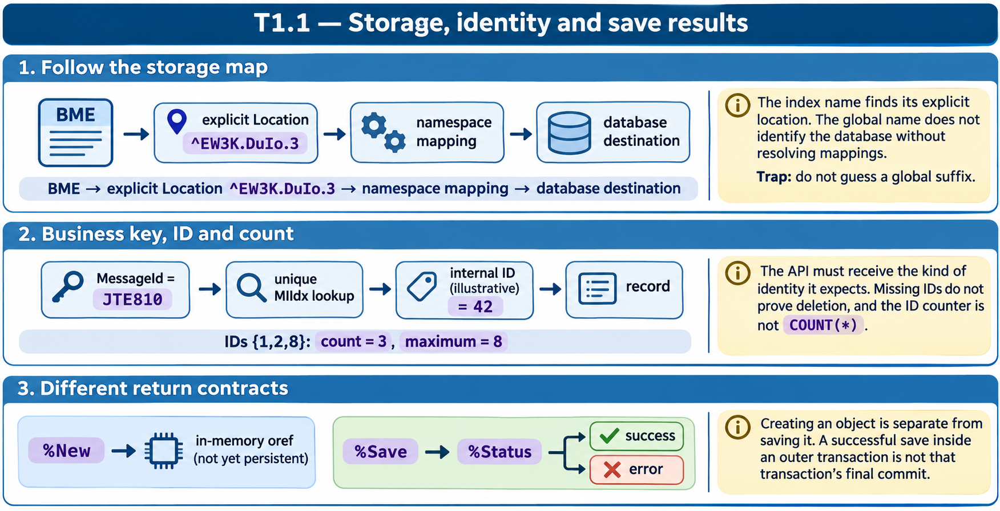

# T1.1 · 02 — Chiave applicativa, ID e conteggio

[Indice degli approfondimenti](README.md) · [Quiz originale](../quiz.md) · [Teoria](../study.md)

**Esercizi di partenza:** [Q2](../quiz.md#question-2-single) · [Q5](../quiz.md#question-5-single) · [Q18](../quiz.md#question-18-single). L’approfondimento rielabora il concetto e aggiunge una variante; non riproduce soltanto la risposta del quiz.

## Il caso concreto

MessageId="JTE810" è una chiave applicativa univoca. Non è automaticamente l’ID interno del record. In un altro esempio il contatore ID vale 5 ma sono mostrate solo due righe.

```objectscript
set sc = ##class(Sample.EmailMessage).MIIdxDelete("JTE810")
```

## Ragionamento passo per passo

MIIdxDelete usa il valore dell’indice univoco per identificare il record. %DeleteId richiede invece un ID. Un contatore a 5 può portare alla prossima allocazione 6 nello schema mostrato, senza significare cinque righe presenti. Scorrere 1..contatore incontra quindi possibili buchi.

## Perché il distrattore è plausibile

Passare una chiave di business a un metodo che accetta l’ID; interpretare il massimo ID come COUNT(*).

## Lo spunto da portare oltre l’esercizio

Chiediti sempre quale identità richiede l’API: chiave, ID o riferimento in memoria. Non sono intercambiabili.



*Leggi il pannello 2; gli altri due collegano il caso agli altri approfondimenti del capitolo.*

## Variante: prova prima di leggere la soluzione

Sono presenti gli ID 1, 2 e 8. Quante righe ci sono? Puoi assumere che l’ID 3 esista?

<details>
<summary>Soluzione ragionata</summary>

Tre righe; no. Gli ID non sono un intervallo garantito privo di buchi.

</details>

## Riferimenti e precisazioni

- [Storage delle classi](https://docs.intersystems.com/irislatest/csp/docbook/DocBook.UI.Page.cls?KEY=GOBJ_storage)
- [Oggetti persistenti](https://docs.intersystems.com/irislatest/csp/docbook/DocBook.UI.Page.cls?KEY=GOBJ_persobj)
- [API degli oggetti](https://docs.intersystems.com/irislatest/csp/docbook/DocBook.UI.Page.cls?KEY=GOBJ_objapi)

[Note specifiche del capitolo](README.md#precisazioni-rispetto-al-quiz) · [Metodo e limiti della revisione](../../../approfondimenti-esercizi.md#metodo-e-limiti)
