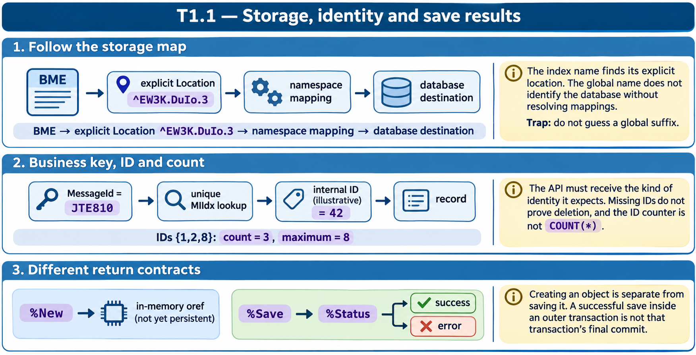

# T1.1 · 03 — Creare, salvare e controllare il risultato

[Indice degli approfondimenti](README.md) · [Quiz originale](../quiz.md) · [Teoria](../study.md)

**Esercizi di partenza:** [Q3](../quiz.md#question-3-single) · [Q6](../quiz.md#question-6-single) · [Q9](../quiz.md#question-9-single) · [Q12](../quiz.md#question-12-single) · [Q14](../quiz.md#question-14-single). L’approfondimento rielabora il concetto e aggiunge una variante; non riproduce soltanto la risposta del quiz.

## Il caso concreto

Il quiz alterna API che restituiscono un oggetto e API che restituiscono %Status. Sono due canali di risultato diversi.

```objectscript
set obj = ##class(Clinic.Patient).%New("John Smith")
if $ISOBJECT(obj) {
  set sc = obj.%Save()
  do $SYSTEM.Status.DisplayError(sc)
}
```

## Ragionamento passo per passo

%New crea l’istanza e richiama %OnNew con gli argomenti; restituisce un riferimento se la costruzione riesce. %Save valida e salva un oggetto persistente, restituendo %Status. Un ID disponibile dopo il save non sostituisce il controllo dello status. Per %OpenId usa anche lo status di uscita quando serve distinguere un fallimento di caricamento.

## Perché il distrattore è plausibile

Controllare %New come se fosse %Status, chiamare proprietà su "", oppure chiamare %Save su una classe che estende soltanto %RegisteredObject.

## Lo spunto da portare oltre l’esercizio

Separa esistenza dell’oggetto, esito dell’operazione e confine della transazione.



*Leggi il pannello 3; gli altri due collegano il caso agli altri approfondimenti del capitolo.*

## Variante: prova prima di leggere la soluzione

Un oggetto è stato creato con %New ma non è stato salvato. Ha già una riga persistente per il solo fatto di esistere?

<details>
<summary>Soluzione ragionata</summary>

No. La costruzione in memoria e la scrittura persistente sono operazioni separate.

</details>

## Riferimenti e precisazioni

- [Storage delle classi](https://docs.intersystems.com/irislatest/csp/docbook/DocBook.UI.Page.cls?KEY=GOBJ_storage)
- [Oggetti persistenti](https://docs.intersystems.com/irislatest/csp/docbook/DocBook.UI.Page.cls?KEY=GOBJ_persobj)
- [API degli oggetti](https://docs.intersystems.com/irislatest/csp/docbook/DocBook.UI.Page.cls?KEY=GOBJ_objapi)

[Note specifiche del capitolo](README.md#precisazioni-rispetto-al-quiz) · [Metodo e limiti della revisione](../../../approfondimenti-esercizi.md#metodo-e-limiti)
