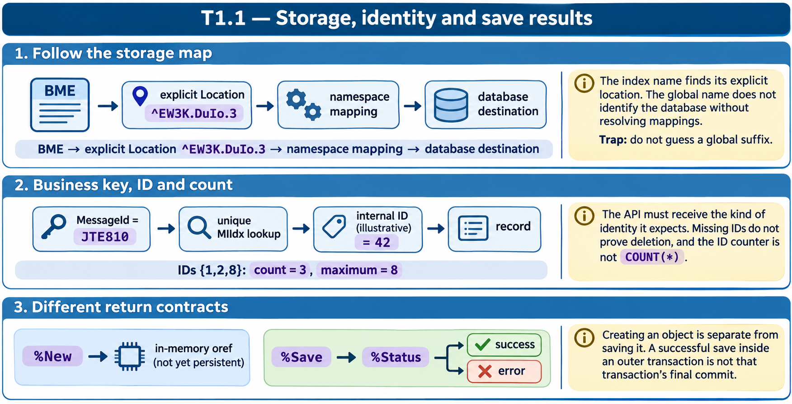
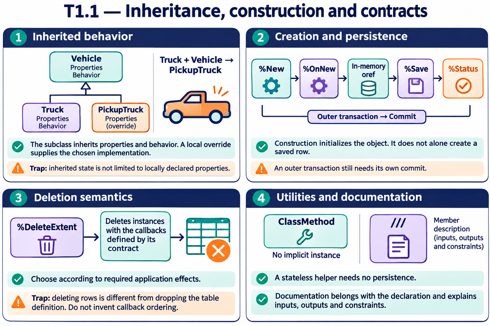

# T1.1 — Approfondimenti dagli esercizi

## Tutte le 18 domande approfondite

[Apri le schede domanda per domanda](<Domanda per domanda/README.md>) · [Tavole spiegate in inglese](tavole-esercizi.md)

Ogni domanda dispone ora di un commento specifico, un concetto ulteriore e una variante con soluzione. I tre casi seguenti sono percorsi tematici aggiuntivi. Le immagini sono in inglese.

[Teoria](../study.md) · [Quiz](../quiz.md) · [Tutti gli approfondimenti](../../../approfondimenti-esercizi.md)

Tre percorsi trasversali, da affiancare alle schede individuali, per capire il meccanismo dietro le risposte: scenario, ragionamento, distrattore, regola riutilizzabile e variante con soluzione. I riferimenti Q rimandano al quiz scaricato; la numerazione è locale al capitolo.

[Leggi esempi e spiegazioni dei pannelli](tavole-esercizi.md).

## Percorso consigliato

1. [Dal nome dell’indice al global reale](<01 - Dal nome dell’indice al global reale.md>) — Q1, Q10, Q11, Q16
2. [Chiave applicativa, ID e conteggio](<02 - Chiave applicativa, ID e conteggio.md>) — Q2, Q5, Q18
3. [Creare, salvare e controllare il risultato](<03 - Creare, salvare e controllare il risultato.md>) — Q3, Q6, Q9, Q12, Q14

[Indice di tutte le 18 domande del capitolo](mappa-domande.md). I percorsi sono tematici; ogni domanda ha inoltre una scheda individuale nella sottocartella dedicata.

## Precisazioni rispetto al quiz

Q5: il contatore indica l’ultimo ID allocato nello scenario, non il numero di righe; non dimostra da solo che gli ID mancanti siano stati cancellati. Q13: il layout di una sottoclasse va letto nello storage effettivo, senza generalizzare il nome del sottonodo. Q3: assegnazione ID e persistenza non implicano che una transazione esterna sia già confermata.

Queste precisazioni si applicano agli approfondimenti nuovi. Il testo delle risposte scaricate rimane una testimonianza della fonte e non viene riscritto silenziosamente.

## Documentazione

- [Storage delle classi](https://docs.intersystems.com/irislatest/csp/docbook/DocBook.UI.Page.cls?KEY=GOBJ_storage)
- [Oggetti persistenti](https://docs.intersystems.com/irislatest/csp/docbook/DocBook.UI.Page.cls?KEY=GOBJ_persobj)
- [API degli oggetti](https://docs.intersystems.com/irislatest/csp/docbook/DocBook.UI.Page.cls?KEY=GOBJ_objapi)

Gli snippet sono frammenti didattici: quando usano classi di esempio o macro, presuppongono le relative definizioni e include. Non costituiscono implementazioni complete né sono stati eseguiti in IRIS.
