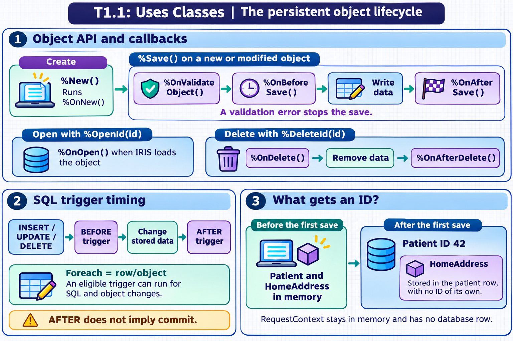
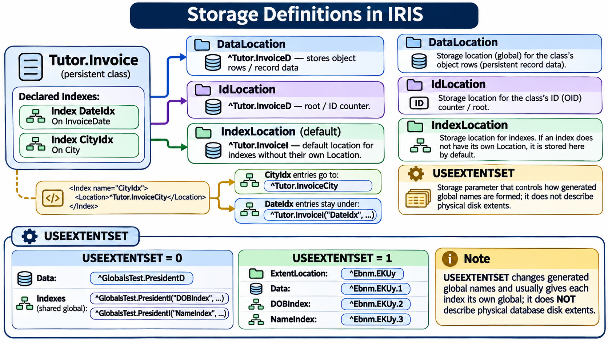
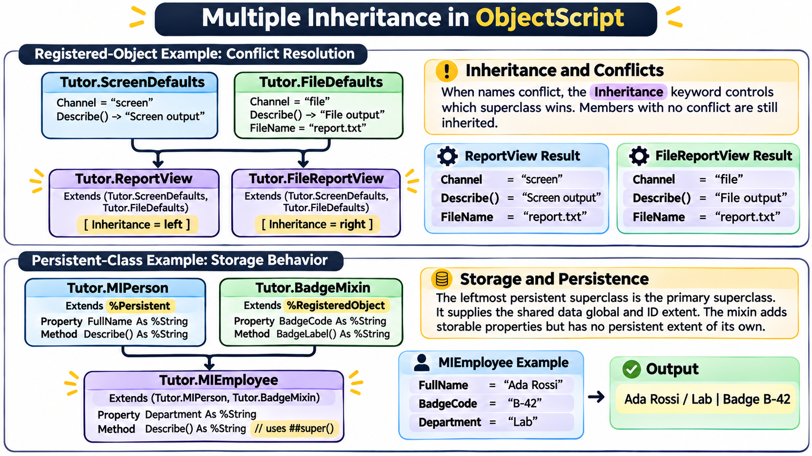

[All topics](../../index.md) · [Practice quiz](quiz.md)

# T1.1: Uses Classes

[Approfondimenti dagli esercizi](<Approfondimenti esercizi/README.md>)

Saved 2 November 2026 from [exam-prep.es](https://exam-prep.es/exams/objectscript/knowledge/T1.1.html). Reference links require internet access.

### Contents

1. [Identifies use cases for persistent and registered object classes](#1-identifies-use-cases-for-persistent-and-registered-object-classes)
2. [Creates and saves a persistent object (%New(), %Save(), %Id())](#2-creates-and-saves-a-persistent-object-new-save-id)
3. [Deletes objects (%DeleteId(), %DeleteExtent())](#3-deletes-objects-deleteid-deleteextent)
4. [Interprets storage definitions (DataLocation, IdLocation, IndexLocation, USEEXTENTSET)](#4-interprets-storage-definitions-datalocation-idlocation-indexlocation-useextentset)
5. [Implements multiple inheritance (order matters, method resolution)](#5-implements-multiple-inheritance-order-matters-method-resolution)
6. [Documents classes (Description keyword, /// comments)](#6-documents-classes-description-keyword--comments)

### Visual study guide — sections 1–3


[View all chapter diagrams](visuals.md) · [Technical review notes](../../visual-technical-notes.md)

## 1. Identifies use cases for persistent and registered object classes

### Key Points

- **%Persistent**: Choose this when an object needs its own database identity and must remain available after the process ends. For example, a patient or invoice can be saved as a row and reopened by its object ID.
- **%RegisteredObject**: Choose this for an object that is useful while code is running but does not need automatic database storage. A request context or a calculation object is a typical example.
- **%SerialObject**: Choose this for a structured value that belongs to another object, such as an address inside a patient record. The parent stores it; the address has no separate persistent ID.
- **A class without a superclass**: Use a class method for stateless operations, such as a shared number-formatting function. The class has no object instances to create with %New().
- Choose the class from the data's lifecycle and ownership: save independent business records, keep temporary state in memory, and embed details that have no independent identity.

### Detailed Notes

#### Start with the object's lifecycle

An object class defines the properties and methods available to its instances. The superclass in the `Extends` clause determines the object behavior the class inherits. In IRIS, `%Persistent` and `%SerialObject` build on the object API provided by `%RegisteredObject`, then add different storage behavior. For example, a patient is an independent record, an address can be part of that patient, and a request context may only be needed while a request is processed.

Calling `%New()` creates an object in memory. If the class defines `%OnNew()`, IRIS runs it during initialization. A persistent instance becomes a stored record when you first save it successfully. IRIS can also call class-defined hooks during validation, saving, opening, and deletion. The next two sections show where those callbacks run and how they differ from SQL triggers.

#### Persistent classes: records with their own identity

A class that extends `%Persistent` represents objects IRIS can save, reopen, and delete. A persistent class is also projected as an SQL table, and each saved object is a row with an object ID. Use it when the entity must be managed independently—for example, when an invoice needs its own ID, must be found by SQL, or must remain available to another process after the current request ends.

```objectscript
Class Tutor.Patient Extends %Persistent
{
    Property MedicalRecordNumber As %String;
    Property Name As %String;
}
```

Creating a patient with `%New()` does not save it yet. Set its properties, call `%Save()`, check the returned status, and then read `%Id()`. The ID identifies the saved object; it is not a row count, and an assigned ID alone does not prove that an enclosing transaction has committed.

```objectscript
set patient = ##class(Tutor.Patient).%New()
set patient.Name = "Ada Lovelace"
set patient.MedicalRecordNumber = "MRN-1042"
set sc = patient.%Save()
if $SYSTEM.Status.IsError(sc) {
    write $SYSTEM.Status.GetErrorText(sc), !
    quit
}
write "Saved patient ID: ", patient.%Id(), !
```

After saving, another part of the application can reopen the record by ID, and SQL can query the class as a table. For example, `%OpenId(id)` reopens the patient, while `SELECT Name FROM Tutor.Patient WHERE ID = ?` queries the projected table.

#### Registered objects: useful state held in memory

A class that extends `%RegisteredObject` supports object properties, instance methods, and inheritance, but it does not provide automatic database persistence. Use it for state that belongs to an active operation—for example, a request context carrying a correlation ID or a helper that gathers intermediate results. Its values are available to code holding the object reference in the current process; they are not saved as a database row and are not shared automatically with another process.

```objectscript
Class Tutor.RequestContext Extends %RegisteredObject
{
    Property CorrelationId As %String;
    Property UserName As %String;
}
```

Create and use a registered object with `%New()`, just like an in-memory object, but do not call `%Save()` on it. If the correlation ID must be available after the request or process ends, copy it into a persistent record or another explicitly shared store.

```objectscript
set context = ##class(Tutor.RequestContext).%New()
set context.CorrelationId = "req-42"
set context.UserName = "Ada"
write context.CorrelationId, " for ", context.UserName, !
```

#### Serial objects: structured values embedded in a parent

A class that extends `%SerialObject` describes an embedded value, such as the home address of a patient. An address instance can have an object reference (OREF) while it is in memory. In the database it has **no persistent ID or table row of its own**. Saving the patient stores the address as part of that patient record. The patient's ID identifies the row, and `HomeAddress` identifies the embedded property within it. If the patient also has a `WorkAddress` of the same class, the two property names distinguish the two values.

```objectscript
Class Tutor.Address Extends %SerialObject
{
    Property Street As %String;
    Property City As %String;
    Property PostalCode As %String;
}
```

Add the serial object as a property of the persistent class. IRIS does not require a separate `%New()` call for the serial property before assigning its fields; saving the patient saves the address as part of that patient.

```objectscript
// Add this property inside Tutor.Patient:
Property HomeAddress As Tutor.Address;

// In a method, after compiling Tutor.Address and Tutor.Patient:
set patient = ##class(Tutor.Patient).%New()
set patient.Name = "Ada Lovelace"
set patient.HomeAddress.Street = "12 Example Street"
set patient.HomeAddress.City = "London"
set sc = patient.%Save()
if $SYSTEM.Status.IsError(sc) {
    write $SYSTEM.Status.GetErrorText(sc), !
    quit
}
set patientId = patient.%Id()
```

To read the stored city in ObjectScript, reopen the patient with `##class(Tutor.Patient).%OpenId(patientId)` and, once it opens successfully, read `patient.HomeAddress.City`. With the default SQL projection, query the parent table and bind `patientId` to the placeholder. `HomeAddress_City` combines the parent property name with the embedded field name.

```sql
SELECT ID, Name, HomeAddress_City
FROM Tutor.Patient
WHERE ID = ?;
```

Here `ID` belongs to `Tutor.Patient`. If the application needs to query or update an address as a record with its own ID, model it as a `%Persistent` class and reference it from `Tutor.Patient`. If the parent customizes its SQL projection, check the generated columns for their exact names.

#### Classes without a superclass: class-level helpers

A class without an `Extends` clause is not an object class, so you do not create instances from it with `%New()`. It can still group class-level behavior, such as a calculation used throughout an application. Use this form when the operation has no per-instance state; use `%RegisteredObject` instead when each helper instance needs its own properties.

```objectscript
Class Tutor.NumberTools
{
    ClassMethod Double(value As %Integer) As %Integer
    {
        return value * 2
    }
}
```

Call the class method directly, without creating an object. For example, `##class(Tutor.NumberTools).Double(21)` returns `42`.

#### Compare the choices

| Question | %Persistent | %RegisteredObject | %SerialObject | No superclass |
| --- | --- | --- | --- | --- |
| Does it have its own database record? | Yes, after a successful save | No automatic record | No; stored through its parent | No |
| Does it have an independent object ID? | Yes | No persistent ID | No | No object instance |
| Typical use | Patient, order, invoice | Request context, temporary helper | Address or other value inside a record | Stateless class method |
| How is it accessed? | Create, save, reopen by ID | Create and use in memory | Set through the parent property | Call a class method |

A useful design check is to ask what should happen to the data after the current operation. If it must be found tomorrow by ID or queried as a record, make it persistent. If it is only working state, make it registered. If it is meaningful only as part of a parent, make it serial. If there is no instance state at all, a class method on a class without a superclass may be enough.

### Documentation References

- [Object Classes](https://docs.intersystems.com/irislatest/csp/docbook/DocBook.UI.Page.cls?KEY=GOBJ_classes)
- [Persistent Objects](https://docs.intersystems.com/irislatest/csp/docbook/DocBook.UI.Page.cls?KEY=GOBJ_persobj)
- [Working with Registered Objects](https://docs.intersystems.com/irislatest/csp/docbook/DocBook.UI.Page.cls?KEY=GOBJ_objapi)
- [Object-Valued Properties and Serial Objects](https://docs.intersystems.com/irislatest/csp/docbook/DocBook.UI.Page.cls?KEY=GOBJ_propobj)
- [Embedded Objects in SQL Tables](https://docs.intersystems.com/irislatest/csp/docbook/DocBook.UI.Page.cls?KEY=GSQL_tables)

## 2. Creates and saves a persistent object (%New(), %Save(), %Id())

### Key Points

- **%New()** creates a new in-memory instance of a class and returns an object reference (oref)
- **%Save()** persists the object to disk and returns a %Status value that must be checked
- **%Id()** returns the object's ID within its extent. **%Oid()** returns its OID, which includes both the ID and the class name.
- **Callbacks** let a class initialize, validate, or react to changes at specific points in the object lifecycle. IRIS calls them automatically if the class defines them.
- **SQL triggers** react to INSERT, UPDATE, or DELETE. A trigger declared with `Foreach = row/object` can also run for corresponding changes made through the object API.
- **%OpenId(id)** retrieves a previously saved object from disk by its ID
- **Generated index methods** let you use a key such as `MessageId` to check for a matching object or open it by a unique index.

### Detailed Notes

#### Overview

Create a persistent object in memory, populate its properties, and save it. Once you have the ID, you can reopen, update, or delete the record. A callback is a method you define to add behavior at one of these steps. Your code calls `%New()` or `%Save()`, for example, and IRIS calls the callback for you at the appropriate point.



#### Creating an Object with %New()

The `%New()` method is inherited from `%RegisteredObject` and allocates memory for a new object instance. It returns an object reference (oref).

```objectscript
Set person = ##class(Sample.Person).%New()
Set person.Name = "John Smith"
Set person.DOB = $HOROLOG
```

Before `%Save()` is called, the object exists only in memory. If the variable goes out of scope without saving, the object is lost.

#### Saving with %Save()

The `%Save()` method serializes the object to the database globals. It returns a `%Status` value indicating success or failure.

```objectscript
Set sc = person.%Save()
If $$$ISERR(sc) {
    // Handle error
    Do $System.Status.DisplayError(sc)
}
```

The first successful save assigns a persistent ID. Saving changes to an existing object updates the same record. The save validates modified objects, stores embedded values with their parent, and can run eligible triggers. Check the returned `%Status` before using the ID or proceeding with dependent work.

#### Callbacks during creation, validation, and saving

`%ValidateObject()` is an instance method that runs validation for the object's current values and returns a `%Status` indicating success or an error. Call it to check an object without saving; `%Save()` calls it before writing a persistent object. If your class defines `%OnValidateObject()`, IRIS calls that method during validation. Check the returned status before continuing.

| Callback | When IRIS calls it | Example use |
| --- | --- | --- |
| `%OnNew()` | During `%New()`, after memory allocation and property initialization. An error status stops creation. | Initialize properties from an argument passed to `%New()`. |
| `%OnValidateObject()` | After property validation during `%ValidateObject()` and when `%Save()` validates a modified object. An error status fails validation. | Check that a start date is on or before the end date. |
| `%OnBeforeSave()` | Before IRIS writes the object. An error status stops the save. | Check whether the operation may proceed. |
| `%OnAfterSave()` | After the object is written. | Record a related database change as part of the save. |

If the caller opened a transaction, the write can still roll back after `%OnAfterSave()` runs.

This class initializes a draft with today's date. Its custom validation rejects a draft whose end date precedes its start date.

```objectscript
Class Tutor.VisitDraft Extends %Persistent
{
    Property StartDate As %Date [ Required ];
    Property EndDate As %Date;

    Method %OnNew(initvalue As %String = "") As %Status [ Private, ServerOnly = 1 ]
    {
        set ..StartDate = +$HOROLOG
        return $$$OK
    }

    Method %OnValidateObject() As %Status [ Private, ServerOnly = 1 ]
    {
        if (..EndDate '= "") && (..EndDate < ..StartDate) {
            return $$$ERROR($$$GeneralError, "End date precedes start date")
        }
        return $$$OK
    }
}
```

```objectscript
set draft = ##class(Tutor.VisitDraft).%New()
set draft.EndDate = draft.StartDate - 1
set sc = draft.%Save()
write $SYSTEM.Status.GetErrorText(sc), !
```

The save returns an error and creates no row. Setting `EndDate` equal to `StartDate` passes this rule. You can call `%ValidateObject()` to run validation without saving the draft.

#### SQL triggers and object callbacks

SQL `INSERT`, `UPDATE`, and `DELETE` act on table rows. SQL DML runs applicable `BEFORE` and `AFTER` triggers. An ordinary SQL `UPDATE` does not run `%OnBeforeSave()` or `%OnAfterSave()` as if it had called `%Save()` on an instance. When a table rule such as auditing needs to run for both SQL and object changes, an eligible trigger declared with `Foreach = row/object` can cover both paths. For example, an `AFTER UPDATE` trigger can record a change made through either SQL `UPDATE` or `%Save()` on a modified existing object.

#### ID, OID, and OREF

The first successful save gives a persistent object two identifiers. Its **ID** is unique within its extent, the set of instances managed together by a persistent class. Its **OID** (object identifier) includes the ID and the object's class name and identifies the object within the database. For example, `Tutor.Patient` and `Tutor.Invoice` can both have an ID of `42` when they use separate extents. Their OIDs differ because they include different class names.

| Value | How to get it | Where to use it |
| --- | --- | --- |
| ID | `person.%Id()` | `%OpenId(id)`, `%ExistsId(id)`, `%DeleteId(id)`, or the SQL `%ID` pseudo-field |
| OID | `person.%Oid()` | `%Open(oid)`, `%Exists(oid)`, or `%Delete(oid)` |
| OREF | Returned by `%New()` or by a successful open | Access the object in memory, for example `person.Name` |

`%New()` returns an OREF immediately. At that point, a new object has yet to receive its persistent identifiers. After saving, use the OREF to read either identifier. Keep the OID in the form returned by `%Oid()` and pass it directly to methods that expect one.

```objectscript
set person = ##class(Sample.Person).%New()
set person.Name = "Jane Doe"
set sc = person.%Save()
if $SYSTEM.Status.IsError(sc) {
    write $SYSTEM.Status.GetErrorText(sc), !
    quit
}

set id = person.%Id()
set oid = person.%Oid()
set byId = ##class(Sample.Person).%OpenId(id)
set byOid = ##class(Sample.Person).%Open(oid)
```

Both calls identify the same saved `Sample.Person` and return an OREF on success. In SQL, use the `%ID` pseudo-field to locate the row by its ID.

The concurrency argument controls how IRIS locks the record during the open. When IRIS loads the record into an instance, `%OnOpen()` can perform an additional check. An error status from the callback prevents the open from succeeding.

#### Open or Find an Object by Index Key

Suppose you know the message code `JTE810`. That is a value of `MessageId`. The object also has a system-assigned ID, which you get from `%Id()`. An ordinary `[ Unique ]` index lets you look up the object by its message code while keeping its system-assigned ID.

```objectscript
Class Tutor.IndexedMessage Extends %Persistent
{
    Property MessageId As %String(COLLATION = "EXACT") [ Required ];
    Index MIIdx On MessageId [ Unique ];
}
```

IRIS generates class methods whose names start with the **index name**, `MIIdx`. Use `%ExistsId(id)` or `%OpenId(id)` when you already have the object ID.

| Call | Result |
| --- | --- |
| `MIIdxExists(key, .id)` | Returns `1` for a match and `0` otherwise. On a match, the optional `.id` receives the object's ID. |
| `MIIdxOpen(key, , .sc)` | Returns an OREF on success. The empty argument uses the default concurrency setting and `.sc` receives the `%Status`. |
| `MIIdxDelete(key)` | Deletes the object by its unique key and returns a `%Status`. See section 3 for the delete example. |

Compile the class in a practice namespace where `JTE810` is unused. Run the example from an ObjectScript method to save the test record, find its ID and reopen it.

```objectscript
Set message = ##class(Tutor.IndexedMessage).%New()
Set message.MessageId = "JTE810"
Set sc = message.%Save()
If $SYSTEM.Status.IsError(sc) {
    Do $SYSTEM.Status.DisplayError(sc)
    Quit
}
Set message = ""

Set found = ##class(Tutor.IndexedMessage).MIIdxExists("JTE810", .id)
If 'found {
    Write "Message not found", !
    Quit
}
Write "Object ID: ", id, !

Set message = ##class(Tutor.IndexedMessage).MIIdxOpen("JTE810", , .sc)
If $SYSTEM.Status.IsError(sc) {
    Do $SYSTEM.Status.DisplayError(sc)
    Quit
}
Write "MessageId: ", message.MessageId, !
Set message = ""
```

Pass one argument per indexed property, in the order of the index declaration. For example, an index named `AccountIdx` on `(TenantCode, ExternalCode)` uses `AccountIdxOpen(tenant, code, , .sc)`. Key comparisons follow the index collation. The example sets `EXACT` on `MessageId` so that matching is case-sensitive.

`Open` and `Delete` require an index that identifies one object, such as a unique index. `Exists` can also check for matches on a standard non-unique index. Bitmap indexes are outside this lookup pattern.

#### Complete Lifecycle Example

```objectscript
// Create
Set person = ##class(Sample.Person).%New()
Set person.Name = "Alice Johnson"

// Save
Set sc = person.%Save()
If $$$ISERR(sc) { Do $System.Status.DisplayError(sc) Quit }

// Capture ID
Set id = person.%Id()
Write "Created person with ID: ", id, !

// Later: open and modify
Set person2 = ##class(Sample.Person).%OpenId(id)
Set person2.Name = "Alice Smith"
Set sc = person2.%Save()
```

### Documentation References

- [Saving Objects](https://docs.intersystems.com/irislatest/csp/docbook/DocBook.UI.Page.cls?KEY=GOBJ_persobj_saving)
- [Opening Objects](https://docs.intersystems.com/irislatest/csp/docbook/DocBook.UI.Page.cls?KEY=GOBJ_persobj_opening)
- [Index Open, Exists, and Delete Methods](https://docs.intersystems.com/irislatest/csp/docbook/DocBook.UI.Page.cls?KEY=GSOD_indexes)
- [Identifiers for Saved Objects](https://docs.intersystems.com/irislatest/csp/docbook/DocBook.UI.Page.cls?KEY=GOBJ_persobj_intro)
- [Defining Callback Methods](https://docs.intersystems.com/irislatest/csp/docbook/DocBook.UI.Page.cls?KEY=GOBJ_callbacks)
- [Using SQL Triggers](https://docs.intersystems.com/irislatest/csp/docbook/DocBook.UI.Page.cls?KEY=GSQL_TRIGGERS)

## 3. Deletes objects (%DeleteId(), %DeleteExtent())

### Key Points

- **%DeleteId(id)** deletes a single object by its ID and returns a %Status
- **`<IndexName>Delete(key)`** deletes a single object identified by a unique index key and returns a `%Status`.
- **%OnDelete(oid)** is the class callback that can reject an object deletion before IRIS removes its data.
- **%DeleteExtent()** deletes all instances of a class (all rows in the SQL table)
- **%KillExtent()** is a faster but less safe alternative that directly kills the storage globals
- Deletion respects referential integrity constraints (foreign keys)
- Always check the return status for errors (e.g., object not found, referential integrity violation)

### Detailed Notes

#### Overview

InterSystems IRIS provides multiple approaches for deleting persistent objects. The choice depends on whether you need to delete a single instance, a filtered set, or the entire extent (all instances) of a class.

#### Deleting a Single Object with %DeleteId()

The `%DeleteId()` class method deletes one object by its ID. It returns a `%Status` value.

```objectscript
Set sc = ##class(Sample.Person).%DeleteId(42)
If $$$ISERR(sc) {
    Do $System.Status.DisplayError(sc)
}
```

Key behaviors:

- Removes the object data from globals
- Removes associated index entries
- Calls `%OnDelete()` before the deletion and `%OnAfterDelete()` after the data is removed, if implemented
- Respects foreign key constraints (deletion may fail if referenced by other objects)
- Can run eligible `DELETE` triggers, such as a `Foreach = row/object` trigger

#### Delete an Object by Unique Index Key

In question 2, `Sample.EmailMessage` declares `Index MIIdx On MessageId [ Unique ];`. The argument `"JTE810"` is the indexed `MessageId`, so the matching call is `##class(Sample.EmailMessage).MIIdxDelete("JTE810")`. `%DeleteId(id)` takes the object ID, and `%Delete(oid)` takes the OID.

Continue with the `Tutor.IndexedMessage` object saved in section 2. This call removes the object and its index entries.

```objectscript
Set sc = ##class(Tutor.IndexedMessage).MIIdxDelete("JTE810")
If $SYSTEM.Status.IsError(sc) {
    Do $SYSTEM.Status.DisplayError(sc)
    Quit
}
Write ##class(Tutor.IndexedMessage).MIIdxExists("JTE810"), !
// 0
```

#### Deleting All Objects with %DeleteExtent()

The `%DeleteExtent()` class method removes all instances of a class.

```objectscript
Set sc = ##class(Sample.Person).%DeleteExtent()
```

This method iterates through all objects and deletes them one at a time, which means:

- Each instance follows the object delete path, including applicable callbacks and triggers
- Foreign key constraints are checked for each object
- It can be slow for large tables
- It returns the count of deleted objects via output parameters

```objectscript
Set sc = ##class(Sample.Person).%DeleteExtent(, .deletecount, .instancecount)
Write "Deleted: ", deletecount, " of ", instancecount, !
```

#### Using %KillExtent() for Fast Deletion

For situations where triggers, callbacks, and referential integrity checks are not needed, `%KillExtent()` directly kills the underlying globals.

```objectscript
Do ##class(Sample.Person).%KillExtent()
```

Caution: `%KillExtent()` bypasses all object-level logic. Use it only when you are certain no side effects are needed, typically during development or data reset operations.

#### Handling Referential Integrity on Delete

If a class has foreign key references from other classes, deletion behavior depends on the `OnDelete` action defined on the foreign key:

- **NoAction** (default): Deletion fails if referenced objects exist
- **Cascade**: Referenced objects are also deleted
- **SetNull**: Foreign key fields in referencing objects are set to null
- **SetDefault**: Foreign key fields in referencing objects are set to their default value

#### The %OnDelete() callback and SQL DELETE triggers

`%OnDelete(oid)` runs before `%Delete()` or `%DeleteId()` removes the object. It is a class method because the caller can delete a record by ID without an open instance. IRIS passes the callback an OID even when the caller starts with `%DeleteId(id)`. Returning an error `%Status` stops the deletion. The example extracts the ID with `$$$oidPrimary(oid)` because it uses `%OpenId()` to read the record's fields.

For example, add `Property HoldForReview As %Boolean;` and the following class method to `Tutor.Patient` to block object deletion while a review is pending.

```objectscript
ClassMethod %OnDelete(oid As %ObjectIdentity) As %Status [ Private, ServerOnly = 1 ]
{
    set id = $$$oidPrimary(oid)
    set patient = ..%OpenId(id, , .sc)
    if $SYSTEM.Status.IsError(sc) { return sc }
    if '$ISOBJECT(patient) {
        return $$$ERROR($$$GeneralError, "Patient could not be opened")
    }
    if patient.HoldForReview {
        return $$$ERROR($$$GeneralError, "Patient review is pending")
    }
    return $$$OK
}
```

Save a patient with `HoldForReview = 1`, then call `%DeleteId(patientId)`. The callback returns an error and the record remains. `%OnAfterDelete()` runs after IRIS removes the data successfully.

An ordinary SQL `DELETE` uses the SQL trigger path. If a deletion rule must cover both access paths, a `BEFORE DELETE` trigger with `Foreach = row/object` can apply it to SQL and object deletions. The foreign key keyword `OnDelete` is separate from both. It specifies what happens to referencing rows, for example `NoAction` or `Cascade`.

### Documentation References

- [Deleting Objects](https://docs.intersystems.com/irislatest/csp/docbook/DocBook.UI.Page.cls?KEY=GOBJ_persobj_deleting)
- [Index Open, Exists, and Delete Methods](https://docs.intersystems.com/irislatest/csp/docbook/DocBook.UI.Page.cls?KEY=GSOD_indexes)
- [Foreign Keys](https://docs.intersystems.com/irislatest/csp/docbook/DocBook.UI.Page.cls?KEY=ROBJ_foreignkey)
- [Defining Callback Methods](https://docs.intersystems.com/irislatest/csp/docbook/DocBook.UI.Page.cls?KEY=GOBJ_callbacks)
- [Using SQL Triggers](https://docs.intersystems.com/irislatest/csp/docbook/DocBook.UI.Page.cls?KEY=GSQL_TRIGGERS)

### Visual study guide — sections 4–6


[View all chapter diagrams](visuals.md) · [Technical review notes](../../visual-technical-notes.md)

## 4. Interprets storage definitions (DataLocation, IdLocation, IndexLocation, USEEXTENTSET)



### Key Points

- **Storage definition** maps class properties to underlying global structures
- **DataLocation** specifies the global where object data is stored (default: `^Package.ClassD`)
- **IdLocation** specifies the global holding the ID counter (default: `^Package.ClassD`)
- **IndexLocation** sets the default location for index entries. A `<Location>` inside a named `<Index>` takes precedence for that index.
- **USEEXTENTSET** controls how IRIS generates storage locations. With `1`, IRIS normally uses short hashed global names and gives each index without an explicit location its own global.
- Storage definitions are auto-generated but can be customized for special requirements

### Detailed Notes

#### Overview

Every persistent class has a storage definition that tells the system how to map object properties to globals. Understanding storage definitions is essential for troubleshooting, performance tuning, and interpreting existing code.

#### Default Storage Layout

By default, InterSystems IRIS uses `%Storage.Persistent` and creates globals named after the class:

```text
Class Sample.Person Extends %Persistent
{
    Property Name As %String;
    Property Age As %Integer;
}
```

Default storage globals:

- **Data**: `^Sample.PersonD` - stores object data
- **Index**: `^Sample.PersonI` - stores index entries
- **ID counter**: `^Sample.PersonD` at the root in this example. With the `increment` ID function, it holds the highest assigned ID.

The data global structure typically looks like:

```text
^Sample.PersonD = 2
^Sample.PersonD(1) = $LB("", "John Smith", 35)
^Sample.PersonD(2) = $LB("", "Jane Doe", 28)
```

Each node stores a `$LISTBUILD` structure where property values are stored in a defined order.

#### Storage Definition in Class Code

The storage definition appears at the end of the class and is managed by the compiler:

```text
Storage Default
{
<Data name="PersonDefaultData">
  <Value name="1"><Value>%%CLASSNAME</Value></Value>
  <Value name="2"><Value>Name</Value></Value>
  <Value name="3"><Value>Age</Value></Value>
</Data>
<DataLocation>^Sample.PersonD</DataLocation>
<DefaultData>PersonDefaultData</DefaultData>
<IdLocation>^Sample.PersonD</IdLocation>
<IndexLocation>^Sample.PersonI</IndexLocation>
<StreamLocation>^Sample.PersonS</StreamLocation>
<Type>%Storage.Persistent</Type>
}
```

#### Default and Per-Index Locations

Suppose `Tutor.Invoice` defines `CityIdx` on `City` and `DateIdx` on `InvoiceDate`. The index declarations in the class identify which properties each index covers:

```objectscript
Index CityIdx On City;
Index DateIdx On InvoiceDate;
```

The physical global for an index is set in the class's `Storage Default` definition. To give one index its own global, place a `<Location>` element inside the matching `<Index>` entry. This excerpt keeps `DateIdx` on the shared default and assigns `CityIdx` a separate location:

```objectscript
Storage Default
{
    ...
    <DataLocation>^Tutor.InvoiceD</DataLocation>
    <IndexLocation>^Tutor.InvoiceI</IndexLocation>
    <Index name="CityIdx">
        <Location>^Tutor.InvoiceCity</Location>
    </Index>
    ...
}
```

`IndexLocation` is the class-wide default for indexes without their own `Location`. Here, `CityIdx` has an explicit location because its `<Location>` is nested under `<Index name="CityIdx">`. `DateIdx` has no such entry, so IRIS stores its entries under `^Tutor.InvoiceI("DateIdx",...)`. The `CityIdx` entries live under `^Tutor.InvoiceCity`. Both are index data; the invoice record itself lives under the `DataLocation`.

#### USEEXTENTSET Parameter

Declare `Parameter USEEXTENTSET = 1;` inside a persistent class to have IRIS generate hashed locations when it creates the default storage. With `USEEXTENTSET = 0`, indexes without their own location normally share the `I` global. With `1`, each index without an explicit location gets its own global.

The [InterSystems example](https://docs.intersystems.com/irislatest/csp/docbook/DocBook.UI.Page.cls?KEY=GOBJ_storageglobals) uses `GlobalsTest.President` with indexes named `DOBIndex` and `NameIndex`. These are the locations shown for the two layouts.

| What IRIS stores | `USEEXTENTSET = 0` | `USEEXTENTSET = 1` |
| --- | --- | --- |
| Records | `^GlobalsTest.PresidentD` | `^Ebnm.EKUy.1` |
| `DOBIndex` entries | `^GlobalsTest.PresidentI("DOBIndex",...)` | `^Ebnm.EKUy.2` |
| `NameIndex` entries | `^GlobalsTest.PresidentI("NameIndex",...)` | `^Ebnm.EKUy.3` |

`ExtentLocation` is `^Ebnm.EKUy` in the hashed layout. IRIS uses it as the base for the numbered globals. For example, the record with ID `42` is at `^Ebnm.EKUy.1(42)` in that layout. For an existing class, changing the parameter alone does not move stored data or replace locations already defined in its storage. Read the active storage definition to see which globals the class uses.

#### Why Storage Definitions Matter

- **Troubleshooting**: Direct global inspection to verify data integrity
- **Migration**: Understanding storage is critical when moving data between systems
- **Performance**: Custom storage layouts can optimize access patterns
- **Inheritance**: Subclasses may share or extend the parent storage definition

#### Examining Storage at Runtime

You can programmatically inspect storage definitions using the `%Dictionary` package:

```objectscript
// Open the storage definition for a class
Set storDef = ##class(%Dictionary.StorageDefinition).%OpenId("Sample.Person||Default")
If storDef '= "" {
    Write "DataLocation: ", storDef.DataLocation, !
    Write "IndexLocation: ", storDef.IndexLocation, !
    Write "IdLocation: ", storDef.IdLocation, !
}

// Directly inspect the global
ZWrite ^Sample.PersonD
```

#### Find the Database Behind a Data Global

`DataLocation` tells you the global name. The namespace's global mappings tell you which database holds that global. For example, if `Sales.Order` has `<DataLocation>^Sales.OrderD</DataLocation>`, check the destination from the namespace where the application runs.

```objectscript
Set dest = ##class(%SYS.Namespace).GetGlobalDest($NAMESPACE, "Sales.OrderD")
Write "System: ", $PIECE(dest, "^", 1), !
Write "Directory: ", $PIECE(dest, "^", 2), !
```

The result has the form `system^directory`. An empty system part means the database is local. For example, `^/iris/db/sales/` identifies the directory containing that database's `IRIS.DAT`. For a remote mapping, the directory refers to the identified remote system. If the mapping covers only certain subscripts, pass the subscript as the third argument. For example, use `GetGlobalDest($NAMESPACE, "Sales.OrderD", 42)` to resolve `^Sales.OrderD(42)`.

### Documentation References

- [Storage Definitions](https://docs.intersystems.com/irislatest/csp/docbook/DocBook.UI.Page.cls?KEY=GOBJ_storage)

- [%SYS.Namespace class reference](https://docs.intersystems.com/irislatest/csp/documatic/%25CSP.Documatic.cls?CLASSNAME=%25SYS.Namespace&LIBRARY=%25SYS)
- [Adding global mappings to a namespace](https://docs.intersystems.com/irislatest/csp/docbook/DocBook.UI.Page.cls?KEY=GSA_config_namespace_addmap)
- [Namespaces and databases](https://docs.intersystems.com/irislatest/csp/docbook/DocBook.UI.Page.cls?KEY=GORIENT_enviro)
- [USEEXTENTSET Parameter](https://docs.intersystems.com/irislatest/csp/docbook/DocBook.UI.Page.cls?KEY=GOBJ_storageglobals)

## 5. Implements multiple inheritance (order matters, method resolution)



### Key Points

- List the superclasses in `Extends (A, B)`. The leftmost class is the **primary superclass**.
- With the default left-to-right inheritance, a property or method from the left superclass wins a name conflict. Members with distinct names can be inherited from either superclass.
- `Inheritance = right` changes which superclass wins a member conflict. The primary superclass stays the leftmost one.
- For a persistent class, put `%Persistent` or a persistent parent first. With the default layout, a persistent subclass shares its parent's data global and ID space. A storable property from a mixin can be saved in that layout.

### Detailed Notes

#### Resolve Name Conflicts in Properties and Methods

Both registered base classes below define `Channel` and `Describe()`. Only `Tutor.FileDefaults` defines `FileName`. Save each definition in a separate class file and compile the two base classes first.

```objectscript
Class Tutor.ScreenDefaults Extends %RegisteredObject
{
    Property Channel As %String [ InitialExpression = "screen" ];

    Method Describe() As %String
    {
        Quit "Screen output"
    }
}

Class Tutor.FileDefaults Extends %RegisteredObject
{
    Property Channel As %String [ InitialExpression = "file" ];
    Property FileName As %String [ InitialExpression = "report.txt" ];

    Method Describe() As %String
    {
        Quit "File output"
    }
}

Class Tutor.ReportView Extends (Tutor.ScreenDefaults, Tutor.FileDefaults)
[ Inheritance = left ]
{
}

Class Tutor.FileReportView Extends (Tutor.ScreenDefaults, Tutor.FileDefaults)
[ Inheritance = right ]
{
}
```

```objectscript
Set report = ##class(Tutor.ReportView).%New()
Write report.Channel, " | ", report.Describe(), " | ", report.FileName, !
// screen | Screen output | report.txt

Set report = ##class(Tutor.FileReportView).%New()
Write report.Channel, " | ", report.Describe(), " | ", report.FileName, !
// file | File output | report.txt
```

Both subclasses expose one `Channel` property. The inheritance direction selects the definition, including its initial value. `Describe()` follows the same priority. `FileName` is inherited in both cases because there is no conflict. These classes are registered objects, so their property values live in memory.

#### Save Properties Inherited from Two Superclasses

`Tutor.MIPerson` is the primary persistent superclass. `Tutor.BadgeMixin` supplies a property and a method. `Tutor.MIEmployee` adds its own property and overrides `Describe()`. Here, `##super()` calls the inherited implementation from `Tutor.MIPerson`.

```objectscript
Class Tutor.MIPerson Extends %Persistent
{
    Parameter USEEXTENTSET = 0;

    Property FullName As %String;
    Index FullNameIdx On FullName;

    Method Describe() As %String
    {
        Quit ..FullName
    }
}

Class Tutor.BadgeMixin Extends %RegisteredObject
{
    Property BadgeCode As %String;

    Method BadgeLabel() As %String
    {
        Quit "Badge "_..BadgeCode
    }
}

Class Tutor.MIEmployee Extends (Tutor.MIPerson, Tutor.BadgeMixin)
[ Inheritance = left ]
{
    Property Department As %String;

    Method Describe() As %String
    {
        Quit ##super()_" / "_..Department
    }
}
```

Compile the three classes in a practice namespace and run the following from an ObjectScript method. Reopening the object by ID lets you check that the badge and department were saved.

```objectscript
Set employee = ##class(Tutor.MIEmployee).%New()
Set employee.FullName = "Ada Rossi"
Set employee.BadgeCode = "B-42"
Set employee.Department = "Lab"

Set sc = employee.%Save()
If $SYSTEM.Status.IsError(sc) {
    Do $SYSTEM.Status.DisplayError(sc)
    Quit
}
Set id = employee.%Id()
Set employee = ##class(Tutor.MIEmployee).%OpenId(id,,.sc)
If $SYSTEM.Status.IsError(sc) {
    Do $SYSTEM.Status.DisplayError(sc)
    Quit
}
Write employee.Describe(), " | ", employee.BadgeLabel(), !
// Ada Rossi / Lab | Badge B-42
ZWrite ^Tutor.MIPersonD(id)
```

| Member | Defined in | What happens on save |
| --- | --- | --- |
| `FullName` | `Tutor.MIPerson` | Stored in the shared data global. The inherited `FullNameIdx` also covers employees. |
| `BadgeCode` | `Tutor.BadgeMixin` | Stored as a property of the employee. The mixin has no persistent extent of its own. |
| `Department` | `Tutor.MIEmployee` | Stored as a property specific to the employee subclass. |
| `Describe()` and `BadgeLabel()` | Subclass and mixin | Methods read the property values when called. |

#### Locate the Record in Storage

With `%Storage.Persistent`, `USEEXTENTSET = 0` and generated storage in this example, the data global is `^Tutor.MIPersonD`. If the assigned ID is `42`, inspect the branch rooted at `^Tutor.MIPersonD(42)`. In the compiled classes, read `DataLocation` in the active storage definition to locate the data global. Then read the `<Data>` mappings in the parent and subclass to see how the inherited and subclass properties are laid out within the branch.

With `USEEXTENTSET = 1` on a fresh hierarchy, the same record layout uses the parent's generated hashed data global. A subclass-only index can instead get a separate global from the subclass's `ExtentLocation`. For an example with both sets of names, see Practice question 13.

The ID is allocated in the parent extent. The employee appears in both `Tutor.MIPerson` and `Tutor.MIEmployee` in SQL under that same ID. The employee projection exposes `BadgeCode` and `Department` alongside `FullName`. Index inheritance follows the primary superclass. An index declared on the employee class covers the employee subextent.

### Documentation References

- [Class inheritance](https://docs.intersystems.com/irislatest/csp/docbook/DocBook.UI.Page.cls?KEY=GOBJ_classes)
- [Inheritance class keyword](https://docs.intersystems.com/irislatest/csp/docbook/DocBook.UI.Page.cls?KEY=ROBJ_class_inheritance)
- [Persistent classes and their subclasses](https://docs.intersystems.com/irislatest/csp/docbook/DocBook.UI.Page.cls?KEY=GOBJ_defpersobj)
- [Storage definitions](https://docs.intersystems.com/irislatest/csp/docbook/DocBook.UI.Page.cls?KEY=GOBJ_storage)
- [Class extents and indexes](https://docs.intersystems.com/irislatest/csp/docbook/DocBook.UI.Page.cls?KEY=GORIENT_persistence)
- [Hashed data and index globals](https://docs.intersystems.com/irislatest/csp/docbook/DocBook.UI.Page.cls?KEY=GOBJ_storageglobals)
- [%Library.Persistent class reference](https://docs.intersystems.com/irislatest/csp/documatic/%25CSP.Documatic.cls?CLASSNAME=%25Library.Persistent&LIBRARY=%25SYS)

## 6. Documents classes (Description keyword, /// comments)

### Key Points

- **/// comments** placed before a class, property, or method become the Description in the class reference
- The **Description keyword** can also be used in class/member definitions
- Documentation is accessible via the Class Reference in the Management Portal and Studio
- Supports **HTML formatting** within descriptions
- Good documentation is essential for maintainability and team collaboration

### Detailed Notes

#### Overview

InterSystems IRIS provides a built-in documentation system that extracts specially formatted comments from class source code and presents them in the Class Reference documentation browser. Proper documentation helps other developers understand your code and is a professional best practice.

#### Using /// Comments

Lines beginning with `///` immediately before a class, property, method, or other class member are treated as the member's description. These comments support HTML markup.

```objectscript
/// This class represents a patient in the healthcare system.
/// <p>It stores demographic information and provides methods
/// for managing patient records.</p>
Class Sample.Patient Extends %Persistent
{
    /// The patient's full legal name as it appears on their ID.
    Property Name As %String(MAXLEN = 200);

    /// The patient's date of birth in $HOROLOG format.
    Property DOB As %Date;

    /// Calculate the patient's age based on their date of birth.
    /// <p>Returns the age in whole years.</p>
    /// <example>
    /// Set age = patient.GetAge()
    /// Write "Patient is ", age, " years old"
    /// </example>
    Method GetAge() As %Integer
    {
        // Method implementation
        Return $HOROLOG - ..DOB \ 365.25
    }
}
```

#### Using the Description Keyword

Alternatively, the `Description` keyword can be used within member definitions:

```objectscript
Property Name As %String [ Description = "The patient's full legal name" ];
```

However, `///` comments are generally preferred because they are easier to read and maintain in the source code.

#### HTML Tags Supported in Documentation

- `<p>` - Paragraphs
- `<b>`, `<i>` - Bold and italic
- `<ul>`, `<ol>`, `<li>` - Lists
- `<table>`, `<tr>`, `<td>` - Tables
- `<code>` - Inline code
- `<example>` - Code example blocks (InterSystems-specific tag)
- `<class>ClassName</class>` - Links to other class documentation
- `<method>MethodName</method>` - Links to methods
- `<property>PropertyName</property>` - Links to properties

#### Viewing Documentation

Class documentation can be viewed through:

- **Management Portal**: System Explorer &gt; Classes &gt; select class &gt; Documentation tab
- **VS Code Extension**: Hover over class/member names to see descriptions
- **Class Reference**: Generated HTML documentation browsable by package

#### Best Practices

- Document every public class and method with `///` comments
- Include parameter descriptions and return value explanations for methods
- Use `<example>` tags to show usage patterns
- Document non-obvious behavior, edge cases, and assumptions
- Keep descriptions concise but informative

### Documentation References

- [Documenting Classes](https://docs.intersystems.com/irislatest/csp/docbook/DocBook.UI.Page.cls?KEY=GOBJ_classes_documenting)
- [Class Reference](https://docs.intersystems.com/irislatest/csp/docbook/DocBook.UI.Page.cls?KEY=ROBJ_class_desc)

## Exam Preparation Summary

### Critical Concepts to Master:

1. When to use %Persistent vs %RegisteredObject vs %SerialObject vs utility classes (no superclass)
2. The complete object lifecycle: %New() -&gt; property setting -&gt; %Save() -&gt; %Id()
3. Always checking %Status return values from %Save() and %DeleteId()
4. Difference between %DeleteExtent() (safe, triggers callbacks) and %KillExtent() (fast, no callbacks)
5. How storage definitions map properties to globals (DataLocation, IdLocation, IndexLocation)
6. USEEXTENTSET parameter and when to use it
7. Left-to-right priority in multiple inheritance
8. How /// comments generate class reference documentation

### Common Exam Scenarios:

- Given a requirement, selecting the correct object class type (persistent, registered, serial)
- Identifying the correct sequence to create and save an object
- Interpreting a storage definition to determine which global stores the data
- Predicting which method is inherited when multiple superclasses define the same method
- Determining what happens when %DeleteId() is called on an object with foreign key references

### Hands-On Practice Recommendations:

- Create persistent and serial classes, save objects, and inspect the underlying globals with ZWrite
- Experiment with %DeleteId() and %DeleteExtent() and observe the global changes
- Build a multiple inheritance scenario and verify which method wins
- Add /// documentation to a class and view it in the Class Reference
- Examine storage definitions of existing system classes to understand the structure
