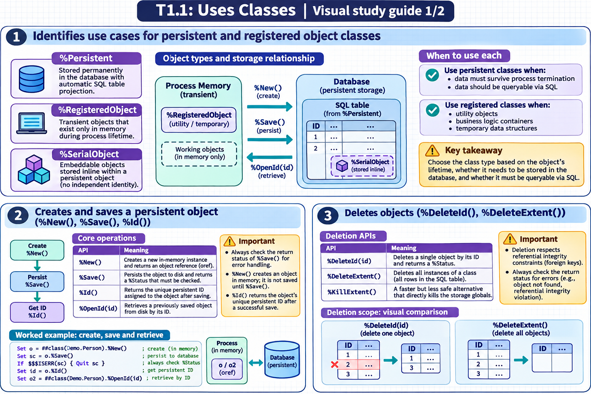
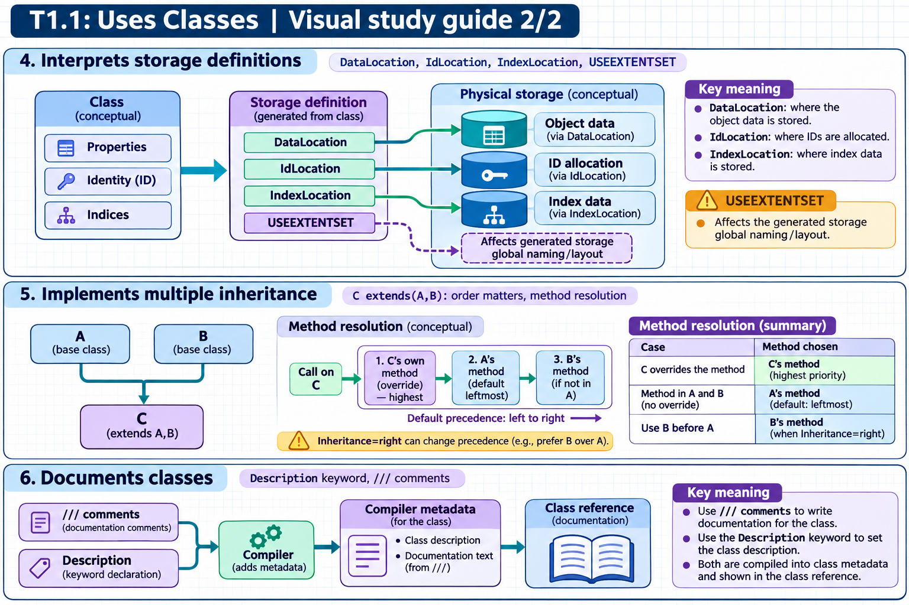
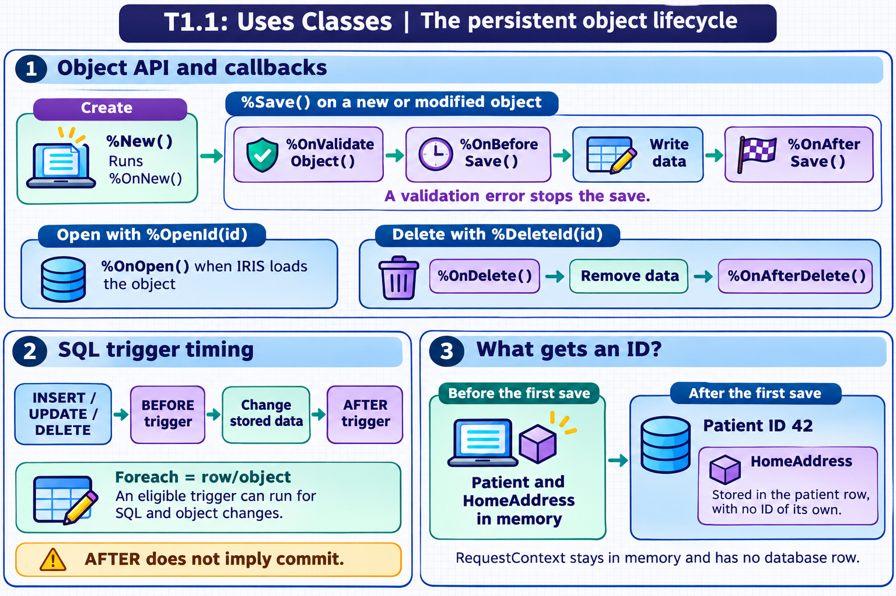
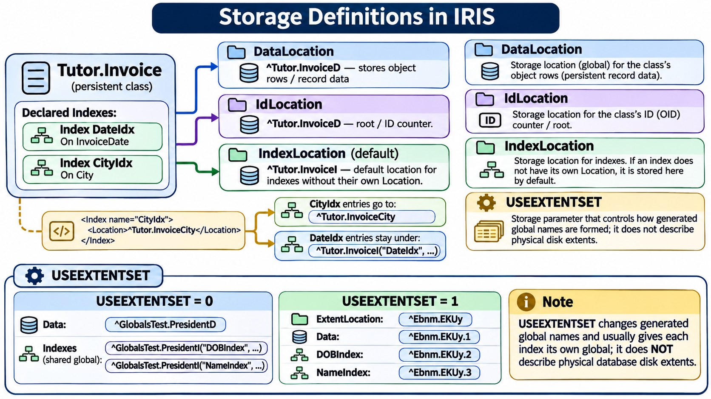
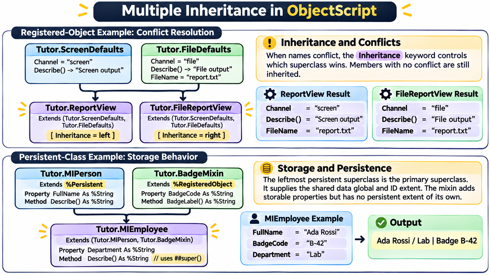
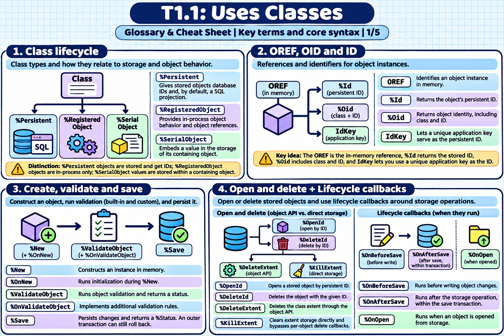
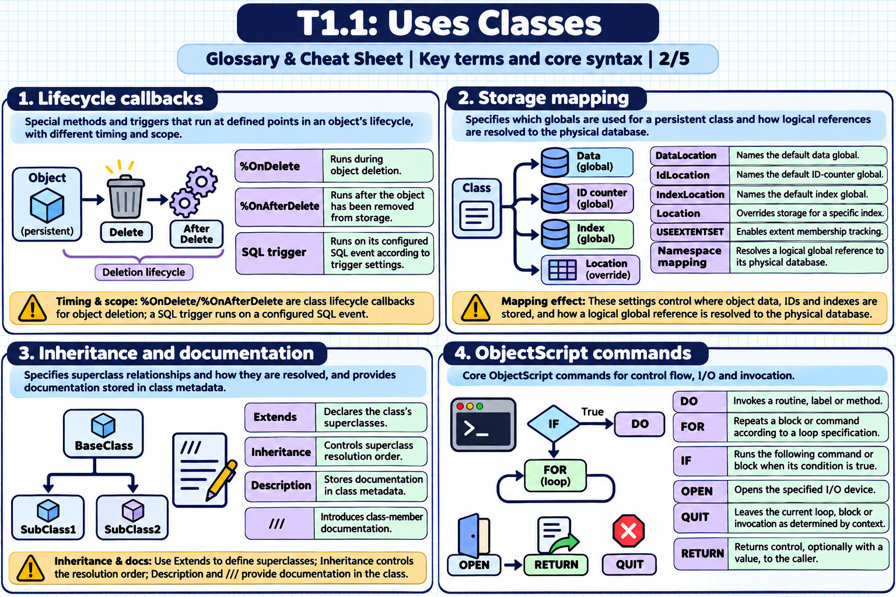
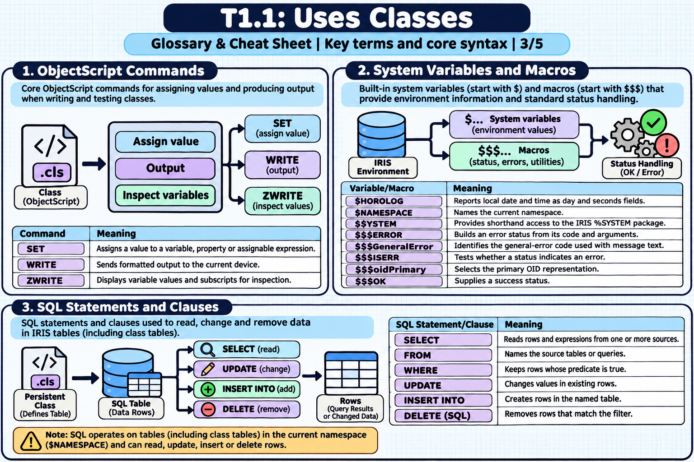
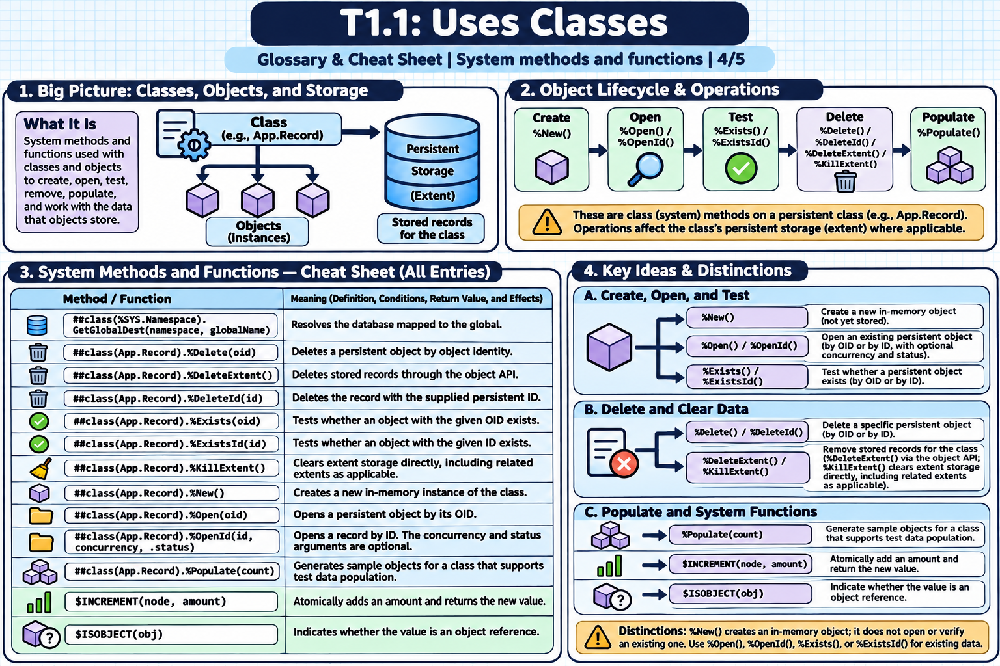
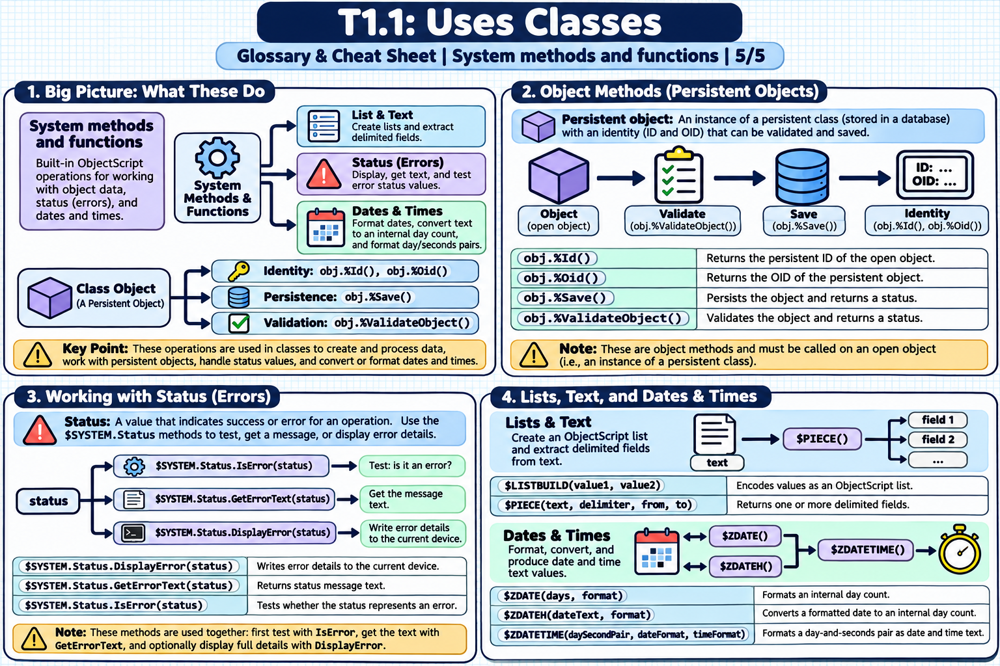

# T1.1: Uses Classes — visual study guides

[Approfondimenti dagli esercizi](<Approfondimenti esercizi/README.md>)

[Chapter contents](index.md) · [Full guide](study.md) · [Practice questions](quiz.md)

Generated learning summaries. Read the full notes for detailed explanations and exact code. [Technical review notes](../../visual-technical-notes.md).

## Visual guide — sections 1–3

Covers:

- 1. Identifies use cases for persistent and registered object classes
- 2. Creates and saves a persistent object (%New(), %Save(), %Id())
- 3. Deletes objects (%DeleteId(), %DeleteExtent())

## Visual guide — sections 4–6

Covers:

- 4. Interprets storage definitions (DataLocation, IdLocation, IndexLocation, USEEXTENTSET)
- 5. Implements multiple inheritance (order matters, method resolution)
- 6. Documents classes (Description keyword, /// comments)

## Object lifecycle and callbacks

## Storage definitions and USEEXTENTSET

## ObjectScript multiple inheritance

## Glossary & Cheat Sheet

[Open the text recap](study.md#glossary--cheat-sheet).
