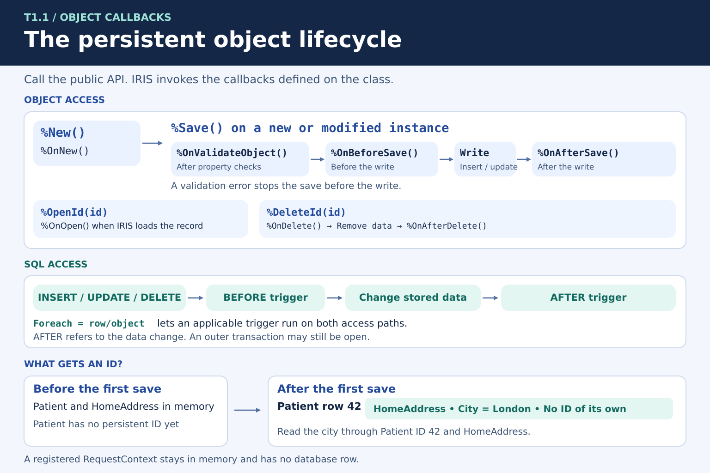

[Topic contents](../index.md) · [Full topic guide](../study.md) · [All topics](../../../index.md)

# T1.1: Uses Classes

Saved 2 November 2026 from [exam-prep.es](https://exam-prep.es/exams/objectscript/knowledge/T1.1.html). Reference links require internet access.

## 2. Creates and saves a persistent object (%New(), %Save(), %Id())


*This diagram covers sections 1–3; use the matching numbered panel for this page.* [Chapter diagrams](../visuals.md) · [Technical review notes](../../../visual-technical-notes.md)

### Key Points

- **%New()** creates a new in-memory instance of a class and returns an object reference (oref)
- **%Save()** persists the object to disk and returns a %Status value that must be checked
- **%Id()** returns the unique persistent ID assigned to the object after saving
- **Callbacks** let a class initialize, validate, or react to changes at specific points in the object lifecycle. IRIS calls them automatically if the class defines them.
- **SQL triggers** react to INSERT, UPDATE, or DELETE. A trigger declared with `Foreach = row/object` can also run for corresponding changes made through the object API.
- **%OpenId(id)** retrieves a previously saved object from disk by its ID

### Detailed Notes

#### Overview

Create a persistent object in memory, populate its properties, and save it. Once you have the ID, you can reopen, update, or delete the record. A callback is a method you define to add behavior at one of these steps. Your code calls `%New()` or `%Save()`, for example, and IRIS calls the callback for you at the appropriate point.



#### Creating an Object with %New()

The `%New()` method is inherited from `%RegisteredObject` and allocates memory for a new object instance. It returns an object reference (oref).

```objectscript
Set person = ##class(Sample.Person).%New()
Set person.Name = "John Smith"
Set person.DOB = $HOROLOG
```

Before `%Save()` is called, the object exists only in memory. If the variable goes out of scope without saving, the object is lost.

#### Saving with %Save()

The `%Save()` method serializes the object to the database globals. It returns a `%Status` value indicating success or failure.

```objectscript
Set sc = person.%Save()
If $$$ISERR(sc) {
    // Handle error
    Do $System.Status.DisplayError(sc)
}
```

The first successful save assigns a persistent ID. Saving changes to an existing object updates the same record. The save validates modified objects, stores embedded values with their parent, and can run eligible triggers. Check the returned `%Status` before using the ID or proceeding with dependent work.

#### Callbacks during creation, validation, and saving

| Callback | When IRIS calls it | Example use |
| --- | --- | --- |
| `%OnNew()` | During `%New()`, after memory allocation and property initialization. An error status stops creation. | Initialize properties from an argument passed to `%New()`. |
| `%OnValidateObject()` | After property validation during `%ValidateObject()` and when `%Save()` validates a modified object. An error status fails validation. | Check that a start date is on or before the end date. |
| `%OnBeforeSave()` | Before IRIS writes the object. An error status stops the save. | Check whether the operation may proceed. |
| `%OnAfterSave()` | After the object is written. | Record a related database change as part of the save. |

If the caller opened a transaction, the write can still roll back after `%OnAfterSave()` runs.

This class initializes a draft with today's date. Its custom validation rejects a draft whose end date precedes its start date.

```objectscript
Class Tutor.VisitDraft Extends %Persistent
{
    Property StartDate As %Date [ Required ];
    Property EndDate As %Date;

    Method %OnNew(initvalue As %String = "") As %Status [ Private, ServerOnly = 1 ]
    {
        set ..StartDate = +$HOROLOG
        return $$$OK
    }

    Method %OnValidateObject() As %Status [ Private, ServerOnly = 1 ]
    {
        if (..EndDate '= "") && (..EndDate < ..StartDate) {
            return $$$ERROR($$$GeneralError, "End date precedes start date")
        }
        return $$$OK
    }
}
```

```objectscript
set draft = ##class(Tutor.VisitDraft).%New()
set draft.EndDate = draft.StartDate - 1
set sc = draft.%Save()
write $SYSTEM.Status.GetErrorText(sc), !
```

The save returns an error and creates no row. Setting `EndDate` equal to `StartDate` passes this rule. You can call `%ValidateObject()` to run validation without saving the draft.

#### SQL triggers and object callbacks

SQL `INSERT`, `UPDATE`, and `DELETE` act on table rows. SQL DML runs applicable `BEFORE` and `AFTER` triggers. An ordinary SQL `UPDATE` does not run `%OnBeforeSave()` or `%OnAfterSave()` as if it had called `%Save()` on an instance. When a table rule such as auditing needs to run for both SQL and object changes, an eligible trigger declared with `Foreach = row/object` can cover both paths. For example, an `AFTER UPDATE` trigger can record a change made through either SQL `UPDATE` or `%Save()` on a modified existing object.

#### Retrieving the ID with %Id()

After a successful save, `%Id()` returns the assigned unique identifier.

```objectscript
Set person = ##class(Sample.Person).%New()
Set person.Name = "Jane Doe"
Set sc = person.%Save()
If $$$ISOK(sc) {
    Write "Saved with ID: ", person.%Id(), !
}
```

#### Opening an Existing Object with %OpenId()

To retrieve a saved object by its ID:

```objectscript
Set person = ##class(Sample.Person).%OpenId(42)
If person '= "" {
    Write person.Name, !
}
```

The concurrency argument controls how IRIS locks the record during the open. When IRIS loads the record into an instance, `%OnOpen()` can perform an additional check. An error status from the callback prevents the open from succeeding.

#### Complete Lifecycle Example

```objectscript
// Create
Set person = ##class(Sample.Person).%New()
Set person.Name = "Alice Johnson"

// Save
Set sc = person.%Save()
If $$$ISERR(sc) { Do $System.Status.DisplayError(sc) Quit }

// Capture ID
Set id = person.%Id()
Write "Created person with ID: ", id, !

// Later: open and modify
Set person2 = ##class(Sample.Person).%OpenId(id)
Set person2.Name = "Alice Smith"
Set sc = person2.%Save()
```

### Documentation References

- [Saving Objects](https://docs.intersystems.com/irislatest/csp/docbook/DocBook.UI.Page.cls?KEY=GOBJ_persobj_saving)
- [Opening Objects](https://docs.intersystems.com/irislatest/csp/docbook/DocBook.UI.Page.cls?KEY=GOBJ_persobj_opening)
- [Defining Callback Methods](https://docs.intersystems.com/irislatest/csp/docbook/DocBook.UI.Page.cls?KEY=GOBJ_callbacks)
- [Using SQL Triggers](https://docs.intersystems.com/irislatest/csp/docbook/DocBook.UI.Page.cls?KEY=GSQL_TRIGGERS)
