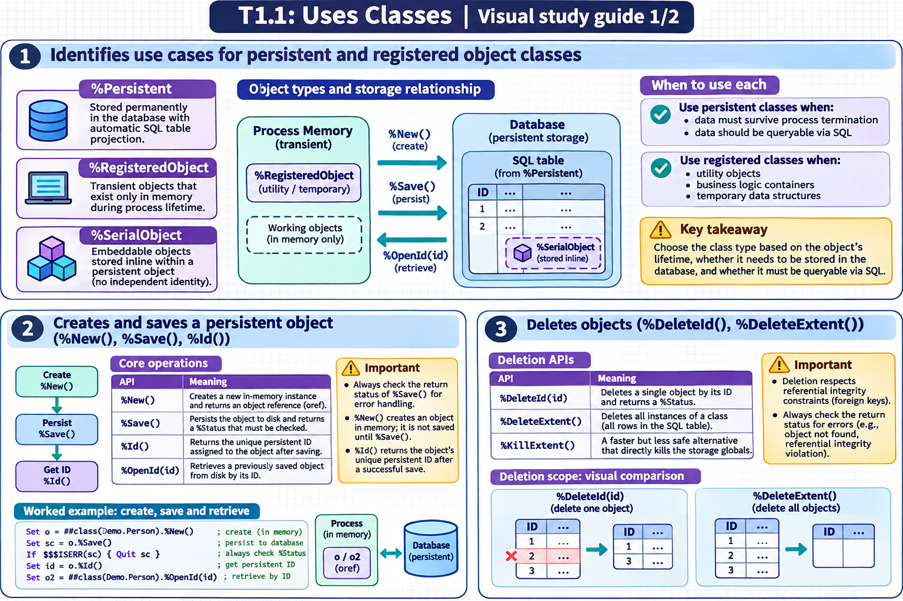

[Topic contents](../index.md) · [Full topic guide](../study.md) · [All topics](../../../index.md)

# T1.1: Uses Classes

Saved 2 November 2026 from [exam-prep.es](https://exam-prep.es/exams/objectscript/knowledge/T1.1.html). Reference links require internet access.

## 3. Deletes objects (%DeleteId(), %DeleteExtent())



*This diagram covers sections 1–3; use the matching numbered panel for this page.* [Chapter diagrams](../visuals.md) · [Technical review notes](../../../visual-technical-notes.md)

### Key Points

- **%DeleteId(id)** deletes a single object by its ID and returns a %Status
- **%OnDelete(oid)** is the class callback that can reject an object deletion before IRIS removes its data.
- **%DeleteExtent()** deletes all instances of a class (all rows in the SQL table)
- **%KillExtent()** is a faster but less safe alternative that directly kills the storage globals
- Deletion respects referential integrity constraints (foreign keys)
- Always check the return status for errors (e.g., object not found, referential integrity violation)

### Detailed Notes

#### Overview

InterSystems IRIS provides multiple approaches for deleting persistent objects. The choice depends on whether you need to delete a single instance, a filtered set, or the entire extent (all instances) of a class.

#### Deleting a Single Object with %DeleteId()

The `%DeleteId()` class method deletes one object by its ID. It returns a `%Status` value.

```objectscript
Set sc = ##class(Sample.Person).%DeleteId(42)
If $$$ISERR(sc) {
    Do $System.Status.DisplayError(sc)
}
```

Key behaviors:

- Removes the object data from globals
- Removes associated index entries
- Calls `%OnDelete()` before the deletion and `%OnAfterDelete()` after the data is removed, if implemented
- Respects foreign key constraints (deletion may fail if referenced by other objects)
- Can run eligible `DELETE` triggers, such as a `Foreach = row/object` trigger

#### Deleting All Objects with %DeleteExtent()

The `%DeleteExtent()` class method removes all instances of a class.

```objectscript
Set sc = ##class(Sample.Person).%DeleteExtent()
```

This method iterates through all objects and deletes them one at a time, which means:

- Each instance follows the object delete path, including applicable callbacks and triggers
- Foreign key constraints are checked for each object
- It can be slow for large tables
- It returns the count of deleted objects via output parameters

```objectscript
Set sc = ##class(Sample.Person).%DeleteExtent(, .deletecount, .instancecount)
Write "Deleted: ", deletecount, " of ", instancecount, !
```

#### Using %KillExtent() for Fast Deletion

For situations where triggers, callbacks, and referential integrity checks are not needed, `%KillExtent()` directly kills the underlying globals.

```objectscript
Do ##class(Sample.Person).%KillExtent()
```

Caution: `%KillExtent()` bypasses all object-level logic. Use it only when you are certain no side effects are needed, typically during development or data reset operations.

#### Handling Referential Integrity on Delete

If a class has foreign key references from other classes, deletion behavior depends on the `OnDelete` action defined on the foreign key:

- **NoAction** (default): Deletion fails if referenced objects exist
- **Cascade**: Referenced objects are also deleted
- **SetNull**: Foreign key fields in referencing objects are set to null
- **SetDefault**: Foreign key fields in referencing objects are set to their default value

#### The %OnDelete() callback and SQL DELETE triggers

`%OnDelete(oid)` runs before `%Delete()` or `%DeleteId()` removes the object. It is a class method because the caller can delete a record by ID without an open instance. The callback receives an OID, which includes the class and its ID. Returning an error `%Status` stops the deletion. If you need the record's fields, extract the ID from the OID and open the object.

For example, add `Property HoldForReview As %Boolean;` and the following class method to `Tutor.Patient` to block object deletion while a review is pending.

```objectscript
ClassMethod %OnDelete(oid As %ObjectIdentity) As %Status [ Private, ServerOnly = 1 ]
{
    set id = $$$oidPrimary(oid)
    set patient = ..%OpenId(id, , .sc)
    if $SYSTEM.Status.IsError(sc) { return sc }
    if '$ISOBJECT(patient) {
        return $$$ERROR($$$GeneralError, "Patient could not be opened")
    }
    if patient.HoldForReview {
        return $$$ERROR($$$GeneralError, "Patient review is pending")
    }
    return $$$OK
}
```

Save a patient with `HoldForReview = 1`, then call `%DeleteId(patientId)`. The callback returns an error and the record remains. `%OnAfterDelete()` runs after IRIS removes the data successfully.

An ordinary SQL `DELETE` uses the SQL trigger path. If a deletion rule must cover both access paths, a `BEFORE DELETE` trigger with `Foreach = row/object` can apply it to SQL and object deletions. The foreign key keyword `OnDelete` is separate from both. It specifies what happens to referencing rows, for example `NoAction` or `Cascade`.

### Documentation References

- [Deleting Objects](https://docs.intersystems.com/irislatest/csp/docbook/DocBook.UI.Page.cls?KEY=GOBJ_persobj_deleting)
- [Foreign Keys](https://docs.intersystems.com/irislatest/csp/docbook/DocBook.UI.Page.cls?KEY=ROBJ_foreignkey)
- [Defining Callback Methods](https://docs.intersystems.com/irislatest/csp/docbook/DocBook.UI.Page.cls?KEY=GOBJ_callbacks)
- [Using SQL Triggers](https://docs.intersystems.com/irislatest/csp/docbook/DocBook.UI.Page.cls?KEY=GSQL_TRIGGERS)
