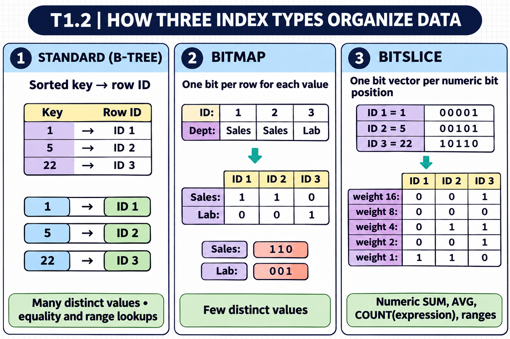
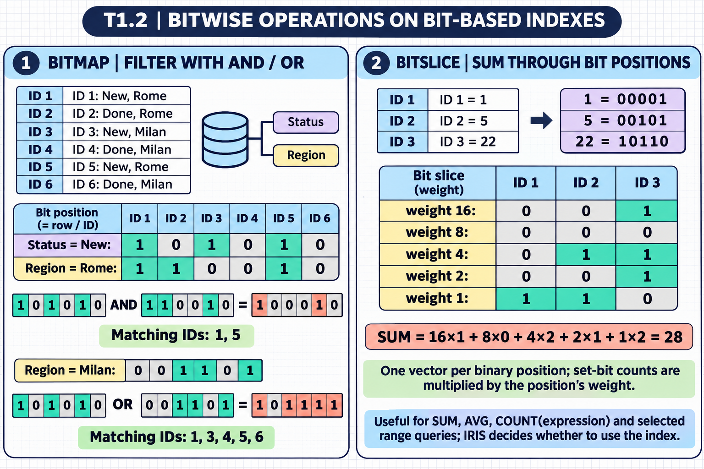

[Topic contents](../index.md) · [Full topic guide](../study.md) · [All topics](../../../index.md)

# T1.2: Creates Properties and Indexes

Saved 2 November 2026 from [exam-prep.es](https://exam-prep.es/exams/objectscript/knowledge/T1.2.html). Reference links require internet access.

## 5. Selects appropriate index type based on data distribution (standard, bitmap, bitslice)


*This diagram covers sections 5–7; use the matching numbered panel for this page.* [Chapter diagrams](../visuals.md) · [Technical review notes](../../../visual-technical-notes.md)





### Key Points

- **Standard index** (B-tree): Best for high-cardinality data (many unique values); supports equality and range queries
- **Bitmap index**: Best for low-cardinality data (few distinct values); excellent for complex AND/OR queries
- **Bitslice index**: Specialized for aggregate operations (SUM, COUNT, AVG) on numeric data
- Index type selection depends on data distribution, query patterns, and update frequency
- Bitmap indexes require a positive integer ID (system-assigned, not custom)

### Detailed Notes

#### Overview

Indexes dramatically improve query performance, but choosing the wrong index type can waste storage and slow down write operations. Understanding the characteristics of each index type and matching them to data patterns is crucial.

#### Standard (B-tree) Indexes

Standard indexes organize data in a balanced tree structure, making them efficient for:

- Equality lookups (`WHERE Name = 'Smith'`)
- Range queries (`WHERE Age > 30 AND Age < 50`)
- Sorting operations (`ORDER BY`)
- High-cardinality columns (many unique values like names, dates, IDs)

```objectscript
Index NameIdx On Name;
Index DOBIdx On DOB;
Index CompoundIdx On (LastName, FirstName);
```

#### Bitmap Indexes

Bitmap indexes use bit strings where each bit represents a row. They are extremely efficient for:

- Low-cardinality columns (gender, status, category, state codes)
- Complex queries combining multiple conditions with AND/OR
- COUNT operations

```objectscript
Index GenderIdx On Gender [ Type = bitmap ];
Index StatusIdx On Status [ Type = bitmap ];
Index StateIdx On State [ Type = bitmap ];
```

Requirements and limitations:

- The class must use system-assigned positive integer IDs (default behavior)
- Not suitable for high-cardinality data (would create huge bit strings)
- INSERT/UPDATE/DELETE operations are somewhat slower due to bit manipulation
- Cannot be used on properties that exceed ~3.6M distinct values

A query like `SELECT COUNT(*) FROM Patients WHERE Gender = 'F' AND State = 'CA'` performs a fast bitwise AND on two bitmap indexes.

#### Bitslice Indexes

Bitslice indexes decompose numeric values into their binary representation, storing each bit position separately. They accelerate:

- SUM aggregation
- COUNT with conditions on the indexed value
- AVG computations (derived from SUM/COUNT)

```objectscript
Index AmountBSIdx On Amount [ Type = bitslice ];
```

A query like `SELECT SUM(Amount) FROM Orders WHERE Status = 'Shipped'` can combine a bitmap index on Status with a bitslice index on Amount for extremely fast execution.

#### Index Selection Decision Matrix

| Data Characteristic | Recommended Index Type |
| --- | --- |
| High cardinality (names, dates, IDs) | Standard |
| Low cardinality (gender, status, type) | Bitmap |
| Numeric aggregation (amounts, quantities) | Bitslice |
| Frequent equality + range queries | Standard |
| Complex AND/OR filtering | Bitmap (on multiple properties) |
| Rarely updated reference data | Bitmap (ideal) |
| Frequently updated data | Standard (lower write overhead) |

#### Building and Rebuilding Indexes

```objectscript
// Rebuild all indexes for a class
Do ##class(Sample.Person).%BuildIndices()

// Rebuild specific index
Do ##class(Sample.Person).%BuildIndices($ListBuild("NameIdx"))

// Purge and rebuild
Do ##class(Sample.Person).%PurgeIndices()
Do ##class(Sample.Person).%BuildIndices()
```

### Documentation References

- [Index Definitions](https://docs.intersystems.com/irislatest/csp/docbook/DocBook.UI.Page.cls?KEY=GSOD_indexes)
- [Bitmap Indexes](https://docs.intersystems.com/irislatest/csp/docbook/DocBook.UI.Page.cls?KEY=GSOD_indexes)
