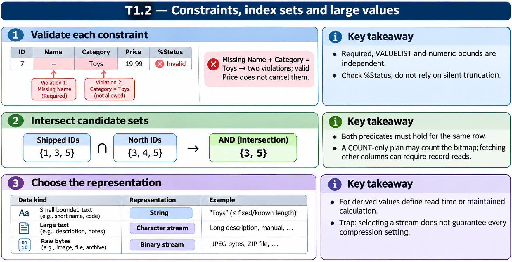

# T1.2 · 01 — La validazione è parte del contratto

[Indice degli approfondimenti](README.md) · [Quiz originale](../quiz.md) · [Teoria](../study.md)

**Esercizi di partenza:** [Q1](../quiz.md#question-1-single) · [Q3](../quiz.md#question-3-single) · [Q13](../quiz.md#question-13-single) · [Q16](../quiz.md#question-16-single) · [Q17](../quiz.md#question-17-single) · [Q18](../quiz.md#question-18-single). L’approfondimento rielabora il concetto e aggiunge una variante; non riproduce soltanto la risposta del quiz.

## Il caso concreto

Nel prodotto del quiz manca Name e Category vale Toys, escluso dalla VALUELIST; Price invece è nel range. Nell’impiegato Salary=25000 viola MINVAL=30000.

```objectscript
Property Name As %String(MAXLEN = 200) [ Required ];
Property Salary As %Numeric(MINVAL = 30000);
```

## Ragionamento passo per passo

Valuta ogni proprietà separatamente. Required controlla un requisito diverso dal range numerico e dall’elenco dei valori. Il fatto che l’assegnazione in memoria sia avvenuta non prova che %Save avrà successo. InitialExpression agisce sulla nuova istanza, non corregge dati già persistiti.

## Perché il distrattore è plausibile

Pensare che l’assenza di un’eccezione nell’assegnazione garantisca un salvataggio valido o che un default sia una migrazione.

## Lo spunto da portare oltre l’esercizio

Il risultato da osservare è lo status dell’operazione; i vincoli vanno controllati tutti, senza fermarsi al primo campo apparentemente plausibile.



*Leggi il pannello 1; gli altri due collegano il caso agli altri approfondimenti del capitolo.*

## Variante: prova prima di leggere la soluzione

Name è presente, Category è valida, Salary=29999. Il solo fatto che Salary sia un numero rende valido il record?

<details>
<summary>Soluzione ragionata</summary>

No: il tipo numerico e il vincolo MINVAL sono requisiti distinti.

</details>

## Riferimenti e precisazioni

- [Tipi di dato e vincoli](https://docs.intersystems.com/irislatest/csp/docbook/DocBook.UI.Page.cls?KEY=GOBJ_datatypes)
- [Tabelle e indici](https://docs.intersystems.com/irislatest/csp/docbook/DocBook.UI.Page.cls?KEY=GSQL_tables)
- [Proprietà stream](https://docs.intersystems.com/irislatest/csp/docbook/DocBook.UI.Page.cls?KEY=GOBJ_propstream)

[Note specifiche del capitolo](README.md#precisazioni-rispetto-al-quiz) · [Metodo e limiti della revisione](../../../approfondimenti-esercizi.md#metodo-e-limiti)
