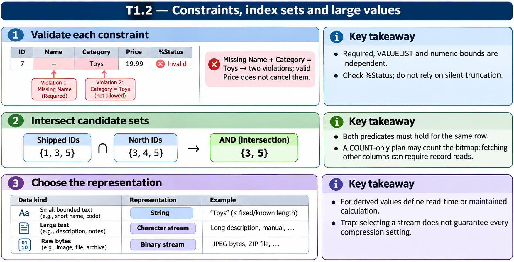

# T1.2 · 02 — Un indice risponde a una domanda specifica

[Indice degli approfondimenti](README.md) · [Quiz originale](../quiz.md) · [Teoria](../study.md)

**Esercizi di partenza:** [Q6](../quiz.md#question-6-single) · [Q7](../quiz.md#question-7-single) · [Q8](../quiz.md#question-8-single) · [Q11](../quiz.md#question-11-single) · [Q15](../quiz.md#question-15-multiple). L’approfondimento rielabora il concetto e aggiunge una variante; non riproduce soltanto la risposta del quiz.

## Il caso concreto

Due bitmap rappresentano gli ID con Status=Shipped e Region=North. L’intersezione individua i candidati; un indice composto serve invece un diverso tipo di ricerca.

## Ragionamento passo per passo

Usa insiemi concreti: Shipped={1,3,5}, North={3,4,5}; AND={3,5}. Un indice composto (SensorId,ReadingTime) può essere utile per SensorId uguale a un valore e intervallo temporale sul secondo campo. L’ordine dei campi conta. La lettura finale della riga dipende dalle colonne richieste e dalla copertura del piano.

## Perché il distrattore è plausibile

Dire che qualunque bitmap evita sempre ogni lettura dei dati, o che l’ordine delle colonne di un indice composto non cambia nulla.

## Lo spunto da portare oltre l’esercizio

Parti da filtro, cardinalità e colonne restituite; poi scegli la struttura di accesso.

*Leggi il pannello 2; gli altri due collegano il caso agli altri approfondimenti del capitolo.*

## Variante: prova prima di leggere la soluzione

Con Shipped={2,4,6} e North={1,4,6}, quali ID soddisfano entrambe le condizioni?

Soluzione ragionata

{4,6}. Per ottenere proprietà non coperte dal piano possono servire letture delle righe.

## Riferimenti e precisazioni

- [Tipi di dato e vincoli](https://docs.intersystems.com/irislatest/csp/docbook/DocBook.UI.Page.cls?KEY=GOBJ_datatypes)
- [Tabelle e indici](https://docs.intersystems.com/irislatest/csp/docbook/DocBook.UI.Page.cls?KEY=GSQL_tables)
- [Proprietà stream](https://docs.intersystems.com/irislatest/csp/docbook/DocBook.UI.Page.cls?KEY=GOBJ_propstream)

[Note specifiche del capitolo](README.md#precisazioni-rispetto-al-quiz) · [Metodo e limiti della revisione](../../../approfondimenti-esercizi.md#metodo-e-limiti)
