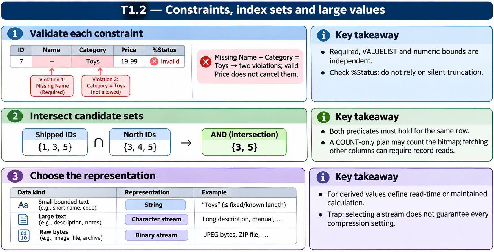

# T1.2 · 03 — Stringa, stream e valore derivato

[Indice degli approfondimenti](README.md) · [Quiz originale](../quiz.md) · [Teoria](../study.md)

**Esercizi di partenza:** [Q2](../quiz.md#question-2-single) · [Q4](../quiz.md#question-4-single) · [Q5](../quiz.md#question-5-single) · [Q12](../quiz.md#question-12-single) · [Q14](../quiz.md#question-14-single). L’approfondimento rielabora il concetto e aggiunge una variante; non riproduce soltanto la risposta del quiz.

## Il caso concreto

Un report di megabyte e un FullName ricavato da due nomi pongono due problemi distinti: volume del dato e origine del valore.

```objectscript
do report.Write("Introduzione")
do report.Write($CHAR(10))
do report.Write("Risultati")
do report.Rewind()
set first = report.Read(12)
```

## Ragionamento passo per passo

Per contenuti grandi usa l’API stream, leggendo e scrivendo a blocchi. Per un valore derivato chiediti chi lo calcola, quando viene aggiornato e se viene memorizzato: una formula SQL non è automaticamente un getter ObjectScript. Il codice è un frammento che presuppone report già inizializzato come stream.

## Perché il distrattore è plausibile

Usare %String come se avesse capacità illimitata o assumere che tutti i computed siano memorizzati e aggiornati nello stesso modo.

## Lo spunto da portare oltre l’esercizio

Dimensione, posizione di lettura e politica di calcolo sono tre decisioni indipendenti.



*Leggi il pannello 3; gli altri due collegano il caso agli altri approfondimenti del capitolo.*

## Variante: prova prima di leggere la soluzione

Aggiungi un campo derivato a una tabella esistente. La sua formula dimostra che tutti i vecchi record sono già materializzati?

<details>
<summary>Soluzione ragionata</summary>

No: occorre verificare le keyword e il meccanismo di aggiornamento, ed eventualmente ricostruire i dati.

</details>

## Riferimenti e precisazioni

- [Tipi di dato e vincoli](https://docs.intersystems.com/irislatest/csp/docbook/DocBook.UI.Page.cls?KEY=GOBJ_datatypes)
- [Tabelle e indici](https://docs.intersystems.com/irislatest/csp/docbook/DocBook.UI.Page.cls?KEY=GSQL_tables)
- [Proprietà stream](https://docs.intersystems.com/irislatest/csp/docbook/DocBook.UI.Page.cls?KEY=GOBJ_propstream)

[Note specifiche del capitolo](README.md#precisazioni-rispetto-al-quiz) · [Metodo e limiti della revisione](../../../approfondimenti-esercizi.md#metodo-e-limiti)
