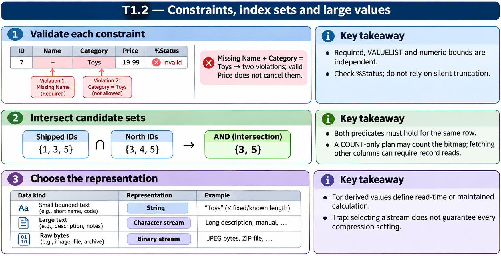
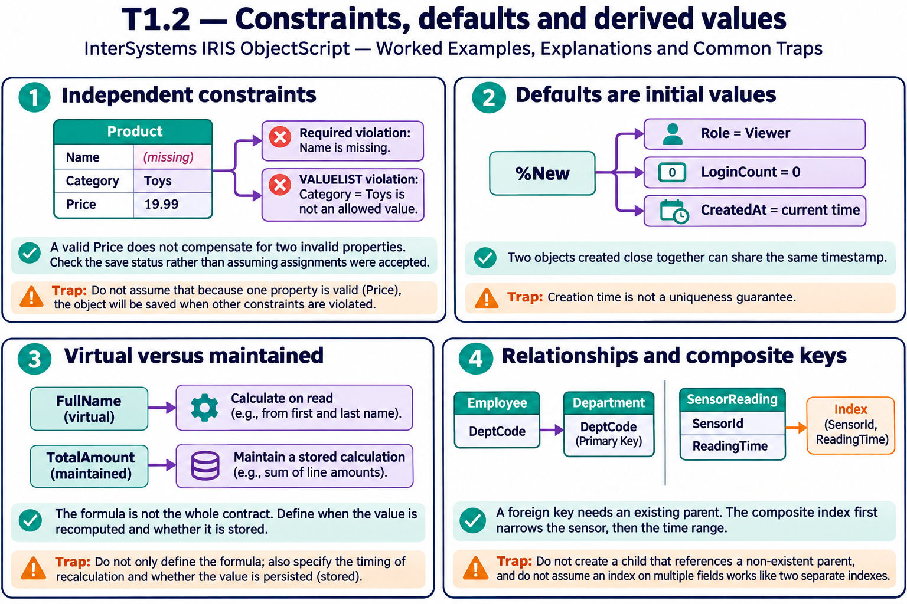

# T1.2 — Approfondimenti dagli esercizi

## Tutte le 18 domande approfondite

[Apri le schede domanda per domanda](<Domanda per domanda/README.md>) · [Tavole spiegate in inglese](tavole-esercizi.md)

Ogni domanda dispone ora di un commento specifico, un concetto ulteriore e una variante con soluzione. I tre casi seguenti sono percorsi tematici aggiuntivi. Le immagini sono in inglese.

[Teoria](../study.md) · [Quiz](../quiz.md) · [Tutti gli approfondimenti](../../../approfondimenti-esercizi.md)

Tre percorsi trasversali, da affiancare alle schede individuali, per capire il meccanismo dietro le risposte: scenario, ragionamento, distrattore, regola riutilizzabile e variante con soluzione. I riferimenti Q rimandano al quiz scaricato; la numerazione è locale al capitolo.

[Leggi esempi e spiegazioni dei pannelli](tavole-esercizi.md).

## Percorso consigliato

1. [La validazione è parte del contratto](<01 - La validazione è parte del contratto.md>) — Q1, Q3, Q13, Q16, Q17, Q18
2. [Un indice risponde a una domanda specifica](<02 - Un indice risponde a una domanda specifica.md>) — Q6, Q7, Q8, Q11, Q15
3. [Stringa, stream e valore derivato](<03 - Stringa, stream e valore derivato.md>) — Q2, Q4, Q5, Q12, Q14

[Indice di tutte le 18 domande del capitolo](mappa-domande.md). I percorsi sono tematici; ogni domanda ha inoltre una scheda individuale nella sottocartella dedicata.

## Precisazioni rispetto al quiz

Q1 e Q16: non fare affidamento sul troncamento; controllare lo status di validazione/salvataggio. Q2: la scelta di uno stream globale non autorizza una promessa universale sulla compressione. Q4–5: computed e calculated richiedono di distinguere proiezione SQL, accessor ObjectScript e keyword di memorizzazione.

Queste precisazioni si applicano agli approfondimenti nuovi. Il testo delle risposte scaricate rimane una testimonianza della fonte e non viene riscritto silenziosamente.

## Documentazione

- [Tipi di dato e vincoli](https://docs.intersystems.com/irislatest/csp/docbook/DocBook.UI.Page.cls?KEY=GOBJ_datatypes)
- [Tabelle e indici](https://docs.intersystems.com/irislatest/csp/docbook/DocBook.UI.Page.cls?KEY=GSQL_tables)
- [Proprietà stream](https://docs.intersystems.com/irislatest/csp/docbook/DocBook.UI.Page.cls?KEY=GOBJ_propstream)

Gli snippet sono frammenti didattici: quando usano classi di esempio o macro, presuppongono le relative definizioni e include. Non costituiscono implementazioni complete né sono stati eseguiti in IRIS.
