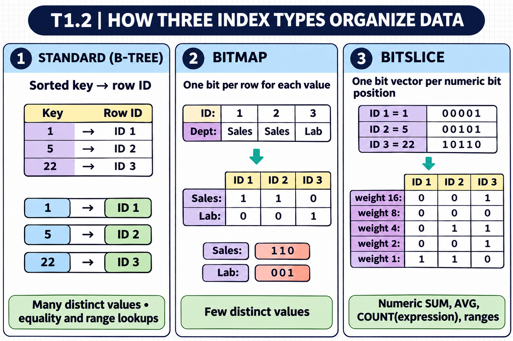
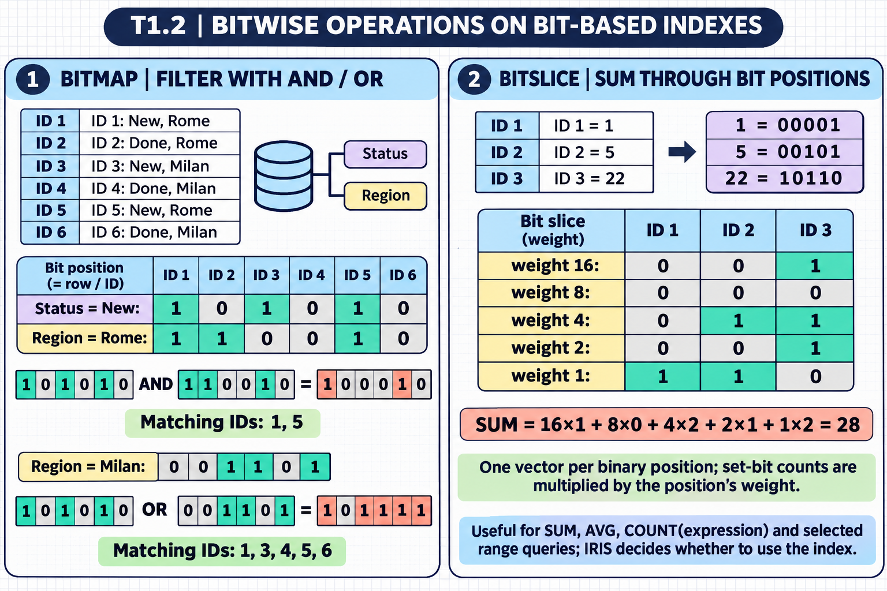

[All topics](../../index.md) · [Practice quiz](quiz.md)

# T1.2: Creates Properties and Indexes

[Approfondimenti dagli esercizi](<Approfondimenti esercizi/README.md>)

Saved 2 November 2026 from [exam-prep.es](https://exam-prep.es/exams/objectscript/knowledge/T1.2.html). Reference links require internet access.

### Contents

1. [Sets max length for string properties (MAXLEN parameter, TRUNCATE)](#1-sets-max-length-for-string-properties-maxlen-parameter-truncate)
2. [Uses stream properties for large data sets (%Stream.GlobalCharacter, %Stream.FileBinary)](#2-uses-stream-properties-for-large-data-sets-streamglobalcharacter-streamfilebinary)
3. [Creates properties that calculate values dynamically or are auto-updated (Calculated, SqlComputed, SqlComputeOnChange)](#3-creates-properties-that-calculate-values-dynamically-or-are-auto-updated-calculated-sqlcomputed-sqlcomputeonchange)
4. [Creates and validates class member parameters and attributes (Required, InitialExpression, parameter keywords)](#4-creates-and-validates-class-member-parameters-and-attributes-required-initialexpression-parameter-keywords)
5. [Selects appropriate index type based on data distribution (standard, bitmap, bitslice)](#5-selects-appropriate-index-type-based-on-data-distribution-standard-bitmap-bitslice)
6. [Uses unique index methods (unique index, %ExistsId)](#6-uses-unique-index-methods-unique-index-existsid)
7. [Recalls how foreign keys enforce referential integrity (ForeignKey, OnDelete, NoAction, Cascade)](#7-recalls-how-foreign-keys-enforce-referential-integrity-foreignkey-ondelete-noaction-cascade)

### Visual study guide — sections 1–4


[View all chapter diagrams](visuals.md) · [Technical review notes](../../visual-technical-notes.md)

## 1. Sets max length for string properties (MAXLEN parameter, TRUNCATE)

### Key Points

- **MAXLEN** parameter controls the maximum length of a %String property (default is 50 characters)
- Setting `MAXLEN = ""` sets the limit to the maximum IRIS string length (~3.6 million characters)
- **TRUNCATE** parameter determines whether values exceeding MAXLEN are silently truncated or rejected
- MAXLEN affects SQL column definitions (VARCHAR size)
- Always set MAXLEN explicitly when the default of 50 is insufficient

### Detailed Notes

#### Overview

String properties in InterSystems IRIS have a default maximum length of 50 characters, which is often insufficient for real-world data. The `MAXLEN` parameter controls this limit and directly affects both object validation and the SQL column definition.

#### Setting MAXLEN

```objectscript
Class Sample.Patient Extends %Persistent
{
    /// Name with explicit max length
    Property Name As %String(MAXLEN = 200);

    /// Description with maximum IRIS string length (~3.6 MB)
    Property Notes As %String(MAXLEN = "");

    /// Uses the default MAXLEN of 50
    Property Code As %String;
}
```

In SQL, `MAXLEN` maps to the `VARCHAR` size:

- `Property Name As %String(MAXLEN = 200)` becomes `VARCHAR(200)`
- `Property Notes As %String(MAXLEN = "")` becomes `VARCHAR(MAXVAL)` (maximum IRIS string length, ~3.6 million characters)

#### The TRUNCATE Parameter

The `TRUNCATE` parameter controls what happens when a value exceeds MAXLEN:

- **TRUNCATE = 0** (default): The value is rejected, and `%Save()` returns an error status
- **TRUNCATE = 1**: The value is silently truncated to MAXLEN characters

```objectscript
Property ShortCode As %String(MAXLEN = 5, TRUNCATE = 1);
```

With TRUNCATE = 1, setting `ShortCode` to `"ABCDEFGH"` would silently store `"ABCDE"`.

#### Practical Considerations

- Always verify MAXLEN is sufficient for production data; the default of 50 is a common source of data truncation bugs
- For properties that store variable-length text (descriptions, notes, addresses), consider using `MAXLEN = ""`
- When data may exceed the maximum IRIS string length (~3.6 million characters / ~3.6 MB) — such as large PDFs, images, or documents — use a stream property instead
- Changing MAXLEN on an existing property may require rebuilding indices that include that property

### Documentation References

- [String Data Type](https://docs.intersystems.com/irislatest/csp/docbook/DocBook.UI.Page.cls?KEY=GOBJ_datatypes)
- [Property Parameters](https://docs.intersystems.com/irislatest/csp/docbook/DocBook.UI.Page.cls?KEY=ROBJ_property)

## 2. Uses stream properties for large data sets (%Stream.GlobalCharacter, %Stream.FileBinary)

### Key Points

- **Streams** handle data too large for standard string properties (documents, images, files)
- **%Stream.GlobalCharacter**: Character data stored in globals (most common for text); **automatically compressed** by IRIS
- **%Stream.GlobalBinary**: Binary data stored in globals (images, PDFs stored in database); **automatically compressed** by IRIS
- **%Stream.FileCharacter**: Character data stored in external files on the file system (not compressed by default, but compressed subclasses exist)
- **%Stream.FileBinary**: Binary data stored in external files on the file system (not compressed by default, but compressed subclasses like `%Stream.FileBinaryGzip` exist)
- **Global-based streams are compressed automatically** — this is the recommended choice when IRIS compression is desired
- Streams use `Write()`, `Read()`, `Rewind()`, and `MoveToEnd()` methods instead of direct assignment
- **`WriteLine()`** is only available on character streams — it appends data followed by a line terminator

### Detailed Notes

#### Overview

When data exceeds the practical limits of a string property (or when handling binary content like images or documents), stream properties provide a chunked storage mechanism. Streams are read and written sequentially, making them suitable for large data that doesn't need random access.

#### Types of Streams

| Stream Class | Content Type | Storage Location | Compressed by IRIS |
| --- | --- | --- | --- |
| %Stream.GlobalCharacter | Text (character) | Database globals | Yes |
| %Stream.GlobalBinary | Binary | Database globals | Yes |
| %Stream.FileCharacter | Text (character) | External file system | No (by default) |
| %Stream.FileBinary | Binary | External file system | No (by default) |

#### Declaring Stream Properties

```objectscript
Class Sample.Document Extends %Persistent
{
    Property Title As %String(MAXLEN = 200);

    /// Large text content stored in globals
    Property Content As %Stream.GlobalCharacter;

    /// PDF file stored in the database
    Property Attachment As %Stream.GlobalBinary;
}
```

#### Writing to Streams

```objectscript
Set doc = ##class(Sample.Document).%New()
Set doc.Title = "My Report"

// Write text to the character stream
Do doc.Content.Write("This is the first paragraph of the report. ")
Do doc.Content.Write("This is the second paragraph.")
Do doc.Content.WriteLine("")  // adds a line with newline

// Save the object (stream data is saved with the object)
Set sc = doc.%Save()
```

#### Reading from Streams

```objectscript
Set doc = ##class(Sample.Document).%OpenId(1)

// Rewind to the beginning
Do doc.Content.Rewind()

// Read in chunks
While 'doc.Content.AtEnd {
    Set chunk = doc.Content.Read(32000)
    Write chunk
}
```

#### Key Stream Methods

- **Write(data)**: Appends data to the stream (all stream types)
- **WriteLine(data)**: Appends data followed by a line terminator (character streams only)
- **Read(len)**: Reads up to `len` characters/bytes from the current position
- **ReadLine()**: Reads one line of text
- **Rewind()**: Resets the read position to the beginning
- **MoveToEnd()**: Positions at the end for appending
- **Clear()**: Removes all content from the stream
- **Size**: Property that returns the total size of the stream
- **AtEnd**: Property that indicates whether the read position is at the end

#### File-Based Streams

```objectscript
// Write to an external file
Set fileStream = ##class(%Stream.FileCharacter).%New()
Set fileStream.Filename = "/tmp/output.txt"
Do fileStream.Write("Content for external file")
Set sc = fileStream.%Save()
```

#### Copying Between Streams

```objectscript
// Copy one stream to another
Do targetStream.CopyFrom(sourceStream)
```

#### Stream Compression

Global-based streams (`%Stream.GlobalCharacter` and `%Stream.GlobalBinary`) are **automatically compressed by IRIS** when stored in the database. This compression is transparent — data is compressed on write and decompressed on read without any additional code. This makes global-based streams the recommended choice when you want IRIS to handle compression automatically.

File-based streams (`%Stream.FileCharacter` and `%Stream.FileBinary`) are stored as regular files on the operating system's file system and are **not compressed by default**. However, IRIS provides compressed subclasses such as `%Stream.FileBinaryGzip` that store the file in gzip format.

**Exam tip**: When a question asks about storing large data that "should be automatically compressed by IRIS if possible," choose a global-based stream class (`%Stream.GlobalCharacter` for text, `%Stream.GlobalBinary` for binary data).

### Documentation References

- [Stream Classes](https://docs.intersystems.com/irislatest/csp/docbook/DocBook.UI.Page.cls?KEY=GOBJ_propstream)
- [%Stream.GlobalCharacter](https://docs.intersystems.com/irislatest/csp/docbook/DocBook.UI.Page.cls?KEY=GOBJ_propstream)

## 3. Creates properties that calculate values dynamically or are auto-updated (Calculated, SqlComputed, SqlComputeOnChange)

### Key Points

- **Calculated** properties have no storage; their value is computed each time via a custom Get method
- **SqlComputed** properties have a SQL compute code expression that provides the value in SQL context
- **SqlComputeOnChange** specifies which properties trigger recalculation on INSERT or UPDATE
- Calculated properties without SqlComputed will appear as NULL in SQL queries
- **Transient** properties exist in memory only (not stored) but differ from Calculated in that they can be set

### Detailed Notes

#### Overview

InterSystems IRIS provides several mechanisms for properties whose values are derived from other data rather than stored independently. Choosing the right mechanism depends on whether the value needs to be available in SQL, whether it should be stored for indexing, and when it should be recalculated.

#### Calculated Properties

A Calculated property has no storage. Each time the property is accessed, the system calls the property's Get method to compute the value.

```objectscript
Class Sample.Person Extends %Persistent
{
    Property FirstName As %String;
    Property LastName As %String;

    /// Full name computed on access
    Property FullName As %String [ Calculated, SqlComputeCode = {
        Set {*} = {FirstName} _ " " _ {LastName}
    }, SqlComputed ];

    Method FullNameGet() As %String
    {
        Return ..FirstName _ " " _ ..LastName
    }
}
```

Key characteristics:

- No storage allocated for the property
- `Get` method is called every time the property is accessed in ObjectScript
- Cannot be SET directly (no `Set` method)
- Must also specify `SqlComputed` and `SqlComputeCode` if the value should be visible in SQL

#### SqlComputed Properties

`SqlComputed` provides a value in the SQL context. Combined with storage, the value can be indexed.

```objectscript
Property AgeGroup As %String [ SqlComputeCode = {
    Set {*} = $Select({Age}<18:"Minor", {Age}<65:"Adult", 1:"Senior")
}, SqlComputed, SqlComputeOnChange = Age ];
```

In the `SqlComputeCode`:

- `{*}` refers to the property being computed
- `{PropertyName}` refers to other properties in the same class
- `{%%INSERT}` is true during INSERT operations
- `{%%UPDATE}` is true during UPDATE operations

#### SqlComputeOnChange

This keyword specifies which property changes should trigger recalculation:

```objectscript
Property TotalPrice As %Numeric [ SqlComputeCode = {
    Set {*} = {Quantity} * {UnitPrice}
}, SqlComputed, SqlComputeOnChange = (Quantity, UnitPrice) ];
```

- When `Quantity` or `UnitPrice` changes (via INSERT or UPDATE), `TotalPrice` is automatically recomputed
- Specify `%%INSERT` to only compute on new records
- Specify multiple trigger properties in parentheses
- Without `SqlComputeOnChange`, the value is computed on every INSERT and UPDATE

#### Stored Computed vs Calculated

| Feature | Calculated + SqlComputed | SqlComputed (not Calculated) |
| --- | --- | --- |
| Value stored on disk | No | Yes |
| Can be indexed | No | Yes |
| SQL visibility | Computed on each query | Stored, fast retrieval |
| Object access | Via Get method | Direct from storage |

#### Transient Properties

Transient properties are in-memory only (not stored) but unlike Calculated properties, they can be set:

```objectscript
Property TempResult As %String [ Transient ];
```

### Documentation References

- [Calculated Properties](https://docs.intersystems.com/irislatest/csp/docbook/DocBook.UI.Page.cls?KEY=GOBJ_datatypes)
- [SqlComputed Properties](https://docs.intersystems.com/irislatest/csp/docbook/DocBook.UI.Page.cls?KEY=GSQL_tables)

## 4. Creates and validates class member parameters and attributes (Required, InitialExpression, parameter keywords)

### Key Points

- **Required** keyword ensures a property must have a value before %Save() succeeds
- **InitialExpression** sets a default value when %New() creates an object
- **Property parameters** (MAXLEN, MINVAL, MAXVAL, VALUELIST, etc.) constrain allowed values
- **Class parameters** define constants accessible throughout the class via `..#ParamName`
- Validation occurs during %Save() and respects all constraints

### Detailed Notes

#### Overview

Class members in InterSystems IRIS can be configured with various keywords and parameters that control validation, default values, and behavior. These attributes are essential for building robust data models that enforce business rules at the object level.

#### The Required Keyword

When a property is marked `Required`, `%Save()` will fail if the property has no value:

```objectscript
Class Sample.Order Extends %Persistent
{
    Property OrderNumber As %String [ Required ];
    Property CustomerName As %String [ Required ];
    Property OrderDate As %Date [ InitialExpression = {+$HOROLOG} ];
    Property Status As %String [ InitialExpression = "NEW" ];
}
```

Attempting to save without setting `OrderNumber` or `CustomerName` returns a `%Status` error.

#### InitialExpression

`InitialExpression` provides a default value assigned when `%New()` creates an instance:

```objectscript
Property CreatedDate As %Date [ InitialExpression = {+$HOROLOG} ];
Property Active As %Boolean [ InitialExpression = 1 ];
Property Counter As %Integer [ InitialExpression = 0 ];
```

Note: Expressions within `{ }` are evaluated at runtime. Without braces, the value is a literal constant.

#### Common Property Parameters

```objectscript
Class Sample.Product Extends %Persistent
{
    /// String with constrained length
    Property Name As %String(MAXLEN = 100, MINLEN = 1);

    /// Numeric with range constraints
    Property Price As %Numeric(MAXVAL = 99999.99, MINVAL = 0, SCALE = 2);

    /// Enumerated values
    Property Category As %String(VALUELIST = ",Electronics,Clothing,Food,Other");

    /// Display values for the enumeration
    Property Priority As %String(
        VALUELIST = ",H,M,L",
        DISPLAYLIST = ",High,Medium,Low"
    );

    /// Pattern-matched string
    Property ZipCode As %String(PATTERN = "5N.1(1""-""4N)");
}
```

#### Class Parameters

Class parameters define constants for the entire class:

```objectscript
Class Sample.Config Extends %Persistent
{
    Parameter DEFAULTCATEGORY = "General";
    Parameter MAXRETRIES As %Integer = 3;
    Parameter TABLENAME = "Products";

    Method GetCategory() As %String
    {
        Return ..#DEFAULTCATEGORY
    }
}
```

Parameters can be overridden in subclasses:

```objectscript
Class Sample.SpecialConfig Extends Sample.Config
{
    Parameter DEFAULTCATEGORY = "Special";
}
```

#### Validation Behavior

Validation occurs at several points: 1. **Property Set**: Type checking happens when a property value is set 2. **%Save()**: Required checks, VALUELIST validation, MAXLEN/MINLEN checks 3. **%ValidateObject()**: Can be called explicitly to validate without saving 4. **SQL INSERT/UPDATE**: Same validation applies through SQL operations

```objectscript
Set order = ##class(Sample.Order).%New()
// OrderNumber is Required but not set
Set sc = order.%Save()
// sc contains an error - Required field missing
If $$$ISERR(sc) {
    Do $System.Status.DisplayError(sc)
    // Displays: "ERROR #7201: Property 'OrderNumber' required"
}
```

### Documentation References

- [Property Keywords](https://docs.intersystems.com/irislatest/csp/docbook/DocBook.UI.Page.cls?KEY=ROBJ_property)
- [Class Parameters](https://docs.intersystems.com/irislatest/csp/docbook/DocBook.UI.Page.cls?KEY=GOBJ_classes_parameters)

### Visual study guide — sections 5–7


[View all chapter diagrams](visuals.md) · [Technical review notes](../../visual-technical-notes.md)

## 5. Selects appropriate index type based on data distribution (standard, bitmap, bitslice)





### Key Points

- **Standard index** (B-tree): Best for high-cardinality data (many unique values); supports equality and range queries
- **Bitmap index**: Best for low-cardinality data (few distinct values); excellent for complex AND/OR queries
- **Bitslice index**: Specialized for aggregate operations (SUM, COUNT, AVG) on numeric data
- Index type selection depends on data distribution, query patterns, and update frequency
- Bitmap indexes require a positive integer ID (system-assigned, not custom)

### Detailed Notes

#### Overview

Indexes dramatically improve query performance, but choosing the wrong index type can waste storage and slow down write operations. Understanding the characteristics of each index type and matching them to data patterns is crucial.

#### Standard (B-tree) Indexes

Standard indexes organize data in a balanced tree structure, making them efficient for:

- Equality lookups (`WHERE Name = 'Smith'`)
- Range queries (`WHERE Age > 30 AND Age < 50`)
- Sorting operations (`ORDER BY`)
- High-cardinality columns (many unique values like names, dates, IDs)

```objectscript
Index NameIdx On Name;
Index DOBIdx On DOB;
Index CompoundIdx On (LastName, FirstName);
```

#### Bitmap Indexes

Bitmap indexes use bit strings where each bit represents a row. They are extremely efficient for:

- Low-cardinality columns (gender, status, category, state codes)
- Complex queries combining multiple conditions with AND/OR
- COUNT operations

```objectscript
Index GenderIdx On Gender [ Type = bitmap ];
Index StatusIdx On Status [ Type = bitmap ];
Index StateIdx On State [ Type = bitmap ];
```

Requirements and limitations:

- The class must use system-assigned positive integer IDs (default behavior)
- Not suitable for high-cardinality data (would create huge bit strings)
- INSERT/UPDATE/DELETE operations are somewhat slower due to bit manipulation
- Cannot be used on properties that exceed ~3.6M distinct values

A query like `SELECT COUNT(*) FROM Patients WHERE Gender = 'F' AND State = 'CA'` performs a fast bitwise AND on two bitmap indexes.

#### Bitslice Indexes

Bitslice indexes decompose numeric values into their binary representation, storing each bit position separately. They accelerate:

- SUM aggregation
- COUNT with conditions on the indexed value
- AVG computations (derived from SUM/COUNT)

```objectscript
Index AmountBSIdx On Amount [ Type = bitslice ];
```

A query like `SELECT SUM(Amount) FROM Orders WHERE Status = 'Shipped'` can combine a bitmap index on Status with a bitslice index on Amount for extremely fast execution.

#### Index Selection Decision Matrix

| Data Characteristic | Recommended Index Type |
| --- | --- |
| High cardinality (names, dates, IDs) | Standard |
| Low cardinality (gender, status, type) | Bitmap |
| Numeric aggregation (amounts, quantities) | Bitslice |
| Frequent equality + range queries | Standard |
| Complex AND/OR filtering | Bitmap (on multiple properties) |
| Rarely updated reference data | Bitmap (ideal) |
| Frequently updated data | Standard (lower write overhead) |

#### Building and Rebuilding Indexes

```objectscript
// Rebuild all indexes for a class
Do ##class(Sample.Person).%BuildIndices()

// Rebuild specific index
Do ##class(Sample.Person).%BuildIndices($ListBuild("NameIdx"))

// Purge and rebuild
Do ##class(Sample.Person).%PurgeIndices()
Do ##class(Sample.Person).%BuildIndices()
```

### Documentation References

- [Index Definitions](https://docs.intersystems.com/irislatest/csp/docbook/DocBook.UI.Page.cls?KEY=GSOD_indexes)
- [Bitmap Indexes](https://docs.intersystems.com/irislatest/csp/docbook/DocBook.UI.Page.cls?KEY=GSOD_indexes)

## 6. Uses unique index methods (unique index, %ExistsId)

### Key Points

- A **unique index** enforces that no two objects can have the same value for the indexed property
- Unique indexes automatically generate `Exists` methods for checking existence
- **%ExistsId(id)** checks if an object with a given ID exists without opening it
- Unique indexes project as SQL UNIQUE constraints
- The **IdKey** index type makes the indexed properties the object ID

### Detailed Notes

#### Overview

Unique indexes enforce data integrity by preventing duplicate values. They also provide efficient existence-checking methods. Understanding unique indexes is important for both data modeling and performance optimization.

#### Defining a Unique Index

```objectscript
Class Sample.Employee Extends %Persistent
{
    Property EmployeeID As %String [ Required ];
    Property SSN As %String [ Required ];
    Property Email As %String;

    /// Ensure no duplicate EmployeeIDs
    Index EmployeeIDIdx On EmployeeID [ Unique ];

    /// Ensure no duplicate SSNs
    Index SSNIdx On SSN [ Unique ];

    /// Compound unique index
    Index NameDOBIdx On (LastName, FirstName, DOB) [ Unique ];
}
```

If you attempt to save an object with a duplicate value in a unique-indexed property, `%Save()` returns an error.

#### Generated Existence Methods

For each unique index, the class compiler generates an `Exists` method:

```objectscript
// Check if an employee with EmployeeID "E12345" exists
If ##class(Sample.Employee).EmployeeIDIdxExists("E12345", .id) {
    Write "Employee exists with ID: ", id, !
}
```

The `Exists` method:

- Takes the indexed property value(s) as input
- Returns a boolean (1 = exists, 0 = does not exist)
- Optionally returns the object ID via an output parameter

#### %ExistsId() for ID-Based Checks

The `%ExistsId()` class method checks if an object with a specific ID exists without opening it:

```objectscript
If ##class(Sample.Employee).%ExistsId(42) {
    Write "Object 42 exists", !
} Else {
    Write "Object 42 does not exist", !
}
```

This is much more efficient than opening the object to check existence, as it only checks the global node without loading data into memory.

#### IdKey Indexes

An `IdKey` index makes the indexed properties the actual object identifier instead of the system-assigned integer:

```objectscript
Class Sample.Country Extends %Persistent
{
    Property Code As %String(MAXLEN = 3);
    Property Name As %String(MAXLEN = 100);

    Index CodeIdx On Code [ IdKey ];
}
```

With an IdKey index:

- `Code` becomes the object ID: `Set country = ##class(Sample.Country).%OpenId("USA")`
- No system-assigned integer ID
- Bitmap indexes cannot be used (IDs are not positive integers)
- The IdKey property cannot be modified after saving

#### Unique Index vs Primary Key in SQL

A unique index projects as a SQL UNIQUE constraint. An `IdKey` index projects as the PRIMARY KEY. A class can have multiple unique indexes but only one IdKey.

### Documentation References

- [Unique Indexes](https://docs.intersystems.com/irislatest/csp/docbook/DocBook.UI.Page.cls?KEY=GSOD_indexes)
- [%ExistsId](https://docs.intersystems.com/irislatest/csp/docbook/DocBook.UI.Page.cls?KEY=GOBJ_storage)

## 7. Recalls how foreign keys enforce referential integrity (ForeignKey, OnDelete, NoAction, Cascade)

### Key Points

- **ForeignKey** defines a relationship between two persistent classes, enforcing that references are valid
- **OnDelete** controls behavior when the referenced object is deleted: NoAction, Cascade, SetNull
- **OnUpdate** controls behavior when the referenced key changes (rarely used since IDs are immutable)
- Foreign keys are validated during %Save() and enforced in SQL operations
- Foreign keys reference a **unique index or IdKey** in the target class

### Detailed Notes

#### Overview

Foreign keys enforce referential integrity by ensuring that relationships between objects remain valid. When a class declares a foreign key, it guarantees that the referenced object exists in the target class before the referencing object can be saved.

#### Defining Foreign Keys

```objectscript
Class Sample.Order Extends %Persistent
{
    Property OrderDate As %Date;
    Property CustomerID As %Integer;

    /// Foreign key referencing the Customer class
    ForeignKey CustomerFK(CustomerID)
        References Sample.Customer(CustomerIDIdx);
}

Class Sample.Customer Extends %Persistent
{
    Property CustomerID As %Integer;
    Property Name As %String;

    Index CustomerIDIdx On CustomerID [ Unique ];
}
```

The foreign key declaration specifies: 1. A name for the constraint (`CustomerFK`) 2. The local property(ies) (`CustomerID`) 3. The referenced class and unique index (`Sample.Customer(CustomerIDIdx)`)

#### OnDelete Actions

The `OnDelete` keyword controls what happens when a referenced (parent) object is deleted:

```objectscript
ForeignKey CustomerFK(CustomerID)
    References Sample.Customer(CustomerIDIdx)
    [ OnDelete = cascade ];
```

| OnDelete Value | Behavior |
| --- | --- |
| **noaction** (default) | Deletion fails if referencing objects exist |
| **cascade** | Referencing objects are automatically deleted |
| **setnull** | Foreign key property in referencing objects is set to NULL |
| **setdefault** | Foreign key property is set to its default value |

#### NoAction Example

```objectscript
// With NoAction (default), this fails if orders reference the customer
Set sc = ##class(Sample.Customer).%DeleteId(1)
// Returns error: "Foreign key constraint violation"
```

#### Cascade Example

```objectscript
// With Cascade, deleting a customer also deletes all their orders
ForeignKey CustomerFK(CustomerID)
    References Sample.Customer(CustomerIDIdx)
    [ OnDelete = cascade ];

// Deleting customer 1 also deletes all orders where CustomerID = 1
Set sc = ##class(Sample.Customer).%DeleteId(1)
```

#### Insert Validation

Foreign keys are checked on INSERT/SAVE. Attempting to save an order with a CustomerID that doesn't exist in the Customer table returns an error:

```objectscript
Set order = ##class(Sample.Order).%New()
Set order.CustomerID = 9999  // No such customer
Set sc = order.%Save()
// Error: foreign key constraint violation
```

#### Compound Foreign Keys

Foreign keys can reference compound (multi-property) unique indexes:

```objectscript
ForeignKey LocationFK(Country, City)
    References Sample.Location(CountryCityIdx);
```

#### Important Considerations

- Foreign keys add overhead to INSERT, UPDATE, and DELETE operations
- They are enforced at both the object level (%Save) and SQL level
- The referenced index must be a unique index or IdKey
- Foreign keys project as SQL FOREIGN KEY constraints
- Use them judiciously: they improve data integrity but impact write performance

### Documentation References

- [Foreign Keys](https://docs.intersystems.com/irislatest/csp/docbook/DocBook.UI.Page.cls?KEY=ROBJ_foreignkey)
- [Referential Integrity](https://docs.intersystems.com/irislatest/csp/docbook/DocBook.UI.Page.cls?KEY=GSQL_foreignkeys)

## Exam Preparation Summary

### Critical Concepts to Master:

1. Default MAXLEN for %String is 50; always set it explicitly for real-world properties
2. TRUNCATE = 1 silently cuts data; TRUNCATE = 0 (default) returns an error
3. Stream types: GlobalCharacter/GlobalBinary (database), FileCharacter/FileBinary (filesystem)
4. Stream I/O: Write(), Read(), Rewind(), AtEnd, Size
5. Calculated vs SqlComputed: Calculated has no storage; SqlComputed can be stored and indexed
6. SqlComputeOnChange determines when recomputation occurs
7. Required keyword causes %Save() to fail if property is empty
8. InitialExpression values in braces are evaluated at runtime
9. Standard indexes for high cardinality, bitmap for low cardinality, bitslice for aggregates
10. Bitmap indexes require positive integer IDs
11. Unique indexes generate Exists methods; %ExistsId() checks by ID
12. Foreign key OnDelete: noaction (default blocks delete), cascade (deletes children), setnull

### Common Exam Scenarios:

- Choosing between MAXLEN adjustment and a stream property for large data
- Identifying whether a computed property will be visible in SQL (needs SqlComputed + SqlComputeCode)
- Selecting the correct index type given a description of the data distribution
- Predicting what happens when you delete a parent object with foreign key constraints
- Determining if %Save() will succeed given Required properties and validation parameters

### Hands-On Practice Recommendations:

- Create properties with various MAXLEN settings and test boundary conditions
- Build a class with stream properties and practice Write/Read/Rewind operations
- Create Calculated and SqlComputed properties and query them via SQL to see the difference
- Set up bitmap and standard indexes, then compare query plans
- Define foreign keys with different OnDelete actions and test deletion behavior
