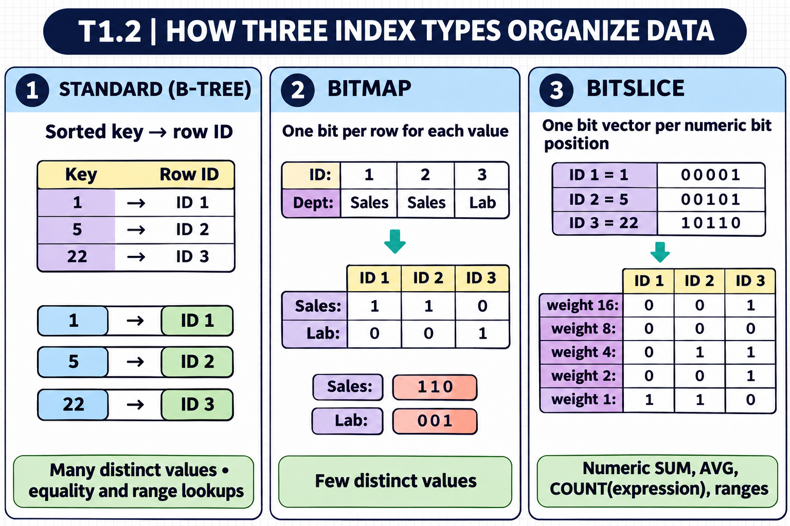
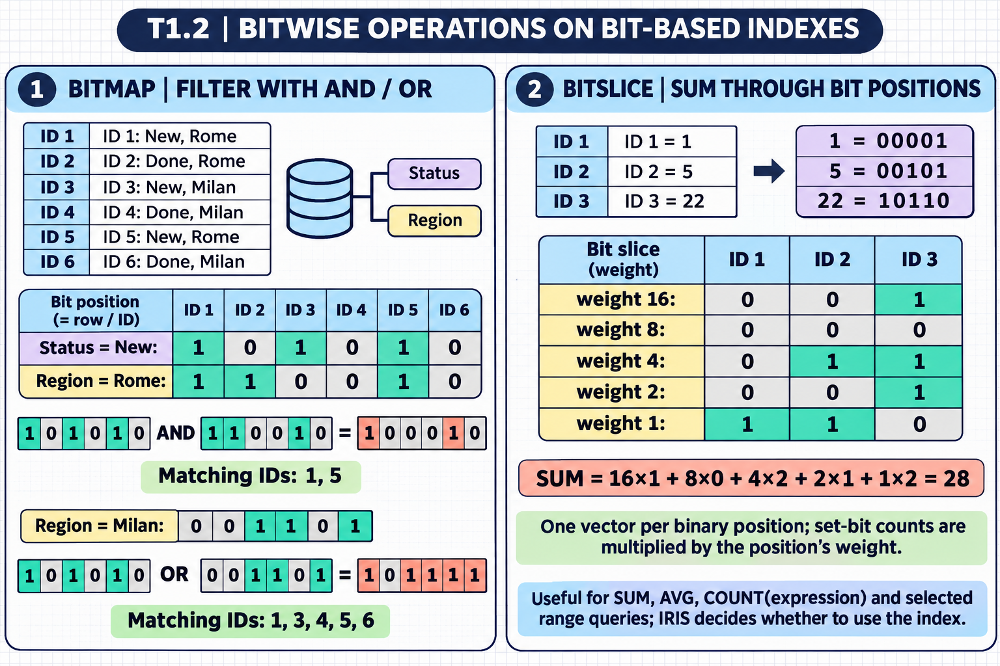

# T1.2: Creates Properties and Indexes — visual study guides

[Approfondimenti dagli esercizi](<Approfondimenti esercizi/README.md>)

[Chapter contents](index.md) · [Full guide](study.md) · [Practice questions](quiz.md)

Illustrated learning summaries. Read the full notes for detailed explanations and exact code. [Technical review notes](../../visual-technical-notes.md).

## Index diagrams — section 5

These two diagrams expand the index overview with concrete key-to-ID, bitmap, and bitslice layouts, then show bitmap `AND`/`OR` filtering and a bitslice sum. The sample bit vectors and arithmetic are shown as learning examples.

### Reusable style prompt

Scientific-educational infographic for the T1.2 ObjectScript study pack. Match the existing chapter guides: landscape 3:2 canvas, white background with a subtle pale-blue square grid, rounded navy title bar, pale-blue section headers, dark-navy sans-serif typography, crisp table borders, and flat vector-like technical diagrams. Use restrained blue, violet, teal, amber/coral, and green accents to group concepts; keep arrows precise, spacing generous, labels high-contrast and readable, and visual hierarchy consistent with the other chapter guides. No photorealism, decorative characters, logos, or watermarks. Preserve all supplied values, bit vectors, and arithmetic exactly.

## Visual guide — sections 1–4

Covers:

- 1. Sets max length for string properties (MAXLEN parameter, TRUNCATE)
- 2. Uses stream properties for large data sets (%Stream.GlobalCharacter, %Stream.FileBinary)
- 3. Creates properties that calculate values dynamically or are auto-updated (Calculated, SqlComputed, SqlComputeOnChange)
- 4. Creates and validates class member parameters and attributes (Required, InitialExpression, parameter keywords)

## Visual guide — sections 5–7

Covers:

- 5. Selects appropriate index type based on data distribution (standard, bitmap, bitslice)
- 6. Uses unique index methods (unique index, %ExistsId)
- 7. Recalls how foreign keys enforce referential integrity (ForeignKey, OnDelete, NoAction, Cascade)
