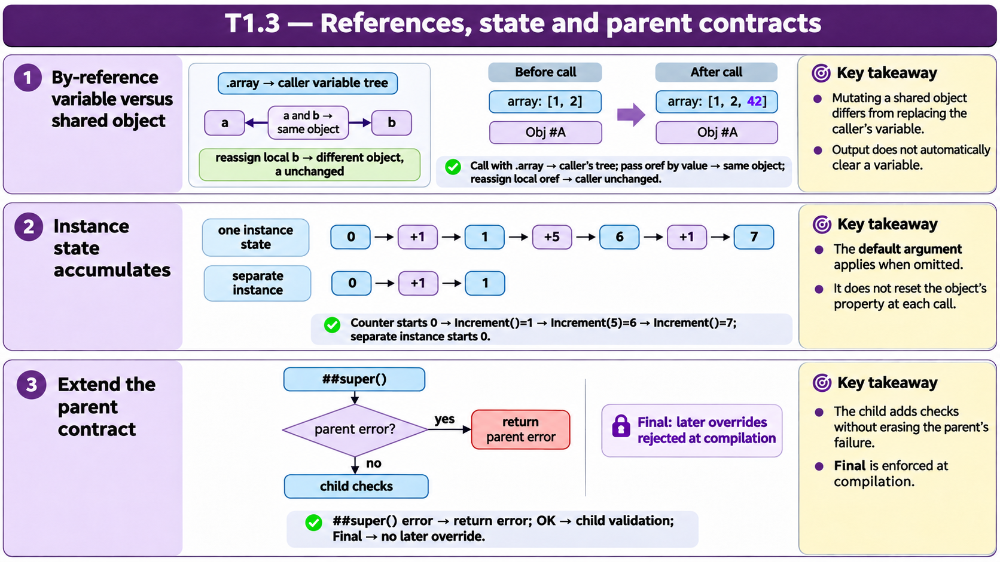

# T1.3 · 01 — Valore, riferimento e alias di un oggetto

[Indice degli approfondimenti](README.md) · [Quiz originale](../quiz.md) · [Teoria](../study.md)

**Esercizi di partenza:** [Q4](../quiz.md#question-4-single) · [Q6](../quiz.md#question-6-single) · [Q15](../quiz.md#question-15-single). L’approfondimento rielabora il concetto e aggiunge una variante; non riproduce soltanto la risposta del quiz.

## Il caso concreto

Il quiz confronta parametri scalari, un array passato con .myCount e due variabili che contengono lo stesso oref.

```objectscript
set myCount = 0
set myCount("extra") = 999
set sc = ##class(App.Reports).GetStats(.myCount)
```

## Ragionamento passo per passo

Nell’esempio GetStats scrive counts("total")=100 ma non tocca il valore al nodo radice né extra: restano 0 e 999. Per un oggetto, copiare l’oref crea un alias dello stesso oggetto: cambiare una proprietà attraverso un alias è osservabile dall’altro. Questo non equivale a sostituire la variabile del chiamante.

## Perché il distrattore è plausibile

Confondere una copia dell’oref con una copia profonda dell’oggetto o credere che scrivere un figlio elimini gli altri nodi dell’array.

## Lo spunto da portare oltre l’esercizio

Disegna separatamente la variabile, il riferimento e l’oggetto; per gli array indica esattamente i nodi modificati.



*Leggi il pannello 1; gli altri due collegano il caso agli altri approfondimenti del capitolo.*

## Variante: prova prima di leggere la soluzione

a e b puntano allo stesso oggetto. b.Status="Active". Cosa legge a.Status? Se invece b viene riassegnata a un altro oref, a cambia bersaglio?

<details>
<summary>Soluzione ragionata</summary>

a.Status legge Active; riassegnare b non cambia il riferimento contenuto in a.

</details>

## Riferimenti e precisazioni

- [Definizione e chiamata dei metodi](https://docs.intersystems.com/irislatest/csp/docbook/DocBook.UI.Page.cls?KEY=GOBJ_methods)
- [Invocazione e argomenti](https://docs.intersystems.com/irislatest/csp/docbook/DocBook.UI.Page.cls?KEY=GCOS_invoking)
- [Passaggio per riferimento](https://docs.intersystems.com/irislatest/csp/docbook/DocBook.UI.Page.cls?KEY=TOS_PassByRef)

[Note specifiche del capitolo](README.md#precisazioni-rispetto-al-quiz) · [Metodo e limiti della revisione](../../../approfondimenti-esercizi.md#metodo-e-limiti)
