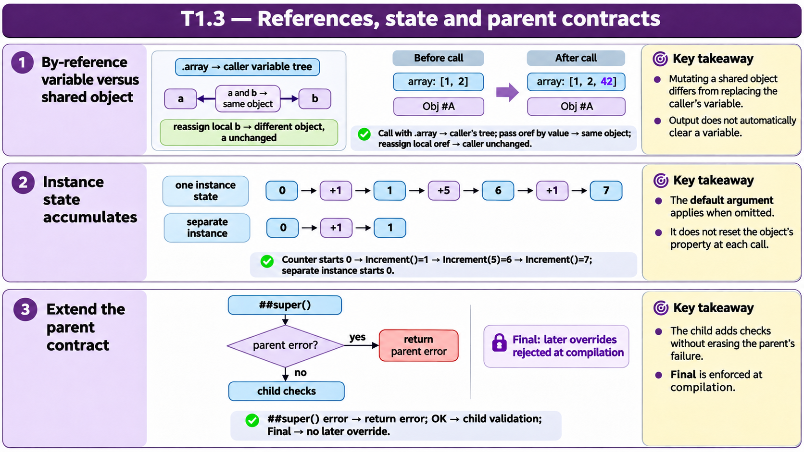

# T1.3 · 02 — Lo stato spiega la sequenza delle risposte

[Indice degli approfondimenti](README.md) · [Quiz originale](../quiz.md) · [Teoria](../study.md)

**Esercizi di partenza:** [Q1](../quiz.md#question-1-single) · [Q2](../quiz.md#question-2-single) · [Q10](../quiz.md#question-10-single) · [Q14](../quiz.md#question-14-single) · [Q17](../quiz.md#question-17-single). L’approfondimento rielabora il concetto e aggiunge una variante; non riproduce soltanto la risposta del quiz.

## Il caso concreto

Counter.Value parte da 0 e Increment ha amount=1 come valore predefinito. Le chiamate sono Increment(), Increment(5), Increment().

```objectscript
set c = ##class(App.Counter).%New()
write c.Increment(), " "
write c.Increment(5), " "
write c.Increment()
```

## Ragionamento passo per passo

Traccia la proprietà dopo ogni chiamata: 0+1=1; 1+5=6; 6+1=7. Il default riguarda l’argomento omesso, non il reset dello stato. Un metodo d’istanza opera sul proprio oggetto; un ClassMethod non riceve automaticamente quell’istanza.

## Perché il distrattore è plausibile

Ricominciare da zero a ogni chiamata o pensare che un metodo di classe abbia accesso implicito alla proprietà dell’oggetto creato altrove.

## Lo spunto da portare oltre l’esercizio

Per prevedere un output, costruisci una tabella prima/dopo di ogni effetto sullo stato.



*Leggi il pannello 2; gli altri due collegano il caso agli altri approfondimenti del capitolo.*

## Variante: prova prima di leggere la soluzione

Un secondo oggetto d parte da 0. Dopo le tre chiamate su c, d.Increment() cosa restituisce?

<details>
<summary>Soluzione ragionata</summary>

1: le due istanze hanno stato separato.

</details>

## Riferimenti e precisazioni

- [Definizione e chiamata dei metodi](https://docs.intersystems.com/irislatest/csp/docbook/DocBook.UI.Page.cls?KEY=GOBJ_methods)
- [Invocazione e argomenti](https://docs.intersystems.com/irislatest/csp/docbook/DocBook.UI.Page.cls?KEY=GCOS_invoking)
- [Passaggio per riferimento](https://docs.intersystems.com/irislatest/csp/docbook/DocBook.UI.Page.cls?KEY=TOS_PassByRef)

[Note specifiche del capitolo](README.md#precisazioni-rispetto-al-quiz) · [Metodo e limiti della revisione](../../../approfondimenti-esercizi.md#metodo-e-limiti)
