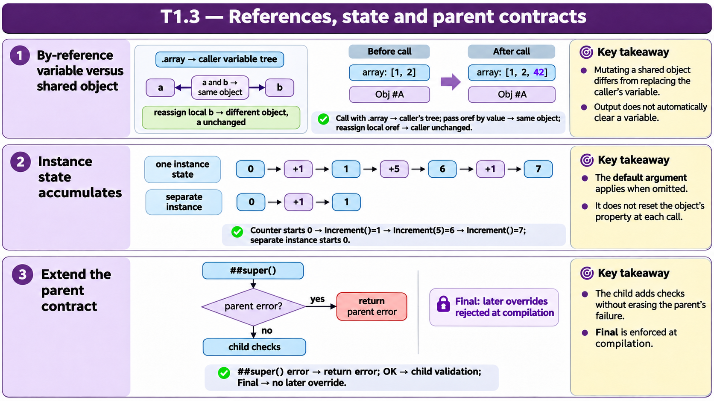

# T1.3 · 03 — Override e validazione non cancellano il contratto

[Indice degli approfondimenti](README.md) · [Quiz originale](../quiz.md) · [Teoria](../study.md)

**Esercizi di partenza:** [Q7](../quiz.md#question-7-single) · [Q9](../quiz.md#question-9-single) · [Q12](../quiz.md#question-12-single) · [Q18](../quiz.md#question-18-single). L’approfondimento rielabora il concetto e aggiunge una variante; non riproduce soltanto la risposta del quiz.

## Il caso concreto

Una sottoclasse ridefinisce una validazione: il controllo ereditato e quello specifico devono entrambi essere rispettati.

## Ragionamento passo per passo

Nel quiz il metodo chiama prima ##super(). Se lo status ereditato segnala errore, lo propaga; altrimenti verifica Email. Email non vuota ma senza @ fallisce il controllo specifico. L’override sceglie il corpo eseguito, ma non rende irrilevanti le precondizioni del padre. Un metodo Final non è ridefinibile.

## Perché il distrattore è plausibile

Ignorare lo status restituito dal padre, oppure trattare override e overload come sinonimi.

## Lo spunto da portare oltre l’esercizio

Una specializzazione valida aggiunge regole mantenendo il contratto necessario del comportamento ereditato.

*Leggi il pannello 3; gli altri due collegano il caso agli altri approfondimenti del capitolo.*

## Variante: prova prima di leggere la soluzione

Il controllo del padre fallisce e il controllo email sarebbe valido. È corretto restituire successo?

Soluzione ragionata

No: il fallimento precedente deve essere propagato o gestito esplicitamente.

## Riferimenti e precisazioni

- [Definizione e chiamata dei metodi](https://docs.intersystems.com/irislatest/csp/docbook/DocBook.UI.Page.cls?KEY=GOBJ_methods)
- [Invocazione e argomenti](https://docs.intersystems.com/irislatest/csp/docbook/DocBook.UI.Page.cls?KEY=GCOS_invoking)
- [Passaggio per riferimento](https://docs.intersystems.com/irislatest/csp/docbook/DocBook.UI.Page.cls?KEY=TOS_PassByRef)

[Note specifiche del capitolo](README.md#precisazioni-rispetto-al-quiz) · [Metodo e limiti della revisione](../../../approfondimenti-esercizi.md#metodo-e-limiti)
