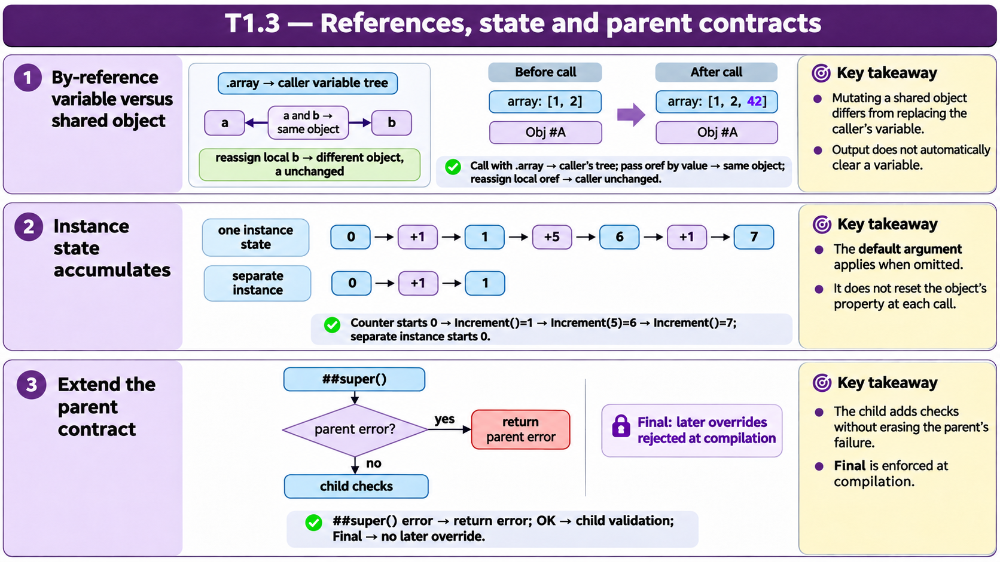
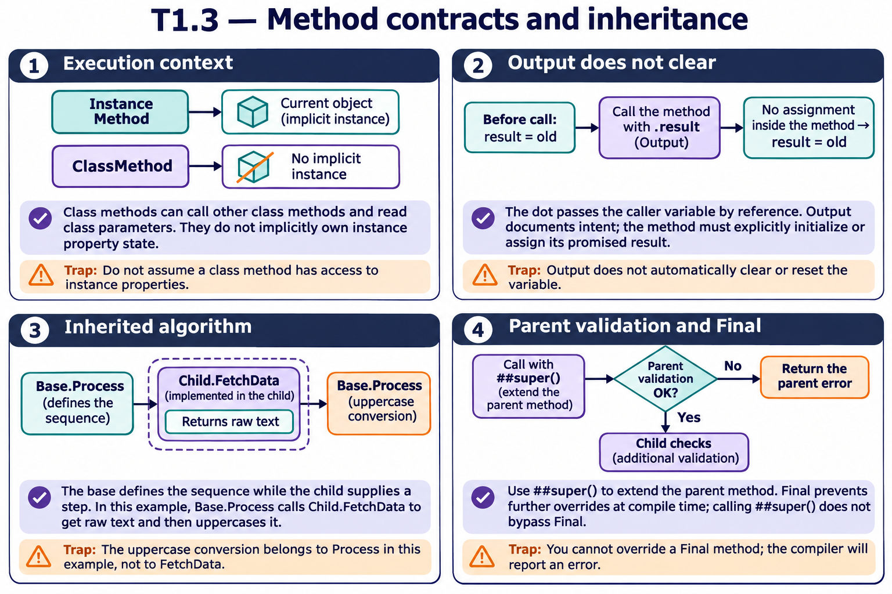

# T1.3 — Approfondimenti dagli esercizi

## Tutte le 18 domande approfondite

[Apri le schede domanda per domanda](<Domanda per domanda/README.md>) · [Tavole spiegate in inglese](tavole-esercizi.md)

Ogni domanda dispone ora di un commento specifico, un concetto ulteriore e una variante con soluzione. I tre casi seguenti sono percorsi tematici aggiuntivi. Le immagini sono in inglese.

[Teoria](../study.md) · [Quiz](../quiz.md) · [Tutti gli approfondimenti](../../../approfondimenti-esercizi.md)

Tre percorsi trasversali, da affiancare alle schede individuali, per capire il meccanismo dietro le risposte: scenario, ragionamento, distrattore, regola riutilizzabile e variante con soluzione. I riferimenti Q rimandano al quiz scaricato; la numerazione è locale al capitolo.

[Leggi esempi e spiegazioni dei pannelli](tavole-esercizi.md).

## Percorso consigliato

1. [Valore, riferimento e alias di un oggetto](<01 - Valore, riferimento e alias di un oggetto.md>) — Q4, Q6, Q15
2. [Lo stato spiega la sequenza delle risposte](<02 - Lo stato spiega la sequenza delle risposte.md>) — Q1, Q2, Q10, Q14, Q17
3. [Override e validazione non cancellano il contratto](<03 - Override e validazione non cancellano il contratto.md>) — Q7, Q9, Q12, Q18

[Indice di tutte le 18 domande del capitolo](mappa-domande.md). I percorsi sono tematici; ogni domanda ha inoltre una scheda individuale nella sottocartella dedicata.

## Precisazioni rispetto al quiz

ByRef e Output nella firma documentano l’intenzione ma non forzano il passaggio per riferimento: il punto nel chiamante è determinante. Un ClassMethod può usare .. per altri ClassMethod e parametri di classe; gli manca l’istanza implicita per le proprietà.

Queste precisazioni si applicano agli approfondimenti nuovi. Il testo delle risposte scaricate rimane una testimonianza della fonte e non viene riscritto silenziosamente.

## Documentazione

- [Definizione e chiamata dei metodi](https://docs.intersystems.com/irislatest/csp/docbook/DocBook.UI.Page.cls?KEY=GOBJ_methods)
- [Invocazione e argomenti](https://docs.intersystems.com/irislatest/csp/docbook/DocBook.UI.Page.cls?KEY=GCOS_invoking)
- [Passaggio per riferimento](https://docs.intersystems.com/irislatest/csp/docbook/DocBook.UI.Page.cls?KEY=TOS_PassByRef)

Gli snippet sono frammenti didattici: quando usano classi di esempio o macro, presuppongono le relative definizioni e include. Non costituiscono implementazioni complete né sono stati eseguiti in IRIS.
