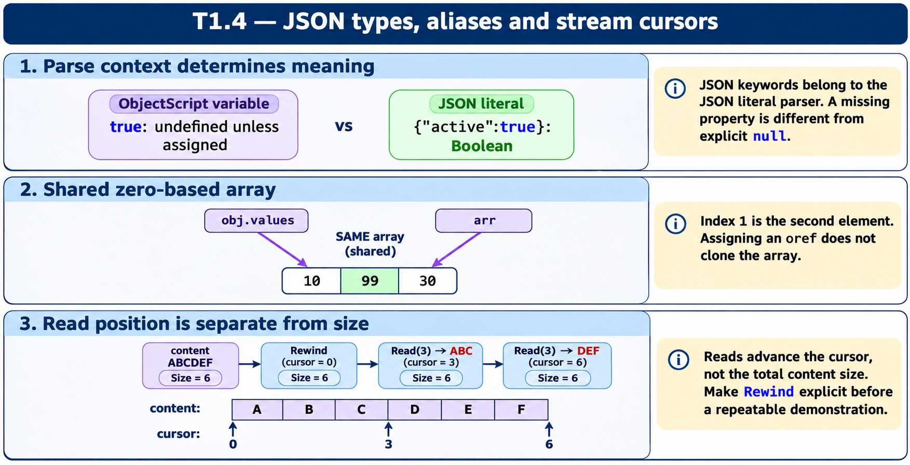

# T1.4 · 01 — Il parser JSON e ObjectScript parlano linguaggi diversi

[Indice degli approfondimenti](README.md) · [Quiz originale](../quiz.md) · [Teoria](../study.md)

**Esercizi di partenza:** [Q1](../quiz.md#question-1-single) · [Q3](../quiz.md#question-3-single) · [Q7](../quiz.md#question-7-single). L’approfondimento rielabora il concetto e aggiunge una variante; non riproduce soltanto la risposta del quiz.

## Il caso concreto

patient.active=true è un’assegnazione ObjectScript: true viene interpretato come nome di variabile. In un literal JSON è invece un booleano.

```objectscript
set patient = {"active":true,"address":null}
write patient.%IsDefined("address")
write patient.%IsDefined("phone")
write patient.%GetTypeOf("address")
```

## Ragionamento passo per passo

Il primo controllo vale 1, il secondo 0, il tipo di address è null. Una proprietà presente con null non è una proprietà assente. Per impostare esplicitamente il tipo booleano tramite API usa %Set con tipo boolean.

## Perché il distrattore è plausibile

Scrivere true fuori dal literal come se fosse una costante ObjectScript; usare il valore null come prova che la chiave non esiste.

## Lo spunto da portare oltre l’esercizio

Distingui il linguaggio del codice, il formato serializzato e il tipo JSON della singola proprietà.



*Leggi il pannello 1; gli altri due collegano il caso agli altri approfondimenti del capitolo.*

## Variante: prova prima di leggere la soluzione

address:null e nessuna proprietà phone: %IsDefined restituisce lo stesso risultato per entrambe?

<details>
<summary>Soluzione ragionata</summary>

No: address esiste, phone no.

</details>

## Riferimenti e precisazioni

- [Creazione JSON dinamico](https://docs.intersystems.com/irislatest/csp/docbook/DocBook.UI.Page.cls?KEY=GJSON_create)
- [Proprietà stream](https://docs.intersystems.com/irislatest/csp/docbook/DocBook.UI.Page.cls?KEY=GOBJ_propstream)

[Note specifiche del capitolo](README.md#precisazioni-rispetto-al-quiz) · [Metodo e limiti della revisione](../../../approfondimenti-esercizi.md#metodo-e-limiti)
