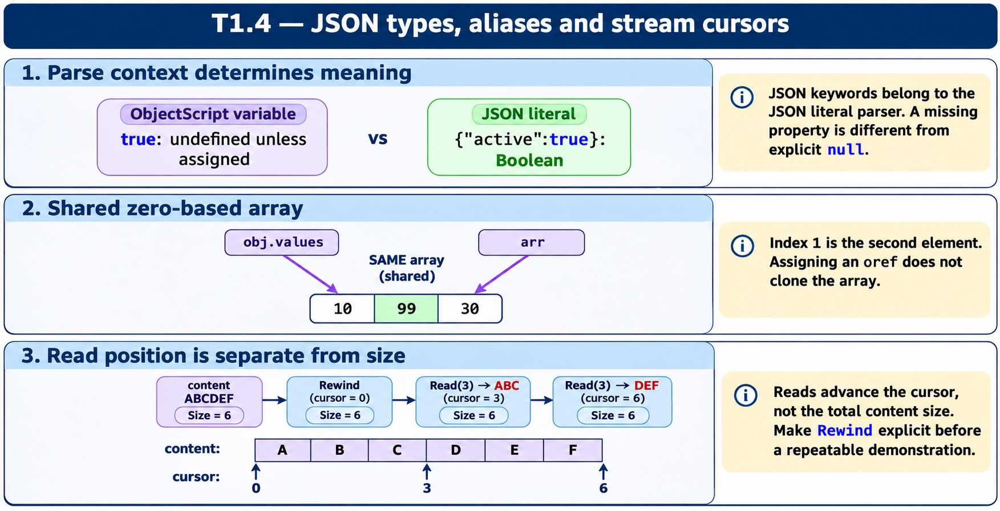

# T1.4 · 02 — Gli array JSON partono da zero e sono condivisi per riferimento

[Indice degli approfondimenti](README.md) · [Quiz originale](../quiz.md) · [Teoria](../study.md)

**Esercizi di partenza:** [Q2](../quiz.md#question-2-single) · [Q5](../quiz.md#question-5-single) · [Q6](../quiz.md#question-6-single) · [Q12](../quiz.md#question-12-single) · [Q14](../quiz.md#question-14-single). L’approfondimento rielabora il concetto e aggiunge una variante; non riproduce soltanto la risposta del quiz.

## Il caso concreto

obj.values è [10,20,30]. Assegnarlo ad arr non clona l’array. %Set(1,99) modifica il secondo elemento.

```objectscript
set obj = {"values":[10,20,30]}
set arr = obj.values
do arr.%Set(1,99)
write obj.%ToJSON()
```

## Ragionamento passo per passo

Gli indici sono 0,1,2. arr e obj.values identificano la stessa struttura; dopo la scrittura entrambi mostrano [10,99,30]. La serializzazione JSON descrive lo stato corrente, non una fotografia precedente all’assegnazione.

## Perché il distrattore è plausibile

Usare la numerazione uno-based delle liste $LIST per un %DynamicArray o presumere una copia profonda.

## Lo spunto da portare oltre l’esercizio

Tipo di contenitore e semantica del riferimento determinano l’effetto della mutazione.



*Leggi il pannello 2; gli altri due collegano il caso agli altri approfondimenti del capitolo.*

## Variante: prova prima di leggere la soluzione

Con [10,20,30], quale elemento cambia con %Set(0,7)?

<details>
<summary>Soluzione ragionata</summary>

Il primo; il risultato è [7,20,30].

</details>

## Riferimenti e precisazioni

- [Creazione JSON dinamico](https://docs.intersystems.com/irislatest/csp/docbook/DocBook.UI.Page.cls?KEY=GJSON_create)
- [Proprietà stream](https://docs.intersystems.com/irislatest/csp/docbook/DocBook.UI.Page.cls?KEY=GOBJ_propstream)

[Note specifiche del capitolo](README.md#precisazioni-rispetto-al-quiz) · [Metodo e limiti della revisione](../../../approfondimenti-esercizi.md#metodo-e-limiti)
