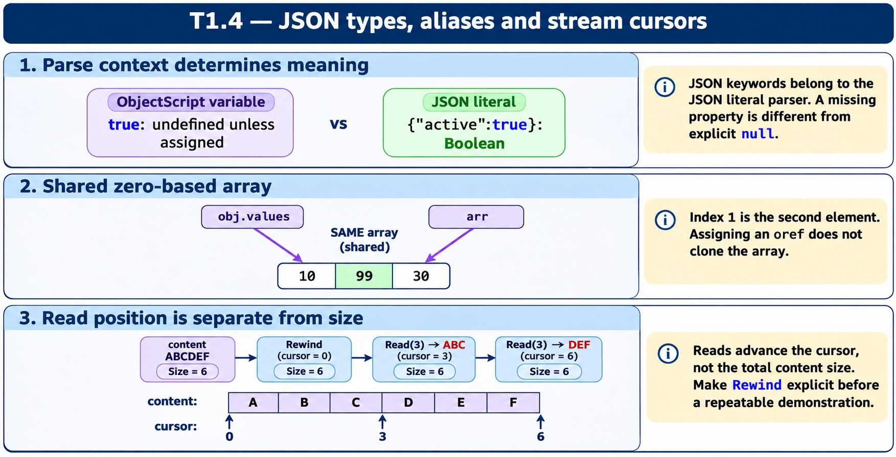

# T1.4 · 03 — Uno stream si legge dalla posizione corrente

[Indice degli approfondimenti](README.md) · [Quiz originale](../quiz.md) · [Teoria](../study.md)

**Esercizi di partenza:** [Q8](../quiz.md#question-8-single) · [Q9](../quiz.md#question-9-single) · [Q10](../quiz.md#question-10-single) · [Q11](../quiz.md#question-11-single) · [Q13](../quiz.md#question-13-single) · [Q15](../quiz.md#question-15-single). L’approfondimento rielabora il concetto e aggiunge una variante; non riproduce soltanto la risposta del quiz.

## Il caso concreto

Più Write producono una sequenza di caratteri. Per leggere dall’inizio, il punto chiave è rendere esplicito il riavvolgimento.

```objectscript
set s = ##class(%Stream.GlobalCharacter).%New()
do s.Write("ABC")
do s.Write("DEF")
do s.Rewind()
write s.Read(3)
write s.Read(3)
```

## Ragionamento passo per passo

Dopo Rewind, la prima lettura restituisce ABC e la seconda DEF. Size descrive la dimensione complessiva, non i caratteri rimasti. AtEnd riguarda la posizione. Una riga include inoltre una convenzione di terminazione diversa da una lettura a numero di caratteri.

## Perché il distrattore è plausibile

Confondere dimensione con cursore, oppure aspettarsi che ogni Read riparta dall’inizio.

## Lo spunto da portare oltre l’esercizio

Disegna il cursore come parte dello stato del contenitore, esattamente come per un iteratore.



*Leggi il pannello 3; gli altri due collegano il caso agli altri approfondimenti del capitolo.*

## Variante: prova prima di leggere la soluzione

Dopo aver letto ABC, Rewind e poi Read(2): che cosa ottieni?

<details>
<summary>Soluzione ragionata</summary>

AB: Rewind riporta la lettura all’inizio.

</details>

## Riferimenti e precisazioni

- [Creazione JSON dinamico](https://docs.intersystems.com/irislatest/csp/docbook/DocBook.UI.Page.cls?KEY=GJSON_create)
- [Proprietà stream](https://docs.intersystems.com/irislatest/csp/docbook/DocBook.UI.Page.cls?KEY=GOBJ_propstream)

[Note specifiche del capitolo](README.md#precisazioni-rispetto-al-quiz) · [Metodo e limiti della revisione](../../../approfondimenti-esercizi.md#metodo-e-limiti)
