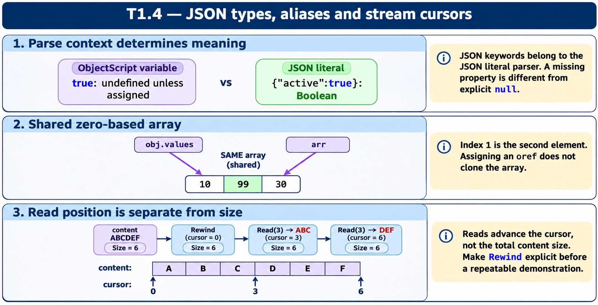
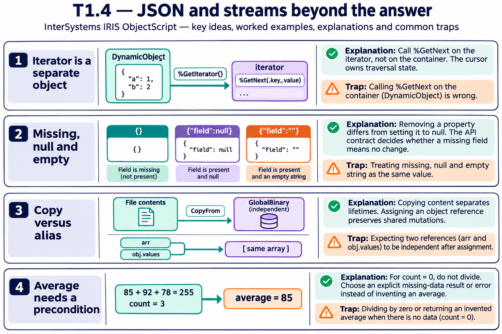

# T1.4 — Approfondimenti dagli esercizi

## Tutte le 15 domande approfondite

[Apri le schede domanda per domanda](<Domanda per domanda/README.md>) · [Tavole spiegate in inglese](tavole-esercizi.md)

Ogni domanda dispone ora di un commento specifico, un concetto ulteriore e una variante con soluzione. I tre casi seguenti sono percorsi tematici aggiuntivi. Le immagini sono in inglese.

[Teoria](../study.md) · [Quiz](../quiz.md) · [Tutti gli approfondimenti](../../../approfondimenti-esercizi.md)

Tre percorsi trasversali, da affiancare alle schede individuali, per capire il meccanismo dietro le risposte: scenario, ragionamento, distrattore, regola riutilizzabile e variante con soluzione. I riferimenti Q rimandano al quiz scaricato; la numerazione è locale al capitolo.

[Leggi esempi e spiegazioni dei pannelli](tavole-esercizi.md).

## Percorso consigliato

1. [Il parser JSON e ObjectScript parlano linguaggi diversi](<01 - Il parser JSON e ObjectScript parlano linguaggi diversi.md>) — Q1, Q3, Q7
2. [Gli array JSON partono da zero e sono condivisi per riferimento](<02 - Gli array JSON partono da zero e sono condivisi per riferimento.md>) — Q2, Q5, Q6, Q12, Q14
3. [Uno stream si legge dalla posizione corrente](<03 - Uno stream si legge dalla posizione corrente.md>) — Q8, Q9, Q10, Q11, Q13, Q15

[Indice di tutte le 15 domande del capitolo](mappa-domande.md). I percorsi sono tematici; ogni domanda ha inoltre una scheda individuale nella sottocartella dedicata.

## Precisazioni rispetto al quiz

Q10: la dimensione riportata, 65, è coerente con le stringhe mostrate. Per isolare il tema del cursore, negli esempi qui viene usato Rewind esplicito. I literal JSON true/null non sono variabili ObjectScript predefinite.

Queste precisazioni si applicano agli approfondimenti nuovi. Il testo delle risposte scaricate rimane una testimonianza della fonte e non viene riscritto silenziosamente.

## Documentazione

- [Creazione JSON dinamico](https://docs.intersystems.com/irislatest/csp/docbook/DocBook.UI.Page.cls?KEY=GJSON_create)
- [Proprietà stream](https://docs.intersystems.com/irislatest/csp/docbook/DocBook.UI.Page.cls?KEY=GOBJ_propstream)

Gli snippet sono frammenti didattici: quando usano classi di esempio o macro, presuppongono le relative definizioni e include. Non costituiscono implementazioni complete né sono stati eseguiti in IRIS.
