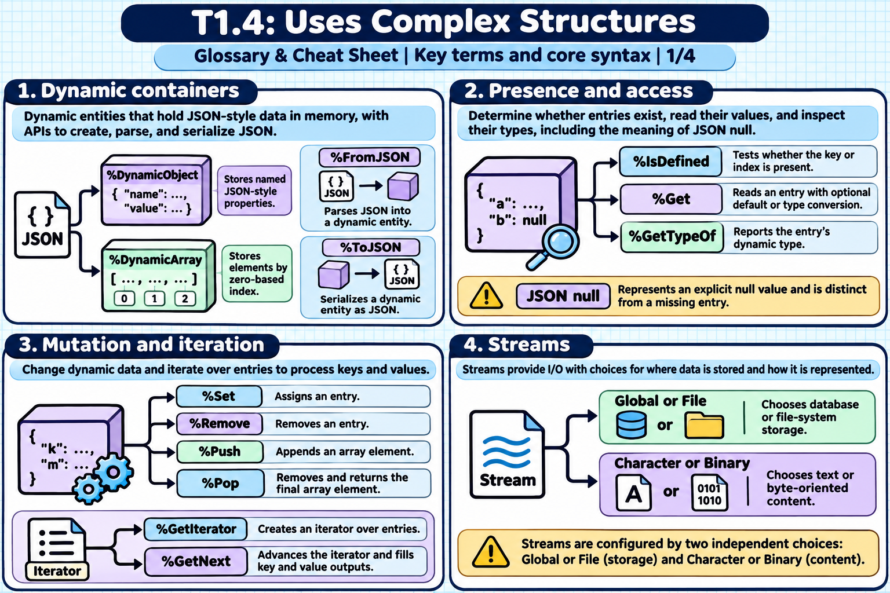
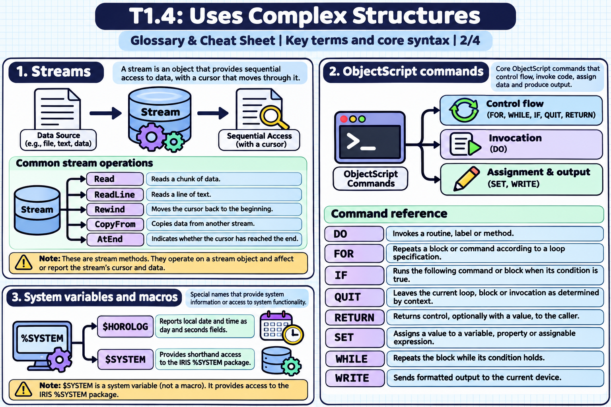
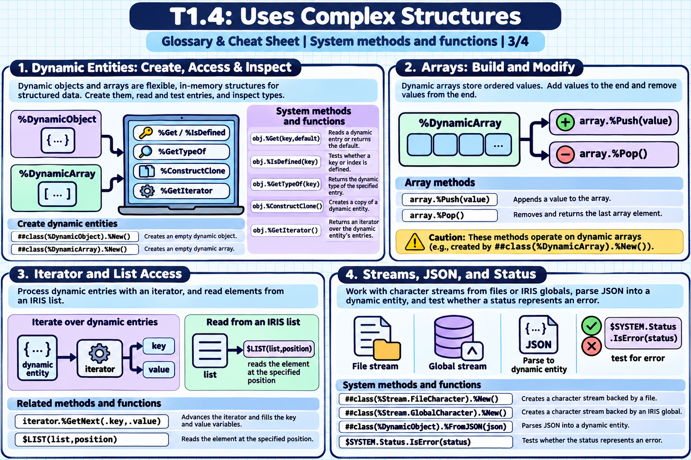
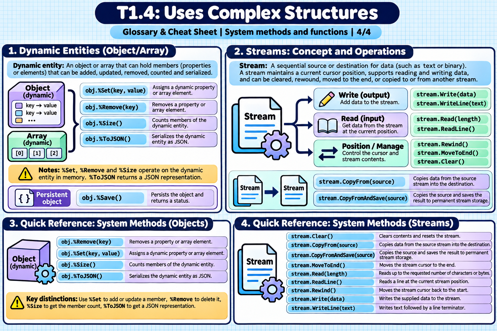

[All topics](../../index.md) · [Practice quiz](quiz.md)

# T1.4: Uses Complex Structures

[Approfondimenti dagli esercizi](<Approfondimenti esercizi/README.md>)

Saved 2 November 2026 from [exam-prep.es](https://exam-prep.es/exams/objectscript/knowledge/T1.4.html). Reference links require internet access.

### Contents

1. [Creates dynamic objects/arrays (JSON) - %DynamicObject, %DynamicArray, %FromJSON, %ToJSON](#1-creates-dynamic-objectsarrays-json---dynamicobject-dynamicarray-fromjson-tojson)
2. [Uses stream objects of the appropriate type (%Stream.GlobalCharacter, %Stream.GlobalBinary, %Stream.FileCharacter, %Stream.FileBinary, Write(), Read(), Rewind())](#2-uses-stream-objects-of-the-appropriate-type-streamglobalcharacter-streamglobalbinary-streamfilecharacter-streamfilebinary-write-read-rewind)

[Glossary & Cheat Sheet](#glossary--cheat-sheet)

### Visual study guide — sections 1–2


[View all chapter diagrams](visuals.md) · [Technical review notes](../../visual-technical-notes.md)

## 1. Creates dynamic objects/arrays (JSON) - %DynamicObject, %DynamicArray, %FromJSON, %ToJSON

### Key Points

- **%DynamicObject** creates key-value structures similar to JSON objects
- **%DynamicArray** creates ordered lists similar to JSON arrays
- **%FromJSON()** parses a JSON string into a %DynamicObject or %DynamicArray
- **%ToJSON()** serializes a dynamic object/array back to a JSON string
- Curly brace `{}` and bracket `[]` literals create dynamic objects and arrays inline
- Dynamic objects are schema-less: no class definition required
- Assigning a nested dynamic array or object to a variable shares a reference; mutations are visible through the parent

### Detailed Notes

#### Overview

InterSystems IRIS provides native JSON support through `%DynamicObject` and `%DynamicArray`. These classes allow you to create, manipulate, and serialize JSON data without defining formal class schemas. They are essential for building REST APIs, processing external data, and exchanging structured data with other systems.

#### Creating Dynamic Objects

Using the `%New()` constructor:

```objectscript
Set obj = ##class(%DynamicObject).%New()
Do obj.%Set("name", "John Smith")
Do obj.%Set("age", 35, "number")
Do obj.%Set("active", 1, "boolean")
Write obj.%ToJSON()
// Output: {"name":"John Smith","age":35,"active":true}
```

Using the `{}` literal syntax (preferred for simple cases):

```objectscript
Set obj = {"name": "John Smith", "age": 35, "active": true}
Write obj.%ToJSON()
// Output: {"name":"John Smith","age":35,"active":true}
```

#### Accessing Properties

```objectscript
Set obj = {"name": "John", "age": 35}

// Dot syntax for simple property names
Write obj.name, !          // John
Write obj.age, !           // 35

// %Get() method for dynamic access
Set key = "name"
Write obj.%Get(key), !     // John
```

#### Modifying Dynamic Objects

```objectscript
Set obj = {"name": "John"}

// Add/modify properties
Set obj.age = 35
Do obj.%Set("email", "john@example.com")

// Remove a property
Do obj.%Remove("email")

// Check if property exists
Write obj.%IsDefined("name")   // 1
Write obj.%IsDefined("email")  // 0
```

#### Creating Dynamic Arrays

Using `%New()`:

```objectscript
Set arr = ##class(%DynamicArray).%New()
Do arr.%Push("apple")
Do arr.%Push("banana")
Do arr.%Push("cherry")
Write arr.%ToJSON()
// Output: ["apple","banana","cherry"]
```

Using the `[]` literal syntax:

```objectscript
Set arr = ["apple", "banana", "cherry"]
Write arr.%ToJSON()
```

#### Array Operations

```objectscript
Set arr = ["a", "b", "c", "d"]

// Access by index (0-based)
Write arr.%Get(0), !      // a
Write arr.%Get(2), !      // c

// Get array size
Write arr.%Size(), !       // 4

// Push to the end
Do arr.%Push("e")

// Pop from the end
Set last = arr.%Pop()      // "e"

// Remove at index
Do arr.%Remove(1)          // removes "b"
```

#### Parsing JSON with %FromJSON()

```objectscript
Set jsonString = "{""name"":""Alice"",""scores"":[95,87,92]}"
Set obj = ##class(%DynamicAbstractObject).%FromJSON(jsonString)
// or equivalently:
Set obj = {}.%FromJSON(jsonString)

Write obj.name, !                  // Alice
Write obj.scores.%Get(0), !       // 95
Write obj.scores.%Size(), !       // 3
```

From a stream:

```objectscript
Set stream = ##class(%Stream.GlobalCharacter).%New()
Do stream.Write("{""key"":""value""}")
Do stream.Rewind()
Set obj = ##class(%DynamicAbstractObject).%FromJSON(stream)
Write obj.key, !   // value
```

#### Nested Structures

```objectscript
Set person = {
    "name": "Bob",
    "address": {
        "street": "123 Main St",
        "city": "Springfield",
        "state": "IL"
    },
    "phones": [
        {"type": "home", "number": "555-1234"},
        {"type": "work", "number": "555-5678"}
    ]
}

Write person.address.city, !                      // Springfield
Write person.phones.%Get(0).number, !             // 555-1234
Write person.%ToJSON(), !                          // Full JSON string
```

#### Shared References to Nested Arrays

A nested dynamic array is an object. In `Set arr = obj.values`, the variable `arr` receives a reference to the same array held by the `values` member. Both references let you access and modify that array.

`%DynamicArray` indexes start at 0, so `arr.%Set(1, 99)` replaces the second element, 20, with 99. Serializing the parent with `obj.%ToJSON()` includes the array's current contents, so the change appears in the parent's JSON.

```objectscript
Set obj = {"name":"Test","values":[10,20,30]}
Set arr = obj.values
Do arr.%Set(1, 99)

Write arr.%ToJSON(), !
// [10,99,30]
Write obj.values.%ToJSON(), !
// [10,99,30]
Write obj.%ToJSON(), !
// {"name":"Test","values":[10,99,30]}
```

Assigning a new array to `arr` has a different effect: it changes which object that variable references. It leaves `obj.values` pointing to the original array.

```objectscript
Set arr = [1,2,3]
Write arr.%ToJSON(), !
// [1,2,3]
Write obj.values.%ToJSON(), !
// [10,99,30]
```

The same reference behavior applies to nested `%DynamicObject` values.

#### Iterating Over Dynamic Objects

```objectscript
Set obj = {"name": "Alice", "age": 30, "city": "Boston"}
Set iter = obj.%GetIterator()
While iter.%GetNext(.key, .value) {
    Write key, " = ", value, !
}
// Output:
// name = Alice
// age = 30
// city = Boston
```

#### Iterating Over Dynamic Arrays

```objectscript
Set arr = ["red", "green", "blue"]
Set iter = arr.%GetIterator()
While iter.%GetNext(.idx, .value) {
    Write idx, ": ", value, !
}
// Output:
// 0: red
// 1: green
// 2: blue
```

#### Type Control with %Set()

The third argument of `%Set()` controls the JSON type:

```objectscript
Set obj = ##class(%DynamicObject).%New()
Do obj.%Set("count", 42, "number")       // JSON number
Do obj.%Set("label", "42", "string")      // JSON string "42"
Do obj.%Set("active", 1, "boolean")       // JSON true
Do obj.%Set("deleted", 0, "boolean")      // JSON false
Do obj.%Set("notes", "", "null")          // JSON null
Write obj.%ToJSON()
// {"count":42,"label":"42","active":true,"deleted":false,"notes":null}
```

#### Checking Value Types

```objectscript
Set obj = {"name": "Test", "count": 5, "active": true, "data": null}
Write obj.%GetTypeOf("name"), !      // string
Write obj.%GetTypeOf("count"), !     // number
Write obj.%GetTypeOf("active"), !    // boolean
Write obj.%GetTypeOf("data"), !      // null
Write obj.%GetTypeOf("missing"), !   // unassigned
```

### Documentation References

- [Using JSON in ObjectScript](https://docs.intersystems.com/irislatest/csp/docbook/DocBook.UI.Page.cls?KEY=GJSON_create)
- [%DynamicObject](https://docs.intersystems.com/irislatest/csp/docbook/DocBook.UI.Page.cls?KEY=GJSON_create)
- [%DynamicArray](https://docs.intersystems.com/irislatest/csp/docbook/DocBook.UI.Page.cls?KEY=GJSON_create)

## 2. Uses stream objects of the appropriate type (%Stream.GlobalCharacter, %Stream.GlobalBinary, %Stream.FileCharacter, %Stream.FileBinary, Write(), Read(), Rewind())

### Key Points

- Streams handle data too large for string variables (max ~3.6M characters)
- **Global streams** store data in database globals (portable, backed up with database)
- **File streams** store data in external files on the file system
- **Character streams** handle text data with character encoding support
- **Binary streams** handle raw binary data (images, PDFs, executables)
- Core operations: **Write()**, **Read()**, **Rewind()**, **CopyFrom()**, **Clear()**

### Detailed Notes

#### Overview

Stream objects provide sequential access to large data. Unlike string properties that load entirely into memory, streams can be read and written in chunks, making them suitable for files, documents, and binary content of any size.

#### Stream Type Selection Guide

| Need | Stream Class | Storage |
| --- | --- | --- |
| Large text in database | %Stream.GlobalCharacter | Globals |
| Binary data in database | %Stream.GlobalBinary | Globals |
| Text files on disk | %Stream.FileCharacter | File system |
| Binary files on disk | %Stream.FileBinary | File system |

#### %Stream.GlobalCharacter - Text in Database

```objectscript
// Create and write
Set stream = ##class(%Stream.GlobalCharacter).%New()
Do stream.Write("Line 1 of the document. ")
Do stream.WriteLine("Line 2 with newline.")
Do stream.Write("Line 3 continues.")

// Read back
Do stream.Rewind()
While 'stream.AtEnd {
    Set chunk = stream.Read(1000)
    Write chunk
}
```

When used as a property in a persistent class, the stream data is automatically saved with the object:

```objectscript
Class Sample.Document Extends %Persistent
{
    Property Title As %String(MAXLEN = 200);
    Property Body As %Stream.GlobalCharacter;

    ClassMethod CreateDoc(title As %String, text As %String) As %Status
    {
        Set doc = ##class(Sample.Document).%New()
        Set doc.Title = title
        Do doc.Body.Write(text)
        Return doc.%Save()
    }
}
```

#### %Stream.GlobalBinary - Binary in Database

```objectscript
Class Sample.Attachment Extends %Persistent
{
    Property Filename As %String;
    Property Content As %Stream.GlobalBinary;
    Property ContentType As %String;
}

// Store binary data
Set att = ##class(Sample.Attachment).%New()
Set att.Filename = "report.pdf"
Set att.ContentType = "application/pdf"

// Read from a file stream and copy to global stream
Set fileStream = ##class(%Stream.FileBinary).%New()
Set fileStream.Filename = "/path/to/report.pdf"
Do att.Content.CopyFrom(fileStream)
Set sc = att.%Save()
```

#### %Stream.FileCharacter - Text on File System

```objectscript
// Write to an external file
Set stream = ##class(%Stream.FileCharacter).%New()
Set stream.Filename = "/tmp/output.csv"
Do stream.Write("Name,Age,City")
Do stream.WriteLine("")
Do stream.Write("Alice,30,Boston")
Do stream.WriteLine("")
Set sc = stream.%Save()

// Read from an external file
Set stream = ##class(%Stream.FileCharacter).%New()
Set stream.Filename = "/tmp/output.csv"
Do stream.Rewind()
While 'stream.AtEnd {
    Set line = stream.ReadLine()
    Write line, !
}
```

#### %Stream.FileBinary - Binary on File System

```objectscript
// Read a binary file
Set stream = ##class(%Stream.FileBinary).%New()
Set stream.Filename = "/path/to/image.png"
Write "File size: ", stream.Size, " bytes", !

// Copy to another location
Set target = ##class(%Stream.FileBinary).%New()
Set target.Filename = "/path/to/copy.png"
Do target.CopyFrom(stream)
Set sc = target.%Save()
```

#### Core Stream Methods Reference

| Method/Property | Description |
| --- | --- |
| **Write(data)** | Appends data at the current position |
| **WriteLine(data)** | Appends data followed by a platform line terminator |
| **Read(len)** | Reads up to `len` characters/bytes from current position |
| **ReadLine(len, .sc, .eol)** | Reads one line (up to len characters) |
| **Rewind()** | Resets position to the beginning of the stream |
| **MoveToEnd()** | Moves position to the end (for appending) |
| **Clear()** | Removes all content from the stream |
| **CopyFrom(source)** | Copies all content from another stream |
| **Size** | Returns the total size in characters/bytes |
| **AtEnd** | Returns 1 if at end of stream, 0 otherwise |

#### Stream Processing Patterns

Reading in fixed-size chunks (for large streams):

```objectscript
Set chunkSize = 32000
Do stream.Rewind()
While 'stream.AtEnd {
    Set chunk = stream.Read(chunkSize)
    // Process chunk
}
```

Line-by-line reading (for text streams):

```objectscript
Do stream.Rewind()
While 'stream.AtEnd {
    Set line = stream.ReadLine()
    // Process each line
}
```

Appending to an existing stream:

```objectscript
// Position at the end before writing more data
Do stream.MoveToEnd()
Do stream.Write("Additional content appended.")
Set sc = stream.%Save()
```

#### Character Encoding with File Streams

File character streams support the `TranslateTable` property for character encoding:

```objectscript
Set stream = ##class(%Stream.FileCharacter).%New()
Set stream.Filename = "/tmp/utf8file.txt"
Set stream.TranslateTable = "UTF8"
Do stream.Write("Content with special characters: accents, symbols")
Set sc = stream.%Save()
```

#### Comparing Streams

```objectscript
// Check if two streams have identical content
Set same = stream1.%ConstructClone().Equals(stream2)

// Or use SizeGet for a quick size comparison first
If stream1.Size '= stream2.Size {
    Write "Streams differ (different sizes)", !
}
```

### Documentation References

- [Stream Classes](https://docs.intersystems.com/irislatest/csp/docbook/DocBook.UI.Page.cls?KEY=GOBJ_propstream)
- [Working with Streams](https://docs.intersystems.com/irislatest/csp/docbook/DocBook.UI.Page.cls?KEY=GOBJ_propstream)
- [%Stream.GlobalCharacter](https://docs.intersystems.com/irislatest/csp/docbook/DocBook.UI.Page.cls?KEY=RCOS_stream)

## Exam Preparation Summary

### Critical Concepts to Master:

1. `{}` creates a %DynamicObject; `[]` creates a %DynamicArray (literal syntax)
2. %FromJSON() parses JSON strings or streams into dynamic objects/arrays
3. %ToJSON() serializes dynamic objects/arrays back to JSON strings
4. Dynamic arrays are 0-indexed; use %Get(index), %Push(), %Pop(), %Size()
5. %GetIterator() is the proper way to iterate over dynamic objects and arrays
6. %Set() with a third argument controls JSON type (number, string, boolean, null)
7. Four stream types: GlobalCharacter, GlobalBinary, FileCharacter, FileBinary
8. Streams use Write/Read/Rewind pattern (not direct property assignment)
9. CopyFrom() copies content between any two streams
10. AtEnd property controls read loops; Rewind() resets to beginning
11. Global streams are stored in the database; File streams on the external file system
12. Character streams handle text with encoding; Binary streams handle raw bytes

### Common Exam Scenarios:

- Creating a JSON response from ObjectScript data using %DynamicObject
- Parsing incoming JSON into a dynamic object and accessing nested values
- Choosing the correct stream type for a given use case (text vs binary, database vs file)
- Writing code to read a stream chunk by chunk or line by line
- Converting between stream types using CopyFrom()
- Identifying the correct method for checking JSON value types (%GetTypeOf)

### Hands-On Practice Recommendations:

- Build nested JSON structures using both literal syntax and %Set/%Push methods
- Parse sample JSON strings with %FromJSON() and navigate the resulting structure
- Create each of the four stream types, write data, and read it back
- Practice CopyFrom() to transfer data between global and file streams
- Use %GetIterator() to iterate over dynamic objects and arrays
- Build a simple REST handler that accepts and returns JSON using dynamic objects

## Glossary & Cheat Sheet

### Key terms

- **Dynamic containers**
  - `%DynamicObject` — Stores named JSON-style properties.
  - `%DynamicArray` — Stores elements by zero-based index.
  - `%FromJSON` — Parses JSON into a dynamic entity.
  - `%ToJSON` — Serializes a dynamic entity as JSON.
- **Presence and access**
  - `%IsDefined` — Tests whether the key or index is present.
  - `%Get` — Reads an entry with optional default or type conversion.
  - `%GetTypeOf` — Reports the entry's dynamic type.
  - **JSON null** — Represents an explicit null value and is distinct from a missing entry.
- **Mutation and iteration**
  - `%Set` — Assigns an entry.
  - `%Remove` — Removes an entry.
  - `%Push` — Appends an array element.
  - `%Pop` — Removes and returns the final array element.
  - `%GetIterator` — Creates an iterator over entries.
  - `%GetNext` — Advances the iterator and fills key and value outputs.
- **Streams**
  - **Global or File** — Chooses database or file-system storage.
  - **Character or Binary** — Chooses text or byte-oriented content.
  - **Read** — Reads a chunk of data.
  - **ReadLine** — Reads a line of text.
  - **Rewind** — Moves the cursor back to the beginning.
  - **CopyFrom** — Copies data from another stream.
  - **AtEnd** — Indicates whether the cursor has reached the end.
- **ObjectScript commands**
  - `DO` — Invokes a routine, label or method.
  - `FOR` — Repeats a block or command according to a loop specification.
  - `IF` — Runs the following command or block when its condition is true.
  - `QUIT` — Leaves the current loop, block or invocation as determined by context.
  - `RETURN` — Returns control, optionally with a value, to the caller.
  - `SET` — Assigns a value to a variable, property or assignable expression.
  - `WHILE` — Repeats the block while its condition holds.
  - `WRITE` — Sends formatted output to the current device.
- **System variables and macros**
  - `$HOROLOG` — Reports local date and time as day and seconds fields.
  - `$SYSTEM` — Provides shorthand access to the IRIS %SYSTEM package.

### System methods and functions

- `##class(%DynamicArray).%New()` — Creates an empty dynamic array.
- `##class(%DynamicObject).%FromJSON(json)` — Parses JSON into a dynamic entity.
- `##class(%DynamicObject).%New()` — Creates an empty dynamic object.
- `##class(%Stream.FileCharacter).%New()` — Creates a character stream backed by a file.
- `##class(%Stream.GlobalCharacter).%New()` — Creates a character stream backed by an IRIS global.
- `$LIST(list, position)` — Reads the element at the specified position.
- `$SYSTEM.Status.IsError(status)` — Tests whether the status represents an error.
- `array.%Pop()` — Removes and returns the last array element.
- `array.%Push(value)` — Appends a value to the array.
- `iterator.%GetNext(.key, .value)` — Advances the iterator and fills the key and value variables.
- `obj.%ConstructClone()` — Creates a copy of a dynamic entity.
- `obj.%Get(key, default)` — Reads a dynamic entry or returns the default.
- `obj.%GetIterator()` — Returns an iterator over the dynamic entity's entries.
- `obj.%GetTypeOf(key)` — Returns the dynamic type of the specified entry.
- `obj.%IsDefined(key)` — Tests whether a key or index is defined.
- `obj.%Remove(key)` — Removes a property or array element.
- `obj.%Save()` — Persists the object and returns a status.
- `obj.%Set(key, value)` — Assigns a dynamic property or array element.
- `obj.%Size()` — Counts members of the dynamic entity.
- `obj.%ToJSON()` — Serializes the dynamic entity as JSON.
- `stream.Clear()` — Clears contents and resets the stream.
- `stream.CopyFrom(source)` — Copies data from the source stream into the destination.
- `stream.CopyFromAndSave(source)` — Copies the source and saves the result to permanent stream storage.
- `stream.MoveToEnd()` — Moves the stream cursor to the end.
- `stream.Read(length)` — Reads up to the requested number of characters or bytes.
- `stream.ReadLine()` — Reads a line at the current stream position.
- `stream.Rewind()` — Moves the stream cursor back to the start.
- `stream.Write(data)` — Writes the supplied data to the stream.
- `stream.WriteLine(text)` — Writes text followed by a line terminator.

Official reference: [Creating dynamic entities](https://docs.intersystems.com/irislatest/csp/docbook/DocBook.UI.Page.cls?KEY=GJSON_create).

### Visual recap





