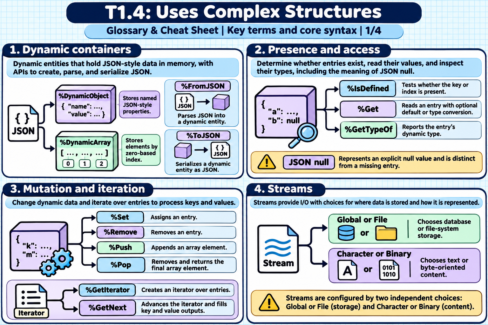
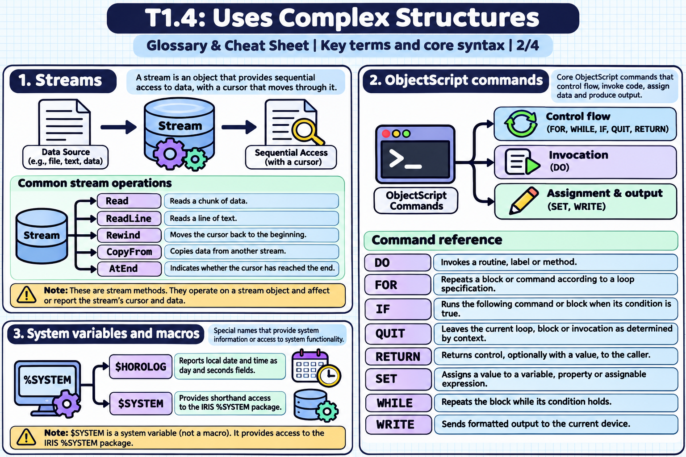
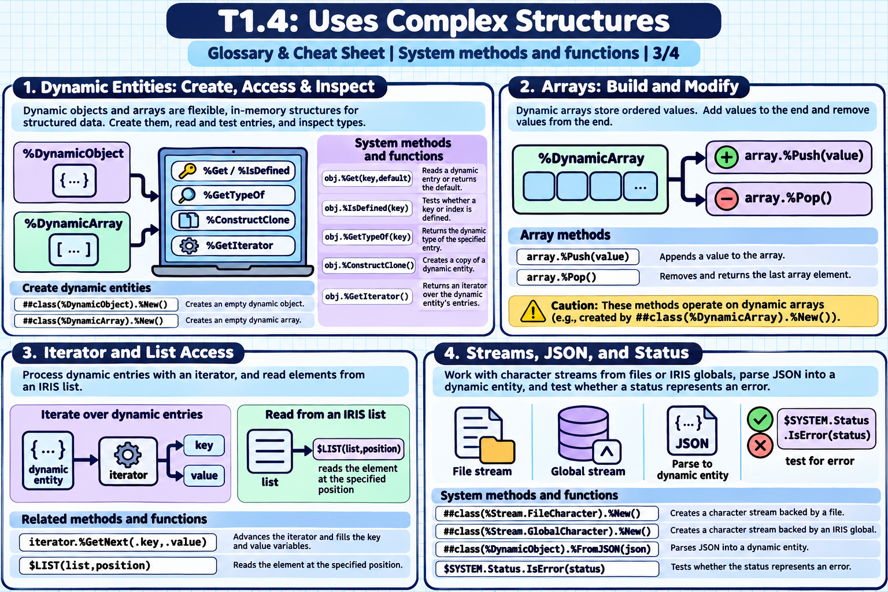
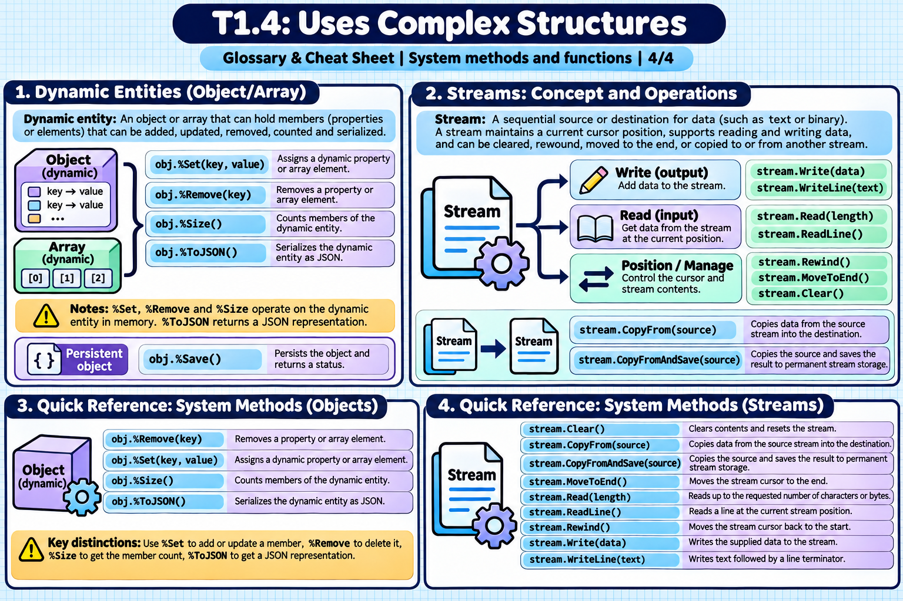

# T1.4: Uses Complex Structures — visual study guides

[Approfondimenti dagli esercizi](<Approfondimenti esercizi/README.md>)

[Chapter contents](index.md) · [Full guide](study.md) · [Practice questions](quiz.md)

Generated learning summaries. Read the full notes for detailed explanations and exact code. [Technical review notes](../../visual-technical-notes.md).

## Visual guide — sections 1–2

Covers:

- 1. Creates dynamic objects/arrays (JSON) - %DynamicObject, %DynamicArray, %FromJSON, %ToJSON
- 2. Uses stream objects of the appropriate type (%Stream.GlobalCharacter, %Stream.GlobalBinary, %Stream.FileCharacter, %Stream.FileBinary, Write(), Read(), Rewind())

## Glossary & Cheat Sheet

[Open the text recap](study.md#glossary--cheat-sheet).
