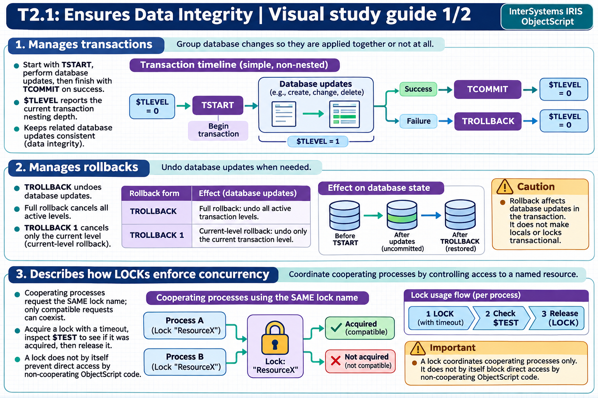

[Topic contents](../index.md) · [Full topic guide](../study.md) · [All topics](../../../index.md)

# T2.1: Ensures Data Integrity

Saved 2 November 2026 from [exam-prep.es](https://exam-prep.es/exams/objectscript/knowledge/T2.1.html). Reference links require internet access.

## 1. Manages transactions



*This diagram covers sections 1–3; use the matching numbered panel for this page.* [Chapter diagrams](../visuals.md) · [Technical review notes](../../../visual-technical-notes.md)

### Key Points

- **TSTART**: Begins a transaction and increments $TLEVEL by 1
- **TCOMMIT**: Commits the transaction and decrements $TLEVEL by 1; actual commit occurs only when $TLEVEL returns to 0
- **$TLEVEL**: Special variable tracking transaction nesting depth (0 = no active transaction, max 255)
- **Nested transactions**: Each TSTART/TCOMMIT pair creates a nesting level; inner commits are deferred until the outermost TCOMMIT
- **Journaling**: All global changes within a transaction are journaled automatically, regardless of database journal settings

### Detailed Notes

#### Overview

Transactions in ObjectScript guarantee atomicity: either all changes within the transaction are applied, or none are. The TSTART command marks the beginning of a transaction and increments the $TLEVEL special variable. TCOMMIT marks the end of a successful transaction and decrements $TLEVEL. The actual commit to the database only happens when $TLEVEL reaches 0, meaning the outermost transaction has completed.

#### Basic Transaction Pattern

```objectscript
 TSTART
 TRY {
     SET ^Data("account", 1001, "balance") = ^Data("account", 1001, "balance") - 500
     SET ^Data("account", 1002, "balance") = ^Data("account", 1002, "balance") + 500
     TCOMMIT
 }
 CATCH ex {
     TROLLBACK
     WRITE "Error: ", ex.DisplayString(), !
 }
```

#### Nested Transactions

InterSystems IRIS supports nested transactions up to 255 levels. Each TSTART increments $TLEVEL, and each TCOMMIT decrements it. The key concept is that inner TCOMMIT calls do not actually commit data -- commitment is deferred until $TLEVEL reaches 0.

```objectscript
 WRITE "$TLEVEL = ", $TLEVEL, !   // 0
 TSTART
 WRITE "$TLEVEL = ", $TLEVEL, !   // 1
 SET ^Data("outer") = "value1"
 TSTART
 WRITE "$TLEVEL = ", $TLEVEL, !   // 2
 SET ^Data("inner") = "value2"
 TCOMMIT                           // $TLEVEL back to 1 (not yet committed)
 TCOMMIT                           // $TLEVEL back to 0 (all changes committed)
```

This design allows modular code where called methods can issue their own TSTART/TCOMMIT without knowing whether the caller already started a transaction.

### Documentation References

- [Transaction Processing](https://docs.intersystems.com/irislatest/csp/docbook/DocBook.UI.Page.cls?KEY=GAPPS_tp)
- [TSTART Command](https://docs.intersystems.com/irislatest/csp/docbook/DocBook.UI.Page.cls?KEY=RCOS_ctstart)
- [TCOMMIT Command](https://docs.intersystems.com/irislatest/csp/docbook/DocBook.UI.Page.cls?KEY=RCOS_ctcommit)
