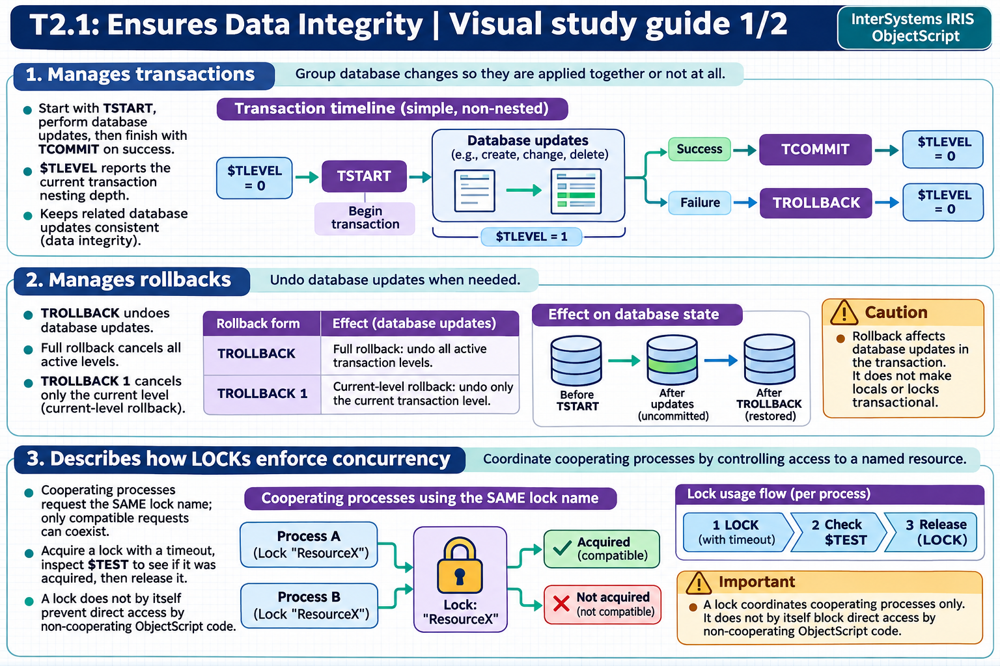

[Topic contents](../index.md) · [Full topic guide](../study.md) · [All topics](../../../index.md)

# T2.1: Ensures Data Integrity

Saved 2 November 2026 from [exam-prep.es](https://exam-prep.es/exams/objectscript/knowledge/T2.1.html). Reference links require internet access.

## 2. Manages rollbacks



*This diagram covers sections 1–3; use the matching numbered panel for this page.* [Chapter diagrams](../visuals.md) · [Technical review notes](../../../visual-technical-notes.md)

### Key Points

- **TROLLBACK** (no argument): Rolls back ALL transaction levels and resets $TLEVEL to 0
- **TROLLBACK 1**: Rolls back only the current nesting level and decrements $TLEVEL by 1
- **Partial rollback**: TROLLBACK 1 undoes only the changes made at the current $TLEVEL
- **Non-rollbackable operations**: Local variables, $INCREMENT, $SEQUENCE, LOCK operations, and process-private globals are NOT rolled back
- **Error handling**: Always pair TROLLBACK with TRY-CATCH blocks for robust transaction management

### Detailed Notes

#### Full Rollback vs Partial Rollback

TROLLBACK without an argument performs a complete rollback of all transaction levels, resetting $TLEVEL to 0 and undoing all global changes made since the first TSTART. TROLLBACK 1 performs a partial rollback, undoing only the changes made at the current $TLEVEL and decrementing $TLEVEL by 1.

```objectscript
 TSTART
 SET ^Data("A") = 100
 TSTART
 SET ^Data("B") = 200
 TROLLBACK 1                  // Only ^Data("B") = 200 is rolled back; $TLEVEL decremented to 1
 WRITE "$TLEVEL = ", $TLEVEL, !  // 1
 TCOMMIT                      // ^Data("A") = 100 is committed
```

#### Complete Rollback Pattern

```objectscript
 TSTART
 SET ^Data("A") = 100
 TSTART
 SET ^Data("B") = 200
 TROLLBACK                    // ALL changes rolled back; $TLEVEL reset to 0
 WRITE "$TLEVEL = ", $TLEVEL, !  // 0
```

#### Critical: What TROLLBACK Does NOT Undo

Several operations are not affected by TROLLBACK:

- **Local variables**: Changes to local variables persist after rollback
- **$INCREMENT / $SEQUENCE**: These atomic operations are not transactional
- **LOCK operations**: Locks acquired within a transaction are released at the end of the transaction, but TROLLBACK does not "undo" lock operations
- **Process-private globals** (^||PPG): Not journaled, therefore not rolled back

```objectscript
 SET localVar = "before"
 TSTART
 SET localVar = "during"
 SET ^Data("test") = "transactional"
 TROLLBACK
 WRITE localVar, !          // "during" -- local variable NOT rolled back
 WRITE $GET(^Data("test"))  // "" -- global change WAS rolled back
```

### Documentation References

- [TROLLBACK Command](https://docs.intersystems.com/irislatest/csp/docbook/DocBook.UI.Page.cls?KEY=RCOS_ctrollback)
- [Rolling Back Transactions](https://docs.intersystems.com/irislatest/csp/docbook/DocBook.UI.Page.cls?KEY=GAPPS_tp)
