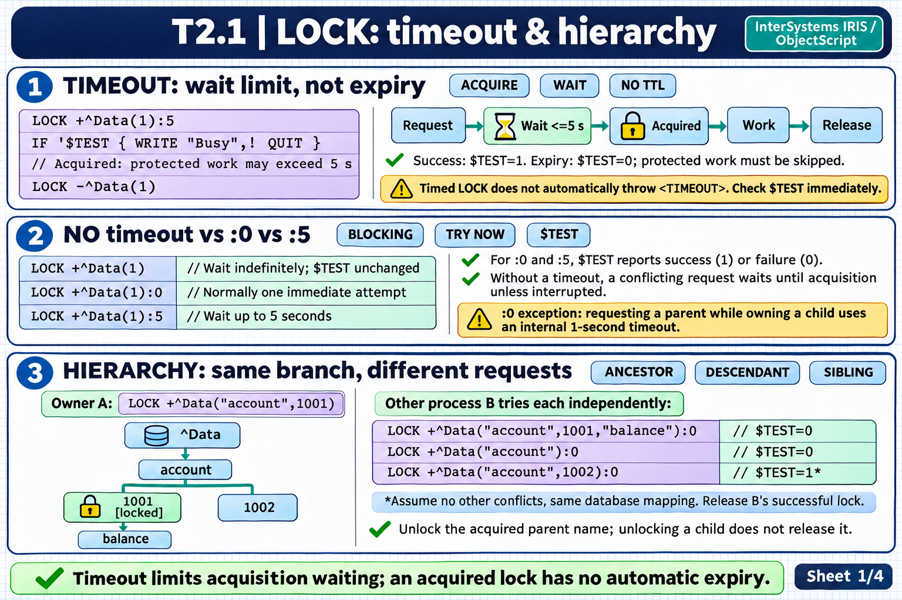
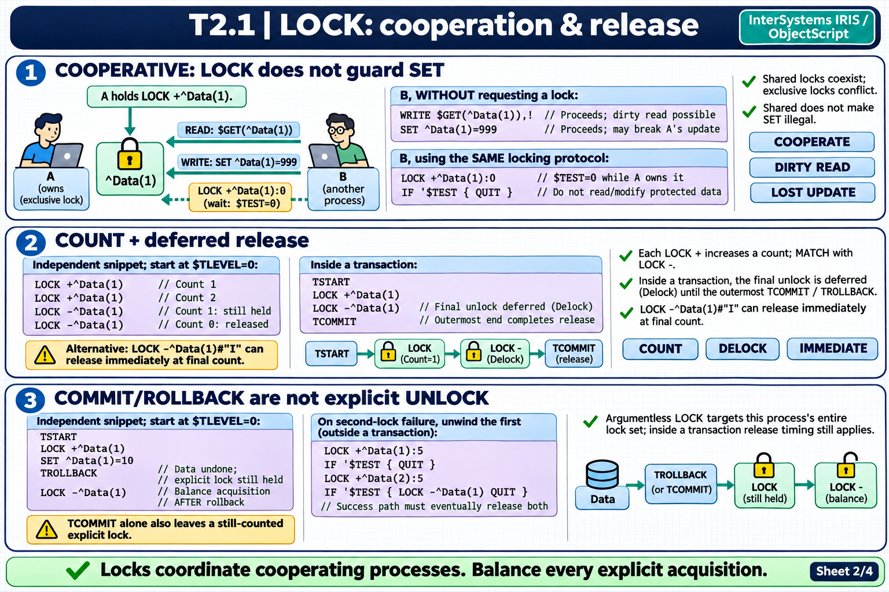
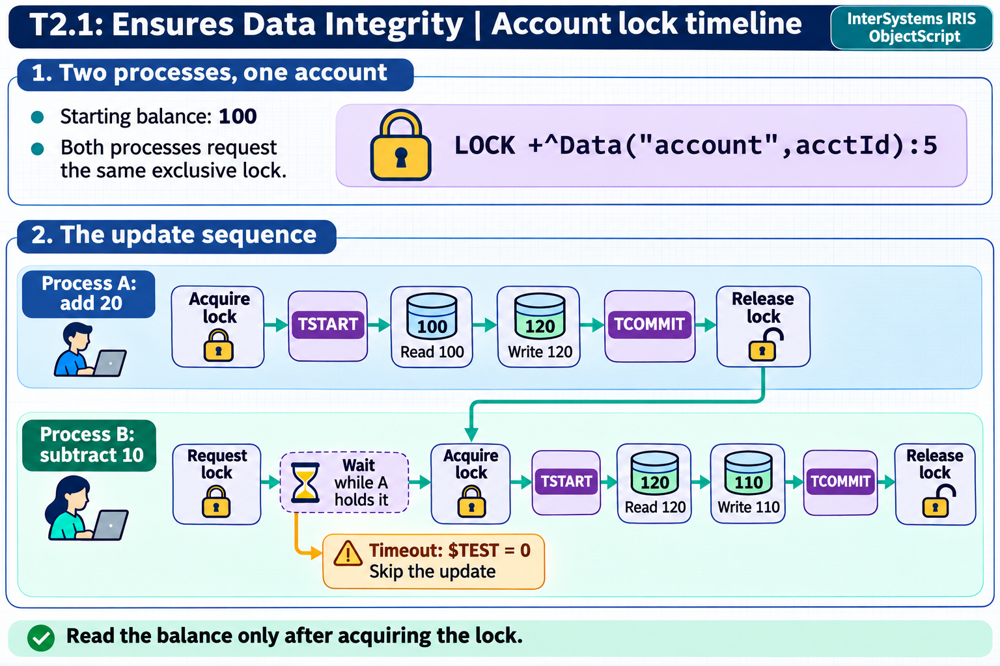
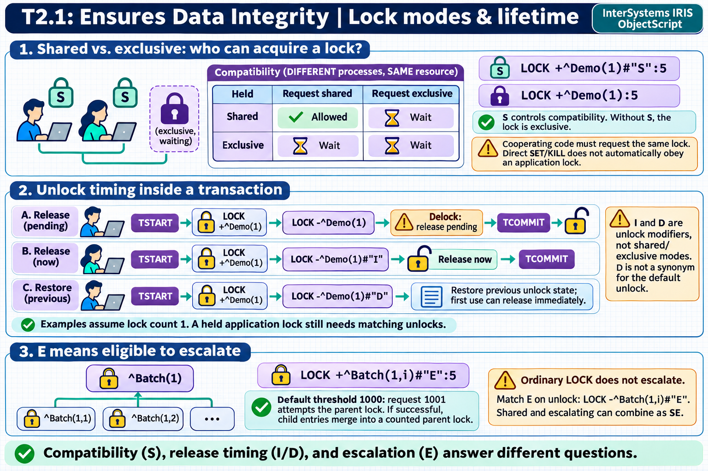

[Topic contents](../index.md) · [Full topic guide](../study.md) · [All topics](../../../index.md)

# T2.1: Ensures Data Integrity

Saved 2 November 2026 from [exam-prep.es](https://exam-prep.es/exams/objectscript/knowledge/T2.1.html). Reference links require internet access.

## 3. Describes how LOCKs enforce concurrency


*This diagram covers sections 1–3; use the matching numbered panel for this page.* [Chapter diagrams](../visuals.md) · [Technical review notes](../../../visual-technical-notes.md)

### Key Points

- **Incremental lock**: `LOCK +lockname` acquires a lock without releasing existing locks
- **Incremental unlock**: `LOCK -lockname` releases a specific lock without affecting others
- **Classic LOCK**: `LOCK lockname` releases ALL existing locks and acquires the new one (rarely used)
- **Lock timeout**: `LOCK +lockname:timeout` specifies maximum wait time in seconds; check $TEST for success
- **Exclusive locks**: Any lock without `#"S"` is exclusive (the default); blocks all other locks on that resource
- **Shared locks**: `LOCK +lockname#"S"` allows multiple readers; exclusive locks block other processes
- **Lock type flags**: `#"S"` (shared), `#"E"` (escalating), `#"I"` (immediate unlock), `#"D"` (history-dependent unlock timing); some combinations are supported (e.g., `#"SI"`), but `I` and `D` are mutually exclusive
- **Immediate unlock**: `LOCK -lockname#"I"` releases a lock immediately even within a transaction, overriding the default deferred behavior
- **Lock table**: System-wide resource viewable in Management Portal under System Operation &gt; Locks

### Detailed Notes





These worked fragments assume the stated transaction and ownership conditions. In the cooperation diagram, the conflicting `:0` request returns failure immediately in the normal case; “wait” marks contention, not a five-second wait. [Copyable examples and four-sheet revision route](../revision-examples.md).

#### Timeout is an acquisition deadline

In `LOCK +^Data("account",1001):5`, five seconds limit the wait to acquire the lock. They do not give an acquired lock a five-second lifetime. Acquisition after one second can be followed by work lasting beyond the original deadline; the owner must still release the lock.

| Request | If a conflicting lock exists | Result when the command returns |
| --- | --- | --- |
| `LOCK +^Data("account",1001)` | Waits indefinitely until acquisition, unless interrupted or the process ends | Does not change `$TEST` |
| `LOCK +^Data("account",1001):0` | Normally one attempt, then returns immediately | `$TEST=1` on success; `0` on failure |
| `LOCK +^Data("account",1001):5` | Waits until acquisition or the five-second deadline | `$TEST=1` on success; `0` on expiry |

Read `$TEST` immediately after a timed request. Failure grants no permission to enter protected code and does not automatically roll back work or release other incremental locks.

```objectscript
 LOCK +^Data("account",1001):0
 IF '$TEST {
     WRITE "Account busy; no update performed", !
     QUIT
 }
 // Protected work, even if it takes more than zero seconds
 LOCK -^Data("account",1001)
```

A conflict initially causes waiting, not an exception. Expiry of this timeout sets `$TEST=0`; it does not automatically throw `<TIMEOUT>`. `TRY/CATCH` alone therefore does not handle it. An API can expose its own timeout exception or status: consult that API's contract rather than treating `<TIMEOUT>` as the universal ObjectScript lock result.

There is a documented edge case for `:0`: requesting a parent while already owning a child lock uses an internal one-second timeout. See [LOCK timeout](https://docs.intersystems.com/irislatest/csp/docbook/DocBook.UI.Page.cls?KEY=RCOS_clock) and [creating locks with timeouts](https://docs.intersystems.com/irislatest/csp/docbook/DocBook.UI.Page.cls?KEY=GAPPS_lockbasics).

#### A global lock and its subnodes

Lock names form a hierarchy. An exclusive lock on `^Data` conflicts with other processes' locks anywhere below it. Locking `^Data("account",1001)` covers that branch: descendants and ancestors conflict; sibling accounts can be locked independently. This does not create a separate explicit entry for every descendant.

Assume A holds `LOCK +^Data("account",1001)` and B tries each request separately:

| B's request | Outcome while A holds the exclusive lock |
| --- | --- |
| `LOCK +^Data("account",1001):0` | Conflict: same node |
| `LOCK +^Data("account",1001,"balance"):0` | Conflict: descendant |
| `LOCK +^Data("account"):0` or `LOCK +^Data:0` | Conflict: ancestor covers A's branch |
| `LOCK +^Data("account",1002):0` | Compatible sibling, assuming no other conflict |

Unlock the name acquired: `LOCK -^Data("account",1001)`. Unlocking its `"balance"` child does not release the parent. A name need not refer to existing data; locking does not create a global value. These examples assume both sessions resolve the name to the same database. See [lock names and implicit locks](https://docs.intersystems.com/irislatest/csp/docbook/DocBook.UI.Page.cls?KEY=GAPPS_lockbasics).

#### What other processes can read and write

ObjectScript locking is cooperative: it coordinates lock requests, without intercepting ordinary global reads or writes. The owner continues running; other processes can work on unrelated resources.

| What B does while A holds an exclusive account lock | Result |
| --- | --- |
| Reads `^Data("account",1001,"balance")` without a lock | Read proceeds; can see an uncommitted value |
| Writes it with `SET`, without a lock | Write proceeds, subject to permissions; can break the intended update sequence |
| Requests the same branch with a shared or exclusive lock first | Waits or times out; B must skip protected work on failure |
| Requests another account's lock | Can proceed if that branch has no conflict |

Cooperating readers take shared locks and writers take exclusive locks **before** accessing data. A shared owner permits another shared reader, while an exclusive writer waits. A shared lock does not make `SET` illegal: application code must respect the protocol. SQL adds automatic locking and isolation rules (section 6).

For example, A reads balance 100, B bypasses the protocol and writes 999, then A writes its calculated 120: B's update is lost despite A's lock. Both must cooperate. See [locking and concurrency control](https://docs.intersystems.com/irislatest/csp/docbook/DocBook.UI.Page.cls?KEY=GAPPS_lockbasics).

#### Incremental Lock Pattern

An incremental `LOCK +` acquires a lock without releasing the process's other locks. For a read-modify-write operation, acquire the lock before reading the balance and hold it until the transaction commits or rolls back. The following example assumes there is no outer transaction and that the account already exists.

```objectscript
 // Acquire lock with 5-second timeout
 LOCK +^Data("account", acctId):5
 IF '$TEST {
     WRITE "Could not acquire lock", !
     QUIT
 }
 TRY {
     TSTART
     // Critical section: read-modify-write
     SET balance = ^Data("account", acctId, "balance")
     SET ^Data("account", acctId, "balance") = balance + amount
     TCOMMIT
 }
 CATCH ex {
     TROLLBACK
     WRITE "Update failed: ", ex.DisplayString(), !
 }
 LOCK -^Data("account", acctId)     // Always release the lock
```

#### Two processes updating the same account

The account starts at 100. Process A adds 20 and process B subtracts 10. Both request the same exclusive lock. A reads 100 and commits 120, then releases the lock. B can then acquire the lock, read 120, and commit 110. If B's lock attempt times out, `$TEST` is 0 and B skips the update. The transaction groups each write with any other database changes in that unit of work. The lock controls when the other process can start its read-modify-write sequence.



#### Shared vs Exclusive Locks

Any lock without the `#"S"` flag is an **exclusive lock** (also called a write lock). There is no explicit "exclusive" flag — the absence of `#"S"` makes a lock exclusive by default. For cooperating processes, shared locks permit concurrent readers, while exclusive locks prevent competing lock acquisition. Direct access without locking still proceeds:

- An existing **shared lock** prevents other processes from acquiring an **exclusive lock** on that resource
- An existing **exclusive lock** prevents other processes from acquiring **any lock** (shared or exclusive) on that resource
- Multiple processes **can** hold shared locks on the same resource simultaneously

```objectscript
 // Shared lock for reading (multiple readers allowed)
 LOCK +^Data("report")#"S":5
 IF $TEST {
     // Read operations
     LOCK -^Data("report")#"S"
 }

 // Exclusive lock for writing (blocks all other locks)
 LOCK +^Data("report"):5
 IF $TEST {
     // Write operations
     LOCK -^Data("report")
 }
```

#### Three independent questions: compatibility, release timing, escalation



| Question | Modifier | Meaning |
| --- | --- | --- |
| Who can hold a compatible lock? | `#"S"` | Shared; omitting S means exclusive. Different processes can share S, but S/exclusive and exclusive/exclusive conflict. |
| When does an unlock take effect? | `#"I"` / `#"D"` | I releases immediately when the count reaches zero; D restores the previous unlock state and depends on lock history. Both apply only to unlocks. |
| Can many sibling locks merge? | `#"E"` | Enables escalation; use E on the matching unlock too. `#"SE"` combines shared and escalating. |

#### Default unlock, immediate unlock, and D are different

For a lock with count 1, an ordinary `LOCK -` inside a transaction normally leaves a pending release (**Delock**) until the transaction ends. `#"I"` makes that release immediate. `#"D"` restores prior unlock behavior: on the first lock/unlock cycle it can release immediately; after a previous ordinary unlock it can restore Delock. It is therefore inaccurate to describe D as simply the default unlock. Decrementing a count greater than 1 leaves the resource locked. Outside a transaction, release is immediate when the count reaches zero.

```objectscript
 // Separate examples, each starting with no existing lock and no outer transaction:
 TSTART
 LOCK +^Demo(1):5
 IF $TEST {
     LOCK -^Demo(1)       // Delock until transaction end
 }
 TCOMMIT

 TSTART
 LOCK +^Demo(1):5
 IF $TEST {
     LOCK -^Demo(1)#"I"  // Immediate release
 }
 TCOMMIT

 TSTART
 LOCK +^Demo(1):5
 IF $TEST {
     LOCK -^Demo(1)#"D"  // First cycle: can release immediately
 }
 TCOMMIT
```

An application lock that remains held still needs its matching unlocks: transaction completion does not replace application lock cleanup. Immediate release is suitable only when another process may safely use the resource before the remaining transaction finishes.

#### E-type escalation: a concrete parent/child example

Suppose process A holds E locks on `^Batch(1,1)` through `^Batch(1,1000)` with the default threshold of 1000. Its next request, `LOCK +^Batch(1,1001)#"E":5`, attempts to lock the parent `^Batch(1)`. If successful, the children merge into one counted parent lock. Process B's incompatible request for `^Batch(1,1500)` now conflicts even though A never explicitly locked that child. If the parent cannot be acquired, escalation does not take place. Check `$TEST` after timed requests.

Balance every successful E acquisition with an E unlock, for example `LOCK -^Batch(1,1001)#"E"`. Once escalated, the parent retains a count rather than individual child identities. Ordinary ObjectScript locks without E do not participate in this escalation. SQL commonly uses E locking for supported storage/IDKey layouts; section 4 explains its table-level effect.

#### Immediate vs Deferred Unlock Within Transactions

Each successful incremental acquisition adds to that name's count for the process and lock mode. Two acquisitions require two matching releases. Outside a transaction, reaching zero releases the lock immediately. Inside a transaction, a normal final `LOCK -name` puts it in **Delock**: other processes remain blocked until the outer transaction ends. An inner commit with `$TLEVEL>0` is insufficient.

For example, outside a transaction, start with no lock on this name:

```objectscript
 LOCK +^DemoCount:0
 IF '$TEST { QUIT }
 LOCK +^DemoCount:0               // Same owner: count becomes 2
 LOCK -^DemoCount                // Count becomes 1: still held
 LOCK -^DemoCount                // Count becomes 0: released
```

Compare independent sequences starting with `$TLEVEL=0` and no existing lock on the name:

| Sequence | When another process can acquire it |
| --- | --- |
| `TSTART`, acquire, `LOCK -name`, `TCOMMIT` | After commit: unlock was deferred |
| `TSTART`, acquire, `TCOMMIT`, with no unlock | Still held; issue matching `LOCK -name` |
| `TSTART`, acquire, `TROLLBACK`, with no unlock | Still held; rollback does not undo acquisition |
| `TSTART`, acquire, `LOCK -name#"I"`, `TCOMMIT` | At the immediate final unlock |

`#"D"` is an advanced modifier depending on prior unlock history; it can even release immediately. Use ordinary `LOCK -name` to demonstrate default deferral. See [LOCK unlock timing](https://docs.intersystems.com/irislatest/csp/docbook/DocBook.UI.Page.cls?KEY=RCOS_clock) and [transaction lock behavior](https://docs.intersystems.com/irislatest/csp/docbook/DocBook.UI.Page.cls?KEY=GAPPS_tp).

**Immediate unlock** (`#"I"`) overrides this behavior and releases the lock right away, even inside a transaction:

```objectscript
 TSTART
 LOCK +^Data("temp"):5
 // ... work with ^Data("temp") ...
 LOCK -^Data("temp")#"I"          // Released NOW, not at TCOMMIT
 // ... other work continues in the transaction ...
 TCOMMIT
```

Use immediate unlock only when early release preserves correctness. Releasing a lock protecting uncommitted changes can expose an unsafe intermediate state. In the main account pattern, finish commit/rollback before releasing the explicit acquisition.

An argumentless `LOCK` releases all locks owned by this process, including accumulated counts, across namespaces; inside a transaction release is deferred. It cannot release another process's locks. Use it only when this code owns the entire lock set. Process termination also releases its locks.

#### Lock Table

The **lock table** is IRIS's in-memory registry of resources, owning processes, modes, counts and waiting requests. It records both narrow and broad locks. A **table lock** protects an SQL table; a **row lock** protects a record. They are scopes of protection recorded in the registry, rather than alternatives to using the lock table. View it in Management Portal under **System Operation > Locks**.

The lock table is a system-wide in-memory structure tracking lock ownership and requests, viewable in Management Portal (System Operation &gt; Locks). When capacity is exhausted, `LOCK TABLE FULL` is logged and requests can wait for space. This is separate from a conflict on one account; timed requests still require outcome handling. See [managing the lock table](https://docs.intersystems.com/irislatest/csp/docbook/DocBook.UI.Page.cls?KEY=GAPPS_locktable).

### Documentation References

- [LOCK Command](https://docs.intersystems.com/irislatest/csp/docbook/DocBook.UI.Page.cls?KEY=RCOS_clock)
- [Lock Names, Hierarchy, and Timeouts](https://docs.intersystems.com/irislatest/csp/docbook/DocBook.UI.Page.cls?KEY=GAPPS_lockbasics)
- [Lock Management](https://docs.intersystems.com/irislatest/csp/docbook/DocBook.UI.Page.cls?KEY=GOBJ_concurrency)
- [Database Integrity Tutorial](https://docs.intersystems.com/irislatest/csp/docbook/DocBook.UI.Page.cls?KEY=TOS_Integrity)
