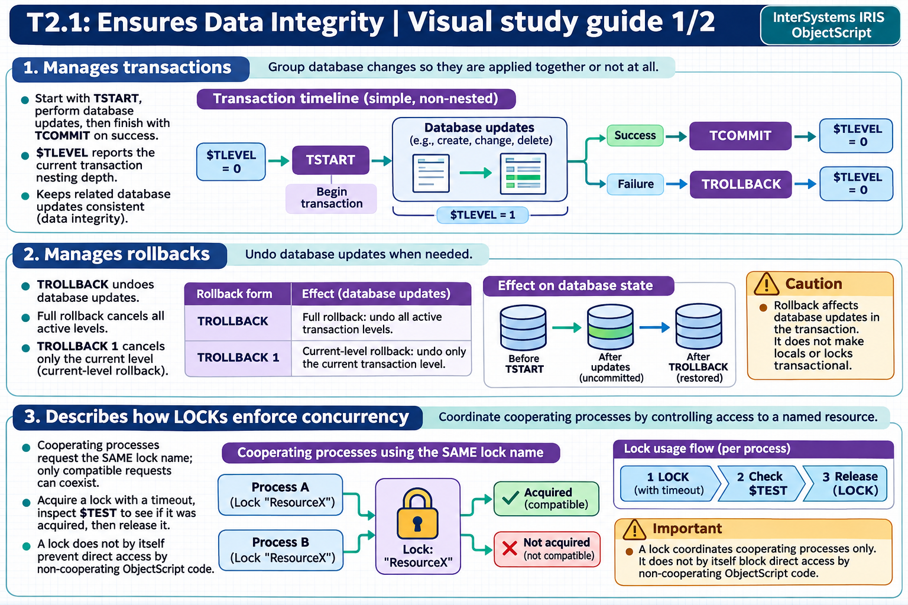

[Topic contents](../index.md) · [Full topic guide](../study.md) · [All topics](../../../index.md)

# T2.1: Ensures Data Integrity

Saved 2 November 2026 from [exam-prep.es](https://exam-prep.es/exams/objectscript/knowledge/T2.1.html). Reference links require internet access.

## 3. Describes how LOCKs enforce concurrency



*This diagram covers sections 1–3; use the matching numbered panel for this page.* [Chapter diagrams](../visuals.md) · [Technical review notes](../../../visual-technical-notes.md)

### Key Points

- **Incremental lock**: `LOCK +lockname` acquires a lock without releasing existing locks
- **Incremental unlock**: `LOCK -lockname` releases a specific lock without affecting others
- **Classic LOCK**: `LOCK lockname` releases ALL existing locks and acquires the new one (rarely used)
- **Lock timeout**: `LOCK +lockname:timeout` specifies maximum wait time in seconds; check $TEST for success
- **Exclusive locks**: Any lock without `#"S"` is exclusive (the default); blocks incompatible requests by other processes on that resource
- **Shared locks**: `LOCK +lockname#"S"` allows multiple readers; exclusive locks block other processes
- **Lock type flags**: `#"S"` (shared), `#"E"` (escalating), `#"I"` (immediate unlock), `#"D"` (restore prior unlock state) — combinable (e.g., `#"SI"`)
- **Immediate unlock**: `LOCK -lockname#"I"` releases a lock immediately even within a transaction, when its lock count reaches zero
- **Lock table**: System-wide resource viewable in Management Portal under System Operation &gt; Locks

### Detailed Notes

#### Incremental Lock Pattern

An incremental `LOCK +` acquires a lock without releasing the process's other locks. For a read-modify-write operation, acquire the lock before reading the balance and hold it until the transaction commits or rolls back. The following example assumes there is no outer transaction and that the account already exists.

```objectscript
 // Acquire lock with 5-second timeout
 LOCK +^Data("account", acctId):5
 IF '$TEST {
     WRITE "Could not acquire lock", !
     QUIT
 }
 TRY {
     TSTART
     // Critical section: read-modify-write
     SET balance = ^Data("account", acctId, "balance")
     SET ^Data("account", acctId, "balance") = balance + amount
     TCOMMIT
 }
 CATCH ex {
     TROLLBACK
 }
 LOCK -^Data("account", acctId)     // Always release the lock
```

#### Two processes updating the same account

The account starts at 100. Process A adds 20 and process B subtracts 10. Both request the same exclusive lock. A reads 100 and commits 120, then releases the lock. B can then acquire the lock, read 120, and commit 110. If B's lock attempt times out, `$TEST` is 0 and B skips the update. The transaction groups each write with any other database changes in that unit of work. The lock controls when the other process can start its read-modify-write sequence.


#### Shared vs Exclusive Locks

Any lock without the `#"S"` flag is an **exclusive lock** (also called a write lock). There is no explicit "exclusive" flag — the absence of `#"S"` makes a lock exclusive by default. Shared locks allow multiple processes to read concurrently, while exclusive locks provide sole access:

- An existing **shared lock** prevents other processes from acquiring an **exclusive lock** on that resource
- An existing **exclusive lock** prevents other processes from acquiring **any lock** (shared or exclusive) on that resource
- Multiple processes **can** hold shared locks on the same resource simultaneously

```objectscript
 // Shared lock for reading (multiple readers allowed)
 LOCK +^Data("report")#"S":5
 IF $TEST {
     // Read operations
     LOCK -^Data("report")#"S"
 }

 // Exclusive lock for writing (blocks all other locks)
 LOCK +^Data("report"):5
 IF $TEST {
     // Write operations
     LOCK -^Data("report")
 }
```

#### Three independent questions: compatibility, release timing, escalation


| Question | Modifier | Meaning |
| --- | --- | --- |
| Who can hold a compatible lock? | `#"S"` | Shared; omitting S means exclusive. Different processes can share S, but S/exclusive and exclusive/exclusive conflict. |
| When does an unlock take effect? | `#"I"` / `#"D"` | I releases immediately when the count reaches zero; D restores the previous unlock state and depends on lock history. Both apply only to unlocks. |
| Can many sibling locks merge? | `#"E"` | Enables escalation; use E on the matching unlock too. `#"SE"` combines shared and escalating. |

#### Default unlock, immediate unlock, and D are different

For a lock with count 1, an ordinary `LOCK -` inside a transaction normally leaves a pending release (**Delock**) until the transaction ends. `#"I"` makes that release immediate. `#"D"` restores prior unlock behavior: on the first lock/unlock cycle it can release immediately; after a previous ordinary unlock it can restore Delock. It is therefore inaccurate to describe D as simply the default unlock. Decrementing a count greater than 1 leaves the resource locked. Outside a transaction, release is immediate when the count reaches zero.

```objectscript
 // Separate examples, each starting with no existing lock and no outer transaction:
 TSTART
 LOCK +^Demo(1):5
 IF $TEST {
     LOCK -^Demo(1)       // Delock until transaction end
 }
 TCOMMIT

 TSTART
 LOCK +^Demo(1):5
 IF $TEST {
     LOCK -^Demo(1)#"I"  // Immediate release
 }
 TCOMMIT

 TSTART
 LOCK +^Demo(1):5
 IF $TEST {
     LOCK -^Demo(1)#"D"  // First cycle: can release immediately
 }
 TCOMMIT
```

An application lock that remains held still needs its matching unlocks: transaction completion does not replace application lock cleanup. Immediate release is suitable only when another process may safely use the resource before the remaining transaction finishes.

#### E-type escalation: a concrete parent/child example

Suppose process A holds E locks on `^Batch(1,1)` through `^Batch(1,1000)` with the default threshold of 1000. Its next request, `LOCK +^Batch(1,1001)#"E":5`, attempts to lock the parent `^Batch(1)`. If successful, the children merge into one counted parent lock. Process B's incompatible request for `^Batch(1,1500)` now conflicts even though A never explicitly locked that child. If the parent cannot be acquired, escalation does not take place. Check `$TEST` after timed requests.

Balance every successful E acquisition with an E unlock, for example `LOCK -^Batch(1,1001)#"E"`. Once escalated, the parent retains a count rather than individual child identities. Ordinary ObjectScript locks without E do not participate in this escalation. SQL commonly uses E locking for supported storage/IDKey layouts; section 4 explains its table-level effect.

#### Lock table: the registry, not a table-level lock

The **lock table** is IRIS's in-memory registry of resources, owning processes, modes, counts and waiting requests. It records both narrow and broad locks. A **table lock** protects an SQL table; a **row lock** protects a record. They are scopes of protection recorded in the registry, rather than alternatives to using the lock table. View it in Management Portal under **System Operation > Locks**. Exhausting its capacity can cause `<LOCKTABLEFULL>`.

ObjectScript application locks coordinate code that requests compatible names. A direct `SET` or `KILL` does not automatically request the application lock, and an arbitrary lock name need not match the name generated for SQL rows. SQL DML normally acquires its row locks automatically. Use a consistent locking protocol when mixing access paths.

### Documentation References

- [LOCK Command](https://docs.intersystems.com/irislatest/csp/docbook/DocBook.UI.Page.cls?KEY=RCOS_clock)
- [Lock Management](https://docs.intersystems.com/irislatest/csp/docbook/DocBook.UI.Page.cls?KEY=GOBJ_concurrency)
- [Database Integrity Tutorial](https://docs.intersystems.com/irislatest/csp/docbook/DocBook.UI.Page.cls?KEY=TOS_Integrity)

- [Managing the Lock Table](https://docs.intersystems.com/irislatest/csp/docbook/DocBook.UI.Page.cls?KEY=GCOS_locktable)
