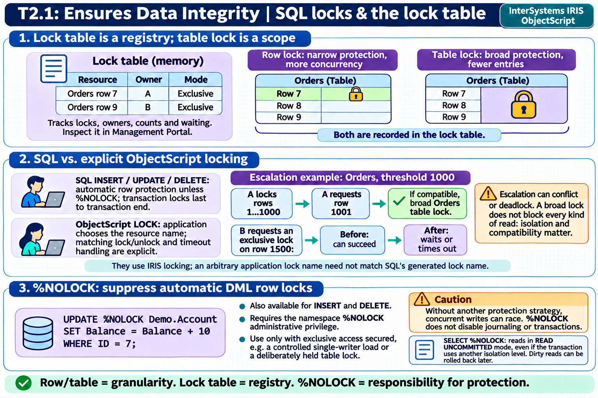

[Topic contents](../index.md) · [Full topic guide](../study.md) · [All topics](../../../index.md)

# T2.1: Ensures Data Integrity

Saved 2 November 2026 from [exam-prep.es](https://exam-prep.es/exams/objectscript/knowledge/T2.1.html). Reference links require internet access.

## 4. Describes lock escalation threshold and effect on row locks versus table locks


*This diagram covers sections 4–6; use the matching numbered panel for this page.* [Chapter diagrams](../visuals.md) · [Technical review notes](../../../visual-technical-notes.md)

### Key Points

- **Default threshold**: 1000; requesting the next eligible lock attempts escalation.
- **Trade-off**: Fewer lock-table entries, but a wider conflict scope.
- **Scope**: Locks accumulated by a process for a table; `LockThreshold` is a system-wide configuration value.
- **Access**: Compatibility and isolation determine waiting; a table lock does not block every read.
- **%NOLOCK**: SELECT reads uncommitted data; DML skips automatic row locking. These are different effects.

### Detailed Notes

SQL normally locks rows changed by INSERT, UPDATE and DELETE until the transaction ends. As locks accumulate, IRIS can replace narrow protection with a broader table lock to reduce pressure on the lock registry. The default threshold is 1000: escalation is attempted on request 1001, not merely because 1000 rows exist in the table. SQL supports E-type and traditional escalation strategies depending on storage and IDKey layout; ordinary ObjectScript LOCK without E does not automatically escalate.

#### Registry versus protection scope



| Concept | What it does | Typical use or trade-off |
| --- | --- | --- |
| Lock table | Records current locks and their owners in memory | Inspect contention and waiting; monitor capacity. |
| Row lock | Protects a particular record | Independent rows can be updated concurrently; many locks consume registry space. |
| Table lock | Protects a whole SQL table in shared or exclusive mode | Deliberate bulk work or escalation; broader conflicts, fewer entries. |

#### Worked example: another row becomes affected

A transaction in process A updates Orders rows 1–1000. An exclusive request by B for another row, 1500, can succeed while A only protects its own rows. A then requests eligible row lock 1001. If escalation succeeds, A now holds broad table protection, and B's new incompatible request for row 1500 waits or times out. If B already holds an incompatible row lock, it can prevent A from obtaining the broader lock; overlapping transactions can deadlock. Do not assume escalation always succeeds immediately.

A broad exclusive lock blocks conflicting locking requests. Reads that do not request conflicting locks can still observe data according to their isolation rules, including uncommitted data at READ UNCOMMITTED. Thus “locks the whole table” does not mean “blocks all access.”

```objectscript
 // Inspect the actual system setting; do not change it just to run an example.
 WRITE $SYSTEM.SQL.Util.GetOption("LockThreshold"), !
```

For explicit table protection, SQL supports `LOCK TABLE Demo.Orders IN EXCLUSIVE MODE` or `IN SHARE MODE`. Row locking is appropriate when transactions work on separate records; a deliberate table lock can suit controlled bulk operations where broad contention is acceptable. Follow the SQL LOCK/UNLOCK transaction-lifetime rules. Keep transactions short and monitor the registry before changing system-wide thresholds.

#### Releasing a whole-table lock: identify its origin

| How the table became locked | Normal release |
| --- | --- |
| SQL-managed row locks escalated during a transaction | SQL manages their counts and releases the transaction's locks at its end; an inner ObjectScript commit is insufficient |
| Explicit SQL `LOCK TABLE Account IN EXCLUSIVE MODE` | Matching `UNLOCK TABLE Account IN EXCLUSIVE MODE`; commit/rollback alone does not balance the explicit acquisition |
| Explicit ObjectScript `LOCK +^Data` as an application-wide gate | Matching `LOCK -^Data`, respecting count and transaction timing |

Escalating child unlocks reduce the count; once sufficiently reduced, the implicit parent lock can disappear. SQL manages its own row-lock bookkeeping. Do not unlock guessed storage-global names to undo SQL escalation. A root global lock is not necessarily an SQL table lock: tables can use several globals.

For an explicit SQL table lock, request release before ending the transaction. Assuming no outer transaction, the successful path is:

```objectscript
 &sql(START TRANSACTION)
 &sql(LOCK TABLE Account IN EXCLUSIVE MODE WAIT 5)
 IF SQLCODE < 0 {
     WRITE "Lock failed: ", SQLCODE, " ", %msg, !
     &sql(ROLLBACK)
     QUIT
 }
 // Perform batch work and handle statement errors here
 &sql(UNLOCK TABLE Account IN EXCLUSIVE MODE)
 // Release is deferred while the transaction is active
 &sql(COMMIT)
```

The error path after successful acquisition must also balance the lock and roll back. Repeated explicit acquisitions require the same number of unlocks in the same mode. `UNLOCK TABLE Account IN EXCLUSIVE MODE IMMEDIATE` releases at once when its count reaches zero, even inside a transaction; use only when early release is correct. See [SQL LOCK](https://docs.intersystems.com/irislatest/csp/docbook/DocBook.UI.Page.cls?KEY=RSQL_lock), [SQL UNLOCK](https://docs.intersystems.com/irislatest/csp/docbook/DocBook.UI.Page.cls?KEY=RSQL_unlock), and [escalating locks](https://docs.intersystems.com/irislatest/csp/docbook/DocBook.UI.Page.cls?KEY=GAPPS_lockbasics).

#### %NOLOCK: query visibility versus write protection

`%NOLOCK` is an IRIS SQL keyword option, placed after the statement verb. It is not the SQL Server-style syntax `FROM Account %NOLOCK`.

```sql
SELECT %NOLOCK ID, Balance FROM Demo.Account WHERE ID = 7;
```

For SELECT, it performs no locking on the query's tables and uses **READ UNCOMMITTED** regardless of the transaction's current isolation mode. For example, A changes Balance from 100 to 120 without committing; B can read 120 using SELECT %NOLOCK; A rolls back, leaving 100. B's observed 120 was a dirty read. This is inappropriate when a decision requires committed data.

```sql
UPDATE %NOLOCK Demo.Account SET Balance = Balance + 10 WHERE ID = 7;
```

For INSERT, UPDATE and DELETE, it suppresses automatic row locking. Reserve this for controlled exclusive access, such as a single-writer load or deliberately held table protection. Without another protection strategy, concurrent writers can race. It requires the corresponding namespace administrative privilege and does not itself disable journaling, transactions or rollback. It is distinct from `%NOJOURN`.

### Documentation References

- [Releasing explicit table locks](https://docs.intersystems.com/irislatest/csp/docbook/DocBook.UI.Page.cls?KEY=RSQL_unlock)

- [ObjectScript LOCK and E-type escalation](https://docs.intersystems.com/irislatest/csp/docbook/DocBook.UI.Page.cls?KEY=RCOS_clock)
- [SQL UPDATE: transaction locking and %NOLOCK](https://docs.intersystems.com/irislatest/csp/docbook/DocBook.UI.Page.cls?KEY=RSQL_UPDATE)
- [SQL SELECT: %NOLOCK and isolation](https://docs.intersystems.com/irislatest/csp/docbook/DocBook.UI.Page.cls?KEY=RSQL_SELECT)
- [Explicit SQL table locks](https://docs.intersystems.com/irislatest/csp/docbook/DocBook.UI.Page.cls?KEY=RSQL_lock)
- [Managing the Lock Table](https://docs.intersystems.com/irislatest/csp/docbook/DocBook.UI.Page.cls?KEY=GCOS_locktable)
