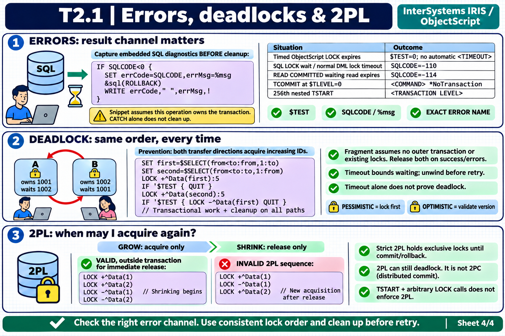

[Topic contents](../index.md) · [Full topic guide](../study.md) · [All topics](../../../index.md)

# T2.1: Ensures Data Integrity

Saved 2 November 2026 from [exam-prep.es](https://exam-prep.es/exams/objectscript/knowledge/T2.1.html). Reference links require internet access.

## 5. Differentiates between pessimistic and optimistic concurrency controls


*This diagram covers sections 4–6; use the matching numbered panel for this page.* [Chapter diagrams](../visuals.md) · [Technical review notes](../../../visual-technical-notes.md)

### Key Points

- **Pessimistic concurrency**: Locks resources BEFORE reading; serializes cooperating conflicting access but can cause waiting or deadlocks
- **Optimistic concurrency**: Reads without locking; checks for conflicts at commit time; better throughput for low-contention scenarios
- **Object concurrency**: Default 1 (Atomic read); inspect an object with `%Concurrency`. The method argument, class and process defaults can override the effective mode.
- **Optimistic via %VersionId**: Uses a version counter to detect concurrent modifications
- **SQL ISOLATION LEVEL**: READ UNCOMMITTED (default), READ COMMITTED, and READ VERIFIED provide different read guarantees; verify the process setting

### Detailed Notes



Read the three panels together: an error result needs cleanup, a shared acquisition order prevents circular waiting, and 2PL governs acquisition versus release. [Copyable examples](../revision-examples.md#4-errors-deadlocks-and-2pl).

#### Pessimistic Concurrency

In pessimistic concurrency, a process acquires an exclusive lock before reading or modifying a resource. Other cooperating processes wait for incompatible locks; direct global access without locking can still proceed. It is suitable for high-contention scenarios where conflicts are frequent.

```objectscript
 // Pessimistic approach: lock first, then read and modify
 LOCK +^Data("customer", custId):5
 IF '$TEST {
     WRITE "Resource busy", !
     QUIT
 }
 SET data = ^Data("customer", custId)
 // ... modify data ...
 SET ^Data("customer", custId) = data
 LOCK -^Data("customer", custId)
```

#### Optimistic Concurrency

In optimistic concurrency, a process reads data without acquiring locks. Before committing changes, it verifies that no other process has modified the data in the meantime. If a conflict is detected, the operation is retried or reported as a failure. This works well in low-contention environments.

```objectscript
 // Optimistic approach using %VersionId in persistent classes
 SET obj = ##class(MyApp.Customer).%OpenId(custId)
 // ... modify obj properties ...
 SET sc = obj.%Save()
 IF $$$ISERR(sc) {
     // Check if it's a concurrency conflict
     // %VersionId mismatch means another process modified the object
     WRITE "Concurrency conflict - retry needed", !
 }
```

#### Object concurrency: default 1 (Atomic read)

The usual object concurrency default is **1 (Atomic read)**. An omitted `%OpenId` concurrency argument means `-1`: use the class's `DEFAULTCONCURRENCY`, which normally obtains the process default (initially 1). An explicit method argument or class override can change this. The process default can be changed with `$SYSTEM.OBJ.SetConcurrencyMode()`.

**Naming:** the effective object property is `%Concurrency`, not `%ConcurrencyMode`. Mode 1 provides an atomic read, acquiring a temporary shared lock when needed; it does not retain a lock while you edit the object or automatically detect a stale copy.

InterSystems IRIS persistent objects support several concurrency modes:

- **0 (None)**: No locking; fastest but no protection
- **1 (Atomic read, default)**: Temporary shared lock during open when needed for an atomic read; no retained read lock
- **2 (Shared locks)**: Always takes a shared lock during open, then releases it after the read
- **3 (SharedRetain)**: Shared lock on open retained until close
- **4 (PessimisticRetain)**: Exclusive lock on open retained until close; maximum protection

```objectscript
 // Open with pessimistic locking
 SET obj = ##class(MyApp.Customer).%OpenId(custId, 4, .sc)  // concurrency = 4
```

#### Deadlock prevention and two-phase locking

These terms appear as alternatives in the T2.1 quiz; the study pack previously had no dedicated explanation in another chapter. They address different concerns from optimistic version checking:

| Concept | Question it answers | Example |
| --- | --- | --- |
| Pessimistic control | When do I reserve access? | Lock before reading |
| Optimistic control | How do I detect a stale update? | Compare a version before accepting the write |
| Deadlock prevention | How do I avoid circular waiting? | Every transfer locks accounts in increasing ID order |
| Two-phase locking (2PL) | When may I acquire and release locks? | After the first release, acquire no new locks |

**Deadlock example:** A owns account 1001 and waits for 1002; B owns 1002 and waits for 1001. Without timeouts, neither reaches its unlock. Prevent the cycle by using the same acquisition order everywhere. A timeout bounds waiting, but recovery must release locks already owned. Retrying while retaining them can preserve the cycle.

This acquisition fragment assumes no outer transaction and no existing acquisitions of these names. Both transfer directions must calculate the same order:

```objectscript
 SET first=$SELECT(fromAcct<toAcct:fromAcct,1:toAcct)
 SET second=$SELECT(fromAcct<toAcct:toAcct,1:fromAcct)
 LOCK +^Data("account",first):5
 IF '$TEST { QUIT }
 LOCK +^Data("account",second):5
 IF '$TEST {
     LOCK -^Data("account",first)  // Unwind before retrying later
     QUIT
 }
 // Transactional transfer body with TRY/CATCH cleanup goes here
 // Finish commit/rollback before releasing either lock
 LOCK -^Data("account",second)
 LOCK -^Data("account",first)
```

The fragment omits the transfer body. A complete operation releases both acquired locks on success and exceptions, and retries the entire logical operation after cleanup. See [avoiding deadlocks](https://docs.intersystems.com/irislatest/csp/docbook/DocBook.UI.Page.cls?KEY=GAPPS_lockbasics).

**2PL** has a growing phase (acquire locks, release none) and a shrinking phase (release locks, acquire none). `acquire A → acquire B → work → release A → release B` follows it; `acquire A → release A → acquire B` does not. Strict 2PL additionally holds exclusive locks until commit/rollback. It can still deadlock while participants are acquiring locks; a shared order addresses that separate problem.

2PL is a concurrency protocol. Two-phase commit (2PC) coordinates distributed commitment. `TSTART` plus arbitrary `LOCK` calls does not automatically enforce 2PL; application code must follow the protocol. See [CMU Database Systems: two-phase locking](https://15445.courses.cs.cmu.edu/spring2026/notes/18-twophaselocking.pdf).

#### SQL isolation: default READ UNCOMMITTED

The initial SQL isolation setting is **READ UNCOMMITTED (`IsolationMode = 0`)**, not READ COMMITTED. It controls query visibility independently of object concurrency: object mode 1 and SQL isolation mode 1 are different settings. A connection or application can change the process setting; inspect the current value rather than assuming the initial default still applies.

```objectscript
 WRITE $SYSTEM.SQL.Util.GetOption("IsolationMode"), !
 // 0 = READ UNCOMMITTED; 1 = READ COMMITTED; 3 = READ VERIFIED
```

- **READ UNCOMMITTED (default)**: Can see another transaction's uncommitted changes, including values later rolled back.
- **READ COMMITTED**: Normally waits for pending inserts/updates. IRIS has exceptions, including pending deletes, aggregates, DISTINCT, GROUP BY and SELECT %NOLOCK; consult the SQL reference.
- **READ VERIFIED**: Still permits uncommitted data; rechecks relevant query conditions. It does not mean committed-only reads.

For example, if A changes a balance from 100 to 120 and later rolls back, a default SQL read can observe 120. Starting a transaction alone does not guarantee committed-only reads. Set the intended isolation explicitly, for example `SET TRANSACTION ISOLATION LEVEL READ COMMITTED`; the setting persists for the process until changed, including after COMMIT/ROLLBACK.

### Documentation References

- [Concurrency Control](https://docs.intersystems.com/irislatest/csp/docbook/DocBook.UI.Page.cls?KEY=GOBJ_concurrency)
- [Deadlock Prevention](https://docs.intersystems.com/irislatest/csp/docbook/DocBook.UI.Page.cls?KEY=GAPPS_lockbasics)
- [Object Concurrency](https://docs.intersystems.com/irislatest/csp/docbook/DocBook.UI.Page.cls?KEY=GOBJ_concurrency)
- [SQL Transaction Isolation Levels](https://docs.intersystems.com/irislatest/csp/docbook/DocBook.UI.Page.cls?KEY=RSQL_starttransaction)
