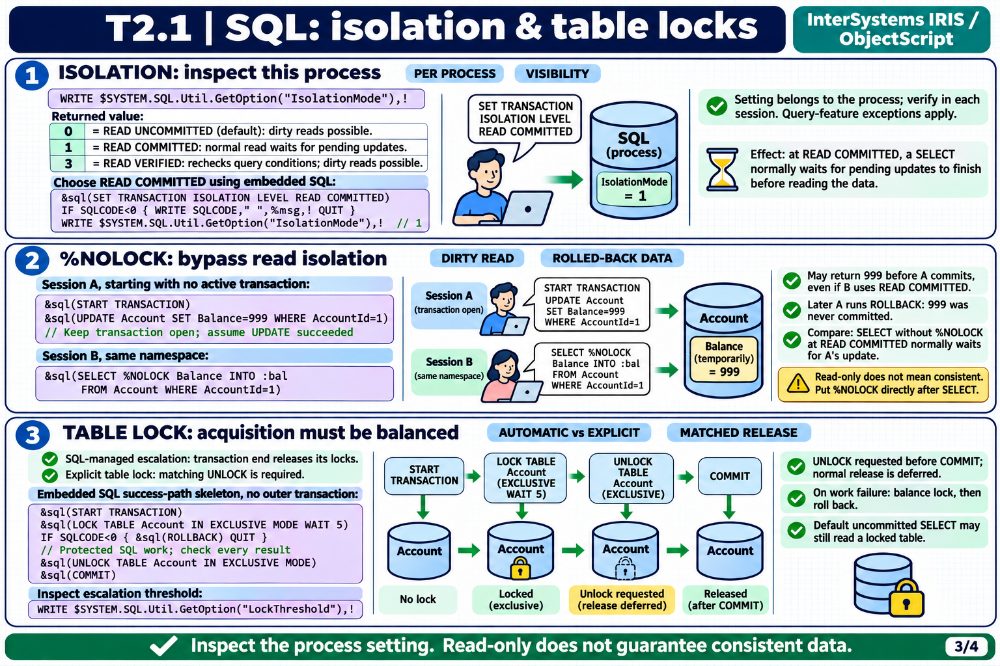

[Topic contents](../index.md) · [Full topic guide](../study.md) · [All topics](../../../index.md)

# T2.1: Ensures Data Integrity

Saved 2 November 2026 from [exam-prep.es](https://exam-prep.es/exams/objectscript/knowledge/T2.1.html). Reference links require internet access.

## 6. Uses transactions and applies concurrency controls in SQL scripts


*This diagram covers sections 4–6; use the matching numbered panel for this page.* [Chapter diagrams](../visuals.md) · [Technical review notes](../../../visual-technical-notes.md)

### Key Points

- **&sql(START TRANSACTION)**: Begins an SQL transaction using the same state as ObjectScript; repeated SQL starts do not nest like repeated `TSTART`
- **&sql(COMMIT)**: Commits the SQL transaction
- **&sql(ROLLBACK)**: Rolls back the SQL transaction
- **SQLCODE**: Check after each SQL statement; 0 = success, 100 = no data, negative = error
- **%NOLOCK hint**: For SELECT, forces READ UNCOMMITTED without query locks; for DML, suppresses automatic row locking
- **Parameterized queries**: Use host variables (:variable) in embedded SQL for safe value binding

### Detailed Notes



The SQL table-lock diagram is a success-path skeleton; check every statement and balance acquired locks on error paths. [Copyable examples](../revision-examples.md#3-sql-isolation-nolock-and-table-locks).

#### Basic Embedded SQL Transaction Pattern

```objectscript
 &sql(START TRANSACTION)
 &sql(UPDATE Account SET Balance = Balance - :amount WHERE AccountId = :fromAcct)
 IF SQLCODE < 0 {
     &sql(ROLLBACK)
     WRITE "Error on debit: ", %msg, !
     QUIT
 }
 &sql(UPDATE Account SET Balance = Balance + :amount WHERE AccountId = :toAcct)
 IF SQLCODE < 0 {
     &sql(ROLLBACK)
     WRITE "Error on credit: ", %msg, !
     QUIT
 }
 &sql(COMMIT)
```

#### Mixing ObjectScript and SQL Transactions

TSTART and &sql(START TRANSACTION) share transaction state and $TLEVEL. Their nesting semantics differ: repeated SQL starts do not increment an active transaction like repeated TSTART commands. Define transaction ownership before mixing them:

```objectscript
 TSTART
 SET ^AuditLog($INCREMENT(^AuditLog)) = $HOROLOG _ "|Transfer"
 &sql(UPDATE Account SET Balance = Balance - :amount WHERE AccountId = :fromAcct)
 IF SQLCODE < 0 {
     TROLLBACK
     QUIT
 }
 TCOMMIT
```

#### Inspect and choose isolation in the current process

The API expression `$SYSTEM.SQL.Util.GetOption("IsolationMode")` returns the current process setting. Use `WRITE` in ObjectScript Terminal to display it; this is ObjectScript, not a Bash command:

```objectscript
 WRITE $SYSTEM.SQL.Util.GetOption("IsolationMode"),!
 // 0 = READ UNCOMMITTED; 1 = READ COMMITTED; 3 = READ VERIFIED
```

To choose READ COMMITTED for this process and check the result:

```objectscript
 &sql(SET TRANSACTION ISOLATION LEVEL READ COMMITTED)
 IF SQLCODE < 0 {
     WRITE SQLCODE, " ", %msg, !
     QUIT
 }
 WRITE $SYSTEM.SQL.Util.GetOption("IsolationMode"),!  // 1
```

Check both sessions independently when experimenting. This setting controls SQL reads; it does not make direct global reads honor SQL isolation or force uncooperative writers to acquire locks. READ VERIFIED can still read uncommitted values. See [SQL isolation configuration](https://docs.intersystems.com/irislatest/csp/documatic/%25CSP.Documatic.cls?CLASSNAME=%25SYSTEM.SQL.Util&LIBRARY=%25SYS).

#### Using %NOLOCK: accept dirty reads explicitly

SELECT %NOLOCK reads in READ UNCOMMITTED mode regardless of the current transaction isolation mode. Place the option after SELECT:

```objectscript
 &sql(SELECT %NOLOCK Name, Balance INTO :name, :bal
      FROM Account
      WHERE AccountId = :acctId)
```

The query can see another transaction's changes that are later rolled back. Section 4 shows a dirty-read example and explains the separate DML meaning of %NOLOCK. It does not remove the need for a safe write-locking strategy.

#### SQL reads, writes, and timeout errors

SQL automatically requests locks for ordinary `INSERT`, `UPDATE`, and `DELETE`. An exclusive table lock conflicts with these operations. A default READ UNCOMMITTED `SELECT` can still read the table; a normal READ COMMITTED read can wait for an uncommitted update. `%NOLOCK`, aggregates, `DISTINCT`, and `GROUP BY` have documented exceptions to READ COMMITTED behavior. See [SELECT locking](https://docs.intersystems.com/irislatest/csp/docbook/DocBook.UI.Page.cls?KEY=RSQL_select) and [transaction isolation](https://docs.intersystems.com/irislatest/csp/docbook/DocBook.UI.Page.cls?KEY=RSQL_starttransaction).

| Operation whose wait expires | Reported outcome | Required response |
| --- | --- | --- |
| ObjectScript `LOCK +name:5` | `$TEST=0`, without an automatic `<TIMEOUT>` exception | Skip protected work; release earlier acquisitions owned by this operation |
| SQL `LOCK TABLE ... WAIT 5` | `SQLCODE=-110` and diagnostic `%msg` | Check the result and clean up |
| SQL `INSERT`, `UPDATE`, or `DELETE` unable to acquire its lock | Normally `SQLCODE=-110` | Handle the failed statement and surrounding transaction |
| READ COMMITTED query waiting for an update | `SQLCODE=-114` on lock timeout | Handle the failed read; output variables are not valid results |

`SQLCODE` and `%msg` belong to embedded SQL; Dynamic SQL exposes errors through its result object. Save diagnostics before cleanup statements overwrite them. A timeout identifies an expired wait, not necessarily a deadlock: a long-running owner can cause it too. See [SQL error codes](https://docs.intersystems.com/irislatest/csp/docbook/DocBook.UI.Page.cls?KEY=RERR_sql).

For a two-session exercise, A explicitly locks `Account` in exclusive mode. B tries `LOCK TABLE Account IN EXCLUSIVE MODE WAIT 2` and gets `-110` if A keeps holding the lock. A issues the matching `UNLOCK`; B's next attempt succeeds. Use persistent Terminal/SQL Shell sessions in the same namespace: a short-lived Portal SQL process may end and release its lock before B tests it. See [SQL LOCK examples](https://docs.intersystems.com/irislatest/csp/docbook/DocBook.UI.Page.cls?KEY=RSQL_lock).

#### Checking SQL Permissions Within Transactions

SQL operations within transactions respect the same privilege model. Combine transaction management with error handling for privilege failures:

```objectscript
 &sql(START TRANSACTION)
 &sql(INSERT INTO SensitiveData (PatientId, Diagnosis) VALUES (:pid, :diag))
 IF SQLCODE = -99 {
     &sql(ROLLBACK)
     WRITE "Insufficient SQL privileges", !
     QUIT
 }
 &sql(COMMIT)
```

### Documentation References

- [Embedded SQL](https://docs.intersystems.com/irislatest/csp/docbook/DocBook.UI.Page.cls?KEY=GSQL_esql)
- [SQL Transaction Processing](https://docs.intersystems.com/irislatest/csp/docbook/DocBook.UI.Page.cls?KEY=GAPPS_tp)
- [SELECT and %NOLOCK](https://docs.intersystems.com/irislatest/csp/docbook/DocBook.UI.Page.cls?KEY=RSQL_select)
- [SQL Timeout Error Codes](https://docs.intersystems.com/irislatest/csp/docbook/DocBook.UI.Page.cls?KEY=RERR_sql)
