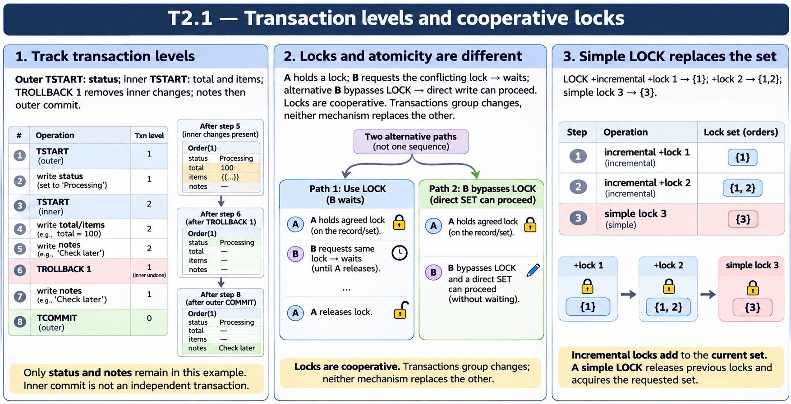

# T2.1 · 01 — Una transazione annidata si traccia per livelli

[Indice degli approfondimenti](README.md) · [Quiz originale](../quiz.md) · [Teoria](../study.md)

**Esercizi di partenza:** [Q1](../quiz.md#question-1-single) · [Q2](../quiz.md#question-2-single) · [Q3](../quiz.md#question-3-single) · [Q14](../quiz.md#question-14-single) · [Q15](../quiz.md#question-15-single) · [Q18](../quiz.md#question-18-single). L’approfondimento rielabora il concetto e aggiunge una variante; non riproduce soltanto la risposta del quiz.

## Il caso concreto

Order.status viene scritto al livello 1; total e items al livello 2; TROLLBACK 1 annulla solo il livello interno; notes viene poi scritto al livello 1.

```objectscript
TSTART
SET ^Order(101,"status") = "Processing"
TSTART
SET ^Order(101,"total") = 250
TROLLBACK 1
SET ^Order(101,"notes") = "Reviewed"
TCOMMIT
```

## Ragionamento passo per passo

Assumendo un contesto iniziale senza transazioni, i livelli sono 0→1→2→1→0. Restano status e notes; total torna al valore precedente. Un TCOMMIT interno riduce l’annidamento: non rende autonome e irrevocabili le scritture rispetto a un rollback esterno.

## Perché il distrattore è plausibile

Leggere il numero 1 di TROLLBACK come “annulla tutto”, oppure considerare un commit interno una transazione separata già definitiva.

## Lo spunto da portare oltre l’esercizio

Annota il livello e l’insieme delle scritture dopo ogni comando; così distingui rollback parziale e totale.



*Leggi il pannello 1; gli altri due collegano il caso agli altri approfondimenti del capitolo.*

## Variante: prova prima di leggere la soluzione

Se al posto di TROLLBACK 1 usi TROLLBACK senza argomento, qual è il livello finale subito dopo il comando?

<details>
<summary>Soluzione ragionata</summary>

0: l’intera transazione aperta viene annullata, non soltanto il livello interno.

</details>

## Riferimenti e precisazioni

- [TROLLBACK](https://docs.intersystems.com/irislatest/csp/docbook/DocBook.UI.Page.cls?KEY=RCOS_ctrollback)
- [LOCK](https://docs.intersystems.com/irislatest/csp/docbook/DocBook.UI.Page.cls?KEY=RCOS_clock)
- [Transazioni](https://docs.intersystems.com/irislatest/csp/docbook/DocBook.UI.Page.cls?KEY=GAPPS_tp)

[Note specifiche del capitolo](README.md#precisazioni-rispetto-al-quiz) · [Metodo e limiti della revisione](../../../approfondimenti-esercizi.md#metodo-e-limiti)
