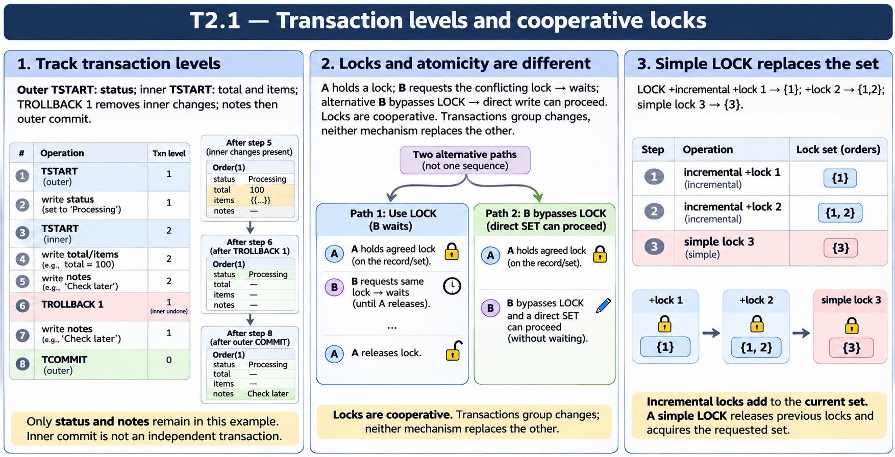

# T2.1 · 02 — LOCK è un protocollo tra partecipanti

[Indice degli approfondimenti](README.md) · [Quiz originale](../quiz.md) · [Teoria](../study.md)

**Esercizi di partenza:** [Q4](../quiz.md#question-4-single) · [Q5](../quiz.md#question-5-single) · [Q6](../quiz.md#question-6-single) · [Q7](../quiz.md#question-7-single) · [Q10](../quiz.md#question-10-single) · [Q11](../quiz.md#question-11-single) · [Q16](../quiz.md#question-16-multiple). L’approfondimento rielabora il concetto e aggiunge una variante; non riproduce soltanto la risposta del quiz.

## Il caso concreto

Il processo A ottiene un LOCK su ^Patient(42). Il processo B esegue SET senza tentare quel LOCK.

```objectscript
LOCK +^Patient(42):5
IF $TEST {
  ; aggiornamento protetto fra processi cooperanti
  LOCK -^Patient(42)
}
```

## Ragionamento passo per passo

Il LOCK ordinario non intercetta magicamente ogni SET: B può scrivere se non rispetta il protocollo. Il timeout limita l’attesa e $TEST indica l’acquisizione. Lock e transazione risolvono problemi diversi: esclusione fra partecipanti e atomicità degli aggiornamenti.

## Perché il distrattore è plausibile

Pensare che il global diventi fisicamente non scrivibile, o usare TSTART come sostituto dell’esclusione richiesta dalla logica applicativa.

## Lo spunto da portare oltre l’esercizio

Tutti i percorsi concorrenti devono concordare sulla stessa risorsa e sull’ordine di acquisizione.



*Leggi il pannello 2; gli altri due collegano il caso agli altri approfondimenti del capitolo.*

## Variante: prova prima di leggere la soluzione

Due processi usano risorse LOCK diverse per modificare lo stesso record. La sola presenza di LOCK garantisce la serializzazione?

<details>
<summary>Soluzione ragionata</summary>

No: non c’è conflitto sulla stessa risorsa, quindi il protocollo non coordina quei percorsi.

</details>

## Riferimenti e precisazioni

- [TROLLBACK](https://docs.intersystems.com/irislatest/csp/docbook/DocBook.UI.Page.cls?KEY=RCOS_ctrollback)
- [LOCK](https://docs.intersystems.com/irislatest/csp/docbook/DocBook.UI.Page.cls?KEY=RCOS_clock)
- [Transazioni](https://docs.intersystems.com/irislatest/csp/docbook/DocBook.UI.Page.cls?KEY=GAPPS_tp)

[Note specifiche del capitolo](README.md#precisazioni-rispetto-al-quiz) · [Metodo e limiti della revisione](../../../approfondimenti-esercizi.md#metodo-e-limiti)
