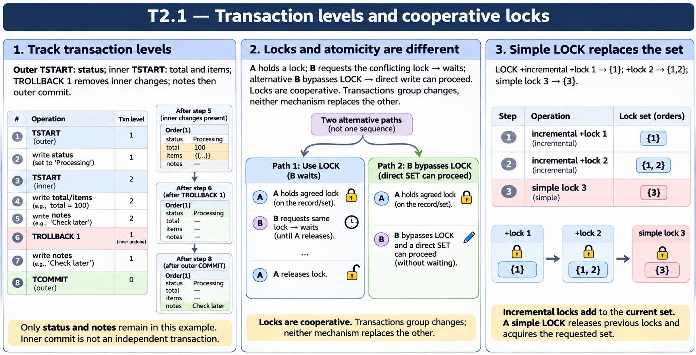

# T2.1 · 03 — Il segno più cambia l’insieme dei lock

[Indice degli approfondimenti](README.md) · [Quiz originale](../quiz.md) · [Teoria](../study.md)

**Esercizi di partenza:** [Q12](../quiz.md#question-12-single) · [Q13](../quiz.md#question-13-single). L’approfondimento rielabora il concetto e aggiunge una variante; non riproduce soltanto la risposta del quiz.

## Il caso concreto

Due acquisizioni incrementali sono seguite da una acquisizione semplice.

```objectscript
LOCK +^Order(1)
LOCK +^Order(2)
LOCK ^Order(3)
```

## Ragionamento passo per passo

Dopo il primo comando l’insieme è {1}; dopo il secondo {1,2}; la forma senza + rilascia i lock precedenti e acquisisce 3. Rimane quindi soltanto {3}. La forma - rilascia invece la risorsa indicata, rispettando il conteggio di acquisizioni.

## Perché il distrattore è plausibile

Leggere LOCK ^Order(3) come una terza aggiunta. La mancanza del più modifica il significato del comando.

## Lo spunto da portare oltre l’esercizio

Non osservare soltanto il record corrente: controlla l’intero insieme di risorse possedute.



*Leggi il pannello 3; gli altri due collegano il caso agli altri approfondimenti del capitolo.*

## Variante: prova prima di leggere la soluzione

Sostituisci l’ultima riga con LOCK +^Order(3). Quali risorse restano possedute?

<details>
<summary>Soluzione ragionata</summary>

1,2,3, assumendo che tutte le acquisizioni riescano.

</details>

## Riferimenti e precisazioni

- [TROLLBACK](https://docs.intersystems.com/irislatest/csp/docbook/DocBook.UI.Page.cls?KEY=RCOS_ctrollback)
- [LOCK](https://docs.intersystems.com/irislatest/csp/docbook/DocBook.UI.Page.cls?KEY=RCOS_clock)
- [Transazioni](https://docs.intersystems.com/irislatest/csp/docbook/DocBook.UI.Page.cls?KEY=GAPPS_tp)

[Note specifiche del capitolo](README.md#precisazioni-rispetto-al-quiz) · [Metodo e limiti della revisione](../../../approfondimenti-esercizi.md#metodo-e-limiti)
