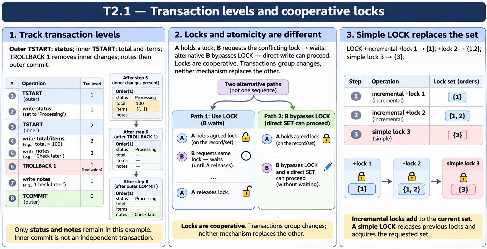
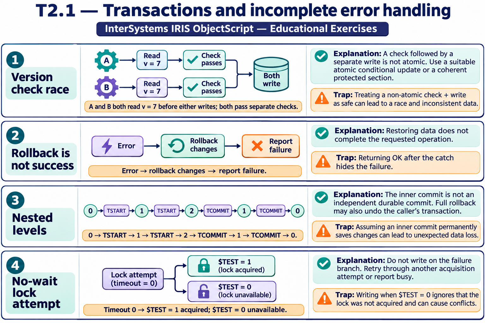

# T2.1 — Approfondimenti dagli esercizi

## Tutte le 18 domande approfondite

[Apri le schede domanda per domanda](<Domanda per domanda/README.md>) · [Tavole spiegate in inglese](tavole-esercizi.md)

Ogni domanda dispone ora di un commento specifico, un concetto ulteriore e una variante con soluzione. I tre casi seguenti sono percorsi tematici aggiuntivi. Le immagini sono in inglese.

[Teoria](../study.md) · [Quiz](../quiz.md) · [Tutti gli approfondimenti](../../../approfondimenti-esercizi.md)

Tre percorsi trasversali, da affiancare alle schede individuali, per capire il meccanismo dietro le risposte: scenario, ragionamento, distrattore, regola riutilizzabile e variante con soluzione. I riferimenti Q rimandano al quiz scaricato; la numerazione è locale al capitolo.

[Leggi esempi e spiegazioni dei pannelli](tavole-esercizi.md).

## Percorso consigliato

1. [Una transazione annidata si traccia per livelli](<01 - Una transazione annidata si traccia per livelli.md>) — Q1, Q2, Q3, Q14, Q15, Q18
2. [LOCK è un protocollo tra partecipanti](<02 - LOCK è un protocollo tra partecipanti.md>) — Q4, Q5, Q6, Q7, Q10, Q11, Q16
3. [Il segno più cambia l’insieme dei lock](<03 - Il segno più cambia l’insieme dei lock.md>) — Q12, Q13

[Indice di tutte le 18 domande del capitolo](mappa-domande.md). I percorsi sono tematici; ogni domanda ha inoltre una scheda individuale nella sottocartella dedicata.

## Precisazioni rispetto al quiz

Q8: la soglia di escalation è configurabile e un lock ampio non equivale a bloccare ogni tipo di lettura. Nei casi considerati il rollback riguarda aggiornamenti transazionali: non ripristina automaticamente variabili locali o normali LOCK; $INCREMENT/$SEQUENCE hanno regole specifiche.

Queste precisazioni si applicano agli approfondimenti nuovi. Il testo delle risposte scaricate rimane una testimonianza della fonte e non viene riscritto silenziosamente.

## Documentazione

- [TROLLBACK](https://docs.intersystems.com/irislatest/csp/docbook/DocBook.UI.Page.cls?KEY=RCOS_ctrollback)
- [LOCK](https://docs.intersystems.com/irislatest/csp/docbook/DocBook.UI.Page.cls?KEY=RCOS_clock)
- [Transazioni](https://docs.intersystems.com/irislatest/csp/docbook/DocBook.UI.Page.cls?KEY=GAPPS_tp)

Gli snippet sono frammenti didattici: quando usano classi di esempio o macro, presuppongono le relative definizioni e include. Non costituiscono implementazioni complete né sono stati eseguiti in IRIS.
