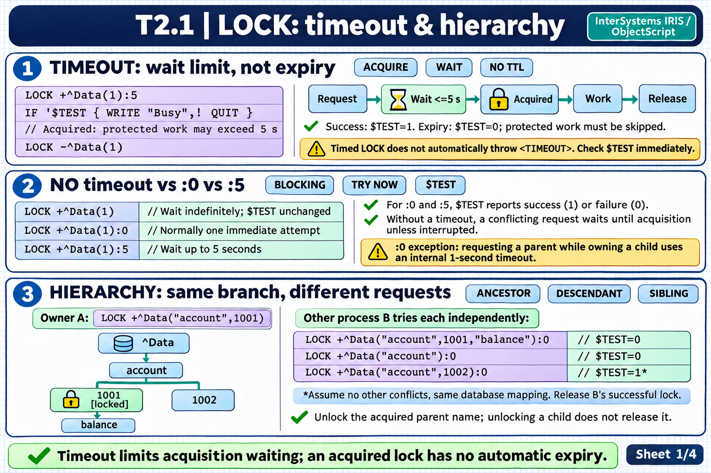
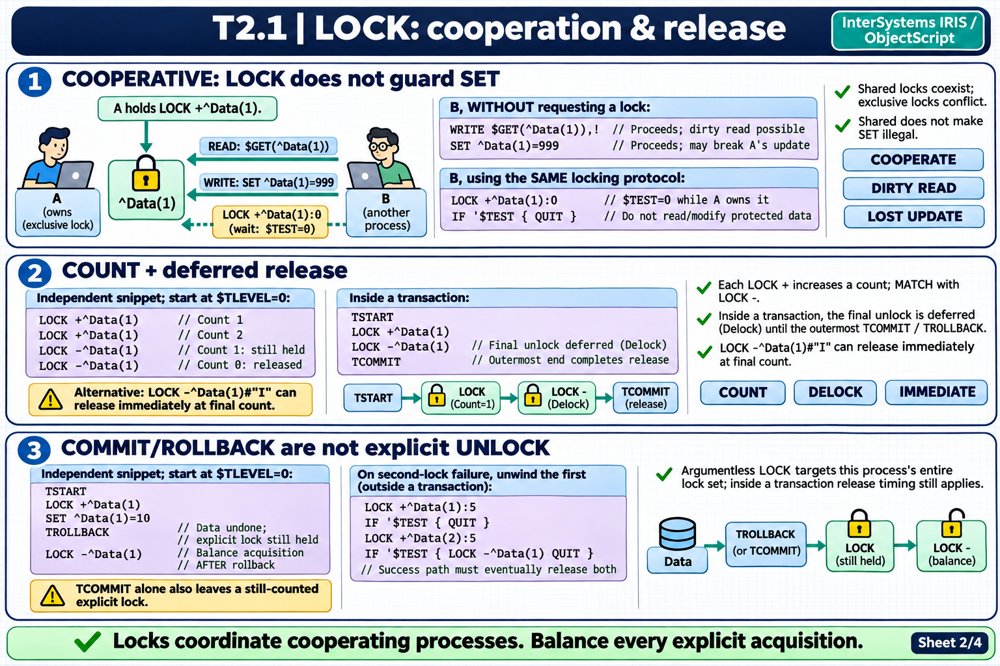
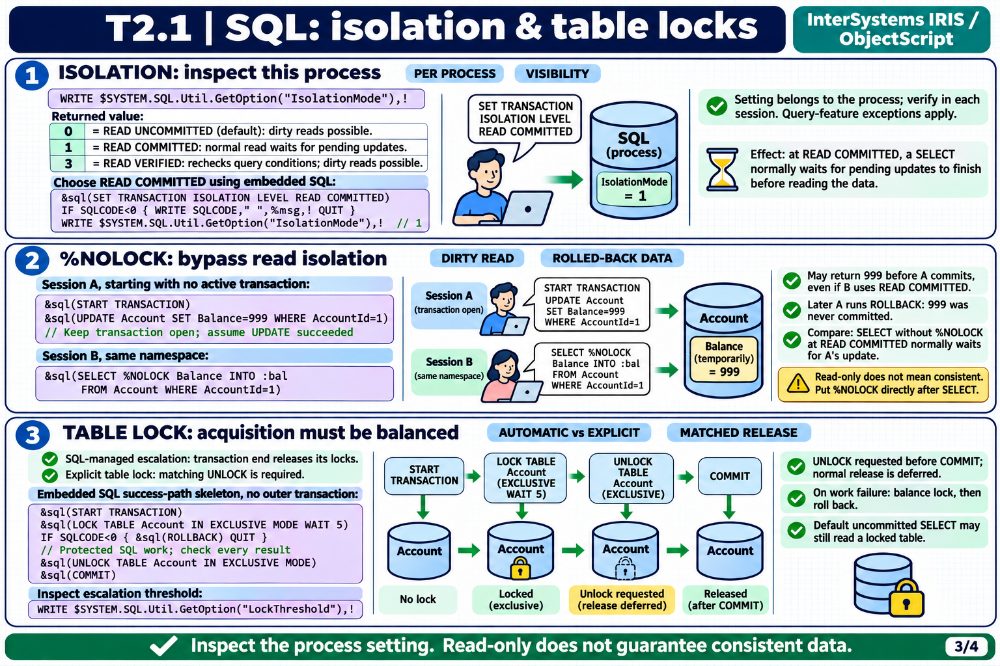
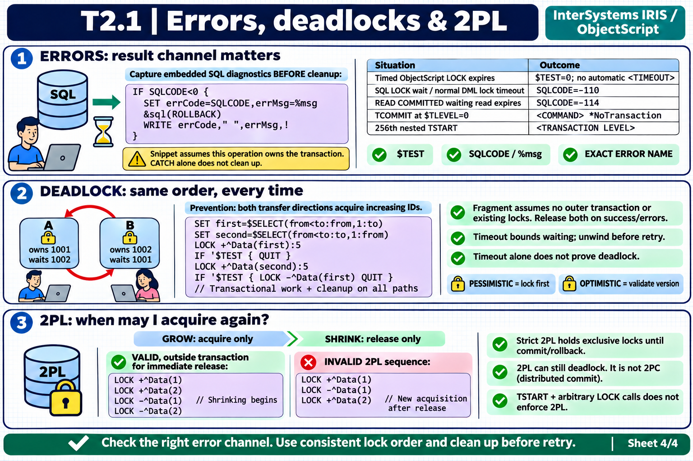

# T2.1 — illustrated revision and copyable examples

[Full chapter](study.md) · [Chapter diagrams](visuals.md) · [Practice questions](quiz.md)

Four sheets revisit the questions about lock waiting, hierarchy, access, cleanup, SQL isolation, errors, and concurrency protocols. Read them in order, predict the outcome, then compare with the annotations. Code is ObjectScript or embedded SQL, not Bash. The snippets are independent teaching fragments, not complete application methods. Examples that finish a transaction assume this operation owns it and there is no caller-owned outer transaction. No IRIS runtime was available to execute them.

## 1. Timeout and hierarchy



**Keywords:** acquisition timeout, no TTL, `$TEST`, ancestor, descendant, sibling.

```objectscript
 LOCK +^Data(1):5
 IF '$TEST {
     WRITE "Busy; protected work skipped",!
     QUIT
 }
 // Acquired: the lock does not expire five seconds later.
 // Protected work belongs here, with cleanup on exceptions too.
 LOCK -^Data(1)
```

Without a timeout, `LOCK +^Data(1)` waits indefinitely for acquisition unless interrupted and does not change `$TEST`. With `:0`, it normally tries immediately; with `:5`, it can wait up to five seconds. Timed failure sets `$TEST=0`, without automatically throwing `<TIMEOUT>`. The documented parent-after-child `:0` case uses an internal one-second timeout.

If A owns `LOCK +^Data("account",1001)`, B can test these requests **separately**, while A keeps its lock and no other conflicts exist:

```objectscript
 LOCK +^Data("account",1001,"balance"):0  // Descendant: $TEST=0
 LOCK +^Data("account"):0                 // Ancestor: $TEST=0
 LOCK +^Data("account",1002):0            // Sibling: $TEST=1
 IF $TEST { LOCK -^Data("account",1002) }
```

Both processes must resolve names to the same database. Unlock the exact acquired name. See [LOCK and its timeout](https://docs.intersystems.com/irislatest/csp/docbook/DocBook.UI.Page.cls?KEY=RCOS_clock) and [hierarchical locks](https://docs.intersystems.com/irislatest/csp/docbook/DocBook.UI.Page.cls?KEY=GAPPS_lockbasics).

## 2. Cooperation, counts, and release



**Keywords:** cooperative locking, dirty read, lost update, count, Delock, immediate unlock.

A's exclusive `LOCK +^Data(1)` conflicts with B's lock requests; it does not intercept B's ordinary `WRITE $GET(^Data(1))` or `SET ^Data(1)=999`. Both can proceed without first acquiring a lock. In the diagram, the `:0` arrow labelled “wait” means a conflicting resource; the normal request returns `$TEST=0` immediately.

Starting without an active transaction or existing acquisitions:

```objectscript
 LOCK +^Data(1)             // Count 1
 LOCK +^Data(1)             // Count 2
 LOCK -^Data(1)             // Count 1: still held
 LOCK -^Data(1)             // Count 0: released
```

Compare these independent sequences:

```objectscript
 TSTART
 LOCK +^Data(1)
 LOCK -^Data(1)             // Final normal unlock is deferred
 TCOMMIT                    // Outermost end completes release
```

```objectscript
 TSTART
 LOCK +^Data(1)
 SET ^Data(1)=10
 TROLLBACK                  // Data restored; explicit lock still held
 LOCK -^Data(1)             // Balance the explicit acquisition
```

`LOCK -^Data(1)#"I"` can complete the final release immediately inside a transaction; use it only if early access is correct. Full rollback does not reverse lock acquisitions. Argumentless `LOCK` targets the process's entire lock set, so use specific unlocks when a caller may own other locks. See [LOCK release semantics](https://docs.intersystems.com/irislatest/csp/docbook/DocBook.UI.Page.cls?KEY=RCOS_clock).

## 3. SQL isolation, NOLOCK, and table locks



**Keywords:** per-process isolation, READ UNCOMMITTED, READ COMMITTED, READ VERIFIED, `%NOLOCK`, automatic versus explicit lock.

```objectscript
 WRITE $SYSTEM.SQL.Util.GetOption("IsolationMode"),!
 // 0 = READ UNCOMMITTED (default)
 // 1 = READ COMMITTED
 // 3 = READ VERIFIED

 &sql(SET TRANSACTION ISOLATION LEVEL READ COMMITTED)
 IF SQLCODE < 0 { WRITE SQLCODE," ",%msg,! QUIT }
 WRITE $SYSTEM.SQL.Util.GetOption("IsolationMode"),!  // 1

 WRITE $SYSTEM.SQL.Util.GetOption("LockThreshold"),!
```

READ VERIFIED rechecks relevant query conditions but can still read uncommitted values. Normal READ COMMITTED reads wait for pending updates, with documented exceptions for query features. Check settings in each process; SQL isolation does not govern raw global reads.

For the two-session experiment, use a disposable `Account` table with an existing row `AccountId=1`, persistent sessions in the same namespace, and no active transaction in A. A executes:

```objectscript
 &sql(START TRANSACTION)
 &sql(UPDATE Account SET Balance=999 WHERE AccountId=1)
 // Check SQLCODE and confirm the row was updated; keep transaction open.
```

While A's update remains uncommitted, B executes:

```objectscript
 &sql(SELECT %NOLOCK Balance INTO :bal
      FROM Account WHERE AccountId=1)
 IF SQLCODE=0 { WRITE bal,! }  // Can be 999 before A commits
```

A then runs `&sql(ROLLBACK)`. B may already have read 999 even though that value was never committed. `%NOLOCK` goes directly after `SELECT` and reads as READ UNCOMMITTED regardless of B's isolation. Without the hint, this ordinary lookup at READ COMMITTED normally waits for A. Read-only does not mean consistent.

An explicit table-lock success path differs from SQL-managed escalation:

```objectscript
 &sql(START TRANSACTION)
 &sql(LOCK TABLE Account IN EXCLUSIVE MODE WAIT 5)
 IF SQLCODE < 0 {
     SET lockCode=SQLCODE,lockMsg=%msg
     &sql(ROLLBACK)
     WRITE lockCode," ",lockMsg,!
     QUIT
 }
 // Protected work here. Check every result.
 // On a work failure, balance the acquired lock and roll back.
 &sql(UNLOCK TABLE Account IN EXCLUSIVE MODE)
 // Check the unlock result before deciding to commit.
 &sql(COMMIT)
```

This is a skeleton, not a complete error-handling implementation. Normal explicit unlock is deferred until transaction end. Commit alone does not balance the explicit acquisition. SQL manages automatically escalated transaction locks itself. An exclusive table lock need not prevent a default uncommitted SELECT from reading.

References: [process SQL options](https://docs.intersystems.com/irislatest/csp/documatic/%25CSP.Documatic.cls?CLASSNAME=%25SYSTEM.SQL.Util&LIBRARY=%25SYS), [SELECT and %NOLOCK](https://docs.intersystems.com/irislatest/csp/docbook/DocBook.UI.Page.cls?KEY=RSQL_select), [SQL LOCK](https://docs.intersystems.com/irislatest/csp/docbook/DocBook.UI.Page.cls?KEY=RSQL_lock), [SQL UNLOCK](https://docs.intersystems.com/irislatest/csp/docbook/DocBook.UI.Page.cls?KEY=RSQL_unlock).

## 4. Errors, deadlocks, and 2PL



**Keywords:** `$TEST`, `SQLCODE`, `%msg`, exact error name, circular wait, acquisition order, growing phase, shrinking phase, strict 2PL.

| Situation | Expected result |
| --- | --- |
| Timed ObjectScript LOCK expires | `$TEST=0`; no automatic `<TIMEOUT>` |
| SQL LOCK wait or normal DML lock timeout | `SQLCODE=-110` |
| READ COMMITTED waiting read times out | `SQLCODE=-114` |
| TCOMMIT with `$TLEVEL=0` | `<COMMAND>` with `*NoTransaction` |
| A 256th nested TSTART | `<TRANSACTION LEVEL>` |

For embedded SQL, capture diagnostics before cleanup overwrites them. This fragment assumes the operation owns the transaction; explicit acquired locks also need balancing:

```objectscript
 IF SQLCODE < 0 {
     SET errCode=SQLCODE,errMsg=%msg
     &sql(ROLLBACK)
     WRITE errCode," ",errMsg,!
 }
```

A owns 1001 and waits for 1002; B owns 1002 and waits for 1001: circular wait. Both transfer directions should acquire accounts in increasing ID order. This acquisition fragment assumes distinct accounts, no outer transaction, and no pre-existing acquisitions:

```objectscript
 SET first=$SELECT(fromAcct<toAcct:fromAcct,1:toAcct)
 SET second=$SELECT(fromAcct<toAcct:toAcct,1:fromAcct)
 LOCK +^Data(first):5
 IF '$TEST { QUIT }
 LOCK +^Data(second):5
 IF '$TEST {
     LOCK -^Data(first)
     QUIT
 }
 // Transactional work with cleanup on success AND exceptions belongs here.
 // Finish commit/rollback before releasing either acquired lock.
 LOCK -^Data(second)
 LOCK -^Data(first)
```

The image uses shorter local variable names `from` and `to`. These global names form an application locking protocol; they do not automatically correspond to SQL row locks. A timeout bounds waiting but does not prove a deadlock or prevent a retry from retaining earlier locks. Retry only after cleanup.

In **2PL**, the first actual release starts the shrinking phase: acquire no more locks after that. Compare these snippets outside a transaction, where normal final unlock is immediate:

```objectscript
 // Valid 2PL
 LOCK +^Data(1)
 LOCK +^Data(2)
 LOCK -^Data(1)             // Shrinking begins
 LOCK -^Data(2)
```

```objectscript
 // Invalid 2PL
 LOCK +^Data(1)
 LOCK -^Data(1)
 LOCK +^Data(2)             // Acquires after release
 LOCK -^Data(2)             // Cleanup; does not repair the protocol violation
```

Strict 2PL holds exclusive locks until commit/rollback; 2PL can still deadlock. It is distinct from distributed two-phase commit (2PC). Arbitrary `TSTART` and `LOCK` calls do not enforce 2PL automatically. See [LOCK and deadlock avoidance](https://docs.intersystems.com/irislatest/csp/docbook/DocBook.UI.Page.cls?KEY=GAPPS_lockbasics), [SQL errors](https://docs.intersystems.com/irislatest/csp/docbook/DocBook.UI.Page.cls?KEY=RERR_sql), and [CMU: two-phase locking](https://15445.courses.cs.cmu.edu/spring2026/notes/18-twophaselocking.pdf).

## Image provenance

The four sheets were generated with built-in ImageGen, matching the chapter's existing visual guides. Their exact prompts, source paths, dimensions, and hashes are recorded in [revision-image-prompts.json](revision-image-prompts.json). Earlier two-sheet drafts were superseded and are not part of the course. Images were visually reviewed; copyable snippets here clarify line wrapping and abbreviated success paths in the graphics.
