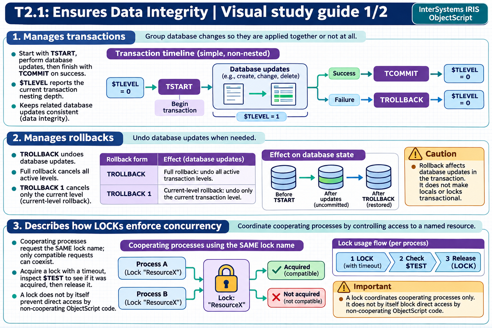
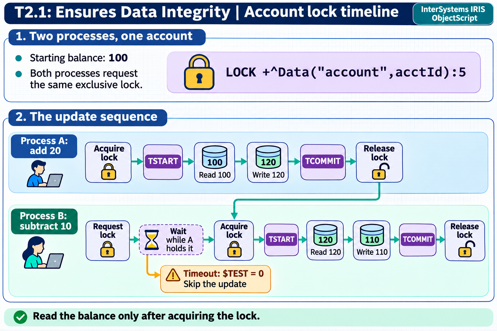

[All topics](../../index.md) · [Practice quiz](quiz.md)

# T2.1: Ensures Data Integrity

[Approfondimenti dagli esercizi](<Approfondimenti esercizi/README.md>)

Saved 2 November 2026 from [exam-prep.es](https://exam-prep.es/exams/objectscript/knowledge/T2.1.html). Reference links require internet access.

### Contents

1. [Manages transactions](#1-manages-transactions)
2. [Manages rollbacks](#2-manages-rollbacks)
3. [Describes how LOCKs enforce concurrency](#3-describes-how-locks-enforce-concurrency)
4. [Describes lock escalation threshold and effect on row locks versus table locks](#4-describes-lock-escalation-threshold-and-effect-on-row-locks-versus-table-locks)
5. [Differentiates between pessimistic and optimistic concurrency controls](#5-differentiates-between-pessimistic-and-optimistic-concurrency-controls)
6. [Uses transactions and applies concurrency controls in SQL scripts](#6-uses-transactions-and-applies-concurrency-controls-in-sql-scripts)

### Visual study guide — sections 1–3



[View all chapter diagrams](visuals.md) · [Technical review notes](../../visual-technical-notes.md)

## 1. Manages transactions

### Key Points

- **TSTART**: Begins a transaction and increments $TLEVEL by 1
- **TCOMMIT**: Commits the transaction and decrements $TLEVEL by 1; actual commit occurs only when $TLEVEL returns to 0
- **$TLEVEL**: Special variable tracking transaction nesting depth (0 = no active transaction, max 255)
- **Nested transactions**: Each TSTART/TCOMMIT pair creates a nesting level; inner commits are deferred until the outermost TCOMMIT
- **Journaling**: All global changes within a transaction are journaled automatically, regardless of database journal settings

### Detailed Notes

#### Overview

Transactions in ObjectScript guarantee atomicity: either all changes within the transaction are applied, or none are. The TSTART command marks the beginning of a transaction and increments the $TLEVEL special variable. TCOMMIT marks the end of a successful transaction and decrements $TLEVEL. The actual commit to the database only happens when $TLEVEL reaches 0, meaning the outermost transaction has completed.

#### Basic Transaction Pattern

```objectscript
 TSTART
 TRY {
     SET ^Data("account", 1001, "balance") = ^Data("account", 1001, "balance") - 500
     SET ^Data("account", 1002, "balance") = ^Data("account", 1002, "balance") + 500
     TCOMMIT
 }
 CATCH ex {
     TROLLBACK
     WRITE "Error: ", ex.DisplayString(), !
 }
```

#### Nested Transactions

InterSystems IRIS supports nested transactions up to 255 levels. Each TSTART increments $TLEVEL, and each TCOMMIT decrements it. The key concept is that inner TCOMMIT calls do not actually commit data -- commitment is deferred until $TLEVEL reaches 0.

```objectscript
 WRITE "$TLEVEL = ", $TLEVEL, !   // 0
 TSTART
 WRITE "$TLEVEL = ", $TLEVEL, !   // 1
 SET ^Data("outer") = "value1"
 TSTART
 WRITE "$TLEVEL = ", $TLEVEL, !   // 2
 SET ^Data("inner") = "value2"
 TCOMMIT                           // $TLEVEL back to 1 (not yet committed)
 TCOMMIT                           // $TLEVEL back to 0 (all changes committed)
```

This design allows modular code where called methods can issue their own TSTART/TCOMMIT without knowing whether the caller already started a transaction.

### Documentation References

- [Transaction Processing](https://docs.intersystems.com/irislatest/csp/docbook/DocBook.UI.Page.cls?KEY=GAPPS_tp)
- [TSTART Command](https://docs.intersystems.com/irislatest/csp/docbook/DocBook.UI.Page.cls?KEY=RCOS_ctstart)
- [TCOMMIT Command](https://docs.intersystems.com/irislatest/csp/docbook/DocBook.UI.Page.cls?KEY=RCOS_ctcommit)

## 2. Manages rollbacks

### Key Points

- **TROLLBACK** (no argument): Rolls back ALL transaction levels and resets $TLEVEL to 0
- **TROLLBACK 1**: Rolls back only the current nesting level and decrements $TLEVEL by 1
- **Partial rollback**: TROLLBACK 1 undoes only the changes made at the current $TLEVEL
- **Non-rollbackable operations**: Local variables, $INCREMENT, $SEQUENCE, LOCK operations, and process-private globals are NOT rolled back
- **Error handling**: Always pair TROLLBACK with TRY-CATCH blocks for robust transaction management

### Detailed Notes

#### Full Rollback vs Partial Rollback

TROLLBACK without an argument performs a complete rollback of all transaction levels, resetting $TLEVEL to 0 and undoing all global changes made since the first TSTART. TROLLBACK 1 performs a partial rollback, undoing only the changes made at the current $TLEVEL and decrementing $TLEVEL by 1.

```objectscript
 TSTART
 SET ^Data("A") = 100
 TSTART
 SET ^Data("B") = 200
 TROLLBACK 1                  // Only ^Data("B") = 200 is rolled back; $TLEVEL decremented to 1
 WRITE "$TLEVEL = ", $TLEVEL, !  // 1
 TCOMMIT                      // ^Data("A") = 100 is committed
```

#### Complete Rollback Pattern

```objectscript
 TSTART
 SET ^Data("A") = 100
 TSTART
 SET ^Data("B") = 200
 TROLLBACK                    // ALL changes rolled back; $TLEVEL reset to 0
 WRITE "$TLEVEL = ", $TLEVEL, !  // 0
```

#### Critical: What TROLLBACK Does NOT Undo

Several operations are not affected by TROLLBACK:

- **Local variables**: Changes to local variables persist after rollback
- **$INCREMENT / $SEQUENCE**: These atomic operations are not transactional
- **LOCK operations**: Locks acquired within a transaction are released at the end of the transaction, but TROLLBACK does not "undo" lock operations
- **Process-private globals** (^||PPG): Not journaled, therefore not rolled back

```objectscript
 SET localVar = "before"
 TSTART
 SET localVar = "during"
 SET ^Data("test") = "transactional"
 TROLLBACK
 WRITE localVar, !          // "during" -- local variable NOT rolled back
 WRITE $GET(^Data("test"))  // "" -- global change WAS rolled back
```

### Documentation References

- [TROLLBACK Command](https://docs.intersystems.com/irislatest/csp/docbook/DocBook.UI.Page.cls?KEY=RCOS_ctrollback)
- [Rolling Back Transactions](https://docs.intersystems.com/irislatest/csp/docbook/DocBook.UI.Page.cls?KEY=GAPPS_tp)

## 3. Describes how LOCKs enforce concurrency

### Key Points

- **Incremental lock**: `LOCK +lockname` acquires a lock without releasing existing locks
- **Incremental unlock**: `LOCK -lockname` releases a specific lock without affecting others
- **Classic LOCK**: `LOCK lockname` releases ALL existing locks and acquires the new one (rarely used)
- **Lock timeout**: `LOCK +lockname:timeout` specifies maximum wait time in seconds; check $TEST for success
- **Exclusive locks**: Any lock without `#"S"` is exclusive (the default); blocks all other locks on that resource
- **Shared locks**: `LOCK +lockname#"S"` allows multiple readers; exclusive locks block other processes
- **Lock type flags**: `#"S"` (shared), `#"E"` (escalating), `#"I"` (immediate unlock), `#"D"` (deferred unlock) — combinable (e.g., `#"SI"`)
- **Immediate unlock**: `LOCK -lockname#"I"` releases a lock immediately even within a transaction, overriding the default deferred behavior
- **Lock table**: System-wide resource viewable in Management Portal under System Operation &gt; Locks

### Detailed Notes

#### Incremental Lock Pattern

An incremental `LOCK +` acquires a lock without releasing the process's other locks. For a read-modify-write operation, acquire the lock before reading the balance and hold it until the transaction commits or rolls back. The following example assumes there is no outer transaction and that the account already exists.

```objectscript
 // Acquire lock with 5-second timeout
 LOCK +^Data("account", acctId):5
 IF '$TEST {
     WRITE "Could not acquire lock", !
     QUIT
 }
 TRY {
     TSTART
     // Critical section: read-modify-write
     SET balance = ^Data("account", acctId, "balance")
     SET ^Data("account", acctId, "balance") = balance + amount
     TCOMMIT
 }
 CATCH ex {
     TROLLBACK
 }
 LOCK -^Data("account", acctId)     // Always release the lock
```

#### Two processes updating the same account

The account starts at 100. Process A adds 20 and process B subtracts 10. Both request the same exclusive lock. A reads 100 and commits 120, then releases the lock. B can then acquire the lock, read 120, and commit 110. If B's lock attempt times out, `$TEST` is 0 and B skips the update. The transaction groups each write with any other database changes in that unit of work. The lock controls when the other process can start its read-modify-write sequence.



#### Shared vs Exclusive Locks

Any lock without the `#"S"` flag is an **exclusive lock** (also called a write lock). There is no explicit "exclusive" flag — the absence of `#"S"` makes a lock exclusive by default. Shared locks allow multiple processes to read concurrently, while exclusive locks provide sole access:

- An existing **shared lock** prevents other processes from acquiring an **exclusive lock** on that resource
- An existing **exclusive lock** prevents other processes from acquiring **any lock** (shared or exclusive) on that resource
- Multiple processes **can** hold shared locks on the same resource simultaneously

```objectscript
 // Shared lock for reading (multiple readers allowed)
 LOCK +^Data("report")#"S":5
 IF $TEST {
     // Read operations
     LOCK -^Data("report")#"S"
 }

 // Exclusive lock for writing (blocks all other locks)
 LOCK +^Data("report"):5
 IF $TEST {
     // Write operations
     LOCK -^Data("report")
 }
```

#### Lock Type Flags

The LOCK command supports type flags specified after `#` in quotes. Available flags:

| Flag | Meaning | Lock | Unlock | Description |
| --- | --- | --- | --- | --- |
| `"S"` | Shared | Yes | Yes | Multiple readers allowed |
| `"E"` | Escalating | Yes | Yes | Participates in lock escalation |
| `"I"` | Immediate | No | Yes | Releases lock immediately, even within a transaction |
| `"D"` | Deferred | No | Yes | Defers unlock until transaction ends (default behavior within transactions) |

Flags can be combined: `#"SE"` (shared escalating), `#"SI"` (shared immediate unlock), `#"EI"` (escalating immediate unlock).

#### Immediate vs Deferred Unlock Within Transactions

By default, locks acquired within a transaction are held until TCOMMIT or TROLLBACK, even if explicitly released with `LOCK -`. This is **deferred unlock** behavior (`#"D"`, the default within transactions).

**Immediate unlock** (`#"I"`) overrides this behavior and releases the lock right away, even inside a transaction:

```objectscript
 TSTART
 LOCK +^Data("temp"):5
 // ... work with ^Data("temp") ...
 LOCK -^Data("temp")#"I"          // Released NOW, not at TCOMMIT
 // ... other work continues in the transaction ...
 TCOMMIT
```

Use immediate unlock when you need to release a lock within a transaction because the protected resource is no longer needed and you want to minimize lock contention. Use the default deferred behavior when the lock must be held for the full duration of the transaction to ensure data integrity.

#### Lock Table

The lock table is a system-wide in-memory structure that tracks all current locks. It can be viewed through the Management Portal (System Operation &gt; Locks) or programmatically. The lock table has a configurable size (locksiz parameter). When the lock table is full, new lock requests fail with a  error.

### Documentation References

- [LOCK Command](https://docs.intersystems.com/irislatest/csp/docbook/DocBook.UI.Page.cls?KEY=RCOS_clock)
- [Lock Management](https://docs.intersystems.com/irislatest/csp/docbook/DocBook.UI.Page.cls?KEY=GOBJ_concurrency)
- [Database Integrity Tutorial](https://docs.intersystems.com/irislatest/csp/docbook/DocBook.UI.Page.cls?KEY=TOS_Integrity)

### Visual study guide — sections 4–6


[View all chapter diagrams](visuals.md) · [Technical review notes](../../visual-technical-notes.md)

## 4. Describes lock escalation threshold and effect on row locks versus table locks

### Key Points

- **Default threshold**: 1000 row-level locks per table triggers automatic escalation to a table-level lock
- **Escalation behavior**: All individual row locks are replaced by a single table-level lock
- **Performance trade-off**: Table locks reduce lock table overhead but block all concurrent access to the table
- **Configurable threshold**: Adjustable via $SYSTEM.SQL.Util.SetOption("LockThreshold", value) or Management Portal
- **Scope**: Threshold applies per-process, per-table

### Detailed Notes

#### How Lock Escalation Works

When a process acquires row-level locks through SQL operations (INSERT, UPDATE, DELETE), InterSystems IRIS tracks the number of locks per table. Once the number of row locks for a single table exceeds the lock escalation threshold (default 1000), the system automatically escalates to a table-level lock. This replaces all individual row locks with a single lock on the entire table.

```objectscript
 // Check current lock escalation threshold
 WRITE $SYSTEM.SQL.Util.GetOption("LockThreshold"), !   // Default: 1000

 // Change the threshold
 DO $SYSTEM.SQL.Util.SetOption("LockThreshold", 2000)
```

#### Impact on Concurrency

- **Before escalation**: Other processes can access rows that are not individually locked. Fine-grained concurrency is maintained.
- **After escalation**: The entire table is locked. Other processes attempting to lock any row in the same table will block (or fail on timeout). This can cause significant concurrency bottlenecks.

#### When Escalation Occurs

Lock escalation typically happens during:

- Large batch INSERT operations
- Bulk UPDATE affecting many rows
- DELETE operations on large result sets
- Long-running transactions that accumulate row locks

#### Best Practices

- Keep transactions short to minimize the number of accumulated row locks
- For intentional bulk operations, consider explicitly acquiring a table-level lock first (to avoid gradual escalation) and using %NOLOCK on concurrent read queries, or increasing the threshold temporarily
- Monitor the lock table in Management Portal to detect escalation events
- The threshold is a system-wide setting; changing it affects all processes

### Documentation References

- [Lock Escalation Threshold](https://docs.intersystems.com/irislatest/csp/docbook/DocBook.UI.Page.cls?KEY=GOBJ_concurrency)
- [SQL Configuration Settings](https://docs.intersystems.com/irislatest/csp/docbook/DocBook.UI.Page.cls?KEY=GSQL_tables)

## 5. Differentiates between pessimistic and optimistic concurrency controls

### Key Points

- **Pessimistic concurrency**: Locks resources BEFORE reading; guarantees no conflicts but reduces throughput
- **Optimistic concurrency**: Reads without locking; checks for conflicts at commit time; better throughput for low-contention scenarios
- **%ConcurrencyMode**: Object property controlling lock behavior (0=None, 1=Atomic, 2=SharedAtomicRetain, 3=SharedRetain, 4=PessimisticRetain)
- **Optimistic via %VersionId**: Uses a version counter to detect concurrent modifications
- **SQL ISOLATION LEVEL**: READ UNCOMMITTED, READ COMMITTED (default), READ VERIFIED provide different concurrency guarantees

### Detailed Notes

#### Pessimistic Concurrency

In pessimistic concurrency, a process acquires an exclusive lock on a resource before reading or modifying it. This prevents other processes from accessing the resource until the lock is released. It is suitable for high-contention scenarios where conflicts are frequent.

```objectscript
 // Pessimistic approach: lock first, then read and modify
 LOCK +^Data("customer", custId):5
 IF '$TEST {
     WRITE "Resource busy", !
     QUIT
 }
 SET data = ^Data("customer", custId)
 // ... modify data ...
 SET ^Data("customer", custId) = data
 LOCK -^Data("customer", custId)
```

#### Optimistic Concurrency

In optimistic concurrency, a process reads data without acquiring locks. Before committing changes, it verifies that no other process has modified the data in the meantime. If a conflict is detected, the operation is retried or reported as a failure. This works well in low-contention environments.

```objectscript
 // Optimistic approach using %VersionId in persistent classes
 SET obj = ##class(MyApp.Customer).%OpenId(custId)
 // ... modify obj properties ...
 SET sc = obj.%Save()
 IF $$$ISERR(sc) {
     // Check if it's a concurrency conflict
     // %VersionId mismatch means another process modified the object
     WRITE "Concurrency conflict - retry needed", !
 }
```

#### Object Concurrency Modes (%ConcurrencyMode)

InterSystems IRIS persistent objects support several concurrency modes:

- **0 (None)**: No locking; fastest but no protection
- **1 (Atomic)**: Lock during %Save only; protects writes but reads may be stale
- **2 (SharedAtomicRetain)**: Shared lock on read, exclusive on write; balanced approach
- **3 (SharedRetain)**: Shared lock on open retained until close
- **4 (PessimisticRetain)**: Exclusive lock on open retained until close; maximum protection

```objectscript
 // Open with pessimistic locking
 SET obj = ##class(MyApp.Customer).%OpenId(custId, 4, .sc)  // concurrency = 4
```

#### SQL Isolation Levels

- **READ UNCOMMITTED**: No locks; may read uncommitted data (dirty reads)
- **READ COMMITTED** (default): Reads only committed data; uses brief shared locks
- **READ VERIFIED**: Re-reads data at end of operation to verify consistency

### Documentation References

- [Concurrency Control](https://docs.intersystems.com/irislatest/csp/docbook/DocBook.UI.Page.cls?KEY=GOBJ_concurrency)
- [Object Concurrency](https://docs.intersystems.com/irislatest/csp/docbook/DocBook.UI.Page.cls?KEY=GOBJ_concurrency)
- [SQL Transaction Isolation Levels](https://docs.intersystems.com/irislatest/csp/docbook/DocBook.UI.Page.cls?KEY=GOBJ_concurrency)

## 6. Uses transactions and applies concurrency controls in SQL scripts

### Key Points

- **&sql(START TRANSACTION)**: Begins an SQL transaction (equivalent to TSTART)
- **&sql(COMMIT)**: Commits the SQL transaction
- **&sql(ROLLBACK)**: Rolls back the SQL transaction
- **SQLCODE**: Check after each SQL statement; 0 = success, 100 = no data, negative = error
- **%NOLOCK hint**: Bypasses row locking for SELECT operations in read-only scenarios
- **Parameterized queries**: Use host variables (:variable) in embedded SQL for safe value binding

### Detailed Notes

#### Basic Embedded SQL Transaction Pattern

```objectscript
 &sql(START TRANSACTION)
 &sql(UPDATE Account SET Balance = Balance - :amount WHERE AccountId = :fromAcct)
 IF SQLCODE < 0 {
     &sql(ROLLBACK)
     WRITE "Error on debit: ", %msg, !
     QUIT
 }
 &sql(UPDATE Account SET Balance = Balance + :amount WHERE AccountId = :toAcct)
 IF SQLCODE < 0 {
     &sql(ROLLBACK)
     WRITE "Error on credit: ", %msg, !
     QUIT
 }
 &sql(COMMIT)
```

#### Mixing ObjectScript and SQL Transactions

TSTART and &sql(START TRANSACTION) work with the same underlying transaction mechanism. They share $TLEVEL:

```objectscript
 TSTART
 SET ^AuditLog($INCREMENT(^AuditLog)) = $HOROLOG _ "|Transfer"
 &sql(UPDATE Account SET Balance = Balance - :amount WHERE AccountId = :fromAcct)
 IF SQLCODE < 0 {
     TROLLBACK
     QUIT
 }
 TCOMMIT
```

#### Using %NOLOCK for Read-Only Operations

The %NOLOCK hint tells SQL not to acquire shared locks during SELECT operations, improving performance for read-only queries where strict consistency is not required:

```objectscript
 &sql(SELECT Name, Balance INTO :name, :bal
      FROM Account %NOLOCK
      WHERE AccountId = :acctId)
```

This is particularly useful for reporting queries that should not block concurrent write operations and do not need to participate in transaction isolation.

#### Checking SQL Permissions Within Transactions

SQL operations within transactions respect the same privilege model. Combine transaction management with error handling for privilege failures:

```objectscript
 &sql(START TRANSACTION)
 &sql(INSERT INTO SensitiveData (PatientId, Diagnosis) VALUES (:pid, :diag))
 IF SQLCODE = -99 {
     &sql(ROLLBACK)
     WRITE "Insufficient SQL privileges", !
     QUIT
 }
 &sql(COMMIT)
```

### Documentation References

- [Embedded SQL](https://docs.intersystems.com/irislatest/csp/docbook/DocBook.UI.Page.cls?KEY=GSQL_esql)
- [SQL Transaction Processing](https://docs.intersystems.com/irislatest/csp/docbook/DocBook.UI.Page.cls?KEY=GAPPS_tp)
- [%NOLOCK Query Hint](https://docs.intersystems.com/irislatest/csp/docbook/DocBook.UI.Page.cls?KEY=GOBJ_concurrency)

## Exam Preparation Summary

### Critical Concepts to Master:

1. **Transaction lifecycle**: TSTART increments $TLEVEL, TCOMMIT decrements it, actual commit happens only at $TLEVEL = 0
2. **TROLLBACK vs TROLLBACK 1**: Full rollback resets $TLEVEL to 0; partial rollback decrements by 1
3. **Incremental locks**: Always use LOCK +/- pattern; understand shared (#"S") vs exclusive (default) locks; know lock type flags (#"I" immediate, #"D" deferred, #"E" escalating)
4. **Lock escalation**: Default 1000 row locks triggers table-level lock; configurable via $SYSTEM.SQL.Util.SetOption
5. **Pessimistic vs optimistic**: Pessimistic locks before reading, optimistic checks at commit time; know the %ConcurrencyMode values (0-4)
6. **SQL transactions**: &sql(START TRANSACTION/COMMIT/ROLLBACK) share $TLEVEL with TSTART/TCOMMIT/TROLLBACK

### Common Exam Scenarios:

- Predicting $TLEVEL values after a sequence of TSTART, TCOMMIT, TROLLBACK, and TROLLBACK 1 commands
- Identifying what is and is NOT rolled back (local variables and $INCREMENT are not rolled back)
- Choosing between pessimistic and optimistic concurrency for given application scenarios
- Recognizing when lock escalation will occur and its impact on concurrent access
- Fixing embedded SQL transaction patterns that lack proper error handling or rollback
- Understanding the effect of %NOLOCK on query behavior

### Hands-On Practice Recommendations:

- Write nested transaction code and verify $TLEVEL at each step using WRITE $TLEVEL
- Experiment with TROLLBACK 1 in nested transactions and observe which changes persist
- Open two terminal sessions and observe LOCK blocking behavior with timeouts
- Use Management Portal (System Operation &gt; Locks) to view the lock table during testing
- Write embedded SQL transactions with intentional errors and verify ROLLBACK behavior
- Test lock escalation by inserting more than 1000 rows in a single transaction and monitoring the lock table
