[All topics](../../index.md) · [Practice quiz](quiz.md)

# T2.1: Ensures Data Integrity

[Approfondimenti dagli esercizi](<Approfondimenti esercizi/README.md>)

Saved 2 November 2026 from [exam-prep.es](https://exam-prep.es/exams/objectscript/knowledge/T2.1.html). Reference links require internet access.

### Contents

1. [Manages transactions](#1-manages-transactions)
2. [Manages rollbacks](#2-manages-rollbacks)
3. [Describes how LOCKs enforce concurrency](#3-describes-how-locks-enforce-concurrency)
4. [Describes lock escalation threshold and effect on row locks versus table locks](#4-describes-lock-escalation-threshold-and-effect-on-row-locks-versus-table-locks)
5. [Differentiates between pessimistic and optimistic concurrency controls](#5-differentiates-between-pessimistic-and-optimistic-concurrency-controls)
6. [Uses transactions and applies concurrency controls in SQL scripts](#6-uses-transactions-and-applies-concurrency-controls-in-sql-scripts)

[Glossary & Cheat Sheet](#glossary--cheat-sheet)

### Visual study guide — sections 1–3

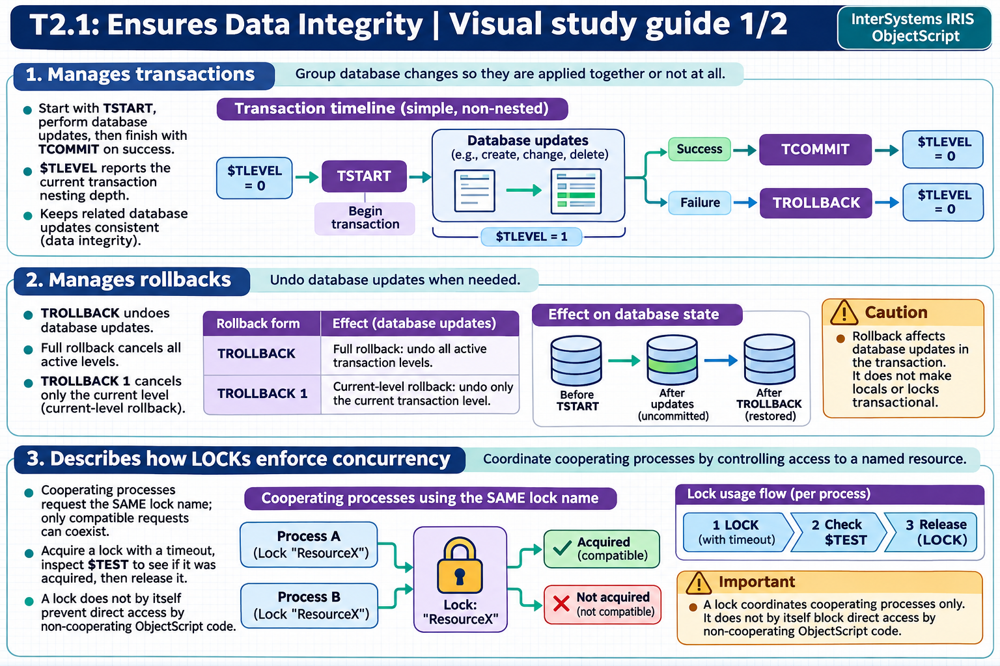

[View all chapter diagrams](visuals.md) · [Technical review notes](../../visual-technical-notes.md)

## 1. Manages transactions

### Key Points

- **TSTART**: Begins a transaction and increments $TLEVEL by 1
- **TCOMMIT**: Commits the transaction and decrements $TLEVEL by 1; actual commit occurs only when $TLEVEL returns to 0
- **$TLEVEL**: Special variable tracking transaction nesting depth (0 = no active transaction, max 255)
- **Nested transactions**: Each TSTART/TCOMMIT pair creates a nesting level; inner commits are deferred until the outermost TCOMMIT
- **Journaling**: All global changes within a transaction are journaled automatically, regardless of database journal settings

### Detailed Notes

#### Overview

Transactions in ObjectScript guarantee atomicity: either all changes within the transaction are applied, or none are. The TSTART command marks the beginning of a transaction and increments the $TLEVEL special variable. TCOMMIT marks the end of a successful transaction and decrements $TLEVEL. The actual commit to the database only happens when $TLEVEL reaches 0, meaning the outermost transaction has completed.

#### Basic Transaction Pattern

```objectscript
 TSTART
 TRY {
     SET ^Data("account", 1001, "balance") = ^Data("account", 1001, "balance") - 500
     SET ^Data("account", 1002, "balance") = ^Data("account", 1002, "balance") + 500
     TCOMMIT
 }
 CATCH ex {
     TROLLBACK
     WRITE "Error: ", ex.DisplayString(), !
 }
```

#### Nested Transactions

InterSystems IRIS supports nested transactions up to 255 levels. Each TSTART increments $TLEVEL, and each TCOMMIT decrements it. The key concept is that inner TCOMMIT calls do not actually commit data -- commitment is deferred until $TLEVEL reaches 0.

```objectscript
 WRITE "$TLEVEL = ", $TLEVEL, !   // 0
 TSTART
 WRITE "$TLEVEL = ", $TLEVEL, !   // 1
 SET ^Data("outer") = "value1"
 TSTART
 WRITE "$TLEVEL = ", $TLEVEL, !   // 2
 SET ^Data("inner") = "value2"
 TCOMMIT                           // $TLEVEL back to 1 (not yet committed)
 TCOMMIT                           // $TLEVEL back to 0 (all changes committed)
```

This design allows modular code where called methods can issue their own TSTART/TCOMMIT without knowing whether the caller already started a transaction.

#### Transaction errors: use the complete error name

`<TRANSACTION>` is not the standard name for every transaction failure. Diagnose the exact error and the command that raised it:

| Situation | Actual result | What to check |
| --- | --- | --- |
| `TCOMMIT` when `$TLEVEL=0` | `<COMMAND>` with `*NoTransaction` in `$ZERROR` | An extra commit, a missing start, or a commit after full rollback |
| A 256th nested `TSTART` | `<TRANSACTION LEVEL>` | Unbalanced starts or recursive calls opening transactions |
| `TROLLBACK` when `$TLEVEL=0` | No operation | Different from an extra `TCOMMIT` |
| Timed ObjectScript `LOCK` cannot be acquired | `$TEST=0` | Handle contention explicitly; this is not a transaction exception |

Assuming `$TLEVEL=0`, this deliberately incorrect sequence raises `<COMMAND>`:

```objectscript
 TSTART
 TROLLBACK                       // Ends ALL transaction levels
 TRY {
     TCOMMIT                    // No transaction remains
 } CATCH ex {
     WRITE ex.DisplayString(), !
     WRITE "$TLEVEL = ", $TLEVEL, !
 }
```

A `CATCH` does not by itself roll back changes or release explicit locks. Define who owns the transaction and clean up resources acquired by this unit of work. Examples using full `TROLLBACK` here assume no caller-owned outer transaction. See [TCOMMIT](https://docs.intersystems.com/irislatest/csp/docbook/DocBook.UI.Page.cls?KEY=RCOS_ctcommit), [$TLEVEL](https://docs.intersystems.com/irislatest/csp/docbook/DocBook.UI.Page.cls?KEY=RCOS_vtlevel), and [system errors](https://docs.intersystems.com/irislatest/csp/docbook/DocBook.UI.Page.cls?KEY=RERR_system).

### Documentation References

- [Transaction Processing](https://docs.intersystems.com/irislatest/csp/docbook/DocBook.UI.Page.cls?KEY=GAPPS_tp)
- [TSTART Command](https://docs.intersystems.com/irislatest/csp/docbook/DocBook.UI.Page.cls?KEY=RCOS_ctstart)
- [TCOMMIT Command](https://docs.intersystems.com/irislatest/csp/docbook/DocBook.UI.Page.cls?KEY=RCOS_ctcommit)
- [Transaction Levels and Errors](https://docs.intersystems.com/irislatest/csp/docbook/DocBook.UI.Page.cls?KEY=RCOS_vtlevel)

## 2. Manages rollbacks

### Key Points

- **TROLLBACK** (no argument): Rolls back ALL transaction levels and resets $TLEVEL to 0
- **TROLLBACK 1**: Rolls back only the current nesting level and decrements $TLEVEL by 1
- **Partial rollback**: TROLLBACK 1 undoes only the changes made at the current $TLEVEL
- **Non-rollbackable operations**: Local variables, $INCREMENT, $SEQUENCE, LOCK operations, and process-private globals are NOT rolled back
- **Error handling**: Always pair TROLLBACK with TRY-CATCH blocks for robust transaction management

### Detailed Notes

#### Full Rollback vs Partial Rollback

TROLLBACK without an argument performs a complete rollback of all transaction levels, resetting $TLEVEL to 0 and undoing all global changes made since the first TSTART. TROLLBACK 1 performs a partial rollback, undoing only the changes made at the current $TLEVEL and decrementing $TLEVEL by 1.

```objectscript
 TSTART
 SET ^Data("A") = 100
 TSTART
 SET ^Data("B") = 200
 TROLLBACK 1                  // Only ^Data("B") = 200 is rolled back; $TLEVEL decremented to 1
 WRITE "$TLEVEL = ", $TLEVEL, !  // 1
 TCOMMIT                      // ^Data("A") = 100 is committed
```

#### Complete Rollback Pattern

```objectscript
 TSTART
 SET ^Data("A") = 100
 TSTART
 SET ^Data("B") = 200
 TROLLBACK                    // ALL changes rolled back; $TLEVEL reset to 0
 WRITE "$TLEVEL = ", $TLEVEL, !  // 0
```

#### Critical: What TROLLBACK Does NOT Undo

Several operations are not affected by TROLLBACK:

- **Local variables**: Changes to local variables persist after rollback
- **$INCREMENT / $SEQUENCE**: These atomic operations are not transactional
- **LOCK operations**: Rollback does not reverse lock acquisitions. Explicit ObjectScript locks need matching unlocks; an unlock deferred in the transaction completes at its end. SQL-managed transaction locks follow their automatic release rules (sections 3–4).
- **Process-private globals** (^||PPG): Not journaled, therefore not rolled back

```objectscript
 SET localVar = "before"
 TSTART
 SET localVar = "during"
 SET ^Data("test") = "transactional"
 TROLLBACK
 WRITE localVar, !          // "during" -- local variable NOT rolled back
 WRITE $GET(^Data("test"))  // "" -- global change WAS rolled back
```

### Documentation References

- [TROLLBACK Command](https://docs.intersystems.com/irislatest/csp/docbook/DocBook.UI.Page.cls?KEY=RCOS_ctrollback)
- [Rolling Back Transactions](https://docs.intersystems.com/irislatest/csp/docbook/DocBook.UI.Page.cls?KEY=GAPPS_tp)

## 3. Describes how LOCKs enforce concurrency

### Key Points

- **Incremental lock**: `LOCK +lockname` acquires a lock without releasing existing locks
- **Incremental unlock**: `LOCK -lockname` releases a specific lock without affecting others
- **Classic LOCK**: `LOCK lockname` releases ALL existing locks and acquires the new one (rarely used)
- **Lock timeout**: `LOCK +lockname:timeout` specifies maximum wait time in seconds; check $TEST for success
- **Exclusive locks**: Any lock without `#"S"` is exclusive (the default); blocks all other locks on that resource
- **Shared locks**: `LOCK +lockname#"S"` allows multiple readers; exclusive locks block other processes
- **Lock type flags**: `#"S"` (shared), `#"E"` (escalating), `#"I"` (immediate unlock), `#"D"` (history-dependent unlock timing); some combinations are supported (e.g., `#"SI"`), but `I` and `D` are mutually exclusive
- **Immediate unlock**: `LOCK -lockname#"I"` releases a lock immediately even within a transaction, overriding the default deferred behavior
- **Lock table**: System-wide resource viewable in Management Portal under System Operation &gt; Locks

### Detailed Notes

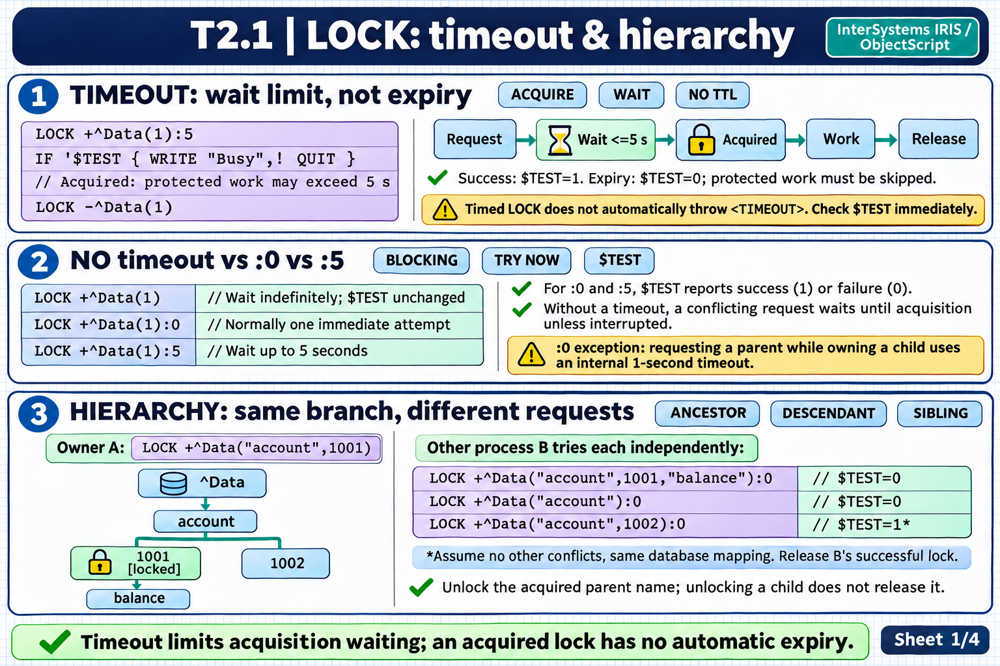

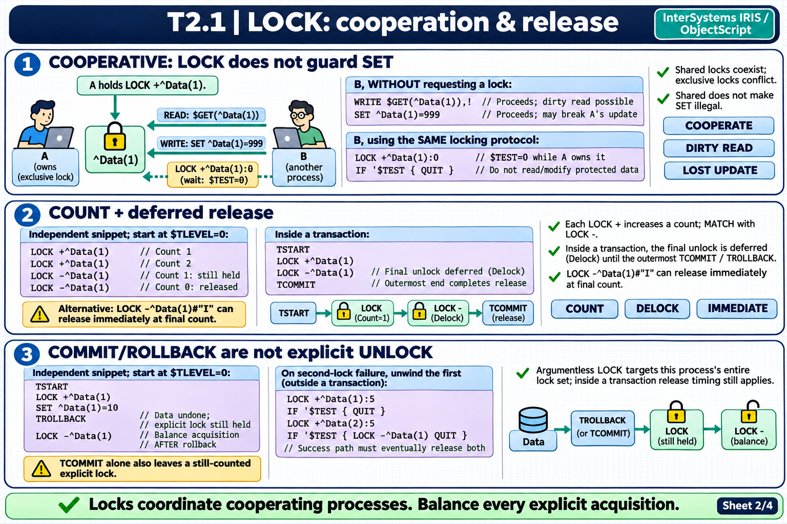

These worked fragments assume the stated transaction and ownership conditions. In the cooperation diagram, the conflicting `:0` request returns failure immediately in the normal case; “wait” marks contention, not a five-second wait. [Copyable examples and four-sheet revision route](revision-examples.md).

#### Timeout is an acquisition deadline

In `LOCK +^Data("account",1001):5`, five seconds limit the wait to acquire the lock. They do not give an acquired lock a five-second lifetime. Acquisition after one second can be followed by work lasting beyond the original deadline; the owner must still release the lock.

| Request | If a conflicting lock exists | Result when the command returns |
| --- | --- | --- |
| `LOCK +^Data("account",1001)` | Waits indefinitely until acquisition, unless interrupted or the process ends | Does not change `$TEST` |
| `LOCK +^Data("account",1001):0` | Normally one attempt, then returns immediately | `$TEST=1` on success; `0` on failure |
| `LOCK +^Data("account",1001):5` | Waits until acquisition or the five-second deadline | `$TEST=1` on success; `0` on expiry |

Read `$TEST` immediately after a timed request. Failure grants no permission to enter protected code and does not automatically roll back work or release other incremental locks.

```objectscript
 LOCK +^Data("account",1001):0
 IF '$TEST {
     WRITE "Account busy; no update performed", !
     QUIT
 }
 // Protected work, even if it takes more than zero seconds
 LOCK -^Data("account",1001)
```

A conflict initially causes waiting, not an exception. Expiry of this timeout sets `$TEST=0`; it does not automatically throw `<TIMEOUT>`. `TRY/CATCH` alone therefore does not handle it. An API can expose its own timeout exception or status: consult that API's contract rather than treating `<TIMEOUT>` as the universal ObjectScript lock result.

There is a documented edge case for `:0`: requesting a parent while already owning a child lock uses an internal one-second timeout. See [LOCK timeout](https://docs.intersystems.com/irislatest/csp/docbook/DocBook.UI.Page.cls?KEY=RCOS_clock) and [creating locks with timeouts](https://docs.intersystems.com/irislatest/csp/docbook/DocBook.UI.Page.cls?KEY=GAPPS_lockbasics).

#### A global lock and its subnodes

Lock names form a hierarchy. An exclusive lock on `^Data` conflicts with other processes' locks anywhere below it. Locking `^Data("account",1001)` covers that branch: descendants and ancestors conflict; sibling accounts can be locked independently. This does not create a separate explicit entry for every descendant.

Assume A holds `LOCK +^Data("account",1001)` and B tries each request separately:

| B's request | Outcome while A holds the exclusive lock |
| --- | --- |
| `LOCK +^Data("account",1001):0` | Conflict: same node |
| `LOCK +^Data("account",1001,"balance"):0` | Conflict: descendant |
| `LOCK +^Data("account"):0` or `LOCK +^Data:0` | Conflict: ancestor covers A's branch |
| `LOCK +^Data("account",1002):0` | Compatible sibling, assuming no other conflict |

Unlock the name acquired: `LOCK -^Data("account",1001)`. Unlocking its `"balance"` child does not release the parent. A name need not refer to existing data; locking does not create a global value. These examples assume both sessions resolve the name to the same database. See [lock names and implicit locks](https://docs.intersystems.com/irislatest/csp/docbook/DocBook.UI.Page.cls?KEY=GAPPS_lockbasics).

#### What other processes can read and write

ObjectScript locking is cooperative: it coordinates lock requests, without intercepting ordinary global reads or writes. The owner continues running; other processes can work on unrelated resources.

| What B does while A holds an exclusive account lock | Result |
| --- | --- |
| Reads `^Data("account",1001,"balance")` without a lock | Read proceeds; can see an uncommitted value |
| Writes it with `SET`, without a lock | Write proceeds, subject to permissions; can break the intended update sequence |
| Requests the same branch with a shared or exclusive lock first | Waits or times out; B must skip protected work on failure |
| Requests another account's lock | Can proceed if that branch has no conflict |

Cooperating readers take shared locks and writers take exclusive locks **before** accessing data. A shared owner permits another shared reader, while an exclusive writer waits. A shared lock does not make `SET` illegal: application code must respect the protocol. SQL adds automatic locking and isolation rules (section 6).

For example, A reads balance 100, B bypasses the protocol and writes 999, then A writes its calculated 120: B's update is lost despite A's lock. Both must cooperate. See [locking and concurrency control](https://docs.intersystems.com/irislatest/csp/docbook/DocBook.UI.Page.cls?KEY=GAPPS_lockbasics).

#### Incremental Lock Pattern

An incremental `LOCK +` acquires a lock without releasing the process's other locks. For a read-modify-write operation, acquire the lock before reading the balance and hold it until the transaction commits or rolls back. The following example assumes there is no outer transaction and that the account already exists.

```objectscript
 // Acquire lock with 5-second timeout
 LOCK +^Data("account", acctId):5
 IF '$TEST {
     WRITE "Could not acquire lock", !
     QUIT
 }
 TRY {
     TSTART
     // Critical section: read-modify-write
     SET balance = ^Data("account", acctId, "balance")
     SET ^Data("account", acctId, "balance") = balance + amount
     TCOMMIT
 }
 CATCH ex {
     TROLLBACK
     WRITE "Update failed: ", ex.DisplayString(), !
 }
 LOCK -^Data("account", acctId)     // Always release the lock
```

#### Two processes updating the same account

The account starts at 100. Process A adds 20 and process B subtracts 10. Both request the same exclusive lock. A reads 100 and commits 120, then releases the lock. B can then acquire the lock, read 120, and commit 110. If B's lock attempt times out, `$TEST` is 0 and B skips the update. The transaction groups each write with any other database changes in that unit of work. The lock controls when the other process can start its read-modify-write sequence.

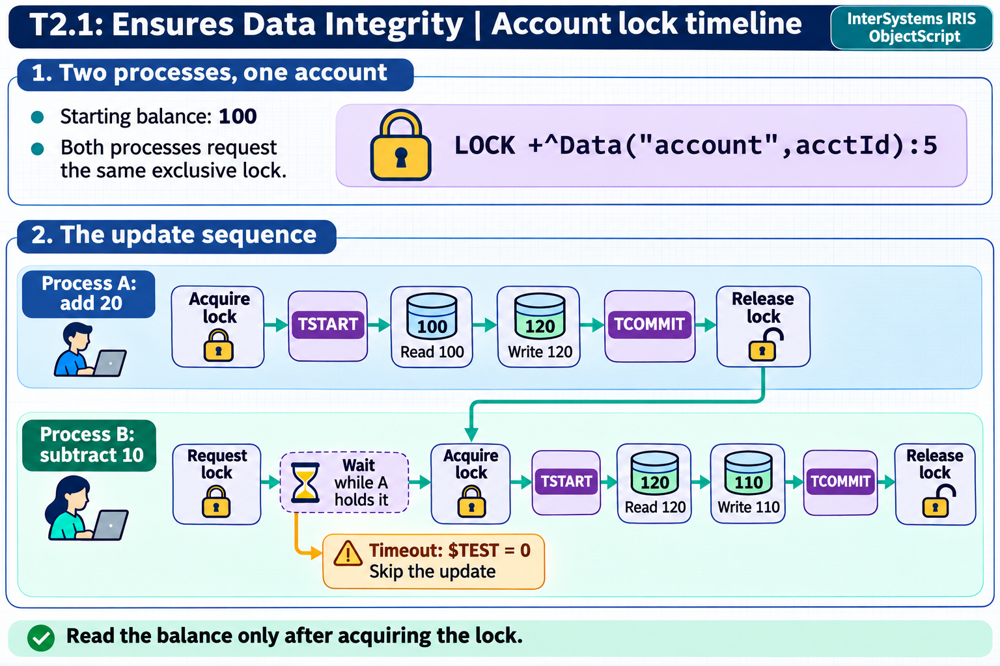

#### Shared vs Exclusive Locks

Any lock without the `#"S"` flag is an **exclusive lock** (also called a write lock). There is no explicit "exclusive" flag — the absence of `#"S"` makes a lock exclusive by default. For cooperating processes, shared locks permit concurrent readers, while exclusive locks prevent competing lock acquisition. Direct access without locking still proceeds:

- An existing **shared lock** prevents other processes from acquiring an **exclusive lock** on that resource
- An existing **exclusive lock** prevents other processes from acquiring **any lock** (shared or exclusive) on that resource
- Multiple processes **can** hold shared locks on the same resource simultaneously

```objectscript
 // Shared lock for reading (multiple readers allowed)
 LOCK +^Data("report")#"S":5
 IF $TEST {
     // Read operations
     LOCK -^Data("report")#"S"
 }

 // Exclusive lock for writing (blocks all other locks)
 LOCK +^Data("report"):5
 IF $TEST {
     // Write operations
     LOCK -^Data("report")
 }
```

#### Three independent questions: compatibility, release timing, escalation

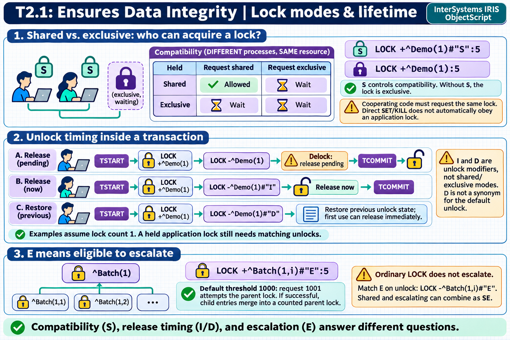

| Question | Modifier | Meaning |
| --- | --- | --- |
| Who can hold a compatible lock? | `#"S"` | Shared; omitting S means exclusive. Different processes can share S, but S/exclusive and exclusive/exclusive conflict. |
| When does an unlock take effect? | `#"I"` / `#"D"` | I releases immediately when the count reaches zero; D restores the previous unlock state and depends on lock history. Both apply only to unlocks. |
| Can many sibling locks merge? | `#"E"` | Enables escalation; use E on the matching unlock too. `#"SE"` combines shared and escalating. |

#### Default unlock, immediate unlock, and D are different

For a lock with count 1, an ordinary `LOCK -` inside a transaction normally leaves a pending release (**Delock**) until the transaction ends. `#"I"` makes that release immediate. `#"D"` restores prior unlock behavior: on the first lock/unlock cycle it can release immediately; after a previous ordinary unlock it can restore Delock. It is therefore inaccurate to describe D as simply the default unlock. Decrementing a count greater than 1 leaves the resource locked. Outside a transaction, release is immediate when the count reaches zero.

```objectscript
 // Separate examples, each starting with no existing lock and no outer transaction:
 TSTART
 LOCK +^Demo(1):5
 IF $TEST {
     LOCK -^Demo(1)       // Delock until transaction end
 }
 TCOMMIT

 TSTART
 LOCK +^Demo(1):5
 IF $TEST {
     LOCK -^Demo(1)#"I"  // Immediate release
 }
 TCOMMIT

 TSTART
 LOCK +^Demo(1):5
 IF $TEST {
     LOCK -^Demo(1)#"D"  // First cycle: can release immediately
 }
 TCOMMIT
```

An application lock that remains held still needs its matching unlocks: transaction completion does not replace application lock cleanup. Immediate release is suitable only when another process may safely use the resource before the remaining transaction finishes.

#### E-type escalation: a concrete parent/child example

Suppose process A holds E locks on `^Batch(1,1)` through `^Batch(1,1000)` with the default threshold of 1000. Its next request, `LOCK +^Batch(1,1001)#"E":5`, attempts to lock the parent `^Batch(1)`. If successful, the children merge into one counted parent lock. Process B's incompatible request for `^Batch(1,1500)` now conflicts even though A never explicitly locked that child. If the parent cannot be acquired, escalation does not take place. Check `$TEST` after timed requests.

Balance every successful E acquisition with an E unlock, for example `LOCK -^Batch(1,1001)#"E"`. Once escalated, the parent retains a count rather than individual child identities. Ordinary ObjectScript locks without E do not participate in this escalation. SQL commonly uses E locking for supported storage/IDKey layouts; section 4 explains its table-level effect.

#### Immediate vs Deferred Unlock Within Transactions

Each successful incremental acquisition adds to that name's count for the process and lock mode. Two acquisitions require two matching releases. Outside a transaction, reaching zero releases the lock immediately. Inside a transaction, a normal final `LOCK -name` puts it in **Delock**: other processes remain blocked until the outer transaction ends. An inner commit with `$TLEVEL>0` is insufficient.

For example, outside a transaction, start with no lock on this name:

```objectscript
 LOCK +^DemoCount:0
 IF '$TEST { QUIT }
 LOCK +^DemoCount:0               // Same owner: count becomes 2
 LOCK -^DemoCount                // Count becomes 1: still held
 LOCK -^DemoCount                // Count becomes 0: released
```

Compare independent sequences starting with `$TLEVEL=0` and no existing lock on the name:

| Sequence | When another process can acquire it |
| --- | --- |
| `TSTART`, acquire, `LOCK -name`, `TCOMMIT` | After commit: unlock was deferred |
| `TSTART`, acquire, `TCOMMIT`, with no unlock | Still held; issue matching `LOCK -name` |
| `TSTART`, acquire, `TROLLBACK`, with no unlock | Still held; rollback does not undo acquisition |
| `TSTART`, acquire, `LOCK -name#"I"`, `TCOMMIT` | At the immediate final unlock |

`#"D"` is an advanced modifier depending on prior unlock history; it can even release immediately. Use ordinary `LOCK -name` to demonstrate default deferral. See [LOCK unlock timing](https://docs.intersystems.com/irislatest/csp/docbook/DocBook.UI.Page.cls?KEY=RCOS_clock) and [transaction lock behavior](https://docs.intersystems.com/irislatest/csp/docbook/DocBook.UI.Page.cls?KEY=GAPPS_tp).

**Immediate unlock** (`#"I"`) overrides this behavior and releases the lock right away, even inside a transaction:

```objectscript
 TSTART
 LOCK +^Data("temp"):5
 // ... work with ^Data("temp") ...
 LOCK -^Data("temp")#"I"          // Released NOW, not at TCOMMIT
 // ... other work continues in the transaction ...
 TCOMMIT
```

Use immediate unlock only when early release preserves correctness. Releasing a lock protecting uncommitted changes can expose an unsafe intermediate state. In the main account pattern, finish commit/rollback before releasing the explicit acquisition.

An argumentless `LOCK` releases all locks owned by this process, including accumulated counts, across namespaces; inside a transaction release is deferred. It cannot release another process's locks. Use it only when this code owns the entire lock set. Process termination also releases its locks.

#### Lock Table

The **lock table** is IRIS's in-memory registry of resources, owning processes, modes, counts and waiting requests. It records both narrow and broad locks. A **table lock** protects an SQL table; a **row lock** protects a record. They are scopes of protection recorded in the registry, rather than alternatives to using the lock table. View it in Management Portal under **System Operation > Locks**.

The lock table is a system-wide in-memory structure tracking lock ownership and requests, viewable in Management Portal (System Operation &gt; Locks). When capacity is exhausted, `LOCK TABLE FULL` is logged and requests can wait for space. This is separate from a conflict on one account; timed requests still require outcome handling. See [managing the lock table](https://docs.intersystems.com/irislatest/csp/docbook/DocBook.UI.Page.cls?KEY=GAPPS_locktable).

### Documentation References

- [LOCK Command](https://docs.intersystems.com/irislatest/csp/docbook/DocBook.UI.Page.cls?KEY=RCOS_clock)
- [Lock Names, Hierarchy, and Timeouts](https://docs.intersystems.com/irislatest/csp/docbook/DocBook.UI.Page.cls?KEY=GAPPS_lockbasics)
- [Lock Management](https://docs.intersystems.com/irislatest/csp/docbook/DocBook.UI.Page.cls?KEY=GOBJ_concurrency)
- [Database Integrity Tutorial](https://docs.intersystems.com/irislatest/csp/docbook/DocBook.UI.Page.cls?KEY=TOS_Integrity)

### Visual study guide — sections 4–6


[View all chapter diagrams](visuals.md) · [Technical review notes](../../visual-technical-notes.md)

## 4. Describes lock escalation threshold and effect on row locks versus table locks

### Key Points

- **Default threshold**: 1000; requesting the next eligible lock attempts escalation.
- **Trade-off**: Fewer lock-table entries, but a wider conflict scope.
- **Scope**: Locks accumulated by a process for a table; `LockThreshold` is a system-wide configuration value.
- **Access**: Compatibility and isolation determine waiting; a table lock does not block every read.
- **%NOLOCK**: SELECT reads uncommitted data; DML skips automatic row locking. These are different effects.

### Detailed Notes

SQL normally locks rows changed by INSERT, UPDATE and DELETE until the transaction ends. As locks accumulate, IRIS can replace narrow protection with a broader table lock to reduce pressure on the lock registry. The default threshold is 1000: escalation is attempted on request 1001, not merely because 1000 rows exist in the table. SQL supports E-type and traditional escalation strategies depending on storage and IDKey layout; ordinary ObjectScript LOCK without E does not automatically escalate.

#### Registry versus protection scope

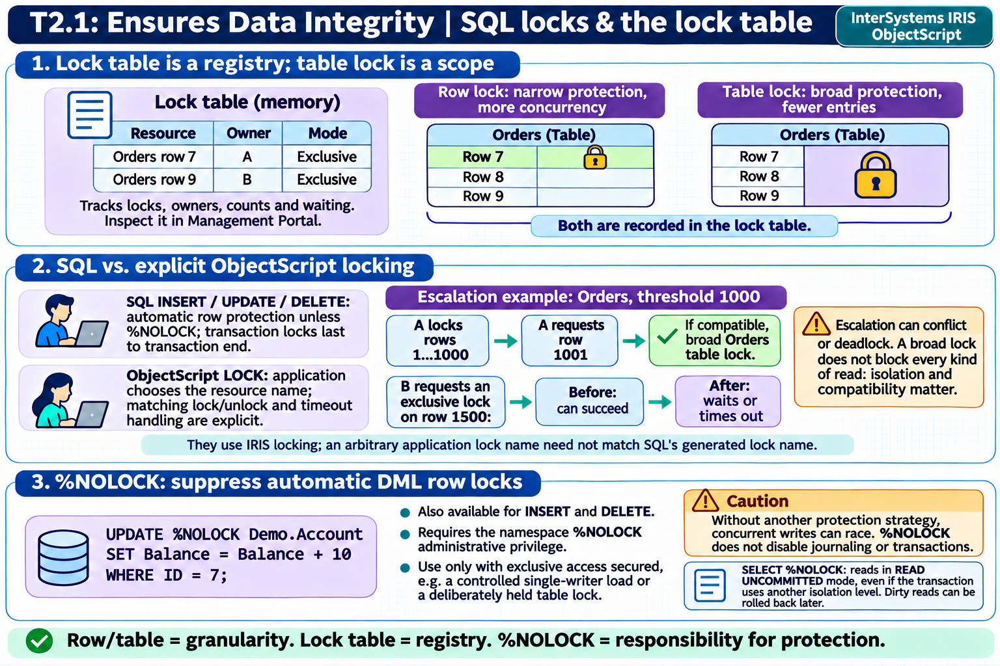

| Concept | What it does | Typical use or trade-off |
| --- | --- | --- |
| Lock table | Records current locks and their owners in memory | Inspect contention and waiting; monitor capacity. |
| Row lock | Protects a particular record | Independent rows can be updated concurrently; many locks consume registry space. |
| Table lock | Protects a whole SQL table in shared or exclusive mode | Deliberate bulk work or escalation; broader conflicts, fewer entries. |

#### Worked example: another row becomes affected

A transaction in process A updates Orders rows 1–1000. An exclusive request by B for another row, 1500, can succeed while A only protects its own rows. A then requests eligible row lock 1001. If escalation succeeds, A now holds broad table protection, and B's new incompatible request for row 1500 waits or times out. If B already holds an incompatible row lock, it can prevent A from obtaining the broader lock; overlapping transactions can deadlock. Do not assume escalation always succeeds immediately.

A broad exclusive lock blocks conflicting locking requests. Reads that do not request conflicting locks can still observe data according to their isolation rules, including uncommitted data at READ UNCOMMITTED. Thus “locks the whole table” does not mean “blocks all access.”

```objectscript
 // Inspect the actual system setting; do not change it just to run an example.
 WRITE $SYSTEM.SQL.Util.GetOption("LockThreshold"), !
```

For explicit table protection, SQL supports `LOCK TABLE Demo.Orders IN EXCLUSIVE MODE` or `IN SHARE MODE`. Row locking is appropriate when transactions work on separate records; a deliberate table lock can suit controlled bulk operations where broad contention is acceptable. Follow the SQL LOCK/UNLOCK transaction-lifetime rules. Keep transactions short and monitor the registry before changing system-wide thresholds.

#### Releasing a whole-table lock: identify its origin

| How the table became locked | Normal release |
| --- | --- |
| SQL-managed row locks escalated during a transaction | SQL manages their counts and releases the transaction's locks at its end; an inner ObjectScript commit is insufficient |
| Explicit SQL `LOCK TABLE Account IN EXCLUSIVE MODE` | Matching `UNLOCK TABLE Account IN EXCLUSIVE MODE`; commit/rollback alone does not balance the explicit acquisition |
| Explicit ObjectScript `LOCK +^Data` as an application-wide gate | Matching `LOCK -^Data`, respecting count and transaction timing |

Escalating child unlocks reduce the count; once sufficiently reduced, the implicit parent lock can disappear. SQL manages its own row-lock bookkeeping. Do not unlock guessed storage-global names to undo SQL escalation. A root global lock is not necessarily an SQL table lock: tables can use several globals.

For an explicit SQL table lock, request release before ending the transaction. Assuming no outer transaction, the successful path is:

```objectscript
 &sql(START TRANSACTION)
 &sql(LOCK TABLE Account IN EXCLUSIVE MODE WAIT 5)
 IF SQLCODE < 0 {
     WRITE "Lock failed: ", SQLCODE, " ", %msg, !
     &sql(ROLLBACK)
     QUIT
 }
 // Perform batch work and handle statement errors here
 &sql(UNLOCK TABLE Account IN EXCLUSIVE MODE)
 // Release is deferred while the transaction is active
 &sql(COMMIT)
```

The error path after successful acquisition must also balance the lock and roll back. Repeated explicit acquisitions require the same number of unlocks in the same mode. `UNLOCK TABLE Account IN EXCLUSIVE MODE IMMEDIATE` releases at once when its count reaches zero, even inside a transaction; use only when early release is correct. See [SQL LOCK](https://docs.intersystems.com/irislatest/csp/docbook/DocBook.UI.Page.cls?KEY=RSQL_lock), [SQL UNLOCK](https://docs.intersystems.com/irislatest/csp/docbook/DocBook.UI.Page.cls?KEY=RSQL_unlock), and [escalating locks](https://docs.intersystems.com/irislatest/csp/docbook/DocBook.UI.Page.cls?KEY=GAPPS_lockbasics).

#### %NOLOCK: query visibility versus write protection

`%NOLOCK` is an IRIS SQL keyword option, placed after the statement verb. It is not the SQL Server-style syntax `FROM Account %NOLOCK`.

```sql
SELECT %NOLOCK ID, Balance FROM Demo.Account WHERE ID = 7;
```

For SELECT, it performs no locking on the query's tables and uses **READ UNCOMMITTED** regardless of the transaction's current isolation mode. For example, A changes Balance from 100 to 120 without committing; B can read 120 using SELECT %NOLOCK; A rolls back, leaving 100. B's observed 120 was a dirty read. This is inappropriate when a decision requires committed data.

```sql
UPDATE %NOLOCK Demo.Account SET Balance = Balance + 10 WHERE ID = 7;
```

For INSERT, UPDATE and DELETE, it suppresses automatic row locking. Reserve this for controlled exclusive access, such as a single-writer load or deliberately held table protection. Without another protection strategy, concurrent writers can race. It requires the corresponding namespace administrative privilege and does not itself disable journaling, transactions or rollback. It is distinct from `%NOJOURN`.

### Documentation References

- [Releasing explicit table locks](https://docs.intersystems.com/irislatest/csp/docbook/DocBook.UI.Page.cls?KEY=RSQL_unlock)

- [ObjectScript LOCK and E-type escalation](https://docs.intersystems.com/irislatest/csp/docbook/DocBook.UI.Page.cls?KEY=RCOS_clock)
- [SQL UPDATE: transaction locking and %NOLOCK](https://docs.intersystems.com/irislatest/csp/docbook/DocBook.UI.Page.cls?KEY=RSQL_UPDATE)
- [SQL SELECT: %NOLOCK and isolation](https://docs.intersystems.com/irislatest/csp/docbook/DocBook.UI.Page.cls?KEY=RSQL_SELECT)
- [Explicit SQL table locks](https://docs.intersystems.com/irislatest/csp/docbook/DocBook.UI.Page.cls?KEY=RSQL_lock)
- [Managing the Lock Table](https://docs.intersystems.com/irislatest/csp/docbook/DocBook.UI.Page.cls?KEY=GCOS_locktable)

## 5. Differentiates between pessimistic and optimistic concurrency controls

### Key Points

- **Pessimistic concurrency**: Locks resources BEFORE reading; serializes cooperating conflicting access but can cause waiting or deadlocks
- **Optimistic concurrency**: Reads without locking; checks for conflicts at commit time; better throughput for low-contention scenarios
- **Object concurrency**: Default 1 (Atomic read); inspect an object with `%Concurrency`. The method argument, class and process defaults can override the effective mode.
- **Optimistic via %VersionId**: Uses a version counter to detect concurrent modifications
- **SQL ISOLATION LEVEL**: READ UNCOMMITTED (default), READ COMMITTED, and READ VERIFIED provide different read guarantees; verify the process setting

### Detailed Notes

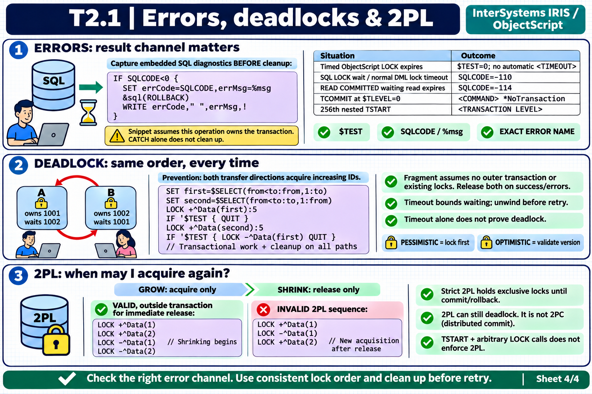

Read the three panels together: an error result needs cleanup, a shared acquisition order prevents circular waiting, and 2PL governs acquisition versus release. [Copyable examples](revision-examples.md#4-errors-deadlocks-and-2pl).

#### Pessimistic Concurrency

In pessimistic concurrency, a process acquires an exclusive lock before reading or modifying a resource. Other cooperating processes wait for incompatible locks; direct global access without locking can still proceed. It is suitable for high-contention scenarios where conflicts are frequent.

```objectscript
 // Pessimistic approach: lock first, then read and modify
 LOCK +^Data("customer", custId):5
 IF '$TEST {
     WRITE "Resource busy", !
     QUIT
 }
 SET data = ^Data("customer", custId)
 // ... modify data ...
 SET ^Data("customer", custId) = data
 LOCK -^Data("customer", custId)
```

#### Optimistic Concurrency

In optimistic concurrency, a process reads data without acquiring locks. Before committing changes, it verifies that no other process has modified the data in the meantime. If a conflict is detected, the operation is retried or reported as a failure. This works well in low-contention environments.

```objectscript
 // Optimistic approach using %VersionId in persistent classes
 SET obj = ##class(MyApp.Customer).%OpenId(custId)
 // ... modify obj properties ...
 SET sc = obj.%Save()
 IF $$$ISERR(sc) {
     // Check if it's a concurrency conflict
     // %VersionId mismatch means another process modified the object
     WRITE "Concurrency conflict - retry needed", !
 }
```

#### Object concurrency: default 1 (Atomic read)

The usual object concurrency default is **1 (Atomic read)**. An omitted `%OpenId` concurrency argument means `-1`: use the class's `DEFAULTCONCURRENCY`, which normally obtains the process default (initially 1). An explicit method argument or class override can change this. The process default can be changed with `$SYSTEM.OBJ.SetConcurrencyMode()`.

**Naming:** the effective object property is `%Concurrency`, not `%ConcurrencyMode`. Mode 1 provides an atomic read, acquiring a temporary shared lock when needed; it does not retain a lock while you edit the object or automatically detect a stale copy.

InterSystems IRIS persistent objects support several concurrency modes:

- **0 (None)**: No locking; fastest but no protection
- **1 (Atomic read, default)**: Temporary shared lock during open when needed for an atomic read; no retained read lock
- **2 (Shared locks)**: Always takes a shared lock during open, then releases it after the read
- **3 (SharedRetain)**: Shared lock on open retained until close
- **4 (PessimisticRetain)**: Exclusive lock on open retained until close; maximum protection

```objectscript
 // Open with pessimistic locking
 SET obj = ##class(MyApp.Customer).%OpenId(custId, 4, .sc)  // concurrency = 4
```

#### Deadlock prevention and two-phase locking

These terms appear as alternatives in the T2.1 quiz; the study pack previously had no dedicated explanation in another chapter. They address different concerns from optimistic version checking:

| Concept | Question it answers | Example |
| --- | --- | --- |
| Pessimistic control | When do I reserve access? | Lock before reading |
| Optimistic control | How do I detect a stale update? | Compare a version before accepting the write |
| Deadlock prevention | How do I avoid circular waiting? | Every transfer locks accounts in increasing ID order |
| Two-phase locking (2PL) | When may I acquire and release locks? | After the first release, acquire no new locks |

**Deadlock example:** A owns account 1001 and waits for 1002; B owns 1002 and waits for 1001. Without timeouts, neither reaches its unlock. Prevent the cycle by using the same acquisition order everywhere. A timeout bounds waiting, but recovery must release locks already owned. Retrying while retaining them can preserve the cycle.

This acquisition fragment assumes no outer transaction and no existing acquisitions of these names. Both transfer directions must calculate the same order:

```objectscript
 SET first=$SELECT(fromAcct<toAcct:fromAcct,1:toAcct)
 SET second=$SELECT(fromAcct<toAcct:toAcct,1:fromAcct)
 LOCK +^Data("account",first):5
 IF '$TEST { QUIT }
 LOCK +^Data("account",second):5
 IF '$TEST {
     LOCK -^Data("account",first)  // Unwind before retrying later
     QUIT
 }
 // Transactional transfer body with TRY/CATCH cleanup goes here
 // Finish commit/rollback before releasing either lock
 LOCK -^Data("account",second)
 LOCK -^Data("account",first)
```

The fragment omits the transfer body. A complete operation releases both acquired locks on success and exceptions, and retries the entire logical operation after cleanup. See [avoiding deadlocks](https://docs.intersystems.com/irislatest/csp/docbook/DocBook.UI.Page.cls?KEY=GAPPS_lockbasics).

**2PL** has a growing phase (acquire locks, release none) and a shrinking phase (release locks, acquire none). `acquire A → acquire B → work → release A → release B` follows it; `acquire A → release A → acquire B` does not. Strict 2PL additionally holds exclusive locks until commit/rollback. It can still deadlock while participants are acquiring locks; a shared order addresses that separate problem.

2PL is a concurrency protocol. Two-phase commit (2PC) coordinates distributed commitment. `TSTART` plus arbitrary `LOCK` calls does not automatically enforce 2PL; application code must follow the protocol. See [CMU Database Systems: two-phase locking](https://15445.courses.cs.cmu.edu/spring2026/notes/18-twophaselocking.pdf).

#### SQL isolation: default READ UNCOMMITTED

The initial SQL isolation setting is **READ UNCOMMITTED (`IsolationMode = 0`)**, not READ COMMITTED. It controls query visibility independently of object concurrency: object mode 1 and SQL isolation mode 1 are different settings. A connection or application can change the process setting; inspect the current value rather than assuming the initial default still applies.

```objectscript
 WRITE $SYSTEM.SQL.Util.GetOption("IsolationMode"), !
 // 0 = READ UNCOMMITTED; 1 = READ COMMITTED; 3 = READ VERIFIED
```

- **READ UNCOMMITTED (default)**: Can see another transaction's uncommitted changes, including values later rolled back.
- **READ COMMITTED**: Normally waits for pending inserts/updates. IRIS has exceptions, including pending deletes, aggregates, DISTINCT, GROUP BY and SELECT %NOLOCK; consult the SQL reference.
- **READ VERIFIED**: Still permits uncommitted data; rechecks relevant query conditions. It does not mean committed-only reads.

For example, if A changes a balance from 100 to 120 and later rolls back, a default SQL read can observe 120. Starting a transaction alone does not guarantee committed-only reads. Set the intended isolation explicitly, for example `SET TRANSACTION ISOLATION LEVEL READ COMMITTED`; the setting persists for the process until changed, including after COMMIT/ROLLBACK.

### Documentation References

- [Concurrency Control](https://docs.intersystems.com/irislatest/csp/docbook/DocBook.UI.Page.cls?KEY=GOBJ_concurrency)
- [Deadlock Prevention](https://docs.intersystems.com/irislatest/csp/docbook/DocBook.UI.Page.cls?KEY=GAPPS_lockbasics)
- [Object Concurrency](https://docs.intersystems.com/irislatest/csp/docbook/DocBook.UI.Page.cls?KEY=GOBJ_concurrency)
- [SQL Transaction Isolation Levels](https://docs.intersystems.com/irislatest/csp/docbook/DocBook.UI.Page.cls?KEY=RSQL_starttransaction)

## 6. Uses transactions and applies concurrency controls in SQL scripts

### Key Points

- **&sql(START TRANSACTION)**: Begins an SQL transaction using the same state as ObjectScript; repeated SQL starts do not nest like repeated `TSTART`
- **&sql(COMMIT)**: Commits the SQL transaction
- **&sql(ROLLBACK)**: Rolls back the SQL transaction
- **SQLCODE**: Check after each SQL statement; 0 = success, 100 = no data, negative = error
- **%NOLOCK hint**: For SELECT, forces READ UNCOMMITTED without query locks; for DML, suppresses automatic row locking
- **Parameterized queries**: Use host variables (:variable) in embedded SQL for safe value binding

### Detailed Notes

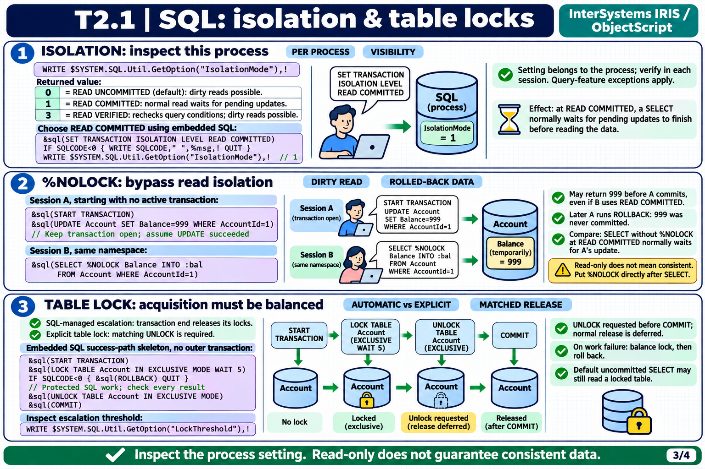

The SQL table-lock diagram is a success-path skeleton; check every statement and balance acquired locks on error paths. [Copyable examples](revision-examples.md#3-sql-isolation-nolock-and-table-locks).

#### Basic Embedded SQL Transaction Pattern

```objectscript
 &sql(START TRANSACTION)
 &sql(UPDATE Account SET Balance = Balance - :amount WHERE AccountId = :fromAcct)
 IF SQLCODE < 0 {
     &sql(ROLLBACK)
     WRITE "Error on debit: ", %msg, !
     QUIT
 }
 &sql(UPDATE Account SET Balance = Balance + :amount WHERE AccountId = :toAcct)
 IF SQLCODE < 0 {
     &sql(ROLLBACK)
     WRITE "Error on credit: ", %msg, !
     QUIT
 }
 &sql(COMMIT)
```

#### Mixing ObjectScript and SQL Transactions

TSTART and &sql(START TRANSACTION) share transaction state and $TLEVEL. Their nesting semantics differ: repeated SQL starts do not increment an active transaction like repeated TSTART commands. Define transaction ownership before mixing them:

```objectscript
 TSTART
 SET ^AuditLog($INCREMENT(^AuditLog)) = $HOROLOG _ "|Transfer"
 &sql(UPDATE Account SET Balance = Balance - :amount WHERE AccountId = :fromAcct)
 IF SQLCODE < 0 {
     TROLLBACK
     QUIT
 }
 TCOMMIT
```

#### Inspect and choose isolation in the current process

The API expression `$SYSTEM.SQL.Util.GetOption("IsolationMode")` returns the current process setting. Use `WRITE` in ObjectScript Terminal to display it; this is ObjectScript, not a Bash command:

```objectscript
 WRITE $SYSTEM.SQL.Util.GetOption("IsolationMode"),!
 // 0 = READ UNCOMMITTED; 1 = READ COMMITTED; 3 = READ VERIFIED
```

To choose READ COMMITTED for this process and check the result:

```objectscript
 &sql(SET TRANSACTION ISOLATION LEVEL READ COMMITTED)
 IF SQLCODE < 0 {
     WRITE SQLCODE, " ", %msg, !
     QUIT
 }
 WRITE $SYSTEM.SQL.Util.GetOption("IsolationMode"),!  // 1
```

Check both sessions independently when experimenting. This setting controls SQL reads; it does not make direct global reads honor SQL isolation or force uncooperative writers to acquire locks. READ VERIFIED can still read uncommitted values. See [SQL isolation configuration](https://docs.intersystems.com/irislatest/csp/documatic/%25CSP.Documatic.cls?CLASSNAME=%25SYSTEM.SQL.Util&LIBRARY=%25SYS).

#### Using %NOLOCK: accept dirty reads explicitly

SELECT %NOLOCK reads in READ UNCOMMITTED mode regardless of the current transaction isolation mode. Place the option after SELECT:

```objectscript
 &sql(SELECT %NOLOCK Name, Balance INTO :name, :bal
      FROM Account
      WHERE AccountId = :acctId)
```

The query can see another transaction's changes that are later rolled back. Section 4 shows a dirty-read example and explains the separate DML meaning of %NOLOCK. It does not remove the need for a safe write-locking strategy.

#### SQL reads, writes, and timeout errors

SQL automatically requests locks for ordinary `INSERT`, `UPDATE`, and `DELETE`. An exclusive table lock conflicts with these operations. A default READ UNCOMMITTED `SELECT` can still read the table; a normal READ COMMITTED read can wait for an uncommitted update. `%NOLOCK`, aggregates, `DISTINCT`, and `GROUP BY` have documented exceptions to READ COMMITTED behavior. See [SELECT locking](https://docs.intersystems.com/irislatest/csp/docbook/DocBook.UI.Page.cls?KEY=RSQL_select) and [transaction isolation](https://docs.intersystems.com/irislatest/csp/docbook/DocBook.UI.Page.cls?KEY=RSQL_starttransaction).

| Operation whose wait expires | Reported outcome | Required response |
| --- | --- | --- |
| ObjectScript `LOCK +name:5` | `$TEST=0`, without an automatic `<TIMEOUT>` exception | Skip protected work; release earlier acquisitions owned by this operation |
| SQL `LOCK TABLE ... WAIT 5` | `SQLCODE=-110` and diagnostic `%msg` | Check the result and clean up |
| SQL `INSERT`, `UPDATE`, or `DELETE` unable to acquire its lock | Normally `SQLCODE=-110` | Handle the failed statement and surrounding transaction |
| READ COMMITTED query waiting for an update | `SQLCODE=-114` on lock timeout | Handle the failed read; output variables are not valid results |

`SQLCODE` and `%msg` belong to embedded SQL; Dynamic SQL exposes errors through its result object. Save diagnostics before cleanup statements overwrite them. A timeout identifies an expired wait, not necessarily a deadlock: a long-running owner can cause it too. See [SQL error codes](https://docs.intersystems.com/irislatest/csp/docbook/DocBook.UI.Page.cls?KEY=RERR_sql).

For a two-session exercise, A explicitly locks `Account` in exclusive mode. B tries `LOCK TABLE Account IN EXCLUSIVE MODE WAIT 2` and gets `-110` if A keeps holding the lock. A issues the matching `UNLOCK`; B's next attempt succeeds. Use persistent Terminal/SQL Shell sessions in the same namespace: a short-lived Portal SQL process may end and release its lock before B tests it. See [SQL LOCK examples](https://docs.intersystems.com/irislatest/csp/docbook/DocBook.UI.Page.cls?KEY=RSQL_lock).

#### Checking SQL Permissions Within Transactions

SQL operations within transactions respect the same privilege model. Combine transaction management with error handling for privilege failures:

```objectscript
 &sql(START TRANSACTION)
 &sql(INSERT INTO SensitiveData (PatientId, Diagnosis) VALUES (:pid, :diag))
 IF SQLCODE = -99 {
     &sql(ROLLBACK)
     WRITE "Insufficient SQL privileges", !
     QUIT
 }
 &sql(COMMIT)
```

### Documentation References

- [Embedded SQL](https://docs.intersystems.com/irislatest/csp/docbook/DocBook.UI.Page.cls?KEY=GSQL_esql)
- [SQL Transaction Processing](https://docs.intersystems.com/irislatest/csp/docbook/DocBook.UI.Page.cls?KEY=GAPPS_tp)
- [SELECT and %NOLOCK](https://docs.intersystems.com/irislatest/csp/docbook/DocBook.UI.Page.cls?KEY=RSQL_select)
- [SQL Timeout Error Codes](https://docs.intersystems.com/irislatest/csp/docbook/DocBook.UI.Page.cls?KEY=RERR_sql)

## Exam Preparation Summary

### Critical Concepts to Master:

1. **Transaction lifecycle**: TSTART increments $TLEVEL, TCOMMIT decrements it, actual commit happens only at $TLEVEL = 0
2. **TROLLBACK vs TROLLBACK 1**: Full rollback resets $TLEVEL to 0; partial rollback decrements by 1
3. **Incremental locks**: Balance LOCK +/- counts; timeout limits acquisition waiting; direct global access is cooperative; distinguish shared/exclusive locks and unlock timing
4. **Lock escalation**: Default 1000: the next eligible lock attempts escalation; configurable via $SYSTEM.SQL.Util.SetOption
5. **Pessimistic vs optimistic**: Pessimistic locks before reading, optimistic checks at commit time; know the object concurrency values (0-4), the default 1, and the separate SQL isolation default READ UNCOMMITTED
6. **SQL transactions**: Share state with ObjectScript, but SQL starts do not nest like TSTART; distinguish SQLCODE failures from $TEST=0
7. **Deadlocks and 2PL**: Use a consistent acquisition order; 2PL separates acquisition and release phases but does not itself prevent deadlocks

### Common Exam Scenarios:

- Predicting $TLEVEL values after a sequence of TSTART, TCOMMIT, TROLLBACK, and TROLLBACK 1 commands
- Identifying what is and is NOT rolled back (local variables and $INCREMENT are not rolled back)
- Choosing between pessimistic and optimistic concurrency for given application scenarios
- Recognizing when lock escalation will occur and its impact on concurrent access
- Fixing embedded SQL transaction patterns that lack proper error handling or rollback
- Understanding the effect of %NOLOCK on query behavior

### Hands-On Practice Recommendations:

- Write nested transaction code and verify $TLEVEL at each step using WRITE $TLEVEL
- Experiment with TROLLBACK 1 in nested transactions and observe which changes persist
- Open two terminal sessions and observe LOCK blocking behavior with timeouts
- Use Management Portal (System Operation &gt; Locks) to view the lock table during testing
- Write embedded SQL transactions with intentional errors and verify ROLLBACK behavior
- Test lock escalation by inserting more than 1000 rows in a single transaction and monitoring the lock table

## Glossary & Cheat Sheet

### Key terms

- **Transaction and nesting**
  - `TSTART` — Opens a transaction level.
  - `TCOMMIT` — Closes a level and commits changes at the outermost level.
  - `TROLLBACK 1` — Undoes work at the current level.
  - `TROLLBACK` — Without an argument, rolls back all active levels.
  - `$TLEVEL` — Reports the transaction nesting depth.
- **Rollback scope**
  - **Journaled changes** — Can be undone by transaction rollback.
  - **Local and external effects** — Require separate recovery where applicable.
  - **Ownership** — Determines which transaction level a routine may commit or roll back.
- **Cooperative lock**
  - **LOCK +** — Incrementally acquires a lock on a named resource.
  - **LOCK -** — Releases one acquisition of that resource.
  - **Timed LOCK** — Sets $TEST to indicate whether acquisition succeeded.
  - **Resource name** — Must be shared by all cooperating code paths.
- **Modes and escalation**
  - **Shared lock** — Allows compatible readers to share the resource.
  - **Exclusive lock** — Conflicts with other processes' shared and exclusive locks.
  - **Lock escalation** — Can replace many SQL row locks with a table lock.
- **Optimistic and pessimistic control**
  - **Pessimistic locking** — Protects the read-to-write interval with a lock.
  - **Optimistic checking** — Detects intervening changes and requires handling a conflict.
- **SQL transaction controls**
  - `START TRANSACTION` — Starts a SQL transaction.
  - `COMMIT` — Makes the transaction's changes permanent.
  - `ROLLBACK` — Undoes transactional changes.
  - `SET TRANSACTION` — Configures the isolation level.
  - **LOCK TABLE and UNLOCK TABLE** — Acquire and release explicit table locks.
  - `%NOLOCK` — Changes the query's locking behavior.
- **Deadlock and lifetime**
  - **Deadlock** — Occurs when processes wait on resources in a cycle.
  - **Lock ordering** — Reduces deadlocks by acquiring shared resources consistently.
  - **Lock lifetime** — Depends on how the lock was taken and the transaction boundary.
- **ObjectScript commands**
  - `CATCH` — Receives the exception raised in the corresponding TRY block.
  - `FOR` — Repeats a block or command according to a loop specification.
  - `IF` — Runs the following command or block when its condition is true.
  - `LOCK` — Acquires or releases a cooperative lock on the supplied name.
  - `QUIT` — Leaves the current loop, block or invocation as determined by context.
  - `TRY` — Begins a block watched for exceptions.
  - `WHILE` — Repeats the block while its condition holds.
  - `WRITE` — Sends formatted output to the current device.
- **System variables and macros**
  - `$HOROLOG` — Reports local date and time as day and seconds fields.
  - `$SYSTEM` — Provides shorthand access to the IRIS %SYSTEM package.
  - `$ZERROR` — Reports the last ObjectScript error text.
  - `$ZTRAP` — Identifies the legacy ObjectScript error handler.
  - `$$$ERROR` — Builds an error status from its code and arguments.
  - `$$$GeneralError` — Identifies the general-error code used with message text.
  - `$$$ISERR` — Tests whether a status indicates an error.
  - `$$$OK` — Supplies a success status.
  - `$TEST` — Reports the result of commands such as a timed LOCK.
- **SQL statements and clauses**
  - `READ UNCOMMITTED` — Allows reads of another transaction's uncommitted changes.
  - `READ COMMITTED` — Prevents reads of uncommitted changes.
  - `REPEATABLE READ` — Protects rows already read from concurrent changes within the transaction.
  - `SERIALIZABLE` — Uses the strongest transaction isolation, protecting against phantom reads.
  - `SELECT` — Reads rows and expressions from one or more sources.
  - `FROM` — Names the source tables or queries.
  - `WHERE` — Keeps rows whose predicate is true.
  - `GROUP BY` — Forms groups of rows for aggregate operations.
  - `INSERT INTO` — Creates rows in the named table.
  - `VALUES` — Supplies row values for an insert.
  - `UPDATE` — Changes values in existing rows.
  - **SET (SQL)** — Defines the columns and expressions updated by an UPDATE.
  - `&sql` — Embeds a SQL statement in ObjectScript.
  - `SQLCODE` — Reports the result of an Embedded SQL operation.
  - `%msg` — Contains diagnostic text for a SQL error where supplied.

### System methods and functions

- `##class(%SQL.Statement).%New()` — Creates a dynamic SQL statement object.
- `##class(App.Record).%New()` — Creates a new in-memory instance of the class.
- `##class(App.Record).%OpenId(id, concurrency, .status)` — Opens a record by ID. The concurrency and status arguments are optional.
- `$GET(node, default)` — Returns the node value or a default.
- `$INCREMENT(node, amount)` — Atomically adds an amount and returns the new value.
- `$LISTNEXT(list, position, value)` — Advances the position variable and outputs the next element.
- `$SELECT(condition:value, 1:default)` — Returns the value for the first true condition.
- `$SEQUENCE(^counter)` — Allocates the next value from a global sequence counter.
- `$SYSTEM.OBJ.SetConcurrencyMode(mode)` — Sets the current process's default object concurrency mode.
- `$SYSTEM.SQL.Util.GetOption(option)` — Reads the current value of an SQL option.
- `$SYSTEM.SQL.Util.SetOption(option, value)` — Sets a named SQL option.
- `ex.DisplayString()` — Returns the exception in displayable form.
- `obj.%Save()` — Persists the object and returns a status.
- `stmt.%Execute(value)` — Runs the prepared statement with the given bound value.
- `stmt.%Prepare(sql)` — Prepares a dynamic statement and returns a status.

Official reference: [ObjectScript LOCK](https://docs.intersystems.com/irislatest/csp/docbook/DocBook.UI.Page.cls?KEY=RCOS_clock).

### Visual recap

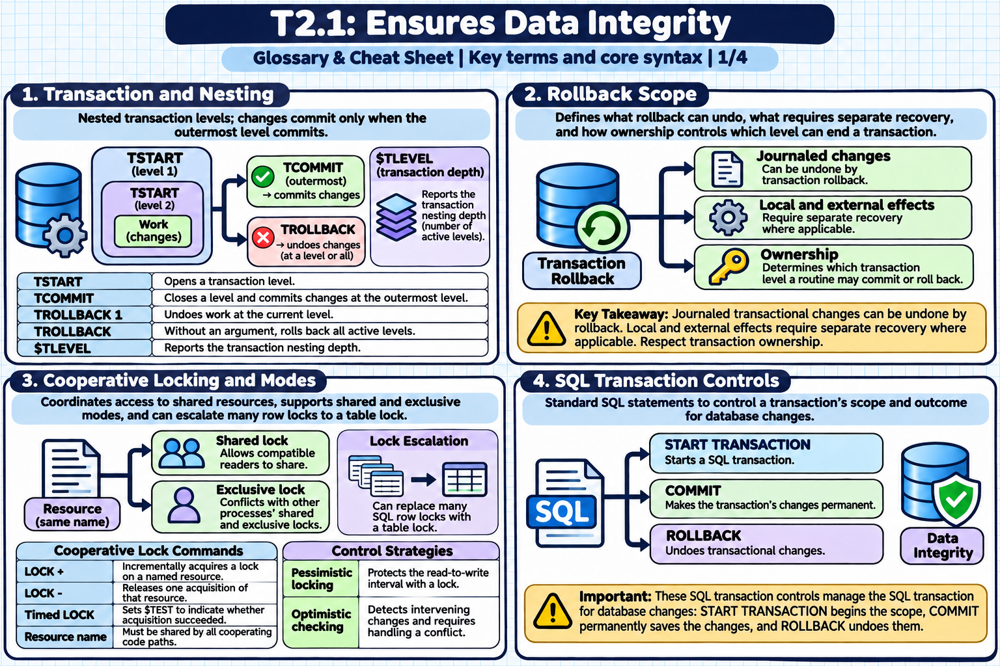
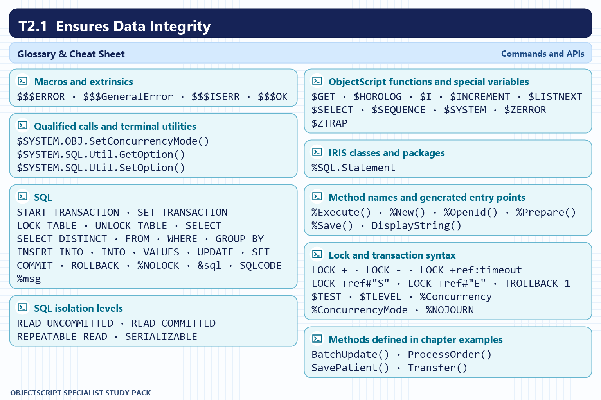
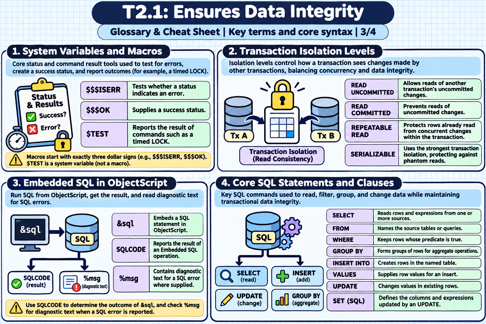
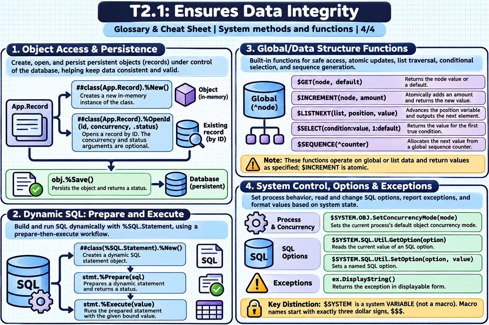
