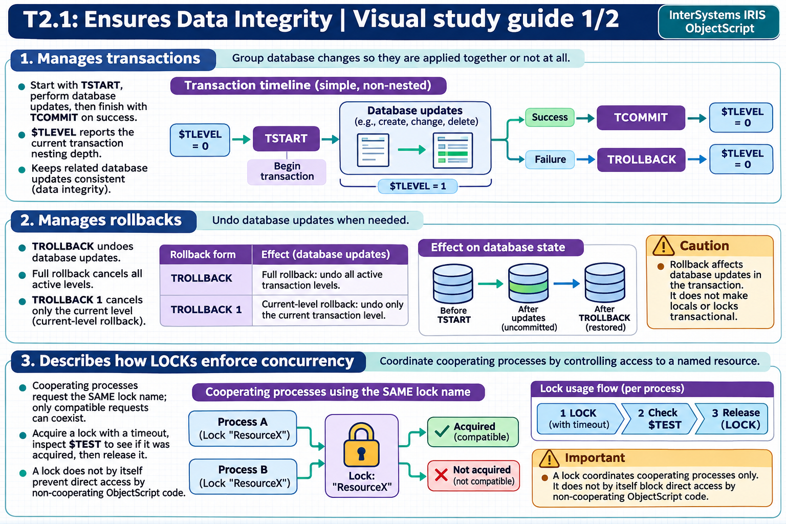

[Topic contents](../index.md) · [Full topic guide](../study.md) · [All topics](../../../index.md)

# T2.1: Ensures Data Integrity

Saved 2 November 2026 from [exam-prep.es](https://exam-prep.es/exams/objectscript/knowledge/T2.1.html). Reference links require internet access.

## 3. Describes how LOCKs enforce concurrency



*This diagram covers sections 1–3; use the matching numbered panel for this page.* [Chapter diagrams](../visuals.md) · [Technical review notes](../../../visual-technical-notes.md)

### Key Points

- **Incremental lock**: `LOCK +lockname` acquires a lock without releasing existing locks
- **Incremental unlock**: `LOCK -lockname` releases a specific lock without affecting others
- **Classic LOCK**: `LOCK lockname` releases ALL existing locks and acquires the new one (rarely used)
- **Lock timeout**: `LOCK +lockname:timeout` specifies maximum wait time in seconds; check $TEST for success
- **Exclusive locks**: Any lock without `#"S"` is exclusive (the default); blocks all other locks on that resource
- **Shared locks**: `LOCK +lockname#"S"` allows multiple readers; exclusive locks block other processes
- **Lock type flags**: `#"S"` (shared), `#"E"` (escalating), `#"I"` (immediate unlock), `#"D"` (deferred unlock) — combinable (e.g., `#"SI"`)
- **Immediate unlock**: `LOCK -lockname#"I"` releases a lock immediately even within a transaction, overriding the default deferred behavior
- **Lock table**: System-wide resource viewable in Management Portal under System Operation &gt; Locks

### Detailed Notes

#### Incremental Lock Pattern

The standard pattern in modern ObjectScript uses incremental locks (+/-) to manage concurrency without accidentally releasing other locks held by the process.

```objectscript
 // Acquire lock with 5-second timeout
 LOCK +^Data("account", acctId):5
 IF '$TEST {
     WRITE "Could not acquire lock", !
     QUIT
 }
 TRY {
     // Critical section: read-modify-write
     SET balance = ^Data("account", acctId, "balance")
     SET ^Data("account", acctId, "balance") = balance + amount
     TCOMMIT
 }
 CATCH ex {
     TROLLBACK
 }
 LOCK -^Data("account", acctId)     // Always release the lock
```

#### Shared vs Exclusive Locks

Any lock without the `#"S"` flag is an **exclusive lock** (also called a write lock). There is no explicit "exclusive" flag — the absence of `#"S"` makes a lock exclusive by default. Shared locks allow multiple processes to read concurrently, while exclusive locks provide sole access:

- An existing **shared lock** prevents other processes from acquiring an **exclusive lock** on that resource
- An existing **exclusive lock** prevents other processes from acquiring **any lock** (shared or exclusive) on that resource
- Multiple processes **can** hold shared locks on the same resource simultaneously

```objectscript
 // Shared lock for reading (multiple readers allowed)
 LOCK +^Data("report")#"S":5
 IF $TEST {
     // Read operations
     LOCK -^Data("report")#"S"
 }

 // Exclusive lock for writing (blocks all other locks)
 LOCK +^Data("report"):5
 IF $TEST {
     // Write operations
     LOCK -^Data("report")
 }
```

#### Lock Type Flags

The LOCK command supports type flags specified after `#` in quotes. Available flags:

| Flag | Meaning | Lock | Unlock | Description |
| --- | --- | --- | --- | --- |
| `"S"` | Shared | Yes | Yes | Multiple readers allowed |
| `"E"` | Escalating | Yes | Yes | Participates in lock escalation |
| `"I"` | Immediate | No | Yes | Releases lock immediately, even within a transaction |
| `"D"` | Deferred | No | Yes | Defers unlock until transaction ends (default behavior within transactions) |

Flags can be combined: `#"SE"` (shared escalating), `#"SI"` (shared immediate unlock), `#"EI"` (escalating immediate unlock).

#### Immediate vs Deferred Unlock Within Transactions

By default, locks acquired within a transaction are held until TCOMMIT or TROLLBACK, even if explicitly released with `LOCK -`. This is **deferred unlock** behavior (`#"D"`, the default within transactions).

**Immediate unlock** (`#"I"`) overrides this behavior and releases the lock right away, even inside a transaction:

```objectscript
 TSTART
 LOCK +^Data("temp"):5
 // ... work with ^Data("temp") ...
 LOCK -^Data("temp")#"I"          // Released NOW, not at TCOMMIT
 // ... other work continues in the transaction ...
 TCOMMIT
```

Use immediate unlock when you need to release a lock within a transaction because the protected resource is no longer needed and you want to minimize lock contention. Use the default deferred behavior when the lock must be held for the full duration of the transaction to ensure data integrity.

#### Lock Table

The lock table is a system-wide in-memory structure that tracks all current locks. It can be viewed through the Management Portal (System Operation &gt; Locks) or programmatically. The lock table has a configurable size (locksiz parameter). When the lock table is full, new lock requests fail with a  error.

### Documentation References

- [LOCK Command](https://docs.intersystems.com/irislatest/csp/docbook/DocBook.UI.Page.cls?KEY=RCOS_clock)
- [Lock Management](https://docs.intersystems.com/irislatest/csp/docbook/DocBook.UI.Page.cls?KEY=GOBJ_concurrency)
