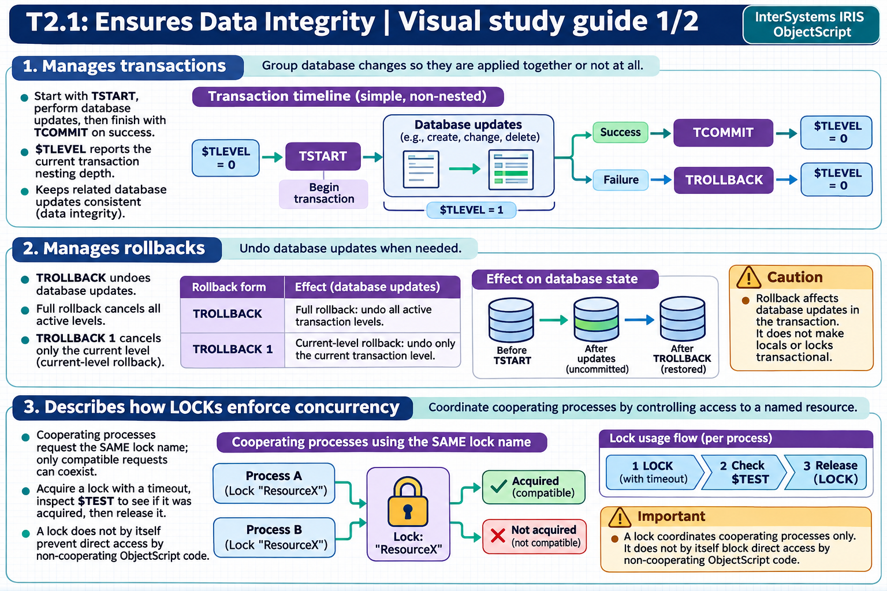

# T2.1: Ensures Data Integrity — visual study guides

[Approfondimenti dagli esercizi](<Approfondimenti esercizi/README.md>)

[Chapter contents](index.md) · [Full guide](study.md) · [Practice questions](quiz.md)

Generated learning summaries. Read the full notes for detailed explanations and exact code. [Technical review notes](../../visual-technical-notes.md).

## Visual guide — sections 1–3

Covers:

- 1. Manages transactions
- 2. Manages rollbacks
- 3. Describes how LOCKs enforce concurrency

## Visual guide — sections 4–6

Covers:

- 4. Describes lock escalation threshold and effect on row locks versus table locks
- 5. Differentiates between pessimistic and optimistic concurrency controls
- 6. Uses transactions and applies concurrency controls in SQL scripts
