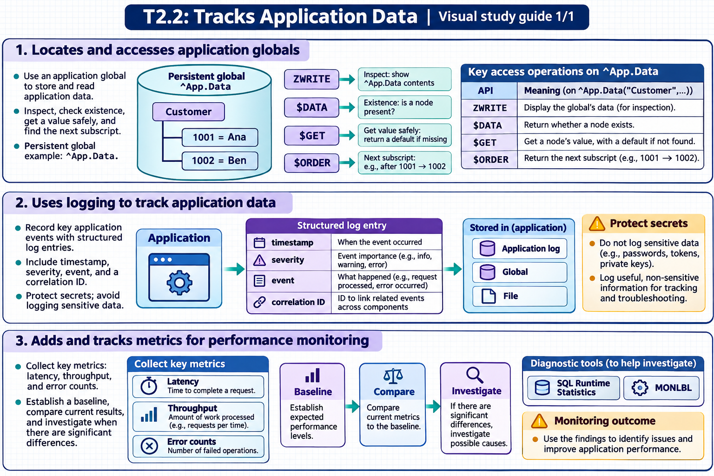

[Topic contents](../index.md) · [Full topic guide](../study.md) · [All topics](../../../index.md)

# T2.2: Tracks Application Data

Saved 2 November 2026 from [exam-prep.es](https://exam-prep.es/exams/objectscript/knowledge/T2.2.html). Reference links require internet access.

## 1. Locates and accesses application globals



*This diagram covers sections 1–3; use the matching numbered panel for this page.* [Chapter diagrams](../visuals.md) · [Technical review notes](../../../visual-technical-notes.md)

### Key Points

- **Globals (^name)**: Persistent multidimensional arrays stored in databases; the fundamental storage mechanism in InterSystems IRIS
- **ZWRITE**: Displays the contents of a global or subtree in a readable format
- **$DATA**: Tests whether a global node exists and whether it has descendants
- **$ORDER**: Iterates through global subscripts at a given level
- **$GET**: Safely retrieves a global node value, returning a default if the node does not exist
- **Management Portal**: System Explorer &gt; Globals provides a visual global viewer and editor

### Detailed Notes

#### Understanding Global Structure

Globals are sparse, hierarchical, multidimensional arrays stored on disk. They persist across process boundaries and system restarts. Every persistent class stores its data in globals -- understanding the underlying global structure is essential for debugging and performance analysis.

```objectscript
 // Setting global nodes
 SET ^Customer(1, "Name") = "John Smith"
 SET ^Customer(1, "Email") = "john@example.com"
 SET ^Customer(2, "Name") = "Jane Doe"
 SET ^Customer(2, "Email") = "jane@example.com"

 // Display entire global tree
 ZWRITE ^Customer
 // Output:
 // ^Customer(1,"Email")="john@example.com"
 // ^Customer(1,"Name")="John Smith"
 // ^Customer(2,"Email")="jane@example.com"
 // ^Customer(2,"Name")="Jane Doe"
```

#### Navigating Globals with $ORDER

$ORDER returns the next subscript at a given level, enabling traversal of global nodes:

```objectscript
 // Iterate through all customer IDs
 SET id = ""
 FOR {
     SET id = $ORDER(^Customer(id))
     QUIT:id=""
     WRITE "Customer ", id, ": ", ^Customer(id, "Name"), !
 }
```

#### Using $DATA to Check Node Existence

$DATA returns a value indicating whether a node exists and/or has children:

- 0 = node does not exist and has no descendants
- 1 = node exists but has no descendants
- 10 = node does not exist but has descendants
- 11 = node exists AND has descendants

```objectscript
 IF $DATA(^Customer(1)) {
     WRITE "Customer 1 exists", !
 }
 // Use $DATA to check before accessing
 IF $DATA(^Config("settings", "timeout"))#2 {
     SET timeout = ^Config("settings", "timeout")
 }
```

#### Management Portal Global Viewer

Navigate to System Explorer &gt; Globals to browse, search, and edit globals. You can:

- View globals across all namespaces
- Filter by global name prefix
- Drill into subscript levels
- Export and import global data
- Delete globals or individual nodes

#### Locating Class Data Globals

Persistent classes store data in globals named after the class. Use the storage definition in Studio/VS Code to find the exact global name:

```objectscript
 // For class MyApp.Customer, data is typically in:
 // ^MyApp.CustomerD (data global)
 // ^MyApp.CustomerI (index global)
 // ^MyApp.CustomerS (sequence counter)
 ZWRITE ^MyApp.CustomerD
```

### Documentation References

- [Introduction to Globals](https://docs.intersystems.com/irislatest/csp/docbook/DocBook.UI.Page.cls?KEY=GGBL_intro)
- [Global Structure](https://docs.intersystems.com/irislatest/csp/docbook/DocBook.UI.Page.cls?KEY=GGBL_structure)
- [$ORDER Function](https://docs.intersystems.com/irislatest/csp/docbook/DocBook.UI.Page.cls?KEY=RCOS_forder)
- [$DATA Function](https://docs.intersystems.com/irislatest/csp/docbook/DocBook.UI.Page.cls?KEY=RCOS_fdata)
