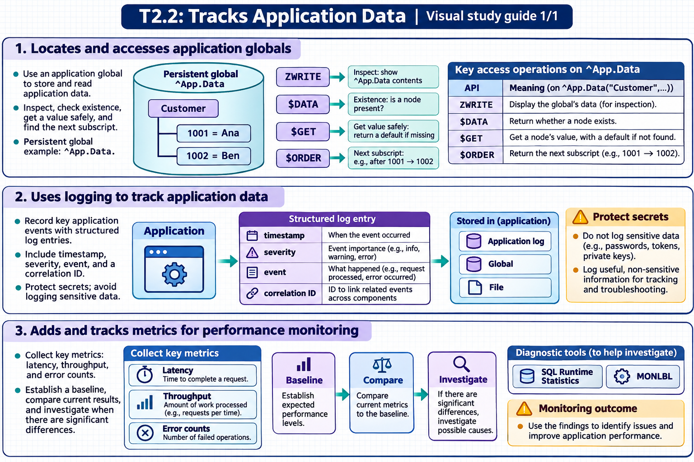

[Topic contents](../index.md) · [Full topic guide](../study.md) · [All topics](../../../index.md)

# T2.2: Tracks Application Data

Saved 2 November 2026 from [exam-prep.es](https://exam-prep.es/exams/objectscript/knowledge/T2.2.html). Reference links require internet access.

## 2. Uses logging to track application data



*This diagram covers sections 1–3; use the matching numbered panel for this page.* [Chapter diagrams](../visuals.md) · [Technical review notes](../../../visual-technical-notes.md)

### Key Points

- **^%ISCLOG**: Built-in diagnostic logging used by InterSystems framework code (CSP gateway, web services, productions); controlled by the ^%ISCLOG global, entries stored in ^ISCLOG in %SYS namespace
- **Custom logging globals**: Application-defined globals (e.g., ^MyApp.Log) for structured application-level logging
- **%Library.File**: Write log data to external files for integration with external log management systems
- **$HOROLOG / $ZTIMESTAMP**: Timestamps for log entries; $ZTIMESTAMP includes UTC time with fractional seconds
- **Log levels**: Implement severity levels (ERROR, WARN, INFO, DEBUG) for filtering and analysis

### Detailed Notes

#### ^%ISCLOG: Built-In Diagnostic Logging

^%ISCLOG is a diagnostic logging facility used by **InterSystems framework code** — CSP gateway, web services, Interoperability productions, and other system components. It is not typically called directly by application code; instead, system code calls the `$$$ISCLOG` and `$$$SysLog` macros (defined in `%occDiagnostics.inc`) to generate log entries.

**How it works:**

- The **^%ISCLOG** global (top-level value) controls the logging level: 0=disabled, 1=errors only, 2=warnings and errors, 3=all messages (most verbose)
- Log entries are written to the **^ISCLOG** global (without the % prefix) in the **%SYS namespace**
- Entries can be viewed using the **%Library.SysLog** class or by doing `ZWRITE ^ISCLOG` in the %SYS namespace

```objectscript
 // Enable diagnostic logging at maximum verbosity
 SET ^%ISCLOG = 3

 // Optionally limit the log size (default is unlimited)
 SET ^%ISCLOG("MaxLogEntries") = 10000

 // After troubleshooting, disable logging (impacts performance when enabled)
 SET ^%ISCLOG = 0
```

```objectscript
 // View log entries — switch to %SYS namespace first
 ZN "%SYS"
 ZWRITE ^ISCLOG

 // Or use the %Library.SysLog class to query entries programmatically
 SET rs = ##class(%Library.SysLog).FindAll()
 WHILE rs.%Next() {
     WRITE rs.%Get("TimeStamp"), " ", rs.%Get("Message"), !
 }
```

**Important:** Remember to set ^%ISCLOG back to 0 after troubleshooting, as verbose logging consumes disk space and impacts performance.

#### Building Custom Application Logs

For application-specific logging, create structured globals with timestamps, severity, and context. Unlike ^%ISCLOG (which is for system/framework diagnostics), custom logging globals give you full control over what your application records:

```objectscript
ClassMethod Log(level As %String, message As %String, context As %String = "")
{
    SET seq = $INCREMENT(^MyApp.Log)
    SET ^MyApp.Log(seq) = $LISTBUILD(
        $ZTIMESTAMP,
        level,
        $USERNAME,
        $JOB,
        context,
        message
    )
    // Also maintain a date-based index for efficient retrieval
    SET date = +$HOROLOG
    SET ^MyApp.Log("date", date, seq) = ""
}
```

```objectscript
 // Usage
 DO ##class(MyApp.Logger).Log("INFO", "Order created", "OrderId=1234")
 DO ##class(MyApp.Logger).Log("ERROR", "Payment failed: timeout", "OrderId=1234")
```

#### Retrieving and Analyzing Log Data

```objectscript
 // Iterate through recent log entries
 SET id = ""
 FOR {
     SET id = $ORDER(^MyApp.Log(id), -1)  // Reverse order (newest first)
     QUIT:id=""
     SET entry = ^MyApp.Log(id)
     SET timestamp = $LISTGET(entry, 1)
     SET level = $LISTGET(entry, 2)
     SET message = $LISTGET(entry, 6)
     WRITE id, " [", level, "] ", message, !
 }
```

#### File-Based Logging

For integration with external log management systems, write to files:

```objectscript
 SET file = ##class(%Library.File).%New("/var/log/myapp/application.log")
 DO file.Open("WSA")   // Write, Stream, Append
 DO file.WriteLine($ZDATETIME($ZTIMESTAMP, 3, 1) _ " [INFO] Application started")
 DO file.Close()
```

### Documentation References

- [Using ^%ISCLOG](https://docs.intersystems.com/irislatest/csp/docbook/DocBook.UI.Page.cls?KEY=GCM_monitor)
- [$ZTIMESTAMP Special Variable](https://docs.intersystems.com/irislatest/csp/docbook/DocBook.UI.Page.cls?KEY=RCOS_vztimestamp)
- [%Library.File](https://docs.intersystems.com/irislatest/csp/docbook/DocBook.UI.Page.cls?KEY=RCOS_file)
