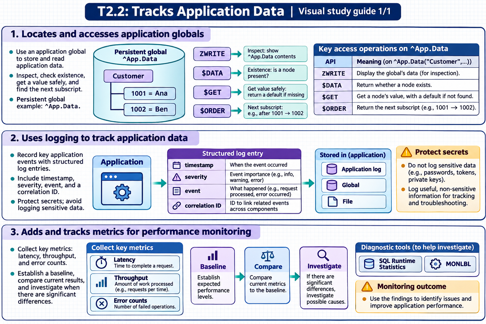

[Topic contents](../index.md) · [Full topic guide](../study.md) · [All topics](../../../index.md)

# T2.2: Tracks Application Data

Saved 2 November 2026 from [exam-prep.es](https://exam-prep.es/exams/objectscript/knowledge/T2.2.html). Reference links require internet access.

## 3. Adds and tracks metrics for performance monitoring



*This diagram covers sections 1–3; use the matching numbered panel for this page.* [Chapter diagrams](../visuals.md) · [Technical review notes](../../../visual-technical-notes.md)

### Key Points

- **$SYSTEM.Process**: Provides per-process performance counters (global references, lines executed, etc.)
- **^IRIS.Temp globals**: Temporary globals for storing transient metrics without journaling overhead
- **$SYSTEM.SQL.Stats**: SQL query statistics and performance data
- **^%SYS.MONLBL**: Line-by-line monitoring data for code profiling
- **%SYSTEM.Process.GetMetric()**: Retrieve specific process-level metrics programmatically

### Detailed Notes

#### Process-Level Metrics with $SYSTEM.Process

$SYSTEM.Process provides access to detailed process performance counters:

```objectscript
 // Get global references count for current process
 WRITE $SYSTEM.Process.GlobalReferences(), !

 // Get lines of ObjectScript executed
 WRITE $SYSTEM.Process.LinesExecuted(), !

 // Get disk read count
 WRITE $SYSTEM.Process.DiskReadCount(), !

 // Measure performance of a code block
 SET startGref = $SYSTEM.Process.GlobalReferences()
 SET startLines = $SYSTEM.Process.LinesExecuted()
 SET startTime = $ZHOROLOG  // High-precision timestamp

 // ... code being measured ...
 DO ##class(MyApp.DataLoader).ProcessBatch()

 SET elapsedTime = $ZHOROLOG - startTime
 SET globalRefs = $SYSTEM.Process.GlobalReferences() - startGref
 SET linesExec = $SYSTEM.Process.LinesExecuted() - startLines

 WRITE "Time: ", elapsedTime, " seconds", !
 WRITE "Global refs: ", globalRefs, !
 WRITE "Lines executed: ", linesExec, !
```

#### Using ^IRIS.Temp for Transient Metrics

^IRIS.Temp globals reside in the IRISTEMP database, which is never journaled. This makes them ideal for storing performance counters and temporary metrics without impacting transaction performance or journal volume:

```objectscript
 // Track API call counts by endpoint
 SET ^IRIS.Temp.Metrics("API", endpoint, $PIECE($HOROLOG, ",", 1)) =
     $INCREMENT(^IRIS.Temp.Metrics("API", endpoint, $PIECE($HOROLOG, ",", 1)))

 // Track method execution times
 SET startTime = $ZHOROLOG
 // ... method execution ...
 SET elapsed = $ZHOROLOG - startTime
 SET ^IRIS.Temp.Metrics("Timing", methodName, $JOB) = elapsed
```

#### SQL Performance Statistics

Use $SYSTEM.SQL.Stats to analyze SQL query performance:

```objectscript
 // Get SQL statistics
 DO $SYSTEM.SQL.Stats.DisplayStats()

 // For a specific query, examine the query plan
 SET stmt = ##class(%SQL.Statement).%New()
 SET sc = stmt.%Prepare("SELECT * FROM MyApp.Customer WHERE State = ?")
 DO stmt.%ShowPlan()
```

#### Line-by-Line Monitoring

Enable line-by-line monitoring to profile code execution:

```objectscript
 // Enable monitoring for a routine
 DO $SYSTEM.Monitor.LineLevelMonStart("MyApp.DataLoader")

 // Run the code
 DO ##class(MyApp.DataLoader).ProcessBatch()

 // Stop monitoring and view results
 DO $SYSTEM.Monitor.LineLevelMonStop()

 // Results stored in ^%SYS.MONLBL
 ZWRITE ^%SYS.MONLBL
```

#### Building a Performance Dashboard

Combine metrics for a comprehensive view:

```objectscript
ClassMethod CollectMetrics() As %Status
{
    SET timestamp = $ZTIMESTAMP
    SET metrics = $LISTBUILD(
        $SYSTEM.Process.GlobalReferences(),
        $SYSTEM.Process.LinesExecuted(),
        $SYSTEM.Process.DiskReadCount(),
        $SYSTEM.Process.JournalEntryCount()
    )
    SET ^IRIS.Temp.PerfLog($INCREMENT(^IRIS.Temp.PerfLog)) =
        $LISTBUILD(timestamp) _ metrics
    RETURN $$$OK
}
```

### Documentation References

- [$SYSTEM.Process](https://docs.intersystems.com/irislatest/csp/docbook/DocBook.UI.Page.cls?KEY=RCOS_vsystem_process)
- [Monitoring Performance](https://docs.intersystems.com/irislatest/csp/docbook/DocBook.UI.Page.cls?KEY=GCM_monitor)
- [SQL Performance Analysis](https://docs.intersystems.com/irislatest/csp/docbook/DocBook.UI.Page.cls?KEY=GSQLOPT)
