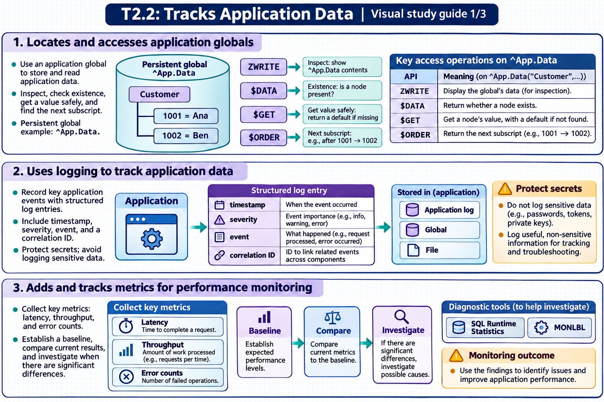
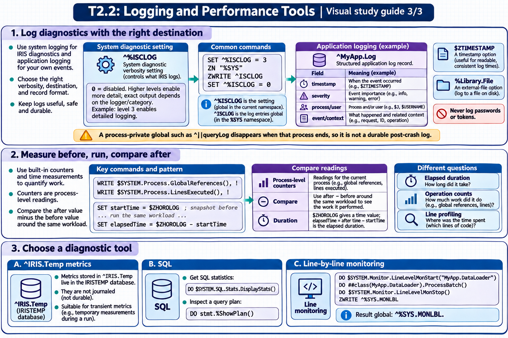

[Topic contents](../index.md) · [Full topic guide](../study.md) · [All topics](../../../index.md)

# T2.2: Tracks Application Data

Saved 2 November 2026 from [exam-prep.es](https://exam-prep.es/exams/objectscript/knowledge/T2.2.html). Reference links require internet access.

## 3. Adds and tracks metrics for performance monitoring



*This diagram covers sections 1–3; use the matching numbered panel for this page.* [Chapter diagrams](../visuals.md) · [Technical review notes](../../../visual-technical-notes.md)



### Key Points

- **$SYSTEM.Process**: Provides per-process performance counters (global references, lines executed, etc.)
- **$ZHOROLOG**: Counts elapsed seconds since the latest IRIS startup, with fractional seconds; take an after-minus-before difference to measure a duration.
- **%SYS.ProcessQuery**: Exposes per-process counters such as `GlobalReferences` through SQL
- **^IRIS.Temp globals**: Temporary globals for storing transient metrics without journaling overhead
- **$SYSTEM.SQL.Stats**: SQL query statistics and performance data
- **^%SYS.MONLBL**: Line-by-line monitoring data for code profiling
- **%SYSTEM.Process.GetMetric()**: Retrieve specific process-level metrics programmatically

### Detailed Notes

#### Process-Level Metrics with $SYSTEM.Process

$SYSTEM.Process provides access to detailed process performance counters:

```objectscript
 // Get global references count for current process
 WRITE $SYSTEM.Process.GlobalReferences(), !

 // Get lines of ObjectScript executed
 WRITE $SYSTEM.Process.LinesExecuted(), !

 // Get disk read count
 WRITE $SYSTEM.Process.DiskReadCount(), !

 // Measure performance of a code block
 SET startGref = $SYSTEM.Process.GlobalReferences()
 SET startLines = $SYSTEM.Process.LinesExecuted()
 SET startTime = $ZHOROLOG  // Elapsed-seconds counter; subtract the starting value

 // ... code being measured ...
 DO ##class(MyApp.DataLoader).ProcessBatch()

 SET elapsedTime = $ZHOROLOG - startTime
 SET globalRefs = $SYSTEM.Process.GlobalReferences() - startGref
 SET linesExec = $SYSTEM.Process.LinesExecuted() - startLines

 WRITE "Time: ", elapsedTime, " seconds", !
 WRITE "Global refs: ", globalRefs, !
 WRITE "Lines executed: ", linesExec, !
```

#### Choosing a clock, timestamp, or elapsed timer

These values answer different questions. `$HOROLOG`, `$ZTIMESTAMP`, and `$NOW()` describe a date and time; `$ZHOROLOG` measures elapsed time.

| Value | What it represents | Good use | Important limit |
| --- | --- | --- | --- |
| `$HOROLOG` (`$H`) | Local IRIS date and time as `days,seconds`; whole seconds only. It applies local seasonal time changes such as DST. | Local date/time fields and date-based indexes when second precision is enough. | It is wall-clock time. A clock, time-zone, or DST change can affect comparisons across that boundary. |
| `$ZTIMESTAMP` (`$ZTS`) | Current UTC date and time in IRIS storage format, with fractional seconds. | Consistent event timestamps in logs read across time zones. | It is a wall-clock timestamp, not a duration counter. Fractional precision depends on the platform clock. |
| `$ZHOROLOG` (`$ZH`) | Floating-point seconds elapsed since the most recent IRIS startup; independent of wall-clock changes and midnight. | Benchmarking: save a start value and subtract it from the end value. | It is not a calendar timestamp. Windows hibernate or standby can make readings unpredictable. |
| `$NOW()` / `$NOW(tzmins)` | Current process date and time with fractional seconds, in IRIS storage format; uses `$ZTIMEZONE` by default or the supplied offset. `$NOW(0)` returns UTC. | A fractional-second timestamp at the process's local offset or an explicit offset. | `$NOW()` does not apply DST or other seasonal local-time changes, so it may differ from the wall clock. It is not an elapsed timer. |

Use `$ZDATETIME`, `$ZDATE`, and `$ZTIME` to format or convert date/time values; these functions do not read a clock. `$SYSTEM.SYS.Horolog()` is a callable alternative to `$HOROLOG`; `$SYSTEM.SYS.TimeStamp()` and `##class(%SYSTEM.SYS).TimeStamp()` are alternatives to `$ZTIMESTAMP`. `$ZTIMEZONE` is a fixed offset: it affects `$HOROLOG` and the default `$NOW()`, while `$HOROLOG` separately applies the operating system's seasonal-time rules.

For date-dependent tests, `%SYSTEM.Process.FixedDate()` overrides the date portion of `$HOROLOG` for the current process while the time of day continues. It does not change the system clock or the values of `$NOW()` and `$ZTIMESTAMP`; pass `0` to restore the current date:

```objectscript
 DO ##class(%SYSTEM.Process).FixedDate(12345)  // Set a test date for this process
 // ... run date-dependent code ...
 DO ##class(%SYSTEM.Process).FixedDate(0)      // Restore the current date
```

#### Reading per-process counters with SQL

The `%SYS.ProcessQuery` SQL projection can retrieve the global-reference count for a process:

```sql
SELECT GlobalReferences
FROM %SYS.ProcessQuery
WHERE PID = :pid
```

`GlobalReferences` is cumulative for the process. To estimate the references made during an operation, take two readings around it and subtract; the process may end before the second reading.

#### Using ^IRIS.Temp for Transient Metrics

^IRIS.Temp globals reside in the IRISTEMP database, which is never journaled. This makes them ideal for storing performance counters and temporary metrics without impacting transaction performance or journal volume:

```objectscript
 // Track API call counts by endpoint
 SET ^IRIS.Temp.Metrics("API", endpoint, $PIECE($HOROLOG, ",", 1)) =
     $INCREMENT(^IRIS.Temp.Metrics("API", endpoint, $PIECE($HOROLOG, ",", 1)))

 // Track method execution times
 SET startTime = $ZHOROLOG  // Elapsed seconds, not a calendar timestamp
 // ... method execution ...
 SET elapsed = $ZHOROLOG - startTime
 SET ^IRIS.Temp.Metrics("Timing", methodName, $JOB) = elapsed
```

#### SQL Performance Statistics

Use $SYSTEM.SQL.Stats to analyze SQL query performance:

```objectscript
 // Get SQL statistics
 DO $SYSTEM.SQL.Stats.DisplayStats()

 // For a specific query, examine the query plan
 SET stmt = ##class(%SQL.Statement).%New()
 SET sc = stmt.%Prepare("SELECT * FROM MyApp.Customer WHERE State = ?")
 DO stmt.%ShowPlan()
```

#### Line-by-Line Monitoring

Enable line-by-line monitoring to profile code execution:

```objectscript
 // Enable monitoring for a routine
 DO $SYSTEM.Monitor.LineLevelMonStart("MyApp.DataLoader")

 // Run the code
 DO ##class(MyApp.DataLoader).ProcessBatch()

 // Stop monitoring and view results
 DO $SYSTEM.Monitor.LineLevelMonStop()

 // Results stored in ^%SYS.MONLBL
 ZWRITE ^%SYS.MONLBL
```

#### Building a Performance Dashboard

Combine metrics for a comprehensive view:

```objectscript
ClassMethod CollectMetrics() As %Status
{
    SET timestamp = $ZTIMESTAMP
    SET metrics = $LISTBUILD(
        $SYSTEM.Process.GlobalReferences(),
        $SYSTEM.Process.LinesExecuted(),
        $SYSTEM.Process.DiskReadCount(),
        $SYSTEM.Process.JournalEntryCount()
    )
    SET ^IRIS.Temp.PerfLog($INCREMENT(^IRIS.Temp.PerfLog)) =
        $LISTBUILD(timestamp) _ metrics
    RETURN $$$OK
}
```

### Documentation References

- [$SYSTEM.Process](https://docs.intersystems.com/irislatest/csp/docbook/DocBook.UI.Page.cls?KEY=RCOS_vsystem_process)
- [$HOROLOG](https://docs.intersystems.com/irislatest/csp/docbook/DocBook.UI.Page.cls?KEY=RCOS_vhorolog)
- [$ZHOROLOG](https://docs.intersystems.com/irislatest/csp/docbook/DocBook.UI.Page.cls?KEY=RCOS_vzhorolog)
- [$ZTIMESTAMP](https://docs.intersystems.com/irislatest/csp/docbook/DocBook.UI.Page.cls?KEY=RCOS_vztimestamp)
- [$NOW](https://docs.intersystems.com/irislatest/csp/docbook/DocBook.UI.Page.cls?KEY=RCOS_fnow)
- [Date and time values](https://docs.intersystems.com/irislatest/csp/docbook/DocBook.UI.Page.cls?KEY=GCOS_datetime)
- [%SYS.ProcessQuery class reference](https://docs.intersystems.com/irislatest/csp/documatic/%25CSP.Documatic.cls?CLASSNAME=%25SYS.ProcessQuery&LIBRARY=%25SYS)
- [Monitoring Performance](https://docs.intersystems.com/irislatest/csp/docbook/DocBook.UI.Page.cls?KEY=GCM_monitor)
- [SQL Performance Analysis](https://docs.intersystems.com/irislatest/csp/docbook/DocBook.UI.Page.cls?KEY=GSQLOPT)
