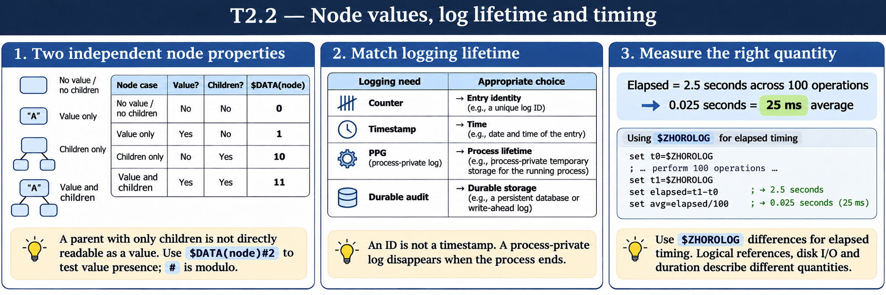

# T2.2 · 01 — Un ramo può esistere senza valore nel nodo

[Indice degli approfondimenti](README.md) · [Quiz originale](../quiz.md) · [Teoria](../study.md)

**Esercizi di partenza:** [Q3](../quiz.md#question-3-single) · [Q8](../quiz.md#question-8-single) · [Q9](../quiz.md#question-9-single) · [Q11](../quiz.md#question-11-multiple). L’approfondimento rielabora il concetto e aggiunge una variante; non riproduce soltanto la risposta del quiz.

## Il caso concreto

Phone ha figli 1 e 2 ma nessun valore assegnato esattamente a Phone.

```objectscript
set data("Phone",1) = "555-0100"
set data("Phone",2) = "555-0200"
write $DATA(data("Phone"))
```

## Ragionamento passo per passo

Il risultato è 10: esistono discendenti, non un valore diretto. $DATA distingue due proprietà indipendenti. Se assegni anche data("Phone")="home", il risultato diventa 11. Una lettura diretta del ramo senza valore non è equivalente a leggerne i figli.

## Perché il distrattore è plausibile

Usare IF $DATA(node) come prova sufficiente che WRITE node sia valido: anche 10 è vero, ma il valore diretto manca.

## Lo spunto da portare oltre l’esercizio

Per testare la presenza del valore usa la componente unità, per esempio $DATA(node)#2.



*Leggi il pannello 1; gli altri due collegano il caso agli altri approfondimenti del capitolo.*

## Variante: prova prima di leggere la soluzione

Un nodo ha un valore e nessun figlio. Quanto restituisce $DATA? E dopo aver aggiunto un figlio?

<details>
<summary>Soluzione ragionata</summary>

Prima 1, poi 11.

</details>

## Riferimenti e precisazioni

- [$DATA](https://docs.intersystems.com/irislatest/csp/docbook/DocBook.UI.Page.cls?KEY=RCOS_fdata)
- [$ZHOROLOG](https://docs.intersystems.com/irislatest/csp/docbook/DocBook.UI.Page.cls?KEY=RCOS_vzhorolog)
- [Global e dati di processo](https://docs.intersystems.com/irislatest/csp/docbook/DocBook.UI.Page.cls?KEY=GCOS_globals)

[Note specifiche del capitolo](README.md#precisazioni-rispetto-al-quiz) · [Metodo e limiti della revisione](../../../approfondimenti-esercizi.md#metodo-e-limiti)
