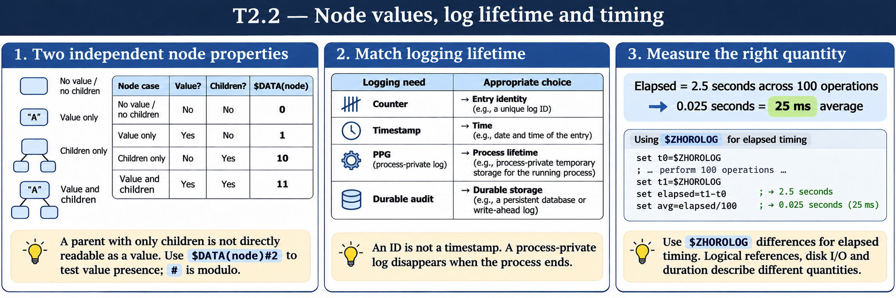

# T2.2 · 02 — Un log ha bisogno di identità e durata

[Indice degli approfondimenti](README.md) · [Quiz originale](../quiz.md) · [Teoria](../study.md)

**Esercizi di partenza:** [Q1](../quiz.md#question-1-single) · [Q2](../quiz.md#question-2-single) · [Q4](../quiz.md#question-4-single) · [Q5](../quiz.md#question-5-single) · [Q6](../quiz.md#question-6-single) · [Q7](../quiz.md#question-7-single) · [Q12](../quiz.md#question-12-single). L’approfondimento rielabora il concetto e aggiunge una variante; non riproduce soltanto la risposta del quiz.

## Il caso concreto

Il quiz usa un process-private global per un log di lavoro e confronta $INCREMENT con chiavi casuali.

```objectscript
set id = $INCREMENT(^||queryLog)
set ^||queryLog(id) = $LISTBUILD($HOROLOG,"query completata")
```

## Ragionamento passo per passo

Il contatore alloca identificativi senza collisioni fra gli inserimenti sullo stesso nodo. Una chiave casuale non esclude la sovrascrittura. ^||queryLog isola il processo e viene eliminato alla sua terminazione: utile per lavoro temporaneo, inadatto come unica traccia di un crash da investigare dopo.

## Perché il distrattore è plausibile

Confondere “privato” con “persistente”, oppure scegliere una struttura temporanea per un audit da conservare.

## Lo spunto da portare oltre l’esercizio

Prima del formato del log decidi chi deve leggerlo e fino a quando deve sopravvivere.



*Leggi il pannello 2; gli altri due collegano il caso agli altri approfondimenti del capitolo.*

## Variante: prova prima di leggere la soluzione

Devi analizzare un batch domani, dopo la fine del processo. Il solo ^||queryLog basta?

<details>
<summary>Soluzione ragionata</summary>

No: esporta o scrivi gli eventi necessari in uno storage con durata adeguata.

</details>

## Riferimenti e precisazioni

- [$DATA](https://docs.intersystems.com/irislatest/csp/docbook/DocBook.UI.Page.cls?KEY=RCOS_fdata)
- [$ZHOROLOG](https://docs.intersystems.com/irislatest/csp/docbook/DocBook.UI.Page.cls?KEY=RCOS_vzhorolog)
- [Global e dati di processo](https://docs.intersystems.com/irislatest/csp/docbook/DocBook.UI.Page.cls?KEY=GCOS_globals)

[Note specifiche del capitolo](README.md#precisazioni-rispetto-al-quiz) · [Metodo e limiti della revisione](../../../approfondimenti-esercizi.md#metodo-e-limiti)
