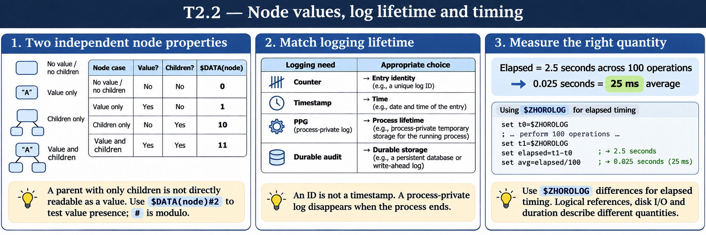

# T2.2 · 03 — Misurare durata, quantità e costo separatamente

[Indice degli approfondimenti](README.md) · [Quiz originale](../quiz.md) · [Teoria](../study.md)

**Esercizi di partenza:** [Q10](../quiz.md#question-10-single) · [Q13](../quiz.md#question-13-multiple) · [Q14](../quiz.md#question-14-multiple) · [Q15](../quiz.md#question-15-single). L’approfondimento rielabora il concetto e aggiunge una variante; non riproduce soltanto la risposta del quiz.

## Il caso concreto

Un blocco dura meno di un secondo; la sola ora intera non consente una misura utile.

```objectscript
set start = $ZHOROLOG
; eseguire il blocco da misurare
set elapsed = $ZHOROLOG - start
```

## Ragionamento passo per passo

$ZHOROLOG rappresenta secondi dall’avvio con frazioni e attraversa il confine di giornata senza dover scomporre date. La durata non spiega da sola la causa: confrontala con conteggi di operazioni, letture e profilo delle righe. Ripeti con input rappresentativi e separa il riscaldamento dalla fase misurata.

## Perché il distrattore è plausibile

Usare un timestamp formattato come numero o attribuire la lentezza alla CPU dal solo tempo totale.

## Lo spunto da portare oltre l’esercizio

Un’unità di misura esplicita e un carico riproducibile rendono confrontabili le osservazioni.



*Leggi il pannello 3; gli altri due collegano il caso agli altri approfondimenti del capitolo.*

## Variante: prova prima di leggere la soluzione

100 esecuzioni impiegano 2,5 secondi. Qual è la media, senza confonderla con un percentile?

<details>
<summary>Soluzione ragionata</summary>

0,025 secondi, cioè 25 ms. La media non descrive da sola le code di latenza.

</details>

## Riferimenti e precisazioni

- [$DATA](https://docs.intersystems.com/irislatest/csp/docbook/DocBook.UI.Page.cls?KEY=RCOS_fdata)
- [$ZHOROLOG](https://docs.intersystems.com/irislatest/csp/docbook/DocBook.UI.Page.cls?KEY=RCOS_vzhorolog)
- [Global e dati di processo](https://docs.intersystems.com/irislatest/csp/docbook/DocBook.UI.Page.cls?KEY=GCOS_globals)

[Note specifiche del capitolo](README.md#precisazioni-rispetto-al-quiz) · [Metodo e limiti della revisione](../../../approfondimenti-esercizi.md#metodo-e-limiti)
