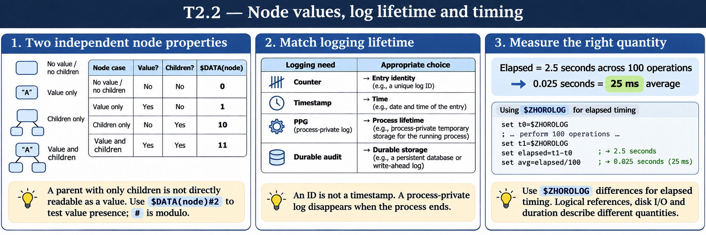
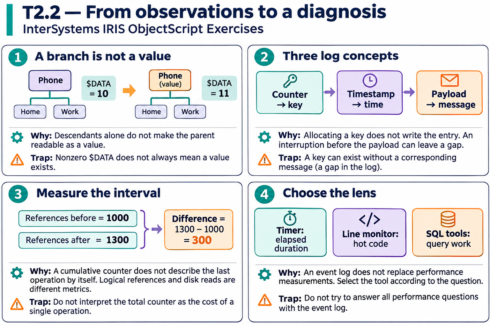

# T2.2 — Approfondimenti dagli esercizi

## Tutte le 15 domande approfondite

[Apri le schede domanda per domanda](<Domanda per domanda/README.md>) · [Tavole spiegate in inglese](tavole-esercizi.md)

Ogni domanda dispone ora di un commento specifico, un concetto ulteriore e una variante con soluzione. I tre casi seguenti sono percorsi tematici aggiuntivi. Le immagini sono in inglese.

[Teoria](../study.md) · [Quiz](../quiz.md) · [Tutti gli approfondimenti](../../../approfondimenti-esercizi.md)

Tre percorsi trasversali, da affiancare alle schede individuali, per capire il meccanismo dietro le risposte: scenario, ragionamento, distrattore, regola riutilizzabile e variante con soluzione. I riferimenti Q rimandano al quiz scaricato; la numerazione è locale al capitolo.

[Leggi esempi e spiegazioni dei pannelli](tavole-esercizi.md).

## Percorso consigliato

1. [Un ramo può esistere senza valore nel nodo](<01 - Un ramo può esistere senza valore nel nodo.md>) — Q3, Q8, Q9, Q11
2. [Un log ha bisogno di identità e durata](<02 - Un log ha bisogno di identità e durata.md>) — Q1, Q2, Q4, Q5, Q6, Q7, Q12
3. [Misurare durata, quantità e costo separatamente](<03 - Misurare durata, quantità e costo separatamente.md>) — Q10, Q13, Q14, Q15

[Indice di tutte le 15 domande del capitolo](mappa-domande.md). I percorsi sono tematici; ogni domanda ha inoltre una scheda individuale nella sottocartella dedicata.

## Precisazioni rispetto al quiz

Le affermazioni sui livelli e l’attivazione di ^%ISCLOG vanno verificate per il componente: non è un logger applicativo universale con una scala garantita 0–3. $ZHOROLOG è invece documentato: secondi dall’avvio con frazioni, non data/ora civile.

Queste precisazioni si applicano agli approfondimenti nuovi. Il testo delle risposte scaricate rimane una testimonianza della fonte e non viene riscritto silenziosamente.

## Documentazione

- [$DATA](https://docs.intersystems.com/irislatest/csp/docbook/DocBook.UI.Page.cls?KEY=RCOS_fdata)
- [$ZHOROLOG](https://docs.intersystems.com/irislatest/csp/docbook/DocBook.UI.Page.cls?KEY=RCOS_vzhorolog)
- [Global e dati di processo](https://docs.intersystems.com/irislatest/csp/docbook/DocBook.UI.Page.cls?KEY=GCOS_globals)

Gli snippet sono frammenti didattici: quando usano classi di esempio o macro, presuppongono le relative definizioni e include. Non costituiscono implementazioni complete né sono stati eseguiti in IRIS.
